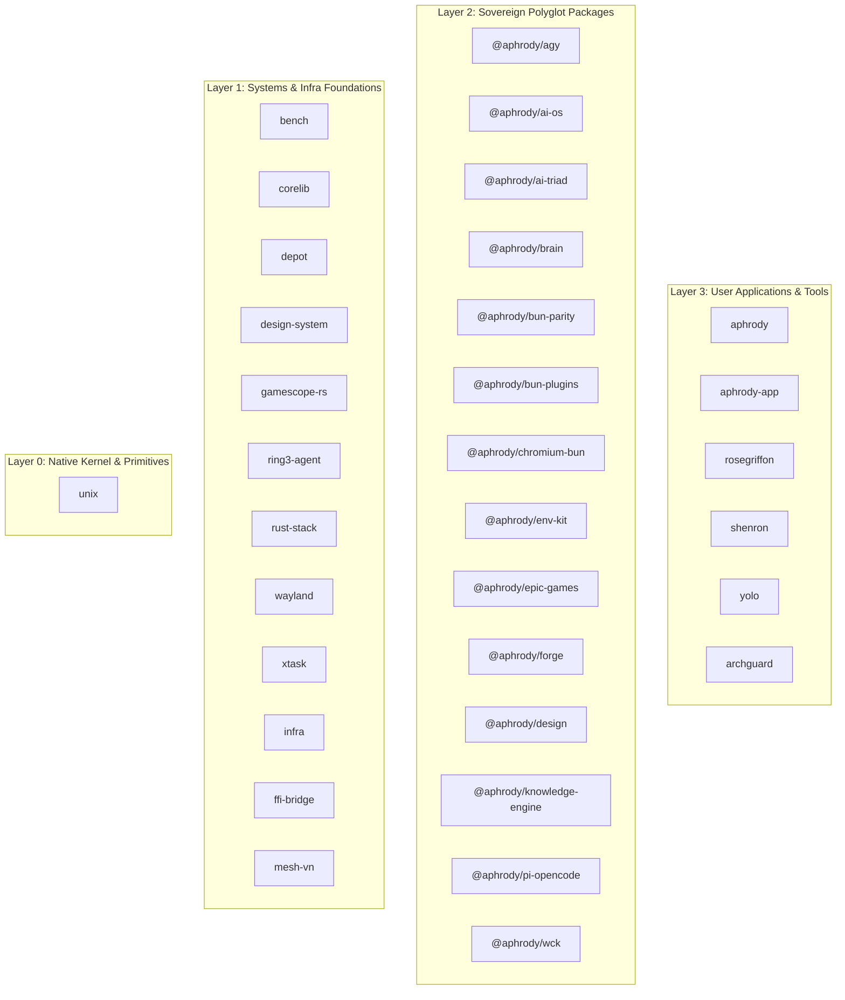

# `archguard` (`C:\src\tools\archguard`)

Deterministic, zero-compromise Rust Edition 2024 architectural gate, domain-purity auditor, upstream hygiene enforcer, and dependency graph engine for the `C:\src` Sovereign Monorepo.

Built with Rayon parallel scanning, Blake3 deterministic report hashing (`report_blake3`), Fat-LTO (`lto = "fat"`), `codegen-units = 1`, and `panic = "abort"`.

---

## 1. Core Engineering Principles

ArchGuard encodes the foundational engineering philosophies governing `C:\src`:

- **Linus Torvalds (Systems Taste & Userspace Boundary)**:
  - *Good taste in data structures*: Flat, clean in-memory tables (`BTreeMap`, `BTreeSet`, `Vec`) over convoluted abstractions.
  - *Never break userspace*: Host OS directories (`C:\Windows\System32`, `SysWOW64`) are sacred and untouched (`ARCH-007`). Userland binaries reside in `~/.local/bin`.
  - *Linux upstream standards*: Canonical `MAINTAINERS` tracking with verified disk patterns and Quilt/git-am patch series hygiene (`ARCH-015`).
- **Jarred Sumner (Bun v1.4.4 Full-Rust Vertical Speed)**:
  - *Sub-millisecond feedback loops*: Parallel execution auditing 2,800+ files in milliseconds.
  - *Delete glue & zero npm dependencies*: Native Bun/Rust APIs over npm bloat (`ARCH-003`, `ARCH-016`). Zero `binding.gyp` or legacy postinstall build scripts.
- **Larry Page (10x Clarity & Autonomous Ambient Verification)**:
  - *Extreme surface simplicity hiding massive capability*: Concise CLI output backed by cryptographic Blake3 digests.
  - *Autonomous NHITL execution*: CI/CD and local agent harnesses run `archguard check --strict` as an infallible pre-commit gate.
- **Google Chromium Upstream (Presubmit & DEPS Hygiene)**:
  - Strict `DEPS` manifest tracking with exact 40-character commit SHAs (`ARCH-014`).
  - Binary presubmit hygiene: no rogue executables or archives > 50MB in git trees (`ARCH-014`).
- **Graphify & Architecture Monotonicity**:
  - 4-layer strictly acyclic directed graph (`Layer0Kernel` -> `Layer1Systems` -> `Layer2Packages` -> `Layer3AppsAndTools`) with zero circular dependencies (`ARCH-017`).

---

## 2. Monorepo Architecture Graph

Generated via `archguard graph`:



---

## 3. Complete Rule Matrix (`ARCH-001` .. `ARCH-017`)

| Rule ID | Category | Default Severity | Invariant Enforced |
| :--- | :--- | :--- | :--- |
| `ARCH-001` | `crate-domain-purity` | `ERROR` | `C:\src\crates\*` must contain zero `.ts`, `.tsx`, `.js`, `.jsx`, `.mjs`, `.cjs`, `.py`, `.go` files and zero `package.json`, `tsconfig.json`, `bun.lock`, `node_modules`, `go.mod`, or `pyproject.toml`. |
| `ARCH-002` | `crate-manifest-edition` | `WARN` (`ERROR` in `--strict`) | Every directory in `C:\src\crates\*` must have a valid `Cargo.toml` declaring `edition = "2024"` and at least one `.rs` source file. |
| `ARCH-003` | `package-domain-purity` | `ERROR` | Every directory in `C:\src\packages\*` must declare a `@aphrody/<slug>` `package.json`, zero external npm dependencies (`workspace:*` and `@types/bun` only), zero legacy lockfiles (`package-lock.json`, `pnpm-lock.yaml`, `yarn.lock`), zero root `Cargo.toml`/`go.mod`, and isolate any native FFI code inside `native/`, `rust-core/`, `crates/`, or `loaders/`. |
| `ARCH-004` | `app-contract-purity` | `ERROR` | `apps/aphrody-app` must remain 100% pure Rust (zero TypeScript/npm files); `apps/aphrody` (`aphrody.com`) must maintain `dependencies: {}`, `devDependencies: {}`, zero `node_modules`, and zero `bun.lock`. |
| `ARCH-005` | `root-topology-junctions` | `ERROR` | `C:\src` root may contain only canonical physical directories (`apps`, `packages`, `crates`, `infra`, `tools`, `docs`, `third_party`, `var`, `graphify-out`, `node_modules`, `.repo`) and valid non-dangling NTFS junctions. |
| `ARCH-006` | `infra-domain-purity` | `ERROR` | `C:\src\infra` must maintain `go.mod` and restrict TypeScript strictly to `infra/ffi-bridge` and `infra/mesh-vn`. |
| `ARCH-007` | `host-userspace-boundary` | `ERROR` | First-party code and scripts must never copy, move, write, or delete files inside `C:\Windows\System32` or `C:\Windows\SysWOW64`. |
| `ARCH-008` | `secret-vault-hygiene` | `ERROR` | Zero `.env` files inside subdirectories (all secrets stay exclusively in untracked `C:\src\.env`), and zero live API/OAuth/PAT tokens in source or docs. |
| `ARCH-009` | `zero-emoji-anti-slop` | `ERROR` | Zero pictographic emoji characters across first-party source code, configs, and documentation. |
| `ARCH-010` | `single-ai-product-ownership` | `ERROR` | `@aphrody/ai-os` is the sole public AI product; generalist apps/packages/crates never market themselves as AI wrappers. |
| `ARCH-011` | `tools-domain-purity` | `ERROR` | Every tool in `C:\src\tools\*` must remain single-domain (pure Rust 2024 `Cargo.toml` or `@aphrody/*` `package.json`), include `README.md`, and maintain a deterministic `tests/` suite. |
| `ARCH-012` | `atlas-link-integrity` | `ERROR` | Every `file:///C:/src/...` link in `AGENTS.md` and `docs/MONOREPO_ATLAS.md` must resolve to an existing file or directory on disk. |
| `ARCH-013` | `manifest-versioning-integrity` | `ERROR` | Root `package.json` must declare CalVer `YYYY.MM.PATCH` (e.g. `2026.11.0`) and all first-party apps, packages, crates, tools, and infra must declare valid SemVer or CalVer versions without omissions. |
| `ARCH-014` | `chromium-deps-binary-hygiene` | `ERROR` | Chromium `DEPS` manifest must pin exact 40-character commit SHAs, and source trees must contain zero unapproved binary executables or archives > 50MB (Presubmit gate). |
| `ARCH-015` | `linux-upstream-maintainers-hygiene` | `ERROR` | Linux upstream `MAINTAINERS` file must declare valid canonical status and existing file patterns `F:`, and `docs/patches/series` must contain valid unified diffs. |
| `ARCH-016` | `bun-speed-zero-glue-hygiene` | `ERROR` | Bun upstream speed contracts: zero `binding.gyp` glue, no `postinstall` native rebuild hooks, and pure Rust FFI vertical integration. |
| `ARCH-017` | `graph-acyclic-boundaries` | `ERROR` | Architecture dependency graph must enforce monotonic layers (`Kernel` -> `Systems` -> `Packages` -> `Apps`) and zero cyclic dependencies across components. |

---

## 4. CLI Reference

```powershell
# Run full strict monorepo audit (CI / pre-push gate):
archguard check --strict --root C:\src

# Emit structured deterministic JSON report with Blake3 hash:
archguard check --strict --json

# Filter audit to a specific rule:
archguard check --rule ARCH-017

# List all enforced rules:
archguard rules

# Render architecture dependency graph (Mermaid flowchart):
archguard graph

# Export architecture graph as Graphviz DOT:
archguard graph --format dot

# Export architecture graph as JSON with god nodes & centrality metrics:
archguard graph --format json

# Export graph directly to file:
archguard graph --format mermaid -o C:\src\docs\ARCH_GRAPH.mermaid
```

---

## 5. Exit Codes

- `0`: Clean (`0` errors, and `0` warnings when `--strict` is passed)
- `1`: One or more architectural, upstream, or boundary violations detected
- `2`: Invalid CLI argument or nonexistent `--root` path
