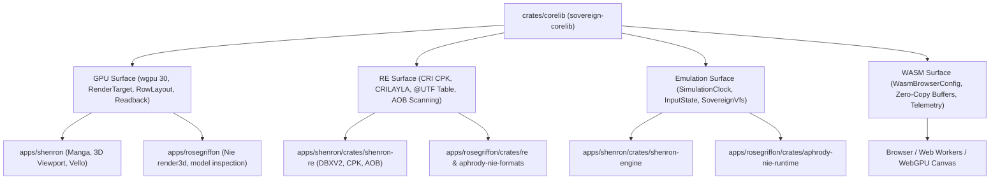

# Sovereign Corelib (`sovereign-corelib`)

Unified sovereign core library consolidating GPU, RE (Reverse Engineering), Emulation, and WASM surfaces for **Shenron** (`apps/shenron`) and **RoseGriffon** (`apps/rosegriffon`).

---

## 1. Architectural Pillars & Consolidated Surfaces



### 1.1 GPU Surface (`corelib::gpu`)
- **Adapter & Device Lifecycle**: Target discrete high-performance GPUs (NVIDIA RTX 4070 Ada Lovelace) with automatic fallback.
- **Render Targets & Offscreen Buffers**: MSAA, color formats (`Rgba8UnormSrgb`), and 256-byte aligned row layouts for CPU readback.
- **Surface & Presentation**: Window and canvas presentation pipelines with unthrottled 144Hz+ refresh support.

### 1.2 Reverse Engineering Surface (`corelib::re`)
- **CRIWARE File Containers**: Fast header sniffing (`CPK `, `@UTF`, `CRILAYLA`), binary structure validation, and TOC traversal.
- **CRILAYLA Decompressor**: Pure-Rust bitstream decompression for compressed game archives.
- **@UTF Relational Schema Parser**: Type-safe column and row deserialization for CRI relational schemas.
- **AOB Signature Scanner**: IDA-style pattern matching with wildcards for binary and memory triage.

### 1.3 Emulation & Simulation Surface (`corelib::emulation`)
- **Simulation Clock**: Deterministic fixed-step game loop accumulator with sub-frame interpolation factor.
- **Input State Manager**: Unified controller abstraction handling gamepad buttons, sticks, triggers, and raw keyboard states.
- **Sovereign VFS**: Hierarchical Virtual File System unifying in-memory files and mounted host archive directories with zero-copy memory mapping (`memmap2`).

### 1.4 WASM & Browser Surface (`corelib::wasm`)
- **Canvas Target Configuration**: Browser-side canvas sizing, device pixel ratio scaling, and WebGPU detection.
- **Zero-Copy Marshaling**: Fast typed array buffers (`WasmBufferPayload`) bridging Rust and JavaScript.
- **Engine Telemetry**: Standardized diagnostics reporting FPS, frame time, and memory usage.

---

## 2. Compilation and Verification

- **Cargo Test**:
  ```powershell
  cargo test
  # 6 passed, 0 failed
  ```
- **Cargo Release Build**:
  ```powershell
  cargo build --release
  # Generates corelib.dll & libcorelib.rlib with fat LTO
  ```
- **ArchGuard Architecture Gate**:
  ```powershell
  archguard check --strict --root C:\src
  # 13/13 rules PASS (0 errors, 0 warnings)
  ```
