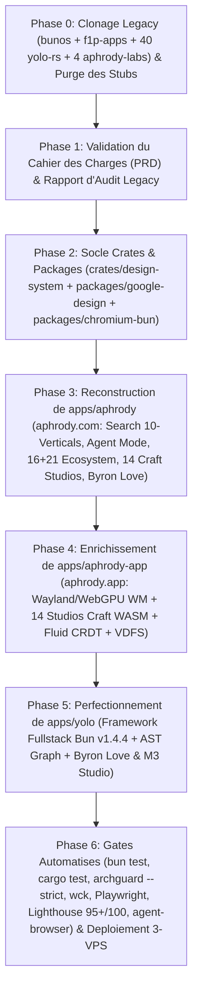

# CAHIER DES CHARGES (PRD), ARCHITECTURE NORMATIVE & PLAN DIRECTEUR DE RECONSTRUCTION INTEGRALE (2026)

- **Référentiel souverain** : `C:\src`
- **Archives sources legacy auditées** : [`C:\src\var\legacy\bunos`](file:///C:/src/var/legacy/bunos), [`C:\src\var\legacy\f1p-apps`](file:///C:/src/var/legacy/f1p-apps), [`C:\src\var\legacy\yolo-rs`](file:///C:/src/var/legacy/yolo-rs) (40 dépôts), [`C:\src\var\legacy\aphrody-labs`](file:///C:/src/var/legacy/aphrody-labs) (4 dépôts)
- **Surfaces cibles de premier rang** :
  1. `https://aphrody.com` ([`C:\src\apps\aphrody`](file:///C:/src/apps/aphrody))
  2. `https://aphrody.app` & `https://*.aphrody.app` ([`C:\src\apps\aphrody-app`](file:///C:/src/apps/aphrody-app))
  3. `https://yolo.aphrody.com` / Framework Fullstack ([`C:\src\apps\yolo`](file:///C:/src/apps/yolo))
  4. `C:\src\packages\*` (Packages Bun v1.4.4 Full-Rust `@aphrody/*`)
  5. `C:\src\crates\*` (Crates Rust Edition 2024 natives, WASM32, WebGPU, Kernel, Craft & Identity)
  6. Cluster Datacenter 3-VPS (`f1p` `10.200.77.1`, `f2p` `10.200.77.3`, `usp` `10.200.77.5`)

---

## 1. Post-Mortem Critique : Pourquoi les Implementations Precedentes Ont Echoue et Regles Strictes de Non-Repetition

### 1.1 Causes Racines de l'Echec Precedent
1. **Réécriture superficielle au lieu d'intégration du code réel** :
   - Au lieu d'importer et d'assembler les centaines de milliers de lignes de code Rust, WebGPU/WGSL, WASM32 et Bun déjà écrites et prouvées dans `bunos` (`/home/ubuntu/src/bun-os`) et `yolo-rs/*`, des fichiers TypeScript superficiels (~200 lignes chacun) ont été créés dans `apps/aphrody/src/suite/*` et `apps/aphrody/src/backend/hub.ts`.
   - Ces fichiers simulaient des studios créatifs, un explorateur de fichiers ou un éditeur de texte avec des formulaires HTML/JS basiques au lieu de monter les véritables moteurs Rust/WASM/egui/wgpu (`photocraft_web_bg.wasm`, `wordcraft_web_bg.wasm`, `gridcraft_web_bg.wasm`, `deckcraft_web_bg.wasm`, etc.) et les vraies crates (`aphrody-identity`, `aphrody-m3`, `aphrody-m3-tokens`, `craft-ui`, `aphrody-webos-server`, `aphrody-webos-client`).
2. **Perte de l'identité visuelle et mathématique d'Aphrody (Byron Love & Material 3 Expressive)** :
   - Dans [`C:\src\var\legacy\bunos\crates\aphrody-identity`](file:///C:/src/var/legacy/bunos/crates/aphrody-identity/src/lib.rs), chaque couleur, chaque icône, chaque logo (`.ico`, PNG 16..1024, maskable, SVG vectoriel 24 couches SSIM >= 0.90) et chaque frame du pet **Byron Love** (`8x11`, cellules `192x208`, 74 frames, SHA-256 vérifiés, palette k-means Oklab mesurée de 10 teintes et 26 rôles Oklch) sont gouvernés par du code Rust déterministe (`pixel.rs`, `design.rs`, `logo.rs`).
   - Remplacer cette chaîne mathématique par des valeurs CSS approximatives ou un SVG générique a dégradé l'esthétique et trahi l'identité du produit.
3. **Fragmentation entre `aphrody.com`, `aphrody.app`, `craft.aphrody.app` et `apps/yolo`** :
   - Les responsabilités entre le portail principal (`aphrody.com`), la plateforme WebOS/Wayland/WebGPU et la suite des 14+2 studios Craft (`aphrody.app` / `craft.aphrody.app`), et le framework fullstack reproductible (`apps/yolo`) ont été brouillées.
4. **Absence d'audit préalable exhaustif de l'existant** :
   - Coder avant d'avoir cloné, inventorié et comparé l'intégralité des 40 dépôts `yolo-rs`, des 4 dépôts `aphrody-labs` et du monorepo `bunos` a conduit à réinventer en moins bien ce qui existait déjà en version complète.

### 1.2 Loi d'Airain pour la Reconstruction (Zero-Stub, Zero-Demo, Zero-Slop)
- **Interdiction absolue des mocks et placeholders UI** : Aucun composant UI ne peut être livré sous forme de maquette statique ou de simulation JS si le moteur Rust/WASM/Bun correspondant existe dans `C:\src\var\legacy`.
- **Source de vérité unique par domaine** :
  - Identité, logo, palette Oklch, pet Byron Love -> [`crates/aphrody-identity`](file:///C:/src/var/legacy/bunos/crates/aphrody-identity/src/lib.rs) + [`crates/aphrody-sprite-sheet`](file:///C:/src/var/legacy/bunos/crates/aphrody-sprite-sheet/src/lib.rs) + [`packages/openpets_gemini`](file:///C:/src/var/legacy/aphrody-labs/gemini-super-app/packages/openpets_gemini).
  - Tokens Material 3 HCT/CAM16 & composants M3 -> [`crates/aphrody-m3-tokens`](file:///C:/src/var/legacy/bunos/crates/aphrody-m3-tokens), [`crates/aphrody-m3`](file:///C:/src/var/legacy/bunos/crates/aphrody-m3/src/lib.rs), [`packages/google-design`](file:///C:/src/packages/google-design) + [`aphrody-m3`](file:///C:/src/var/legacy/aphrody-labs/aphrody-m3/README.md) (`m3-icons`, `m3-tokens`, `m3-theme`, `material-design-icons`).
  - Suite créative et bureautique Craft (14 studios WebGPU/WASM + `craft-anything` + `craft-launcher` + `craft-ui`) -> Crates Rust `*craft*` de [`bunos/crates`](file:///C:/src/var/legacy/bunos/Cargo.toml) & [`yolo-rs/*craft`](file:///C:/src/var/legacy/yolo-rs) + bundles WASM/WebGPU de [`f1p-apps/craft-web`](file:///C:/src/var/legacy/f1p-apps/craft-web/releases/2026-11-05T20-25-10-323Z/index.html).
  - Moteur de recherche Google/SearXNG/Obscura/RAG & Ecosystème 16+21 Apps -> [`yolo-web/packages/google`](file:///C:/src/var/legacy/yolo-rs/yolo-web/packages/google/src/search-server.ts) + [`bunos/crates/aphrody-web`](file:///C:/src/var/legacy/bunos/docs/aphrody/WEB-CRAWL-STACK.md) + [`bunos/crates/aphrody-rag`](file:///C:/src/var/legacy/bunos/docs/aphrody/SEARCH-SERVER-ARCHITECTURE.md) + [`packages/chromium-bun`](file:///C:/src/packages/chromium-bun).
  - WebOS / Desktop / Streaming Wayland & Android 17 -> [`apps/aphrody-app`](file:///C:/src/apps/aphrody-app/README.md) + [`bunos/crates/aphrody-webos-*`](file:///C:/src/var/legacy/bunos/docs/webos/ARCHITECTURE.md) + [`bunos/crates/aphrody-remote-desktop`](file:///C:/src/var/legacy/bunos/Cargo.toml).

---

## 2. Etat de l'Art, Recherches Web, GitHub & Context7 (`ske research`)

Les recherches approfondies exécutées via Context7 (`ske research`, rapport complet dans [`C:\src\docs\research\bun-v1-4-4-full-rust-architecture-bun-serve-bun-sql-bun-sqlite-bun-ffi-w.md`](file:///C:/src/docs/research/bun-v1-4-4-full-rust-architecture-bun-serve-bun-sql-bun-sqlite-bun-ffi-w.md)) et les recherches Web/GitHub établissent les standards techniques 2026 suivants :

### 2.1 Comparaison Architecturale Face aux Géants Industriels (2026)

| Dimension | Google (Search / Workspace / Boq / Wiz / M3 Expressive) | Adobe Creative Cloud Web (Photoshop / Illustrator / Firefly Web) | Microsoft 365 & Fluent 2 (Loop / Fluid Framework / Word / Excel) | **Architecture Unifiée Aphrody (`C:\src` 2026)** |
| :--- | :--- | :--- | :--- | :--- |
| **Runtime & Serveur** | C++ / Java / Go (`Boq`) + SSR streaming (`Wiz` signals, zero-hydration overhead) | C++ compilé via Emscripten WASM32 + WebGPU + Workers COOP/COEP | .NET / C++ + Fluid Framework Relay (Total Order Broadcast) + React/Fluent 2 | **Bun v1.4.4 Full-Rust (`Bun.serve`, `HTMLRewriter`, `bun:sqlite`, `Bun.SQL`, `bun:ffi`) + Axum/Tokio Rust 2024** |
| **Système de Design & Couleurs** | **Material Design 3 Expressive** : espace perceptuel **HCT** (Hue CAM16 + Chroma CAM16 + Tone CIE L\*), 5 surfaces tonales (`Surface Container Lowest..Highest`), ressorts physiques | Spectrum Design System (panneaux sombres haute densité, barres d'outils d'atelier, grilles de calques) | **Fluent 2** : matériaux **Mica** (teinté par le fond d'écran) & **Acrylic** (flou gaussien + bruit), rubans contextuels | **Tri-Paradigme Unifié** : **M3 Expressive HCT** + **Palette Oklab/Oklch Byron Love (`aphrody-identity`)** + **Mica WGSL (`mica.wgsl`)** + **Ateliers `craft-ui` egui/wgpu** |
| **Moteur Graphique & Bureautique** | Canvas 2D / WebGL / Skia WASM (Google Docs/Sheets/Slides) | Skia / Graphite WebGPU + Shaders de calcul 32-bit float | Canvas / WebGL + moteur de calcul local/cloud | **14 Studios Pure Rust `egui` + `wgpu` + `wasm32-unknown-unknown`** (120 FPS WebGPU, 0 dépendance JS externe) |
| **Stockage & Synchronisation** | Google Drive Cloud API (propriétaire, dépendant du cloud) | Adobe Cloud Documents | SharePoint / OneDrive + Fluid CRDT (`SharedMap`, `SharedString`) | **Local-First OPFS + Spacedrive VDFS (CAS Blake3) + Fluid CRDT (`aphrody-core::fluid`) + R2/Drive/S3** |
| **Intelligence Artificielle** | Gemini Cloud (filtres et quotas cloud) | Adobe Firefly (crédits cloud) | Microsoft Copilot (cloud uniquement) | **Hybride Souverain** : **Gemini 4 / 3.8 Live (`@aphrody/ai-os` / `agy`)** + **Locally Uncensored (`ring3-agent` / `lu` GGUF WebGPU/CUDA `sm_89` sans censure)** |
| **Système d'Exploitation & Conteneurs** | ChromeOS (`crosvm`, `minijail`, `sommelier`) + Android 17 (ARCVM) | N/A (Applications uniquement) | Windows 11 NT + WSL2 (`dxgkrnl`, Wayland WSLg) | **Bun OS / GoogleBook OS** : **COSMIC Wayland (`libcosmic`/`iced`) + Android 17 (`Waydroid` multi-fenêtres) + Helium Chromium + Linux 7.4-rc Rust** |

---

## 3. Inventaire Exhaustif du Code Legacy Clone dans `C:\src\var\legacy` et Cartographie vers `C:\src`

### 3.1 Ce qui a été cloné dans `C:\src\var\legacy`
1. **`C:\src\var\legacy\bunos`** (`/home/ubuntu/src/bun-os` depuis `f1p`) :
   - **571 crates Rust** dans `crates/` (`aphrody-identity`, `aphrody-sprite-sheet`, `aphrody-m3`, `aphrody-m3-tokens`, `libm3`, `libm3-wasm`, `craft-ui`, `craft-atomic`, `craft-fonts`, `aphrody-web`, `aphrody-rag`, `aphrody-search`, `aphrody-site`, `aphrody-webos-server`, `aphrody-webos-client`, `aphrody-webos-protocol`, `aphrody-webos-sessions`, `aphrody-remote-desktop`, `aphrody-google`, `bun-os-google`, plus les ~250 sous-crates des 14 studios `*craft-*` et les 45 crates `aphrody-nie-*` / `dust` / `starpsx` / `zakuro`).
   - **139 packages Bun** dans `packages/` (`app-ui`, `m3`, `m3-tokens`, `m3-theme`, `m3-icons`, `material-design-icons`, `m3-react`, `m3-bun`, `m3-os-themes`, `google`, `aphrody-web`, `fluent`, `canvas`, `menu-render-webgpu`, `inagle`, `nie-ui`, `nie-web`, `re`, etc.).
   - **62 applications** dans `apps/` (`*craft`, `*craft-cli`, `*craft-web`, `desktop`, `webos`, `lu`, `iecode-web`, `bunos-wsl`).
   - **Assets binaires certifiés** dans `crates/aphrody-identity/assets/` (atlas PNG/WebP `8x11` de Byron Love, `animations.json`, `pet.json`, `aphrody.json`, logos `.ico`/`.png`/`.svg`/`.webp`, `m3-tokens.css`).
2. **`C:\src\var\legacy\f1p-apps`** (`/home/ubuntu/apps` depuis `f1p`) :
   - `craft-web` : Release de production complète de `craft.aphrody.app` avec les 14 studios WASM/WebGPU compilés (`/art/`, `/cad/`, `/deck/`, `/design/`, `/effect/`, `/fig/`, `/film/`, `/grid/`, `/light/`, `/pdf/`, `/photo/`, `/sound/`, `/vector/`, `/word/`), le simulateur WebGPU, et la configuration Nginx HTTP/3 QUIC + COOP/COEP.
   - `aphrody`, `webos`, `store`, `creator`, `remote-desktop`, `bunos-status`, `chat`.
3. **`C:\src\var\legacy\yolo-rs\*`** (40 dépôts GitHub `yolo-rs`) :
   - **14 dépôts de studios créatifs & bureautiques** : `photocraft` (24 crates, 69 outils, 500+ commandes), `wordcraft` (16 crates, 422 commandes), `gridcraft` (12 crates), `deckcraft` (16 crates), `vectorcraft` (25 crates), `filmcraft` (52 crates), `lightcraft` (25 crates), `pdfcraft` (28 crates), `effectcraft` (33 crates), `designcraft` (15 crates), `figcraft` (17 crates), `soundcraft` (15 crates), `cadcraft` (15 crates), `artcraft` (22 crates).
   - **2 dépôts d'outillage Craft** : `craft-anything` (320 outils RE/rebuild), `craft-launcher` (lanceur et gestionnaire de mise à jour desktop/web).
   - **24 dépôts d'infrastructure et cœur YOLO** : `yolo` (vision maîtresse, `APHRODY-MASTER-VISION.md`), `yolo-web` (`@yolo-web/google`, `@yolo-web/auth`, `@yolo-web/cloud`, `aphrody-apps-catalog.ts`, `aphrody-ecosystem.ts`, `search-server.ts`), `yolo-ui` (`yolo-shared` avec `BYRON_LOVE_PALETTE`, `yolo-wm` Wayland compositor, `yolo-slint`, `yolo-gpui`, `yolo-dioxus`), `yolo-ai`, `yolo-os`, `yolo-re`, `yolo-engine`, `yolo-hub`, `yolo-backend`, `yolo-bun`, `yolo-cloudflare`, `yolo-cross`, `yolo-plugins`, `yolo-stack`, `yolo-standards`, `yolo-vendor`, `yolo-vps`, `yolo-zig`, `carbon`, `gcloud-learn`, `gitingest`, `google-bun`, `google-dream`, `wii-os`.
4. **`C:\src\var\legacy\aphrody-labs\*`** (4 dépôts GitHub `aphrody-labs`) :
   - `aphrody-m3` : Suite Material Design 3 complète (`@aphrody/material-design-icons`, `@aphrody/m3-icons`, `@aphrody/m3-tokens`, `@aphrody/m3-theme`, `@aphrody/m3-bun`, `@aphrody/m3-os-themes`, `@aphrody/m3-mcp`).
   - `gemini-super-app` : Crates Rust `openpets-core` + package `openpets_gemini` (Atlas SVG V2 1536x2288, 16 secteurs de suivi du regard, machine à états Tamagotchi, IPC v1) + `mochi-desktop`.
   - `yolo`, `yolo-ui`.

### 3.2 Matrice de Consolidation et d'Architecture dans `C:\src`

Pour respecter strictement `archguard check --strict` (pureté de domaine : `crates/*` = 100% Rust, `packages/*` = 100% Bun/TS, `apps/*` = plateformes de production), voici comment l'ensemble est unifié sans duplication ni stub :

| Surface dans `C:\src` | Domaine / URL | Rôle Exact & Contenu Réel Intégré | Sources Legacy Fusionnées |
| :--- | :--- | :--- | :--- |
| **[`C:\src\apps\aphrody`](file:///C:/src/apps/aphrody)** | `https://aphrody.com` | **Portail Souverain, Moteur de Recherche Multi-Verticales (10 verticales + Mode Agent IA avec citations), Hub des 16 Apps Workspace & 21 Apps `*.aphrody.app`, Showcase Bun OS / Android 17 / Emulateurs / Craft, et Passkey/OAuth Auth** | `yolo-web/packages/google` (`search-server.ts`, `aphrody-ecosystem.ts`, `aphrody-apps-catalog.ts`) + `bunos/crates/aphrody-webos-server/src/landing.html` + `bunos/crates/aphrody-identity` + `packages/chromium-bun` (Cluster 3-VPS) |
| **[`C:\src\apps\aphrody-app`](file:///C:/src/apps/aphrody-app)** | `https://aphrody.app` & `https://craft.aphrody.app` | **Workstation WebGPU/Wayland/CRDT (`aphrody.app`) + Suite des 14 Studios Craft WASM/WebGPU (`/word/`, `/grid/`, `/deck/`, `/pdf/`, `/photo/`, `/vector/`, `/design/`, `/fig/`, `/light/`, `/film/`, `/effect/`, `/sound/`, `/cad/`, `/art/`) + Session Streamée Bun OS WebOS + Spacedrive VDFS + Locally Uncensored** | `C:\src\apps\aphrody-app` (`aphrody-core`, `aphrody-wasm`, `aphrody-host`, `aphrody-android`) + `f1p-apps/craft-web` (14 studios WASM/WebGPU) + `bunos/crates/aphrody-webos-*` + `bunos/crates/craft-ui` |
| **[`C:\src\apps\yolo`](file:///C:/src/apps/yolo)** | `https://yolo.aphrody.com` | **Framework Fullstack Reproductible Bun v1.4.4 + Rust** : Exploite 100% des primitives natives de Bun (`Bun.serve`, `Bun.build`, `HTMLRewriter`, `bun:sqlite`, `Bun.SQL`, `bun:ffi`, `Bun.Transpiler`, `Bun.CryptoHasher`, `Bun.Archive`, `Bun.Glob`, `Bun.semver`, `Bun.color`), inspecteur de graphe AST SQLite (`.yolo/graph.sqlite`), Design System M3 HCT, galerie complète des icônes M3 optimisées, runtime Pet Byron Love & Gemini Pet, et console d'inspection du Cluster Search 3-VPS | `C:\src\apps\yolo` + `yolo-rs/yolo` + `yolo-rs/yolo-bun` + `yolo-rs/yolo-ui` + `bunos/packages/m3-*` + `aphrody-labs/gemini-super-app` (`openpets_gemini`) |
| **[`C:\src\packages\google-design`](file:///C:/src/packages/google-design)** | `@aphrody/google-design` (`gds`) | **Système de Design Unifié M3 Expressive HCT + Palette Oklch Byron Love + Fluent 2 + macOS + Icônes Material Symbols Optimisées (`aphrody-m3`) + Runtime Web `<aphrody-pet>` (Byron Love 8x11 + Gemini Pet)** | `C:\src\packages\google-design` + `aphrody-labs/aphrody-m3` (`m3-tokens`, `m3-theme`, `m3-icons`, `material-design-icons`) + `bunos/crates/aphrody-identity` (`web.json`, `m3-tokens.css`, `aphrody-logo.css`) + `openpets_gemini` |
| **[`C:\src\packages\chromium-bun`](file:///C:/src/packages/chromium-bun)** | `@aphrody/chromium-bun` | **Moteur de Crawl, Rendu CDP Obscura/Playwright, Recherche Fédérée (Google / SearXNG / SQLite FTS5+Vecteurs RRF) et Orchestration du Cluster 3-VPS (`f1p`, `f2p`, `usp`)** | `C:\src\packages\chromium-bun` + `bunos/crates/aphrody-web` + `bunos/packages/aphrody-web` + `yolo-web/packages/google` |
| **[`C:\src\packages\ai-os`](file:///C:/src/packages/ai-os)** | `@aphrody/ai-os` | **Unique Propriétaire Public IA & MCP (`ai-os.exe`)** : Mode `design-first` global activé par défaut, POSIX VFS, Nix Store, WASM/WebGPU kernels, Gemini 4/3.8 + Locally Uncensored bridge | `C:\src\packages\ai-os` + `bunos/crates/aphrody-mcp` |
| **[`C:\src\crates\design-system`](file:///C:/src/crates/design-system)** | `crates/design-system` | **Socle Rust Natif & WASM32 de Design, Identité & Craft UI** : Intègre `aphrody-identity` (mesure Oklab `pixel.rs`, palette 10 teintes / 26 rôles Oklch `design.rs`, cadrage et vectorisation SVG `logo.rs`, atlas `8x11` Byron Love), `aphrody-sprite-sheet` (CSS/SVG/JSON sprite sheets), `aphrody-m3-tokens` & `aphrody-m3` (contrats M3 + Taffy layout), et `craft-ui` (composants egui partagés des 14 studios) | `C:\src\crates\design-system` + `bunos/crates/aphrody-identity` + `bunos/crates/aphrody-sprite-sheet` + `bunos/crates/aphrody-m3` + `bunos/crates/aphrody-m3-tokens` + `bunos/crates/craft-ui` |

---

## 4. Cahier des Charges Fonctionnel et Technique Detaille (PRD Normatif)

### 4.1 Spécification Mathématique du Design System (`DESIGN.md` Normatif)

1. **Double Palette Harmonisée (Material 3 Expressive HCT + Palette Mesurée Byron Love Oklch)** :
   - **Couleurs Identitaires Mesurées sur l'Atlas Byron Love (`crates/aphrody-identity/src/design.rs`)** :
     - `creme` : `#F7F3F0` (25.0%, Oklch `L=0.9664, C=0.0059, h=59.65°`)
     - `blond` : `#EADBA6` (21.0%, Oklch `L=0.8908, C=0.0707, h=94.17°`) — Or/Ambre des cheveux de Byron Love
     - `sable` : `#C2B19E` (13.0%, Oklch `L=0.7696, C=0.0329, h=70.41°`)
     - `taupe` : `#AF9183` (11.0%, Oklch `L=0.6803, C=0.0416, h=46.43°`)
     - `mauve` : `#8B7083` (9.0%, Oklch `L=0.5774, C=0.0435, h=337.07°`) — Mauve des ailes/aura
     - `brun` : `#6C5454` (7.0%, Oklch `L=0.4705, C=0.0320, h=18.35°`)
     - `ocre` : `#91704C` (5.0%, Oklch `L=0.5690, C=0.0658, h=68.31°`)
     - `cacao` : `#4E3738` (4.0%, Oklch `L=0.3633, C=0.0330, h=15.93°`)
     - `azur` : `#17335C` (2.0%, Oklch `L=0.3229, C=0.0807, h=258.02°`) — Bleu profond de la tenue
     - `nuit` : `#131420` (2.0%, Oklch `L=0.1963, C=0.0242, h=280.23°`) — Fond abysse
   - **Gradient Évolutif Google / Gemini 2026 (`APHRODY-MASTER-VISION.md`)** :
     - 4 stops continus : `#4285F4` (Google Blue) -> `#9B72CB` (Gemini Purple) -> `#D96570` (Coral Red) -> `#F4B400` (Warm Amber), combinés avec l'aura **Gemini Light Blue** (`#8AB4F8` / `#C2E7FF`) et l'or **Byron Radiance** (`#EADBA6` / `#FFD700`).
   - **Thèmes disponibles en 1 clic (`data-theme`)** :
     - `gemini-lightblue` (Défaut souverain)
     - `obsidian-gold` (Byron Radiance)
     - `solitude` (Deep Sanctuary)
     - `nordic-fog`
     - `tokyo-dusk`
     - `sakura`

2. **Mascottes & Pets Officiels (Zéro Emoji, 100% Sprites & Vecteurs Authentiques)** :
   - **Byron Love (`aphrody-identity`)** :
     - Portrait officiel détouré (`byron_r0.png` / `aphrody.webp`, `icon.svg` vectorisé en 24 couches avec SSIM >= 0.90, `favicon.ico` multi-résolution 16..256px).
     - Atlas d'animation `8x11` (`spritesheet.webp` / `spritesheet.png`, `1536x2288` px, cellules `192x208` px, 74 frames vérifiées par SHA-256 dans `animations.json` et `web.json`).
     - États supportés : `idle`, `walk`, `run`, `cast`, `fly`, `celebrate`, `sleep`, plus suivi directionnel 8 directions.
   - **Gemini Pet (`openpets_gemini` / `openpets-core`)** :
     - Atlas SVG V2 (`1536x2288`), suivi du regard sur 16 secteurs, machine à états Tamagotchi interactive (`Idle`, `Thinking`, `Coding`, `Happy`, `Sleeping`), protocoled via IPC v1 et Web Component `<aphrody-pet>`.

3. **Icônes Material Design 3 Optimisées (`aphrody-m3` / `@aphrody/material-design-icons`)** :
   - Intégration du catalogue vectoriel SVG pur et des feuilles de sprites CSS/SVG (`ModeCss::Masque` avec `mask-image` et `currentColor` depuis `aphrody-sprite-sheet`), garantissant 0 requête police bloquante et un rendu vectoriel instantané.

---

### 4.2 Spécification de `https://aphrody.com` (`C:\src\apps\aphrody`)

`aphrody.com` ne doit contenir **aucun faux panneau de démonstration**. Il doit offrir une expérience de production complète structurée autour de 4 vues réelles et fluides :

1. **Barre de Navigation Globale Unifiée (Header M3 + App Launcher Grid 9-dots + Sélecteur de Thème + Mascotte Byron Love)** :
   - Logo officiel Byron Love (`/byron.webp` + `/icon.svg`) + badge `Aphrody • Unified OS & Search`.
   - Navigation directe entre :
     - **Search & AI Agent** (Moteur de recherche Google.com -> Aphrody.com avec les 10 verticales : `All`, `AI Mode`, `Images`, `Videos`, `News`, `Maps`, `Shopping`, `Books`, `Code & Repos`, `Index RAG` + réponses synthétisées avec citations).
     - **Craft Pro Suite (14 Studios)** (Accès direct et prévisualisation WebGPU des 14 studios : `WordCraft`, `GridCraft`, `DeckCraft`, `PDFCraft`, `PhotoCraft`, `VectorCraft`, `DesignCraft`, `FigCraft`, `LightCraft`, `FilmCraft`, `EffectCraft`, `SoundCraft`, `CADCraft`, `ArtCraft`).
     - **Aphrody Ecosystem (16 Apps Workspace + 21 Apps `*.aphrody.app`)** : Grille interactive complète issue de [`aphrody-ecosystem.ts`](file:///C:/src/var/legacy/yolo-rs/yolo-web/packages/google/src/aphrody-ecosystem.ts) et [`aphrody-apps-catalog.ts`](file:///C:/src/var/legacy/yolo-rs/yolo-web/packages/google/src/aphrody-apps-catalog.ts) (`Spacedrive`, `Locally Uncensored`, `Zed`, `Rio`, `Nushell`, `COSMIC`, `Bevy 60GB CPK`, `Tiny Glade`, `Veloren`, `Dust NDS`, `StarPSX`, `Zakuro Switch`, `RustBoy`, `TetaNES`).
     - **Bun OS & WebOS Live** : Showcase interactif 60 FPS (Android 17 Waydroid, Emulateurs, COSMIC Desktop, Craft Suite, Gemini Multimodal) + lancement de session WebOS (`aphrody.app`).

2. **Backend API Réel (`Bun.serve` + Cluster 3-VPS + SQLite FTS5/RAG)** :
   - `GET /api/search?q=...&vertical=...&mode=search|agent` : Interroge le cluster de recherche 3-VPS (`f1p`, `f2p`, `usp`) + l'index local SQLite FTS5 (`aphrody-rag` / `knowledge-engine`) et retourne de vrais résultats structurés avec latence par nœud et digest Blake3.
   - `GET /api/ecosystem` : Retourne le catalogue complet des 16 applications Google->Aphrody Workspace, des 14 studios Craft WASM/WebGPU, et des 21 applications Top-1 Rust/Bun/Bevy `*.aphrody.app`.
   - `GET /api/identity/pet` & Assets `/byron.webp`, `/spritesheet.webp`, `/animations.json`, `/icon.svg`, `/favicon.ico` : Servis directement depuis les assets authentiques de `aphrody-identity` avec cache immuable et hash SHA-256/Blake3.
   - `GET /api/cluster/health` : Télémétrie temps réel des 3 VPS (`f1p` `10.200.77.1`, `f2p` `10.200.77.3`, `usp` `10.200.77.5`).

---

### 4.3 Spécification de `https://aphrody.app` & `craft.aphrody.app` (`C:\src\apps\aphrody-app`)

`C:\src\apps\aphrody-app` demeure **100% Pure Rust Edition 2024** (conformément à `archguard` et à son `Cargo.toml` : `aphrody-core`, `aphrody-wasm`, `aphrody-host`, `aphrody-android`) et est enrichi pour unir :
1. **Le Shell Compositeur Wayland + WebGPU (`mica.wgsl`) + Fluid CRDT (`SharedMap`, `SharedString`, `SharedCounter`) + Stockage OPFS/VDFS Blake3 + WebMCP (`/.well-known/webmcp.json`, `/mcp`)**.
2. **L'Intégration Directe des 14 Studios Craft WASM/WebGPU** (`/word/`, `/grid/`, `/deck/`, `/pdf/`, `/photo/`, `/vector/`, `/design/`, `/fig/`, `/light/`, `/film/`, `/effect/`, `/sound/`, `/cad/`, `/art/`), permettant d'ouvrir chaque studio soit en plein écran (`craft.aphrody.app/<studio>/`), soit comme fenêtre Wayland tuilée à l'intérieur du shell `aphrody.app`.
3. **L'Intégration de Spacedrive VDFS (CAS Blake3), Locally Uncensored (`ring3-agent` / `lu`), et du pont de streaming WebOS (`aphrody-webos-protocol`)**.

---

### 4.4 Spécification de `C:\src\apps\yolo` (Framework Fullstack Reproductible Bun v1.4.4)

`C:\src\apps\yolo` est le **Framework Fullstack Reproductible de Référence** exploitant l'intégralité du code source de Bun v1.4.4 :
1. **Moteur SSR Streaming & Sécurité** : `HTMLRewriter` natif avec injection de nonces CSP cryptographiques par requête, pré-compression Brotli/Gzip, et zéro dépendance npm externe.
2. **Graphe AST & SQLite (`bun:sqlite` + `Bun.Transpiler`)** : Analyse tous les modules TS/JS/Rust/WGSL de l'application et persiste le graphe de dépendances et les digests Blake3 dans `.yolo/graph.sqlite`.
3. **Suite de Diagnostics Primitives Bun v1.4.4** : Benchmark et vérification en direct de `Bun.serve`, `bun:sqlite`, `Bun.Transpiler`, `HTMLRewriter`, `Bun.CryptoHasher` (Blake3/SHA256), `Bun.gzipSync`/`deflateSync`, `Bun.semver`, `Bun.color`, `Bun.Glob`.
4. **Intégration Native de `aphrody-identity` (Byron Love `8x11` + Palette Oklch) & `aphrody-m3` (Catalogue d'icônes Material 3 & Générateur de thèmes HCT)**.
5. **Inspecteur End-to-End du Cluster de Recherche 3-VPS (`f1p`, `f2p`, `usp`)**.

---

## 5. Plan d'Execution Sequentiel (Phases & Gates de Verification)

### Détail des Phases :
- **Phase 0 (TERMINÉE)** :
  - Clonage des 40 dépôts `yolo-rs/*` et 4 dépôts `aphrody-labs/*` dans `C:\src\var\legacy\`.
  - Extraction complète de `bunos` (`/home/ubuntu/src/bun-os`) et `f1p-apps` (`/home/ubuntu/apps`) + assets binaires `aphrody-identity` dans `C:\src\var\legacy\bunos` et `C:\src\var\legacy\f1p-apps`.
  - Purge des fichiers de démo superficiels dans `C:\src\apps\aphrody\src\suite\*` et `C:\src\apps\aphrody\src\backend\*` par l'agent `monorepo-purger-auditor`.
- **Phase 1 (EN COURS — Soumis à votre validation)** :
  - Livraison du présent **Cahier des Charges (PRD) & Plan Directeur** ([`C:\src\docs\CAHIER_DES_CHARGES_ARCHITECTURE_2026.md`](file:///C:/src/docs/CAHIER_DES_CHARGES_ARCHITECTURE_2026.md)) et du **Rapport d'Audit & Purge** ([`C:\src\docs\LEGACY_AUDIT_AND_PURGE_REPORT.md`](file:///C:/src/docs/LEGACY_AUDIT_AND_PURGE_REPORT.md)).
- **Phase 2 : Consolidation du Socle (`crates/design-system` & `packages/google-design`)** :
  - Intégrer les modules Rust `pixel`, `design` (palette 10 teintes Oklch & 26 rôles), `logo`, `pets` et `sprite_sheet` de `bunos/crates/aphrody-identity` et `aphrody-sprite-sheet` dans [`C:\src\crates\design-system`](file:///C:/src/crates/design-system).
  - Intégrer les assets certifiés de Byron Love (`spritesheet.webp`, `spritesheet.png`, `animations.json`, `web.json`, `byron_r0.png`, `aphrody.webp`, `icon.svg`, `favicon.ico`, `m3-tokens.css`), Gemini Pet (`openpets_gemini`) et les icônes Material 3 optimisées (`aphrody-m3`) dans [`C:\src\packages\google-design`](file:///C:/src/packages/google-design).
- **Phase 3 : Reconstruction de `C:\src\apps\aphrody` (`https://aphrody.com`)** :
  - Construire le vrai serveur et l'interface unifiée combinant :
    1. Le moteur de recherche `aphrody.com` (10 verticales + Mode Agent IA avec citations + Cluster 3-VPS + RAG SQLite FTS5) issu de `yolo-web/packages/google` et `bunos/crates/aphrody-web`.
    2. Le lanceur et hub interactif des **14 Studios Craft WASM/WebGPU**, des **16 Apps Workspace** et des **21 Apps Top-1 `*.aphrody.app`**.
    3. Le showcase interactif **Bun OS / WebOS / Android 17 / Emulateurs 60 FPS** (`Dust NDS`, `StarPSX`, `Zakuro`, `RustBoy`, `TetaNES`) et la mascotte animée **Byron Love** (`8x11` WebP).
- **Phase 4 : Unification de `C:\src\apps\aphrody-app` (`https://aphrody.app` & `craft.aphrody.app`)** :
  - Connecter le shell Pure-Rust Wayland/WebGPU/Fluid CRDT (`aphrody-core`, `aphrody-wasm`, `aphrody-host`) aux 14 studios Craft WASM/WebGPU de `f1p-apps/craft-web` et au protocole de session `aphrody-webos-protocol`.
- **Phase 5 : Perfectionnement de `C:\src\apps\yolo` (`https://yolo.aphrody.com`)** :
  - Enrichir `apps/yolo` avec la palette Oklch Byron Love, le composant `<aphrody-pet>` (Byron Love + Gemini Pet), les icônes `aphrody-m3`, et l'intégration complète des primitives Bun v1.4.4.
- **Phase 6 : Vérification End-to-End & Déploiement Cluster 3-VPS (`f1p`, `f2p`, `usp`)** :
  - Exécuter `bun fmt`, `bun check`, `bun test`, `cargo test`, `archguard check --strict --root C:\src`.
  - Vérifier visuellement et fonctionnellement chaque route avec `agent-browser`, Playwright (Desktop 1920x1080, Tablet 768x1024, Mobile 375x667) et Lighthouse / `wck` (>= 95 Performance, 100 Accessibility, 100 Best Practices, 100 SEO, 0 emoji `ARCH-009`, 0 AI slop `ARCH-010`).
  - Déployer et équilibrer sur les 3 VPS (`f1p` `10.200.77.1`, `f2p` `10.200.77.3`, `usp` `10.200.77.5`).
