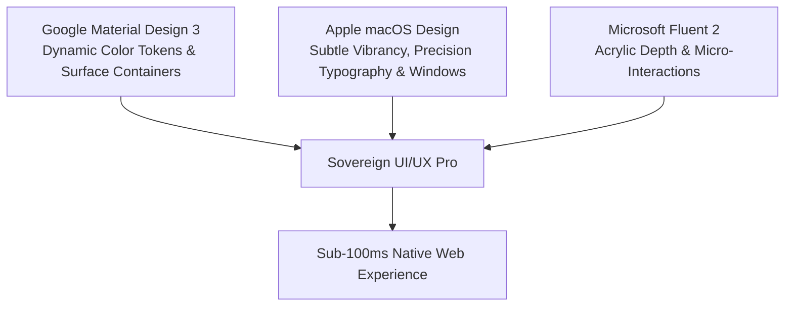
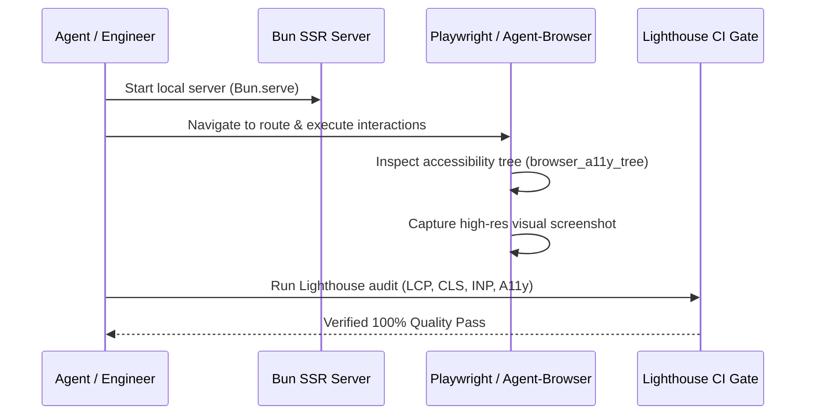

# Sovereign Modern Web, UI/UX Pro & Visual Verification Guidelines

Canonical engineering contract for all web platforms, applications, and graphical interfaces across `C:\src` (`aphrody.com`, `dragonballfr.com`, `rosegriffon.fr`, `yolo`, and desktop apps).

---

## 1. Tri-Platform UI/UX Pro Aesthetics

Every web surface combines the highest aesthetic standards of the three premier design systems:

1. **Google Material Design 3 (M3)**:
   - Dynamic tonal palettes: Primary, Secondary, Tertiary, Surface, and Surface Container (`lowest`, `low`, `standard`, `high`, `highest`).
   - Clear elevation tiers with pure CSS shadow tokens (`--elevation-1` through `--elevation-5`).
   - Accessible color contrast (minimum 4.5:1 for body copy, 3:1 for large display headers) compliant with WCAG 2.2 AAA.
2. **Apple macOS Interface Rigor**:
   - Windowing aesthetics: elegant 12px/16px rounded window borders, subtle backdrop filters (`backdrop-filter: blur(20px)`), and titlebars.
   - Precision typographic hierarchy using system font stacks (`-apple-system`, `BlinkMacSystemFont`, `Inter`, `Roboto`, `system-ui`).
   - Tabular numerals (`font-variant-numeric: tabular-nums`) for all performance metrics, dates, and currency values.
3. **Microsoft Fluent UI 2 Depth**:
   - Subtle acrylic surface lighting and smooth cubic-bezier transitions (`transition: all 120ms cubic-bezier(0.16, 1, 0.3, 1)`).
   - Zero jarring layout jumps; seamless dark and light mode adaptation via CSS custom properties.

---

## 2. Anti-AI-Slop & Impeccable Quality Checklist

To eliminate AI-generated mediocrity and maintain sovereign software taste:

- **Strictly Zero Emojis (`ARCH-009`)**:
  - Zero pictographic emoji characters (`\p{Extended_Pictographic}`) in UI labels, buttons, navigation menus, metadata, or documentation.
  - Use vector SVG icons (e.g. Material Design Icons, Lucide) exclusively.
- **Strictly Zero Marketing Puffery (`ARCH-010`)**:
  - Strictly zero empty marketing tropes ("revolutionary", "unleash", "delve", "seamless", "game-changer", or unverified wrapper claims).
  - Every UI claim must be backed by real, deterministic endpoints (`/api/...`, `/ok`).
- **Strictly Zero Unrequested SaaS Decoration**:
  - No decorative purple/neon mesh gradients.
  - No fake user ratings or simulated customer testimonials (`aggregateRating` emitted only with authentic user reviews).
- **Deterministic No-JS Fallback**:
  - When client JavaScript is disabled, the core information architecture remains accessible via semantic HTML5 SSR (`server.ts`).

---

## 3. Core Web Vitals & Performance Targets

Target performance envelope for all production deployments:

| Metric | Target | Enforced Invariant |
| :--- | :--- | :--- |
| **First Contentful Paint (FCP)** | `< 200 ms` | Server-rendered HTML streamed directly via Bun v1.4.4. |
| **Largest Contentful Paint (LCP)** | `< 1.2 s` | Zero heavy client-side hydrate waterfalls; critical CSS inlined. |
| **Interaction to Next Paint (INP)** | `< 50 ms` | Native DOM event delegation; zero blocking JavaScript loops. |
| **Cumulative Layout Shift (CLS)** | `0.00` | Explicit `width` and `height` attributes on all images and canvases. |
| **First Input Delay (FID)** | `< 16 ms` | Sub-frame execution; compute offloaded to Web Workers or WASM. |

---

## 4. Headless Automated Verification (Playwright, Lighthouse & Agent-Browser)

No UI feature is considered complete until verified through automated browser pipelines:

### 4.1 Playwright End-to-End Validation
- Every route and modal must have an automated test verifying:
  1. Successful HTTP 200 response with correct content-type header.
  2. Document title and meta description presence.
  3. Interactive elements trigger state changes within 50ms.
  4. Responsive viewport behavior (desktop 1920x1080, tablet 768x1024, mobile 375x667).

### 4.2 Lighthouse Audits
- **Performance**: `>= 95`
- **Accessibility**: `100` (ARIA labels, keyboard focus indicators, color contrast)
- **Best Practices**: `100` (HTTPS, secure headers, modern image formats WebP/AVIF)
- **SEO**: `100` (Semantic tags, OpenGraph, JSON-LD schema)

### 4.3 Agent-Browser Visual Verification
- Use `agent-browser` / `browser_navigate` to inspect the visual rendering.
- Verify typography rendering, layout alignment, and absence of broken asset links before committing.
