# Graph Report - codebase

## Corpus Check

- **Nodes:** 23698 · **Edges:** 48545 · **Communities:** 1465
- **Extraction Engine:** 100% Native Tree-Sitter AST & Justfile Integration

## God Nodes (Most connected abstractions)

1. `react` [import] - 1140 connections (test/regressions/fixtures.ts:L1)
2. `ComboboxRoot.test.tsx` [file] - 577 connections (packages/react/src/combobox/root/ComboboxRoot.test.tsx:L1)
3. `React.useState()` [function] - 475 connections (test/regressions/main.tsx:L57)
4. `expect()` [function] - 462 connections (test/screen-reader/radio.spec.ts:L15)
5. `vitest` [import] - 419 connections (test/regressions/index.test.ts:L1)
6. `MenuRoot.test.tsx` [file] - 399 connections (packages/react/src/menu/root/MenuRoot.test.tsx:L1)
7. `describe()` [function] - 390 connections (test/regressions/index.test.ts:L82-L103)
8. `#test-utils` [import] - 359 connections (packages/react/test/pointer.test.tsx:L4)
9. `SelectRoot.test.tsx` [file] - 357 connections (packages/react/src/select/root/SelectRoot.test.tsx:L1)
10. `it()` [function] - 357 connections (test/e2e/index.test.ts:L70-L114)
11. `MenuFilterRoot.test.tsx` [file] - 352 connections (packages/react/src/menu/filter-root/MenuFilterRoot.test.tsx:L1)
12. `createRenderer()` [function] - 303 connections (packages/utils/src/useId.react17.test.tsx:L24)

## Key Structural Connections

- `serve.json` --[defines]--> `public` (Extracted)
- `serve.json` --[defines]--> `rewrites` (Extracted)
- `serve.json` --[defines]--> `source` (Extracted)
- `serve.json` --[defines]--> `destination` (Extracted)
- `fixtures.ts` --[defines]--> `Fixture` (Extracted)
- `fixtures.ts` --[defines]--> `excludeDemoFixture` (Extracted)
- `fixtures.ts` --[imports]--> `react` (Extracted)
- `fixtures.ts` --[calls]--> `import.meta.glob()` (Inferred)
- `fixtures.ts` --[calls]--> `path
  .replace(/\\/g, '/')
  .replace('./', '')
  .replace(/\.\w+$/, '')
  .split()` (Inferred)
- `fixtures.ts` --[calls]--> `path
  .replace(/\\/g, '/')
  .replace('./', '')
  .replace()` (Inferred)
- `fixtures.ts` --[calls]--> `path
  .replace(/\\/g, '/')
  .replace()` (Inferred)
- `fixtures.ts` --[calls]--> `path
  .replace()` (Inferred)
- `fixtures.ts` --[calls]--> `regressionFixtures.push()` (Inferred)
- `excludeDemoFixture` --[calls]--> `blacklist.some()` (Inferred)
- `excludeDemoFixture` --[calls]--> `unusedBlacklistPatterns.delete()` (Inferred)
- `excludeDemoFixture` --[calls]--> `pattern.test()` (Inferred)
- `excludeDemoFixture` --[calls]--> `path.split()` (Inferred)
- `fixtures.ts` --[calls]--> `path.split('react')[1].split('/').reverse()` (Inferred)
- `fixtures.ts` --[calls]--> `path.split('react')[1].split()` (Inferred)
- `fixtures.ts` --[calls]--> `path.split()` (Inferred)

## Architecture Diagram (Mermaid Preview)

```mermaid
flowchart TD
    file_test_regressions_serve_json["serve.json"]
    constant_test_regressions_serve_json_public["public"]
    constant_test_regressions_serve_json_rewrites["rewrites"]
    constant_test_regressions_serve_json_source["source"]
    constant_test_regressions_serve_json_destination["destination"]
    file_test_regressions_fixtures_ts["fixtures.ts"]
    interface_test_regressions_fixtures_ts_Fixture["Fixture"]
    function_test_regressions_fixtures_ts_excludeDemoFixture["excludeDemoFixture"]
    mod_react["react"]
    fn_import_meta_glob["import.meta.glob"]
    fn_path______replace_____g____________replace________________replace_____w______________split["path
    .replace/\\/g, '/'
    .replace'./', ''
    .replace/\.\w+$/, ''
    .split"]
    fn_path______replace_____g____________replace________________replace["path
    .replace/\\/g, '/'
    .replace'./', ''
    .replace"]
    fn_path______replace_____g____________replace["path
    .replace/\\/g, '/'
    .replace"]
    fn_path______replace["path
    .replace"]
    fn_regressionFixtures_push["regressionFixtures.push"]
    fn_blacklist_some["blacklist.some"]
    fn_unusedBlacklistPatterns_delete["unusedBlacklistPatterns.delete"]
    fn_pattern_test["pattern.test"]
    fn_path_split["path.split"]
    fn_path_split__react___1__split______reverse["path.split'react'[1].split'/'.reverse"]
    fn_path_split__react___1__split["path.split'react'[1].split"]
    fn_suiteArray______filter__v_____v_______reverse________join["suiteArray
    .filterv => v
    .reverse
    .join"]
    fn_suiteArray______filter__v_____v_______reverse["suiteArray
    .filterv => v
    .reverse"]
    fn_suiteArray______filter["suiteArray
    .filter"]
    fn_demoFixtures_push["demoFixtures.push"]
    fn_path_includes["path.includes"]
    fn_console_warn["console.warn"]
    fn_Array_from_unusedBlacklistPatterns_________map__pattern__________pattern___________join["Array.fromunusedBlacklistPatterns
      .mappattern => `- ${pattern}`
      .join"]
    fn_Array_from_unusedBlacklistPatterns_________map["Array.fromunusedBlacklistPatterns
      .map"]
    fn_Array_from["Array.from"]
    fn_regressionFixtures_concat["regressionFixtures.concat"]
    file_test_regressions_manual_README_md["README.md"]
    file_test_regressions_postcss_config_js["postcss.config.js"]
    file_test_regressions_index_html["index.html"]
    file_test_regressions_README_md["README.md"]
    file_test_regressions_serve_json -->|defines| constant_test_regressions_serve_json_public
    file_test_regressions_serve_json -->|defines| constant_test_regressions_serve_json_rewrites
    file_test_regressions_serve_json -->|defines| constant_test_regressions_serve_json_source
    file_test_regressions_serve_json -->|defines| constant_test_regressions_serve_json_destination
    file_test_regressions_fixtures_ts -->|defines| interface_test_regressions_fixtures_ts_Fixture
    file_test_regressions_fixtures_ts -->|defines| function_test_regressions_fixtures_ts_excludeDemoFixture
    file_test_regressions_fixtures_ts -->|imports| mod_react
    file_test_regressions_fixtures_ts -->|calls| fn_import_meta_glob
    file_test_regressions_fixtures_ts -->|calls| fn_path______replace_____g____________replace________________replace_____w______________split
    file_test_regressions_fixtures_ts -->|calls| fn_path______replace_____g____________replace________________replace
    file_test_regressions_fixtures_ts -->|calls| fn_path______replace_____g____________replace
    file_test_regressions_fixtures_ts -->|calls| fn_path______replace
    file_test_regressions_fixtures_ts -->|calls| fn_regressionFixtures_push
    function_test_regressions_fixtures_ts_excludeDemoFixture -->|calls| fn_blacklist_some
    function_test_regressions_fixtures_ts_excludeDemoFixture -->|calls| fn_unusedBlacklistPatterns_delete
    function_test_regressions_fixtures_ts_excludeDemoFixture -->|calls| fn_pattern_test
    function_test_regressions_fixtures_ts_excludeDemoFixture -->|calls| fn_path_split
    file_test_regressions_fixtures_ts -->|calls| fn_path_split__react___1__split______reverse
    file_test_regressions_fixtures_ts -->|calls| fn_path_split__react___1__split
    file_test_regressions_fixtures_ts -->|calls| fn_path_split
    file_test_regressions_fixtures_ts -->|calls| fn_suiteArray______filter__v_____v_______reverse________join
    file_test_regressions_fixtures_ts -->|calls| fn_suiteArray______filter__v_____v_______reverse
    file_test_regressions_fixtures_ts -->|calls| fn_suiteArray______filter
    file_test_regressions_fixtures_ts -->|calls| function_test_regressions_fixtures_ts_excludeDemoFixture
    file_test_regressions_fixtures_ts -->|calls| fn_demoFixtures_push
    file_test_regressions_fixtures_ts -->|calls| fn_path_includes
    file_test_regressions_fixtures_ts -->|calls| fn_console_warn
    file_test_regressions_fixtures_ts -->|calls| fn_Array_from_unusedBlacklistPatterns_________map__pattern__________pattern___________join
    file_test_regressions_fixtures_ts -->|calls| fn_Array_from_unusedBlacklistPatterns_________map
    file_test_regressions_fixtures_ts -->|calls| fn_Array_from
    file_test_regressions_fixtures_ts -->|calls| fn_regressionFixtures_concat

```

