# Graph Report - codebase

## Corpus Check
- **Nodes:** 38760 · **Edges:** 68992 · **Communities:** 1554
- **Extraction Engine:** 100% Native Tree-Sitter AST & Justfile Integration

## God Nodes (Most connected abstractions)
1. `worker-configuration.d.ts` [file] - 943 connections (e2e/smoke/test/fixtures/cloudflare/worker-configuration.d.ts:L1)
2. `saml.test.ts` [file] - 596 connections (packages/sso/src/saml.test.ts:L1)
3. `expect()` [function] - 553 connections (demo/nextjs/lib/scim-demo-employee.test.ts:L60)
4. `generic-oauth.test.ts` [file] - 497 connections (packages/better-auth/src/plugins/generic-oauth/generic-oauth.test.ts:L1)
5. `api-key.test.ts` [file] - 479 connections (packages/api-key/src/api-key.test.ts:L1)
6. `bun:test` [import] - 450 connections (demo/nextjs/lib/scim-demo-employee.test.ts:L5)
7. `organization.test.ts` [file] - 425 connections (packages/better-auth/src/plugins/organization/organization.test.ts:L1)
8. `describe()` [function] - 425 connections (demo/nextjs/lib/scim-demo-employee.test.ts:L16-L103)
9. `it()` [function] - 413 connections (demo/nextjs/lib/scim-demo-employee.test.ts:L23-L68)
10. `token.test.ts` [file] - 410 connections (packages/oauth-provider/src/token.test.ts:L1)
11. `internal-adapter.test.ts` [file] - 340 connections (packages/better-auth/src/db/internal-adapter.test.ts:L1)
12. `@better-auth/core` [import] - 324 connections (e2e/adapter/test/adapter-factory/adapter-factory.test.ts:L1)

## Key Structural Connections
- `context7.json` --[defines]--> `url` (Extracted)
- `context7.json` --[defines]--> `public_key` (Extracted)
- `electron.vite.config.ts` --[imports]--> `node:path` (Extracted)
- `electron.vite.config.ts` --[imports]--> `@tailwindcss/vite` (Extracted)
- `electron.vite.config.ts` --[imports]--> `@vitejs/plugin-react` (Extracted)
- `electron.vite.config.ts` --[imports]--> `electron-vite` (Extracted)
- `electron.vite.config.ts` --[calls]--> `defineConfig()` (Inferred)
- `electron.vite.config.ts` --[calls]--> `resolve()` (Inferred)
- `electron.vite.config.ts` --[calls]--> `tailwindcss()` (Inferred)
- `electron.vite.config.ts` --[calls]--> `react()` (Inferred)
- `package.json` --[defines]--> `name` (Extracted)
- `package.json` --[defines]--> `productName` (Extracted)
- `package.json` --[defines]--> `private` (Extracted)
- `package.json` --[defines]--> `version` (Extracted)
- `package.json` --[defines]--> `description` (Extracted)
- `package.json` --[defines]--> `main` (Extracted)
- `package.json` --[defines]--> `scripts` (Extracted)
- `package.json` --[defines]--> `typecheck:node` (Extracted)
- `package.json` --[defines]--> `typecheck:web` (Extracted)
- `package.json` --[defines]--> `typecheck` (Extracted)

## Architecture Diagram (Mermaid Preview)

```mermaid
flowchart TD
    file_CODE_OF_CONDUCT_md["CODE_OF_CONDUCT.md"]
    file_LICENSE_md["LICENSE.md"]
    file_README_md["README.md"]
    file_SECURITY_md["SECURITY.md"]
    file_context7_json["context7.json"]
    constant_context7_json_url["url"]
    constant_context7_json_public_key["public_key"]
    file_demo_electron_README_md["README.md"]
    file_demo_electron_electron_builder_yml["electron-builder.yml"]
    file_demo_electron_electron_vite_config_ts["electron.vite.config.ts"]
    mod_node_path["node:path"]
    mod__tailwindcss_vite["@tailwindcss/vite"]
    mod__vitejs_plugin_react["@vitejs/plugin-react"]
    mod_electron_vite["electron-vite"]
    fn_defineConfig["defineConfig"]
    fn_resolve["resolve"]
    fn_tailwindcss["tailwindcss"]
    fn_react["react"]
    file_demo_electron_package_json["package.json"]
    constant_demo_electron_package_json_name["name"]
    constant_demo_electron_package_json_productName["productName"]
    constant_demo_electron_package_json_private["private"]
    constant_demo_electron_package_json_version["version"]
    constant_demo_electron_package_json_description["description"]
    constant_demo_electron_package_json_main["main"]
    constant_demo_electron_package_json_scripts["scripts"]
    constant_demo_electron_package_json_typecheck_node["typecheck:node"]
    constant_demo_electron_package_json_typecheck_web["typecheck:web"]
    constant_demo_electron_package_json_typecheck["typecheck"]
    constant_demo_electron_package_json_start["start"]
    constant_demo_electron_package_json_dev["dev"]
    constant_demo_electron_package_json_build["build"]
    constant_demo_electron_package_json_postinstall["postinstall"]
    constant_demo_electron_package_json_build_unpack["build:unpack"]
    constant_demo_electron_package_json_build_win["build:win"]
    file_context7_json -->|defines| constant_context7_json_url
    file_context7_json -->|defines| constant_context7_json_public_key
    file_demo_electron_electron_vite_config_ts -->|imports| mod_node_path
    file_demo_electron_electron_vite_config_ts -->|imports| mod__tailwindcss_vite
    file_demo_electron_electron_vite_config_ts -->|imports| mod__vitejs_plugin_react
    file_demo_electron_electron_vite_config_ts -->|imports| mod_electron_vite
    file_demo_electron_electron_vite_config_ts -->|calls| fn_defineConfig
    file_demo_electron_electron_vite_config_ts -->|calls| fn_resolve
    file_demo_electron_electron_vite_config_ts -->|calls| fn_tailwindcss
    file_demo_electron_electron_vite_config_ts -->|calls| fn_react
    file_demo_electron_package_json -->|defines| constant_demo_electron_package_json_name
    file_demo_electron_package_json -->|defines| constant_demo_electron_package_json_productName
    file_demo_electron_package_json -->|defines| constant_demo_electron_package_json_private
    file_demo_electron_package_json -->|defines| constant_demo_electron_package_json_version
    file_demo_electron_package_json -->|defines| constant_demo_electron_package_json_description
    file_demo_electron_package_json -->|defines| constant_demo_electron_package_json_main
    file_demo_electron_package_json -->|defines| constant_demo_electron_package_json_scripts
    file_demo_electron_package_json -->|defines| constant_demo_electron_package_json_typecheck_node
    file_demo_electron_package_json -->|defines| constant_demo_electron_package_json_typecheck_web
    file_demo_electron_package_json -->|defines| constant_demo_electron_package_json_typecheck
    file_demo_electron_package_json -->|defines| constant_demo_electron_package_json_start
    file_demo_electron_package_json -->|defines| constant_demo_electron_package_json_dev
    file_demo_electron_package_json -->|defines| constant_demo_electron_package_json_build
    file_demo_electron_package_json -->|defines| constant_demo_electron_package_json_postinstall
    file_demo_electron_package_json -->|defines| constant_demo_electron_package_json_build_unpack
    file_demo_electron_package_json -->|defines| constant_demo_electron_package_json_build_win

```

