# Graph Report - bun

## Corpus Check
- **Nodes:** 985887 · **Edges:** 2080599 · **Communities:** 65887
- **Extraction Engine:** 100% Native Tree-Sitter AST & Justfile Integration

## God Nodes (Most connected abstractions)
1. `console.log()` [function] - 37517 connections (bench/async/AsyncLocalStorage.mjs:L17)
2. `String()` [function] - 17687 connections (bench/compiler/generate.ts:L54)
3. `Some()` [function] - 14362 connections (packages/bun-build-mdx-rs/src/lib.rs:L17)
4. `require()` [function] - 10898 connections (bench/cat/node.js:L1)
5. `bun:test` [import] - 9820 connections (bench/deepEqual/map.js:L1)
6. `test()` [function] - 9199 connections (bench/expect-to-equal/expect-to-equal.test.js:L11-L42)
7. `JSON.stringify()` [function] - 8702 connections (bench/compiler/generate.ts:L266)
8. `Object.keys()` [function] - 8372 connections (bench/crypto/hkdf.mjs:L18)
9. `expected-durations.json` [file] - 7901 connections (test/expected-durations.json:L1)
10. `JSON.parse()` [function] - 7602 connections (bench/json-corpus/jsonc-parse.mjs:L38)
11. `Ok()` [function] - 6794 connections (packages/bun-build-mdx-rs/src/lib.rs:L24)
12. `import()` [function] - 5950 connections (bench/snippets/console-log.mjs:L39)

## Key Structural Connections
- `AsyncLocalStorage.mjs` --[imports]--> `async_hooks` (Extracted)
- `AsyncLocalStorage.mjs` --[calls]--> `/test/.test()` (Inferred)
- `AsyncLocalStorage.mjs` --[calls]--> `Date.now()` (Inferred)
- `AsyncLocalStorage.mjs` --[calls]--> `fn()` (Inferred)
- `AsyncLocalStorage.mjs` --[calls]--> `console.log()` (Inferred)
- `AsyncLocalStorage.mjs` --[calls]--> `runWithExpiry()` (Inferred)
- `AsyncLocalStorage.mjs` --[calls]--> `asyncLocalStorage.run()` (Inferred)
- `AsyncLocalStorage.mjs` --[calls]--> `asyncLocalStorage.disable()` (Inferred)
- `AsyncLocalStorage.mjs` --[calls]--> `Math.round()` (Inferred)
- `bun.js` --[imports]--> `../runner.mjs` (Extracted)
- `bun.js` --[calls]--> `bench()` (Inferred)
- `bun.js` --[calls]--> `run()` (Inferred)
- `deno.js` --[imports]--> `../runner.mjs` (Extracted)
- `deno.js` --[calls]--> `bench()` (Inferred)
- `deno.js` --[calls]--> `run()` (Inferred)
- `node.mjs` --[imports]--> `../runner.mjs` (Extracted)
- `node.mjs` --[calls]--> `bench()` (Inferred)
- `node.mjs` --[calls]--> `run()` (Inferred)
- `package.json` --[defines]--> `name` (Extracted)
- `package.json` --[defines]--> `scripts` (Extracted)

## Architecture Diagram (Mermaid Preview)

```mermaid
flowchart TD
    file_bench_async_AsyncLocalStorage_mjs["AsyncLocalStorage.mjs"]
    mod_async_hooks["async_hooks"]
    fn__test__test["/test/.test"]
    fn_Date_now["Date.now"]
    fn_fn["fn"]
    fn_console_log["console.log"]
    fn_runWithExpiry["runWithExpiry"]
    fn_asyncLocalStorage_run["asyncLocalStorage.run"]
    fn_asyncLocalStorage_disable["asyncLocalStorage.disable"]
    fn_Math_round["Math.round"]
    file_bench_async_bun_js["bun.js"]
    mod____runner_mjs["../runner.mjs"]
    fn_bench["bench"]
    fn_run["run"]
    file_bench_async_deno_js["deno.js"]
    file_bench_async_node_mjs["node.mjs"]
    file_bench_async_package_json["package.json"]
    constant_bench_async_package_json_name["name"]
    constant_bench_async_package_json_scripts["scripts"]
    constant_bench_async_package_json_deps["deps"]
    constant_bench_async_package_json_build["build"]
    constant_bench_async_package_json_bench_bun["bench:bun"]
    constant_bench_async_package_json_bench_node["bench:node"]
    constant_bench_async_package_json_bench_deno["bench:deno"]
    constant_bench_async_package_json_bench["bench"]
    file_bench_bun_lock["bun.lock"]
    file_bench_bundle_index_ts["index.ts"]
    file_bench_bundle_index10_ts["index10.ts"]
    file_bench_bundle_package_json["package.json"]
    constant_bench_bundle_package_json_name["name"]
    constant_bench_bundle_package_json_module["module"]
    constant_bench_bundle_package_json_type["type"]
    constant_bench_bundle_package_json_devDependencies["devDependencies"]
    constant_bench_bundle_package_json_bun_types["bun-types"]
    constant_bench_bundle_package_json_dependencies["dependencies"]
    file_bench_async_AsyncLocalStorage_mjs -->|imports| mod_async_hooks
    file_bench_async_AsyncLocalStorage_mjs -->|calls| fn__test__test
    file_bench_async_AsyncLocalStorage_mjs -->|calls| fn_Date_now
    file_bench_async_AsyncLocalStorage_mjs -->|calls| fn_fn
    file_bench_async_AsyncLocalStorage_mjs -->|calls| fn_console_log
    file_bench_async_AsyncLocalStorage_mjs -->|calls| fn_runWithExpiry
    file_bench_async_AsyncLocalStorage_mjs -->|calls| fn_asyncLocalStorage_run
    file_bench_async_AsyncLocalStorage_mjs -->|calls| fn_asyncLocalStorage_disable
    file_bench_async_AsyncLocalStorage_mjs -->|calls| fn_Math_round
    file_bench_async_bun_js -->|imports| mod____runner_mjs
    file_bench_async_bun_js -->|calls| fn_bench
    file_bench_async_bun_js -->|calls| fn_run
    file_bench_async_deno_js -->|imports| mod____runner_mjs
    file_bench_async_deno_js -->|calls| fn_bench
    file_bench_async_deno_js -->|calls| fn_run
    file_bench_async_node_mjs -->|imports| mod____runner_mjs
    file_bench_async_node_mjs -->|calls| fn_bench
    file_bench_async_node_mjs -->|calls| fn_run
    file_bench_async_package_json -->|defines| constant_bench_async_package_json_name
    file_bench_async_package_json -->|defines| constant_bench_async_package_json_scripts
    file_bench_async_package_json -->|defines| constant_bench_async_package_json_deps
    file_bench_async_package_json -->|defines| constant_bench_async_package_json_build
    file_bench_async_package_json -->|defines| constant_bench_async_package_json_bench_bun
    file_bench_async_package_json -->|defines| constant_bench_async_package_json_bench_node
    file_bench_async_package_json -->|defines| constant_bench_async_package_json_bench_deno
    file_bench_async_package_json -->|defines| constant_bench_async_package_json_bench
    file_bench_bundle_package_json -->|defines| constant_bench_bundle_package_json_name
    file_bench_bundle_package_json -->|defines| constant_bench_bundle_package_json_module
    file_bench_bundle_package_json -->|defines| constant_bench_bundle_package_json_type
    file_bench_bundle_package_json -->|defines| constant_bench_bundle_package_json_devDependencies
    file_bench_bundle_package_json -->|defines| constant_bench_bundle_package_json_bun_types
    file_bench_bundle_package_json -->|defines| constant_bench_bundle_package_json_dependencies

```

