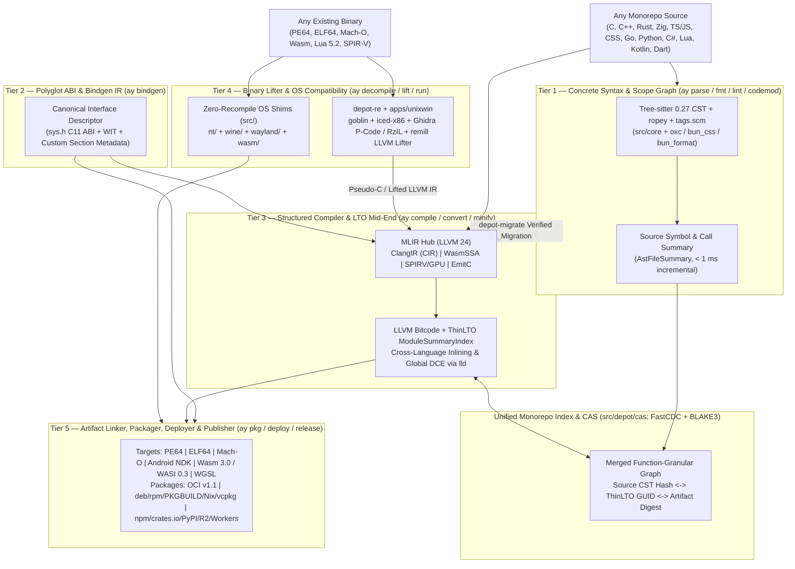

# `ay` Universal Compiler, Lifter & Monorepo Pipeline (`docs/native/AY-UNIVERSAL-PIPELINE.md`)

Architectural evaluation and blueprint for evolving [`ay`](file:///C:/src/src/ay) and [`src/`](file:///C:/src/src) into a universal polyglot parser, linter, formatter, minifier, cross-compiler, binary lifter/decompiler, language/OS converter, packager, deployer, and publisher built on **Tree-sitter**, **LLVM ThinLTO + MLIR**, and **WebAssembly Component / Bindgen descriptors**.

All upstream references below were verified live via GitHub REST API and LLVM documentation on **2026-11-14**.

---

## 1. Upstream Grounding (Verified 2026-11-14)

| Ecosystem                                                                                                                        | Verified Upstream State (2026-11-14)                                                                                                                                                                                                                                                                                          | Architectural Strength                                                                                                                                                                                             | Architectural Limit                                                                                                                                                                                           |
| :------------------------------------------------------------------------------------------------------------------------------- | :---------------------------------------------------------------------------------------------------------------------------------------------------------------------------------------------------------------------------------------------------------------------------------------------------------------------------- | :----------------------------------------------------------------------------------------------------------------------------------------------------------------------------------------------------------------- | :------------------------------------------------------------------------------------------------------------------------------------------------------------------------------------------------------------ |
| **`github.com/orgs/tree-sitter`** (`56` public repos)                                                                            | `tree-sitter/tree-sitter` `v0.27.2` (`afcfe343ea`, 2026-11-13, C11 GLR runtime + Rust CLI + Wasm bindings, ABI 15), `tree-sitter-graph` `v0.12.0` (`b930fb59c2`), 10 official host bindings (`py`, `node`, `swift`, `go`, `java`, `zig`, `kotlin`, `csharp`, `haskell`), 30+ official grammars                                | Sub-millisecond incremental error-tolerant Concrete Syntax Tree (CST), uniform S-expression queries (`tags.scm`, `highlights.scm`), zero compiler-frontend startup cost                                            | **Zero semantic types, borrow/lifetime checking, macro expansion, C++ template instantiation, or target `DataLayout`**. Cannot compile to optimal machine code or soundly transpile typed languages alone.    |
| **`llvm/llvm-project` + ThinLTO** (`main` @ `018898048c3b`, release `llvmorg-23.1.5` 2026-11-03, Chromium 157 trunk `24.0.0git`) | `llvm/IR/ModuleSummaryIndex.h` (ThinLTO), `lld` (`ld.lld`, `lld-link`, `wasm-ld`, `ld64.lld`), `bolt/`, **`clang/include/clang/CIR`** (`ClangIR` structured C/C++ MLIR), **`49` MLIR dialects** incl. `WasmSSA`, `EmitC`, `SPIRV`, `GPU`, `LLVMIR`, `X86`, `ArmNeon`/`ArmSME`                                                 | Compact parallel whole-program call/reference graph (`ModuleSummaryIndex`), cross-language inlining & DCE (C/C++/Rust/Zig/Swift/Fortran on matching LLVM), multi-OS/ISA codegen + MLIR structured dialect lowering | Requires matching LLVM bitcode producer version across `clang` and `rustc`; managed/GC languages (JS/TS, Python, C#) do not lower to zero-runtime LLVM IR without a runtime or typed subset.                  |
| **`github.com/orgs/wasm-bindgen` + Bytecode Alliance**                                                                           | `wasm-bindgen` `0.2.130` (`ce77fe1527`, `walrus` Wasm IR rewriter, `wasm-pack`, `weedle`, `js-bindgen`, `ts-gen`); `bytecodealliance/wit-bindgen` `v0.63.0` (`0769ea80d5`), `wasm-tools` `v1.263.0` (`a104ec67f6`), `jco` `v1.42.0` (`7d36424c57`), `wasmtime` `v50.0.1`, `WebAssembly/binaryen` `version_133` (`5d31e56e85`) | `wasm-bindgen` embeds rich type descriptors in custom sections + `walrus` rewrites; `wit-bindgen` generalizes interfaces across guest/host languages via WIT + Canonical ABI                                       | `wasm-bindgen` is Rust-to-JS only; `wit-bindgen` enforces Canonical ABI linear-memory copies and does not emit zero-copy native C FFI (`sys.h`, `bun:ffi`, JNI, `.NET LibraryImport`).                        |
| **Binary Lifters & Decompilers**                                                                                                 | `NationalSecurityAgency/ghidra` `12.2` (`42db038f3c`, P-Code), `rizinorg/rizin` `v0.9.1` (`1f547abca4`, RzIL), `lifting-bits/remill` `v6.0.1` (`66c488c991`, x86/ARM -> LLVM IR), `revng/revng` (`0e2b259522`, QEMU/TCG -> LLVM IR -> C), `immunant/c2rust` `v0.22.1` (`5f19702465`)                                          | Deterministic ISA decoding (`iced-x86`), CFG recovery, P-Code/RzIL -> Pseudo-C decompilation, and `remill`/`revng` static binary-to-LLVM-IR lifting                                                                | Compilation is **many-to-one (lossy)**: stripped binaries erase high-level types, generics, lifetimes, and comments. Idiomatic source recovery requires type reconstruction + differential test verification. |

---

## 2. Core Verdict: Why One AST Fails, and Why Five Unified Tiers Succeed

A single representation **cannot** simultaneously preserve whitespace/comments for formatting, incremental syntax recovery on broken files, C++/Rust static semantics, cross-module register/inline heuristics, and stripped machine-code control flow.

The clean engineering design for `ay` is **not** to force Tree-sitter to become a code generator, nor to force LLVM IR to format source code. Instead, `ay` unifies **five specialized IR tiers** connected by one content-addressed store ([`src/depot/cas`](file:///C:/src/src/depot/cas), FastCDC + BLAKE3) and one symbol GUID namespace:

---

## 3. The Three Architectural Breakthroughs for `ay`

### 3.1 Rethinking Tree-sitter + ThinLTO Together: Function-Granular Monorepo Graph

In `clang.llvm.org/docs/ThinLTO.html`, ThinLTO scales whole-program optimization by emitting a tiny **Module Summary** alongside each `.bc` object, merging only those summaries during the thin link (`llvm/IR/ModuleSummaryIndex.h`), and computing per-module **import lists** and **dead-symbol roots** before running parallel backend codegen.

Notice the structural duality:

- **Tree-sitter (`src/core`)** computes a compact per-file `AstFileSummary` (`symbols`, `calls`, `imports`, `Span`) in `< 1 ms` _before_ typechecking.
- **LLVM ThinLTO** computes a compact per-module `ModuleSummaryIndex` (function GUIDs, instruction counts, call/ref edges, linkage) _after_ frontend lowering.

**How `ay` fuses them (`ay graph` + `ay build`)**:

1. Tree-sitter hashes each individual **function/type CST body** (stripping comments and whitespace) with BLAKE3.Editing a comment, formatting a file, or modifying function `foo()` leaves the CST hashes of `bar()` and `baz()` unchanged — avoiding useless downstream test/lint/doc runs across the monorepo.
2. When native/Wasm compilation runs (`clang -flto=thin`, `rustc -Clinker-plugin-lto`, `zig cc -flto=thin` on the shared Chromium LLVM 24 toolchain), `ay` caches both the `.bc` object and its ThinLTO summary slice in `depot-cas`.
3. During link, `lld` (`ld.lld`, `lld-link`, `wasm-ld`) uses the combined `ModuleSummaryIndex` to inline C primitives (`src/`) directly into Rust (`crates/*`) and C++ callers and strip unreferenced code globally (`--gc-sections` / `/OPT:REF`).

### 3.2 Rethinking `wasm-bindgen`: Universal Polyglot Interface Descriptors (`ay bindgen`)

Upstream `wasm-bindgen` (`0.2.130`) works by emitting a binary interface description into a custom Wasm section, running `walrus` Wasm-to-Wasm transformations, and generating JS/TS bindings. Its flaw is being **locked to Rust guests and JS hosts**. Conversely, `wit-bindgen` (`v0.63.0`) supports many languages via WIT, but pays serialization copies across linear memories and ignores native `dlopen` FFI.

**How `ay` generalizes both**:

- **Single Source of Truth**: An interface is declared once as either a freestanding C11 header (`src/include/uapi/ay/*.h` parsed via Clang `CIR`/AST) or a `.wit` world.
- **Dual Emission**:
  1. **Zero-Copy Native ABI**: Generates `sys.h` (C11/C++23), `src/core/capi` (`extern "C"` Rust), `packages/core/src/sys.ts` (`bun:ffi`), `ndk_theme.h` (Android JNI/NDK), `.NET 11 [LibraryImport]`, and `dart:ffi`.
  2. **WebAssembly 3.0 & Component Model**: Emits a custom interface section into `.wasm`, runs `walrus` / `wasm-tools component new` + Binaryen `wasm-opt -O4`, and generates tiny zero-dep JS/WebGPU hosts (< 5 KB, like [`m3-host.js`](file:///C:/src/apps/aphrody/public/m3/m3-host.js)) and TypeScript `.d.ts` definitions (`ts-gen` pattern).

### 3.3 Honest Matrix: Compile, Decompile, Convert & Execute Across Languages and OSes

Every operation `ay` exposes must declare its **soundness class** explicitly — never pretending a heuristic rewrite is a lossless compiler pass:

| Operation                           | Input -> Output                                                                         | Soundness Class                                     | Engine Stack in `ay`                                                                                                                 |
| :---------------------------------- | :-------------------------------------------------------------------------------------- | :-------------------------------------------------- | :----------------------------------------------------------------------------------------------------------------------------------- |
| **Parse / Index / Query**           | 40+ languages -> CST, Symbol/Call Graph, SARIF                                          | **Exact (Syntactic)**                               | `src/core` (`tree-sitter` `0.27`, `tags.scm`, `ropey`)                                                                            |
| **Format / Lint**                   | Source -> Canonical Source + Diagnostics                                                | **Exact (Syntactic/Semantic)**                      | `bun fmt`/`oxc` (JS/TS/JSON/CSS), `clang-format`/`clang-tidy` (C/C++), `rustfmt`/`clippy` (Rust), `ruff` (Python)                    |
| **Minify (Code & Binary)**          | JS/CSS/HTML/Wasm/ELF/PE -> Minimal Payload                                              | **Semantics-Preserving**                            | `bun build --minify`, `wasm-opt -O4 --strip-debug`, `lld --icf=all --gc-sections` + `llvm-strip`, `BOLT`                             |
| **Cross-Compile (Native & Wasm)**   | C, C++, Rust, Zig -> Windows PE64, Linux ELF64, macOS Mach-O, Android NDK, Wasm32/WASI  | **Exact (Compiler IR)**                             | Shared LLVM 24 (`clang`, `rustc`, `lld`, `wasi-sdk 34`) + pinned sysroots (`xwin`, NDK r30, glibc/musl)                              |
| **IR-to-Source Lowering**           | Wasm -> C11 (`wasm2c`), MLIR -> C/C++ (`EmitC`), WGSL <-> SPIR-V/MSL/HLSL/GLSL (`naga`) | **Semantics-Preserving (Low-Level Source)**         | `WebAssembly/wabt` `wasm2c`, MLIR `WasmSSA` -> `EmitC`, `naga` / MLIR `SPIRV`                                                        |
| **Source-to-Source Migration**      | C -> Rust (`c2rust`), Node/Electron/TS -> Bun + Rust (`depot-migrate`)                  | **Assisted / Oracle-Verified**                      | `immunant/c2rust` + Clang `CIR` (C -> unsafe Rust -> safe refactor); `depot-migrate` (`tree-sitter` + `aphrody-core` + parity tests) |
| **Cross-OS Binary Execution**       | Windows PE64 <-> Linux ELF64 <-> Browser Wasm/WebGPU                                    | **ABI Compatibility Layer (No Recompile)**          | `src/nt` + `src/wine` (PE64/Win32 on Linux/Wasm), `src/wayland` (`wayland.wasm` WebGPU), WSL2/Lima                                   |
| **Binary Decompilation & Lifting**  | PE64 / ELF64 / Mach-O / Lua 5.2 -> Pseudo-C, LLVM IR, Wasm                              | **Lossy Reconstruction (Requires Trace/Test Gate)** | `crates/depot-re` (`goblin`, `iced-x86`, Ghidra P-Code, MinGW-REA, Lua 5.2) + `apps/unixwin/rea`                                     |
| **Build, Package, Deploy, Publish** | Any Monorepo -> OCI, Distro Pkgs, Workers, Registries                                   | **Deterministic (CAS-Addressed)**                   | `depot-cas` + `ay pkg` (`infra/pkg`) + `packages/deploy` (OCI/Cloudflare/prd) + `packages/release` (GitHub/npm/crates/PyPI)          |

---

## 4. Mapping to Existing `C:\src` Modules (Zero Duplication)

Nearly 70% of the foundational bricks already exist in `C:\src`; the remaining work is **wiring unified CLI verbs and ThinLTO/WIT descriptors** rather than rewriting compilers from scratch:

1. **Tier 1 (CST, Query, Rope Codemods)**:
   - Exists: [`src/core`](file:///C:/src/src/core) (`TreeSitterEngine`, `AstExtractor`, `GRAMMARS` registry, `ropey`), [`src/core/capi`](file:///C:/src/src/core/capi), [`src/depot/migrate`](file:///C:/src/src/depot/migrate).
   - Next step: Add per-symbol BLAKE3 semantic-body hashing (`ast_body_hash` ignoring comments/trivia) to `AstSymbol` in `src/core/src/symbols.rs`.
2. **Tier 2 (`ay bindgen` — C11 + Wasm + FFI Generator)**:
   - Exists: Manual mirror across [`sys.h`](file:///C:/src/src/include/ay/sys.h), [`sys.rs`](file:///C:/src/src/core/capi/src/sys.rs), [`sys.ts`](file:///C:/src/packages/core/src/sys.ts), [`ndk_theme.h`](file:///C:/src/packages/design/tokens/adapters/ndk_theme.h).
   - Next step: Parse `src/include/uapi/ay/*.h` once with Tree-sitter C / `libclang` to auto-emit `sys.rs`, `sys.ts`, `.d.ts`, `.wit`, JNI C shims, and `.NET [LibraryImport]` with `--check` CI gate (same deterministic pattern as [`adapters.ts`](file:///C:/src/packages/design/src/adapters.ts)).
3. **Tier 3 (LLVM 24 ThinLTO + Wasm 3.0 + Sysroots)**:
   - Exists: [`src/Makefile`](file:///C:/src/src/Makefile) (`clang -flto=thin`, `lld-link`, `wasm-ld`, `wasi-sdk 34`, `wasm-opt -O4`), [`UNIFIED-TOOLCHAIN.md`](file:///C:/src/docs/native/llvm/UNIFIED-TOOLCHAIN.md) (`toolchain-157.toml` on R2), [`src/ay/src/build.rs`](file:///C:/src/src/ay/src/build.rs).
   - Next step: Expose `ay compile <path> --target <triple>` driving the shared LLVM 24 + `wasi-sdk` + `xwin`/NDK sysroots and indexing `.thinlto.bc` summaries in `depot-cas`.
4. **Tier 4 (Binary Lifter, Decompiler & Migration)**:
   - Exists: [`crates/depot-re`](file:///C:/src/crates/depot-re) (`goblin`, `iced-x86`, ABI classifier, Ghidra P-Code, MinGW-REA, Lua 5.2 disassembler), [`src/depot/migrate`](file:///C:/src/src/depot/migrate) (polyglot AST migrator, LLVM/CoreCLR), [`apps/unixwin`](file:///C:/src/apps/unixwin) (REA + Replica + POSIX/Win runtime), [`src/nt`](file:///C:/src/src/nt) + [`src/wine`](file:///C:/src/src/wine).
   - Next step: Route `ay decompile <binary>` (`depot-re` P-Code/Pseudo-C + `apps/unixwin/rea`) and `ay convert <src> --to <target>` (`wasm2c`, `naga`, `c2rust`, `depot-migrate` + conformance harness).
5. **Tier 5 (Package, Deploy, Publish)**:
   - Exists: `ay pkg` (`src/posix/omarchy` + `infra/pkg`), `ay deploy` ([`packages/deploy`](file:///C:/src/packages/deploy)), `ay release` ([`packages/release`](file:///C:/src/packages/release)), `ay git` / `just vcs` ([`scripts/vcs.ts`](file:///C:/src/scripts/vcs.ts)).

---

## 5. Phased Execution Roadmap

1. **Lot A — Function-Granular CST + ThinLTO Index (`src/core` + `depot-cas`)**: Compute trivia-insensitive BLAKE3 hashes per `AstSymbol` in `src/core` and link them with LLVM `.thinlto.bc` module summaries (`llvm-bcanalyzer --dump`) so `ay test` and `ay build` skip unaffected symbols across C, Rust, and TS.
2. **Lot B — Deterministic `ay bindgen` from `src/include/uapi/ay/*.h`**: Generate `src/core/capi/src/sys.rs`, `packages/core/src/sys.ts`, `wit/ay.wit`, `.NET` `LibraryImport`, and JS/Wasm host descriptors from `src/include/ay/sys.h` with zero hand-maintained FFI drift.
3. **Lot C — `ay compile` & `ay minify` Unified Driver**: Wrap Clang 24 ThinLTO, `rustc -Clinker-plugin-lto`, `wasi-sdk 34`, `wasm-opt -O4`, and `lld` behind `ay compile` / `ay minify` with hermetic R2-fetched sysroots (Windows MSVC via `xwin`, Linux musl/glibc, Android NDK r30, Wasm32/WASIp2).
4. **Lot D — `ay decompile` & `ay convert` with Conformance Oracles**: Wire `crates/depot-re` + `apps/unixwin` (PE/ELF/Mach-O/Wasm -> CFG + P-Code + Pseudo-C) and `src/depot/migrate` + `wasm2c` + `naga` behind `ay decompile` / `ay convert`, requiring differential test execution (`conformance/`) on every cross-language conversion.
