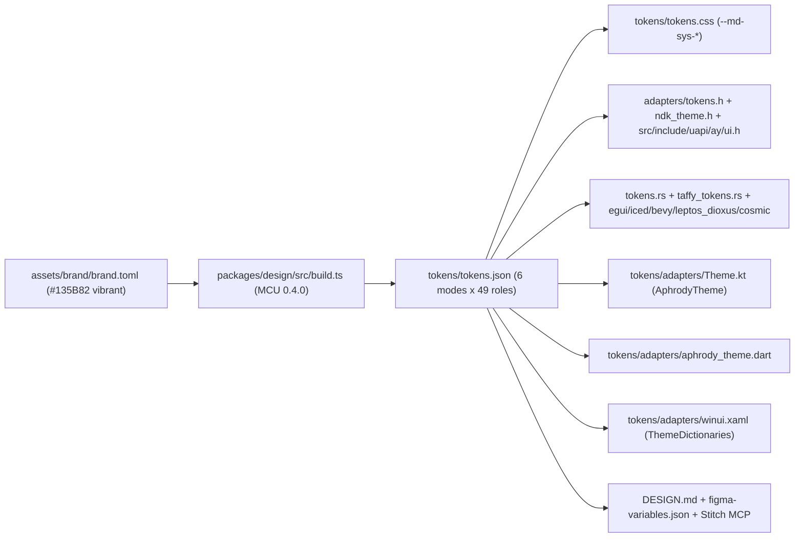
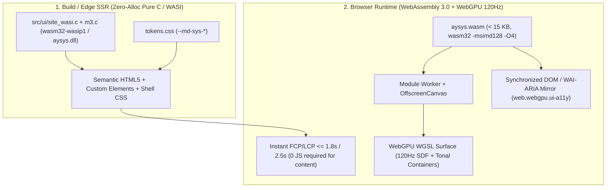

# Pure C11, Assembly, WebAssembly 3.0, WASI & WebGPU UI Specification (2026)

Canonical engineering specification for building zero-drift Material 3 Expressive websites and 120 Hz GPU UI engines in **Pure C (`-std=gnu11`) + Assembly + WebAssembly 3.0 + WASI + WebGPU** under [src](file:///C:/src/src), sharing the exact same design tokens, color roles, spring physics, adaptive window classes, and component semantics across **18 native, mobile, desktop, web, and design targets**.

---

## 1. Design Foundations & Live-Verified 2026 Baseline

All upstream repositories, package registries, and platform specifications below were queried live on **2026-11-14** (`gh api`, `crates.io`, `registry.npmjs.org`, `dl.google.com/android/maven2`, `storage.googleapis.com/flutter_infra_release`).

### 1.1 Normative Upstream Design Pillars

1. **Google Design Principles (`https://design.google/?home`)**:
   - **Scalable Expressiveness**: interfaces dial emotional energy up for hero surfaces or back for dense developer tools without changing semantic structure or accessibility guarantees.
   - **Typography-Driven Hierarchy**: variable fonts (`Google Sans Flex` for UI/display, `Google Sans Code` for monospace, both SIL OFL 1.1 in [brand.toml](file:///C:/src/assets/brand/brand.toml)) establish scannable contrast before decorative chrome.
   - **Adaptive Canonical Layouts**: five viewport size classes (`compact`, `medium`, `expanded`, `large`, `extra-large`) govern navigation (`NavigationBar` vs `NavigationRail`), column count, and pane splitting across phone, foldable, desktop, XR, and web.

2. **Material 3 Expressive & Compose-First Architecture (`https://m3.material.io/blog/material-is-compose-first`)**:
   - Jetpack Compose (`androidx.compose.material3`) is Google's primary upstream reference implementation for Material 3 Expressive; legacy MDC-Android Views are frozen in maintenance.
   - **`MotionScheme` Spring Physics**: fixed cubic-bezier durations are superseded by physical harmonic oscillators split into two orthogonal families:
     - **Spatial springs** (`fast-spatial` `zeta=0.6, k=800`, `default-spatial` `zeta=0.8, k=380`, `slow-spatial` `zeta=0.8, k=200`): under-damped (`zeta < 1.0`), permitting controlled physical overshoot on bounds, position, and corner morphing.
     - **Effects springs** (`fast-effects` `zeta=1.0, k=3800`, `default-effects` `zeta=1.0, k=1600`, `slow-effects` `zeta=1.0, k=800`): critically damped (`zeta = 1.0`), guaranteeing zero overshoot on opacity, state layers, and color transitions.
   - **Expanded `Shapes` & Morphing**: 7 core corner radii (`none` 0, `extra-small` 4px, `small` 8px, `medium` 12px, `large` 16px, `extra-large` 28px, `full` 9999px) plus 35 morphable geometric polygons for interactive press/selection feedback.
   - **`ColorScheme` 2025/2026**: HCT perceptual color space (`Material Color Utilities 0.4.0`), tonal surface containers (`surface-container-lowest` through `surface-container-highest`) replacing drop-shadow elevation, plus `*-dim` roles (`primary-dim`, `secondary-dim`, `tertiary-dim`, `error-dim`) and 6 contrast modes (`light`, `light-medium-contrast`, `light-high-contrast`, `dark`, `dark-medium-contrast`, `dark-high-contrast`).

3. **Flutter Material 3, Impeller & WasmGC (`https://docs.flutter.dev/ui/widgets/material`)**:
   - `ThemeData(useMaterial3: true)` is default; `ColorScheme` exposes 47 active roles (deprecated M2 `background`, `onBackground`, and `surfaceVariant` constructors retired in favor of `surface` and `surfaceContainerHighest`).
   - **Impeller** precompiles shaders offline (`impellerc`) for Vulkan (Android/Windows/Linux), Metal, and experimental WebGPU, eliminating runtime shader-compilation jank; **`dart2wasm`** targets browser WasmGC with automatic JS fallback.

### 1.2 Live-Verified Upstream Versions (2026-11-14)

| Ecosystem / Component        | Upstream Repository / Registry                    | Verified Version / Release                                                  | HEAD Commit & Date                       | License               |
| :--------------------------- | :------------------------------------------------ | :-------------------------------------------------------------------------- | :--------------------------------------- | :-------------------- |
| **LLVM / WASI-SDK**          | `WebAssembly/wasi-sdk`                            | `wasi-sdk-34`                                                               | `0f85552f2c` (2026-11-11)                | Apache-2.0            |
| **Binaryen (`wasm-opt`)**    | `WebAssembly/binaryen`                            | `version_133`                                                               | `5d31e56e85` (2026-11-14)                | Apache-2.0            |
| **Dawn (C/C++ WebGPU)**      | `google/dawn`                                     | `v20261113.214538`                                                          | `12c86c40d4` (2026-11-14)                | BSD-3-Clause          |
| **Android Skills**           | `android/skills` -> `aphrody-labs/android-skills` | `v1.0.21` (36 skills)                                                       | `5815d27fda` (2026-11-09)                | Apache-2.0            |
| **Android NDK**              | `android/ndk`                                     | `r30` stable (`r29` prev)                                                   | `83bbb5ac0d` (2026-09-08)                | Apache-2.0            |
| **Android Gradle Plugin**    | `com.android.tools.build:gradle`                  | `9.5.1` stable, `9.6.0-alpha03`                                             | Google Maven (2026-11-14)                | Apache-2.0            |
| **Kotlin**                   | `JetBrains/kotlin`                                | `v2.4.21` stable, `v2.5.0-RC`                                               | `v2.5.0-RC` (2026-11-11)                 | Apache-2.0            |
| **Jetpack Compose M3**       | `androidx/androidx` (`compose.material3`)         | `1.4.0` stable, `1.5.0-rc01`                                                | `8bb0533894` (2026-11-14)                | Apache-2.0            |
| **Flutter & Dart SDK**       | `flutter/flutter` / `dart-lang/sdk`               | Flutter `3.50.0` / Dart `3.14.0` (`3.51.0-0.1.pre` beta)                    | `ab2912035e` / `f3f72dd639` (2026-11-13) | BSD-3-Clause          |
| **Material Color Utilities** | `material-foundation/material-color-utilities`    | npm `0.4.0`                                                                 | `194144d75e` (2026-11-06)                | Apache-2.0            |
| **Material Web**             | `material-components/material-web`                | npm `2.5.0` (`2.5.1-nightly.37aa14b.0`)                                     | `37aa14b843` (2026-11-10)                | Apache-2.0            |
| **Taffy**                    | `DioxusLabs/taffy`                                | crates.io `0.15.1`                                                          | `1abd8eeaf6` (2026-11-13)                | MIT                   |
| **egui**                     | `emilk/egui`                                      | crates.io `0.37.0`                                                          | `c61b45f657` (2026-11-13)                | Apache-2.0 / MIT      |
| **iced**                     | `iced-rs/iced`                                    | crates.io `0.14.0`                                                          | `b2fbd3cb62` (2026-11-13)                | MIT                   |
| **libcosmic**                | `pop-os/libcosmic`                                | tag `v0.12`                                                                 | `dfc68d1e1a` (2026-11-13)                | MPL-2.0 (tokens only) |
| **Bevy (`bevy_ui`)**         | `bevyengine/bevy`                                 | crates.io `0.20.1`                                                          | `7ea4827e16` (2026-11-13)                | Apache-2.0 / MIT      |
| **Leptos**                   | `leptos-rs/leptos`                                | crates.io `0.8.23`, `v0.9.0-rc1`                                            | `1434587899` (2026-11-12)                | MIT                   |
| **Dioxus**                   | `DioxusLabs/dioxus`                               | crates.io `0.7.10`, `0.8.0-alpha.3`                                         | `97adf7915e` (2026-11-11)                | Apache-2.0 / MIT      |
| **Tauri**                    | `tauri-apps/tauri`                                | crates.io `2.12.5` stable, `3.0.0-alpha.6`                                  | `3aac98b498` (2026-11-13)                | Apache-2.0 / MIT      |
| **GPUI & gpui-kit**          | `zed-industries/zed` / `longbridge/gpui-kit`      | crates.io `gpui` `0.2.2`, Zed `v1.28.1` (`v1.29.1-pre`), `gpui-kit` `0.9.1` | `99c890d39d` (2026-11-14)                | Apache-2.0            |
| **AccessKit**                | `AccessKit/accesskit`                             | crates.io `0.25.2`                                                          | `dea4384134` (2026-10-25)                | Apache-2.0 / MIT      |
| **React**                    | `facebook/react`                                  | npm `19.3.1`                                                                | `df6aa4ec76` (2026-11-12)                | MIT                   |
| **Bun**                      | `oven-sh/bun`                                     | `1.4.4` stable, `1.4.5-canary.1`                                            | `9098897a17` (2026-11-14)                | MIT (JSC LGPL-2)      |
| **WinUI 3 & .NET 11**        | `microsoft/WindowsAppSDK` / `dotnet/sdk`          | WinAppSDK `2.6.5` (`2.6.6-exp`), `.NET 11.0.100`                            | `4a160fc277` / `5947e1a3cc` (2026-11-14) | MIT                   |
| **Stitch & DESIGN.md**       | `google-labs-code/stitch-sdk` / `design.md`       | `stitch-sdk` `0.3.5` (`0.4.0` next), `design.md` `0.4.0`                    | `f6aa86cde1` / `1ed38aa9dd`              | Apache-2.0            |
| **Modern Web Guidance**      | `GoogleChrome/modern-web-guidance`                | `v1.0.0` (Lighthouse `13.6.0`, `web-vitals` `6.2.3`)                        | `4dd968349e` (2026-11-10)                | Apache-2.0            |

---

## 2. Single-Source Token Pipeline (`brand.toml` -> C, CSS, Rust, Mobile, Desktop)

Every visual token in the monorepo originates from [brand.toml](file:///C:/src/assets/brand/brand.toml) (seed `#135B82`, Material Color Utilities `0.4.0` `vibrant` DynamicScheme, custom accent `bolt = #D1D293`). Neither C, Rust, Kotlin, Dart, nor TypeScript recalculates HCT palettes at run time.



### 2.1 Bit-Exact Parity Across Languages

For seed `#135B82` (`vibrant`), every generated target resolves identical sRGB values:

| Semantic Role             | CSS Custom Property ([tokens.css](file:///C:/src/packages/design/tokens/tokens.css)) | Pure C Constant ([ui.h](file:///C:/src/src/include/uapi/ay/ui.h) / [m3.c](file:///C:/src/src/ui/m3.c)) | Light ARGB   | Dark ARGB    |
| :------------------------ | :----------------------------------------------------------------------------------- | :----------------------------------------------------------------------------------------------------- | :----------- | :----------- |
| Surface                   | `--md-sys-color-surface`                                                             | `AY_UI_ROLE_SURFACE` (`0`)                                                                             | `0xFFF6FAFF` | `0xFF0C141B` |
| Surface Container Low     | `--md-sys-color-surface-container-low`                                               | `AY_UI_ROLE_SURFACE_CONTAINER_LOW` (`2`)                                                               | `0xFFECF5FE` | `0xFF141D23` |
| Surface Container Highest | `--md-sys-color-surface-container-highest`                                           | `AY_UI_ROLE_SURFACE_CONTAINER_HIGHEST` (`5`)                                                           | `0xFFDBE3ED` | `0xFF2D363D` |
| On Surface                | `--md-sys-color-on-surface`                                                          | `AY_UI_ROLE_ON_SURFACE` (`6`)                                                                          | `0xFF141D23` | `0xFFDBE3ED` |
| Primary                   | `--md-sys-color-primary`                                                             | `AY_UI_ROLE_PRIMARY` (`8`)                                                                             | `0xFF006492` | `0xFF8BCEFF` |
| On Primary                | `--md-sys-color-on-primary`                                                          | `AY_UI_ROLE_ON_PRIMARY` (`9`)                                                                          | `0xFFFFFFFF` | `0xFF00344E` |
| Primary Container         | `--md-sys-color-primary-container`                                                   | `AY_UI_ROLE_PRIMARY_CONTAINER` (`10`)                                                                  | `0xFFC9E6FF` | `0xFF004B6F` |
| Secondary Container       | `--md-sys-color-secondary-container`                                                 | `AY_UI_ROLE_SECONDARY_CONTAINER` (`14`)                                                                | `0xFFD5E3FF` | `0xFF354763` |
| Tertiary Container        | `--md-sys-color-tertiary-container`                                                  | `AY_UI_ROLE_TERTIARY_CONTAINER` (`18`)                                                                 | `0xFFDDE1FF` | `0xFF3A4472` |
| Error                     | `--md-sys-color-error`                                                               | `AY_UI_ROLE_ERROR` (`20`)                                                                              | `0xFFBA1A1A` | `0xFFFFB4AB` |
| Outline Variant           | `--md-sys-color-outline-variant`                                                     | `AY_UI_ROLE_OUTLINE_VARIANT` (`23`)                                                                    | `0xFFBCC8D3` | `0xFF3D4851` |
| Brand Bolt                | `--aphrody-bolt`                                                                     | `AY_UI_ROLE_BOLT` (`24`)                                                                               | `0xFFD1D293` | `0xFFD1D293` |

### 2.2 Compile-Time C Token Header Pattern (`tokens.h`)

To embed all 6 contrast modes (`light`, `light-medium-contrast`, `light-high-contrast`, `dark`, `dark-medium-contrast`, `dark-high-contrast`), typography px metrics, and corner radii into `.rodata` with zero heap overhead, `packages/design/src/adapters.ts` (or `src/include/uapi/ay/ui.h`) emits a freestanding C11 table:

```c
/* Freestanding C11 token layout (.rodata, 16-byte aligned for Wasm SIMD128 / x86 SSE/AVX) */
struct ay_ui_theme_tokens {
	__u32 colors[AY_UI_ROLE_COUNT]; /* 0xAARRGGBB */
	__u16 corner_px[7];             /* 0, 4, 8, 12, 16, 28, 9999 */
	__u8  state_opacity_permille[4];/* hover=80, focus=100, pressed=100, dragged=160 */
};
```

Because `g_m3_light_argb` and `g_m3_dark_argb` in [m3.c](file:///C:/src/src/ui/m3.c) reside in `.rodata`, `clang -O3 -flto=thin` folds constant lookups (`ay_ui_color_argb(AY_UI_THEME_LIGHT, AY_UI_ROLE_PRIMARY)`) into immediate 32-bit integers at compile time.

---

## 3. Hybrid 2026 Web & GPU Architecture (Pure C + WASI + WebAssembly 3.0 + WebGPU)

A pure `<canvas>` application fails technical SEO (`web.seo.*`), delays Largest Contentful Paint (`web.cwv.*`), and breaks assistive technologies unless paired with a semantic DOM tree (`web.webgpu.ui-a11y`). Conversely, a pure JS VDOM framework incurs hydration main-thread tasks (`> 50 ms`, hurting INP) and cannot drive 120 Hz spring/shader pipelines deterministically.

Aphrody resolves both constraints with a two-stage Pure C architecture sharing [sys.h](file:///C:/src/src/include/ay/sys.h) and [ui.h](file:///C:/src/src/include/uapi/ay/ui.h):



### 3.1 Stage 1: Zero-Allocation Pure C / WASI SSR & SSG (`wasm32-wasip1` & `aysys`)

Implemented in [m3.c](file:///C:/src/src/ui/m3.c) (`ay_ui_emit_m3_card_html`) and [site_wasi.c](file:///C:/src/src/ui/site_wasi.c):

1. **Zero Heap Allocation**:
   - SSR functions write into caller-owned stack or arena slices (`char *dst, __usize cap`) and return the exact byte count written or `-AY_ENOSPC` on overflow. No `malloc`, `free`, or allocator metadata is linked into freestanding `aysys.dll` / `libaysys.so` / `aysys.wasm`.
   - Every dynamic string slice (`title`, `body`, `cta_label`, `cta_href`) passes through deterministic byte-level HTML entity escaping (`&`, `<`, `>`, `"`, `'`), neutralizing reflected/stored XSS by construction.

2. **Semantic HTML5 + Material Web (`<md-*>`) + `tokens.css`**:
   - Emitted markup links `/tokens.css` ([tokens.css](file:///C:/src/packages/design/tokens/tokens.css)) and uses `<header>`, `<main>`, `<section aria-label="...">`, `<article>`, and Material Web custom elements (`<md-filled-button>`, `<md-outlined-button>`).
   - Server-side `ay_ui_compute_shell(width_dp, height_dp, &shell)` pre-computes compact (`390x844`) and desktop (`1440x900`) shell geometry so initial CSS grid/rail dimensions reserve exact space before client scripts load (**CLS = 0.00**, complying with `web.cwv.*`).

3. **Three Deployment Modes from One C Source**:
   - **Static / WASI CLI (`ay-m3-site.wasm`)**: compiled by WASI-SDK 34 (`clang -std=gnu11 -O3 -msimd128 --target=wasm32-wasip1 src/ui/m3.c src/ui/site_wasi.c`) + Binaryen `wasm-opt -O3 --strip-debug`, emitting the complete HTML document to `stdout`.
   - **`Bun.serve` Zero-Copy FFI (`bun:ffi`)**: `dlopen("aysys.dll")` / `dlopen("libaysys.so")` invokes `ay_ui_emit_m3_card_html` directly on a reusable `Uint8Array` buffer in `~200 ns` per component with zero V8/JSC object churn.
   - **Cloudflare Workers Edge Wasm**: instantiates `aysys.wasm` inside the Worker isolate and streams UTF-8 slices directly into `new Response(readableStream, { headers: { "content-type": "text/html; charset=utf-8" } })` (`TTFB <= 100 ms`).

### 3.2 Stage 2: Client WebAssembly 3.0 (`< 15 KB`, `-msimd128`) + WebGPU + Synchronized A11y DOM

Implemented in [Makefile](file:///C:/src/src/Makefile), [m3.c](file:///C:/src/src/ui/m3.c), and [compositor.c](file:///C:/src/src/wasm/compositor.c), governed by `.agents/skills/webgpu-wasm-ui` (`web.webgpu.*`, `web.wasm.*`, `web.workers.*`) and `.agents/skills/web-quality` (`web.a11y.*`):

1. **Compiler & Binary Budget (`< 15 KB`)**:

   ```makefile
   clang -std=gnu11 -O3 -msimd128 -mbulk-memory -mmultivalue -mnontrapping-fptoint -msign-ext \
     --target=wasm32-unknown-unknown -nostdlib -Wl,--no-entry -Wl,--export-dynamic -Wl,--lto-O3 \
     src/ui/m3.c -o aysys_ui.raw.wasm
   wasm-opt -O4 --enable-simd --enable-bulk-memory --enable-multivalue \
     --enable-nontrapping-float-to-int --enable-sign-ext --strip-debug \
     aysys_ui.raw.wasm -o aysys_ui.wasm
   ```
   - With `-nostdlib`, zero libc printf tables, and `wasm-opt -O4`, the compiled UI + spring + shell kernel measures **< 4 KB** uncompressed (`aysys.wasm` with full kernel/DRM/Wayland/NT/Wine/Wasm subsystems stays `< 15 KB`).
   - Loaded exclusively via `WebAssembly.instantiateStreaming(fetch("/m3/aysys.wasm"))` with `Content-Type: application/wasm`; linear memory views (`Uint8Array`, `Float32Array`) are re-materialized after any `memory.grow`.

2. **SIMD128 Multi-Channel M3 Expressive Spring Kernel & Native Assembly**:
   - Scalar `ay_ui_spring_step` ([m3.c](file:///C:/src/src/ui/m3.c)) integrates the damped harmonic oscillator `a = -k * (x - target) - 2 * zeta * sqrt(k) * v` at `<= 1 ms` sub-steps so stiff `fast-effects` springs (`k = 3800`) remain unconditionally stable across 60 Hz, 120 Hz, and 240 Hz displays.
   - For simultaneous 4-channel animation (`x, y, w, h` bounds or 4 independent corner radii `[tl, tr, br, bl]` during M3 Expressive shape morphing), `<wasm_simd128.h>` steps all 4 lanes in parallel:

   ```c
   #ifdef __wasm_simd128__
   #include <wasm_simd128.h>
   /* Step 4 spring channels (e.g. rect x/y/w/h or 4 corner radii) in a single v128 register */
   static inline void ay_ui_spring_step_x4(v128_t *val, v128_t *vel, v128_t target,
                                           float k, float two_zeta_sqrt_k, float sub_dt)
   {
   	v128_t vk  = wasm_f32x4_splat(-k);
   	v128_t vc  = wasm_f32x4_splat(-two_zeta_sqrt_k);
   	v128_t vdt = wasm_f32x4_splat(sub_dt);
   	v128_t disp = wasm_f32x4_sub(*val, target);
   	v128_t acc  = wasm_f32x4_add(wasm_f32x4_mul(vk, disp), wasm_f32x4_mul(vc, *vel));
   	*vel = wasm_f32x4_add(*vel, wasm_f32x4_mul(acc, vdt));
   	*val = wasm_f32x4_add(*val, wasm_f32x4_mul(*vel, vdt));
   }
   #endif
   ```
   - On x86_64 native targets (`aysys.dll`, `libaysys.so`), [entry_64.S](file:///C:/src/src/arch/x86/entry_64.S) provides cycle-accurate `rdtsc` telemetry (`ay_rdtsc`) and `cpuid` feature detection (`SSE4.2`, `AVX2`, `AVX-512F`) via `ay_cpu_probe`.
   - Under `prefers-reduced-motion: reduce`, the host passes `dt_sec = 0` and snaps `st->value = st->target` immediately, matching `tokens.css`.

3. **WebGPU 120 Hz Surface & Worker Offloading (`web.webgpu.*`, `web.workers.*`)**:
   - The `<canvas>` transfers control via `canvas.transferControlToOffscreen()` to a dedicated ES module Worker so main-thread tasks stay `< 50 ms` (`INP <= 200 ms`).
   - Adapter negotiation checks `navigator.gpu`, falls back to `featureLevel: "compatibility"` (Chrome 146+) on older GPUs, and falls back to Canvas 2D software rasterization using `ay_ui_argb_to_abgr` if `requestAdapter()` returns `null`. Every GPU object carries a diagnostic `label`, and `device.lost` triggers clean pipeline reconstruction.
   - Each frame, Wasm writes packed `struct ay_ui_rect` instances (`32 bytes` per node: `id, kind, x, y, w, h, corner_radius_px, fill_argb`) into linear memory; the Worker uploads the slice via `queue.writeBuffer` to a single instanced WGSL rounded-rectangle SDF shader (1 draw call per surface layer).

4. **Synchronized DOM / ARIA A11y Mirror (`web.webgpu.ui-a11y`, WCAG 2.2 AA)**:
   - Interactive `struct ay_ui_rect` primitives maintain lightweight semantic mirror nodes (`<button>`, `<input>`, `[role="navigation"]`, `[role="dialog"]`) positioned over or alongside the `<canvas>` with matching bounding boxes (`transform: translate3d(x, y, 0)`), keyboard focus order, `:focus-visible` 3px outline (`--md-sys-color-secondary`), `>= 24x24 CSS px` pointer targets (`>= 48x48 px` touch targets), and `>= 4.5:1` text / `>= 3:1` UI component contrast verified by `packages/design/tests/tokens.test.ts`.

---

## 4. Universal C ABI Contract (`src/include/uapi/ay/ui.h` & `src/include/ay/sys.h`)

All 18 targets bind to the C ABI declared in [ui.h](file:///C:/src/src/include/uapi/ay/ui.h) and exported by [sys.h](file:///C:/src/src/include/ay/sys.h):

| C Symbol                  | Signature                                                                             | Semantics & Complexity                                                                                                                     |
| :------------------------ | :------------------------------------------------------------------------------------ | :----------------------------------------------------------------------------------------------------------------------------------------- |
| `ay_ui_color_argb`        | `__u32 (__u32 theme_mode, __u32 role_id)`                                             | O(1) `.rodata` lookup returning `0xAARRGGBB` for `AY_UI_ROLE_*` (`0..24`).                                                                 |
| `ay_ui_argb_to_abgr`      | `__u32 (__u32 argb)`                                                                  | Swizzles `0xAARRGGBB` to little-endian `0xAABBGGRR` (`RGBA8Unorm` for WebGPU, Canvas `ImageData`, Vulkan, `ANativeWindow`).                |
| `ay_ui_state_blend_argb`  | `__u32 (__u32 base_argb, __u32 content_argb, __u32 opacity_permille)`                 | Integer-exact M3 state-layer composite (`hover=80`, `focus=100`, `pressed=100`, `dragged=160`).                                            |
| `ay_ui_spring_init`       | `__s32 (struct ay_ui_spring_state *st, __u32 preset_id, float initial, float target)` | Initializes `AY_UI_SPRING_*` (`0..5`) from Compose M3 Expressive motion tokens.                                                            |
| `ay_ui_spring_step`       | `__s32 (struct ay_ui_spring_state *st, float dt_sec)`                                 | Sub-1ms harmonic step; returns `1` when settled, `0` while moving, `-AY_EINVAL` on invalid input.                                          |
| `ay_ui_window_class`      | `__u32 (__u32 width_dp)`                                                              | Maps viewport width to `AY_UI_WIN_COMPACT` (`<600`), `MEDIUM` (`<840`), `EXPANDED` (`<1200`), `LARGE` (`<1600`), `EXTRA_LARGE` (`>=1600`). |
| `ay_ui_compute_shell`     | `__s32 (__u32 width_dp, __u32 height_dp, struct ay_ui_adaptive_shell *out)`           | Computes M3 navigation kind (`NavigationBar` vs `NavigationRail`), margins, gutters, column count, and content rect.                       |
| `ay_ui_emit_m3_card_html` | `__s32 (char *dst, __usize cap, ...)`                                                 | Zero-allocation XSS-safe HTML5 + `<md-filled-button>` + `--md-sys-*` emitter; returns byte length or `-AY_ENOSPC`.                         |

ABI invariants enforced across all FFI consumers:

- Fixed-width types (`__u8`, `__u16`, `__u32`, `__s32`, `__usize`), natural alignment, zero bitfields, zero C++ exceptions, zero thread-local state.
- `struct ay_ui_spring_state` (`20 bytes`, 5 x `f32`), `struct ay_ui_rect` (`32 bytes`, 8 x `u32`), and `struct ay_ui_adaptive_shell` (`44 bytes`, 11 x `u32`) map 1:1 to Rust `#[repr(C)]`, Dart `ffi.Struct`, Zig `extern struct`, C# `[StructLayout(LayoutKind.Sequential)]`, and JS `Float32Array` / `Uint32Array` views.

---

## 5. 18-Target Interoperability Matrix

Every target below consumes the exact same seed (`#135B82` in [brand.toml](file:///C:/src/assets/brand/brand.toml)) and/or links the [sys.h](file:///C:/src/src/include/ay/sys.h) C ABI without re-implementing HCT math or spring physics:

| #      | Target                                | Verified 2026 Baseline                                                       | Token Artifact                                                                                                                                              | C ABI / Runtime Binding                                                                                                     | Component & A11y Model                                                                                                                 |
| :----- | :------------------------------------ | :--------------------------------------------------------------------------- | :---------------------------------------------------------------------------------------------------------------------------------------------------------- | :-------------------------------------------------------------------------------------------------------------------------- | :------------------------------------------------------------------------------------------------------------------------------------- |
| **1**  | **Pure C Web / Wasm32 / WASI**        | Clang `-std=gnu11` + WASI-SDK `34` + Binaryen `133`                          | [tokens.h](file:///C:/src/packages/design/tokens/adapters/tokens.h), [ui.h](file:///C:/src/src/include/uapi/ay/ui.h), `/tokens.css`                         | `aysys.wasm` (`wasm32-unknown-unknown`) & `ay-m3-site.wasm` (`wasm32-wasip1`)                                               | `ay_ui_emit_m3_card_html` (`<md-*>`) + synchronized ARIA DOM                                                                           |
| **2**  | **WebGPU WGSL**                       | W3C WebGPU, Dawn `v20261113`, `wgpu` `30.0.2`                                | [tokens.h](file:///C:/src/packages/design/tokens/adapters/tokens.h) (`ay_ui_argb_to_abgr` `RGBA8Unorm`)                                                     | Storage/uniform buffer of `struct ay_ui_rect` (`32 B` stride) in Worker                                                     | Instanced SDF rounded-rect WGSL + DOM A11y mirror (`web.webgpu.ui-a11y`)                                                               |
| **3**  | **Android NDK**                       | NDK `r30` (`aarch64-linux-android35`)                                        | [ndk_theme.h](file:///C:/src/packages/design/tokens/adapters/ndk_theme.h), `ui.h`                                                                           | `libaysys.so` linked to `ANativeActivity`, `AAssetManager`, `AChoreographer`                                                | Vulkan `VK_KHR_android_surface` / Dawn WebGPU / `ANativeWindow_lock`                                                                   |
| **4**  | **Jetpack Compose (Kotlin)**          | Compose M3 `1.4.0` / `1.5.0-rc01`, Kotlin `2.4.21` / `2.5.0-RC`, AGP `9.5.1` | [Theme.kt](file:///C:/src/packages/design/tokens/adapters/Theme.kt) (`AphrodyTheme`)                                                                        | `@CriticalNative` / `@FastNative` JNI over `libaysys.so` (`.agents/skills/android-ndk-compose`)                             | `MaterialExpressiveTheme`, `MotionScheme.expressive()`, Navigation 3                                                                   |
| **5**  | **Dart / Flutter**                    | Flutter `3.50.0`, Dart `3.14.0`                                              | [aphrody_theme.dart](file:///C:/src/packages/design/tokens/adapters/aphrody_theme.dart)                                                                     | `dart:ffi` `@Native` (`libaysys.so` / `aysys.dll`) + `dart2wasm` WasmGC                                                     | M3 widgets (`useMaterial3: true`), Impeller Vulkan/Metal/WebGPU                                                                        |
| **6**  | **Rust `aphrody-ui` & `gpui`**        | Zed `v1.28.1` (`gpui` `0.2.2`), `gpui-kit` `0.9.1`                           | [tokens.rs](file:///C:/src/packages/design/tokens/tokens.rs), [gpui-kit.json](file:///C:/src/packages/design/tokens/adapters/gpui-kit.json)                 | [lib.rs](file:///C:/src/src/core/capi/src/lib.rs) + [targets.rs](file:///C:/src/src/ui/kit/src/fusion/targets.rs) | 23 `UiKind` primitives, D3D11/Metal/Wayland GPU + AccessKit `0.25.2`                                                                   |
| **7**  | **Rust `taffy`**                      | `taffy` `0.15.1` (`src/taffy`)                                            | [taffy_tokens.rs](file:///C:/src/packages/design/tokens/adapters/taffy_tokens.rs)                                                                           | `WindowSizeClass` aligned 1:1 with `ay_ui_window_class` & `ay_ui_compute_shell`                                             | Flexbox/CSS Grid + Parley `0.13` + Kurbo/Peniko + AccessKit ([ecosystem.rs](file:///C:/src/src/ui/kit/src/layout/ecosystem.rs)) |
| **8**  | **Rust `egui`**                       | `egui` `0.37.0` (`aphrody-labs/egui-1`, `storytold/egui`)                    | [egui_theme.rs](file:///C:/src/packages/design/tokens/adapters/egui_theme.rs), `tokens.rs`                                                                  | `egui::Visuals` mapped from M3 container/primary roles + `ay_ui_spring_step`                                                | Immediate-mode wgpu/glow panels + AccessKit built-in                                                                                   |
| **9**  | **Rust `iced`**                       | `iced` `0.14.0` (`aphrody-labs/iced`)                                        | [iced_theme.rs](file:///C:/src/packages/design/tokens/adapters/iced_theme.rs), `tokens.rs`                                                                  | `iced::theme::Custom` palette derived from M3 surface/primary/error roles                                                   | Retained Elm-style architecture on `wgpu` + AccessKit                                                                                  |
| **10** | **Rust `libcosmic`**                  | System76 `libcosmic` `v0.12` (`dfc68d1e1a`)                                  | [cosmic_theme.ron](file:///C:/src/packages/design/tokens/adapters/cosmic_theme.ron)                                                                         | Process-isolated RON theme file consumer (MPL-2.0 never linked into MIT/Apache crates)                                      | COSMIC Wayland applets/panels consuming M3 tonal surface ramp                                                                          |
| **11** | **Rust `bevy` (`bevy_ui`)**           | `bevy` `0.20.1` (`aphrody-labs/bevy`)                                        | [bevy_theme.rs](file:///C:/src/packages/design/tokens/adapters/bevy_theme.rs), `tokens.rs`                                                                  | ECS `Res<AphrodyM3Theme>` + `Update` system stepping `ay_ui_spring_step`                                                    | Taffy-backed `Node` hierarchy + `wgpu` game/creative HUD + `bevy_a11y`                                                                 |
| **12** | **Rust `leptos`**                     | `leptos` `0.8.23` / `0.9.0-rc1`                                              | [leptos_dioxus_tokens.rs](file:///C:/src/packages/design/tokens/adapters/leptos_dioxus_tokens.rs), `/tokens.css`                                            | Server functions / SSR calling `core-capi` or `<md-*>` islands                                                              | Fine-grained reactive SSR/hydration with native HTML5 landmarks                                                                        |
| **13** | **Rust `dioxus` (+ `blitz`)**         | `dioxus` `0.7.10` / `0.8.0-alpha.3`                                          | [leptos_dioxus_tokens.rs](file:///C:/src/packages/design/tokens/adapters/leptos_dioxus_tokens.rs), `/tokens.css`                                            | `src/ui/kit/src/fusion/dioxus_blitz.rs` (`render_dioxus_ssr_html`)                                                   | SSR HTML + Blitz native GPU (`AnyRender` + `Vello` `0.12.0`, no WebView)                                                               |
| **14** | **Rust `tauri`**                      | `tauri` `2.12.5` stable / `3.0.0-alpha.6` (`cef` `alpha.7`)                  | `/tokens.css` + `tokens.rs`                                                                                                                                 | WebView2/WRY or CEF front-end running `aysys.wasm`; Rust host links `libaysys`                                              | `<md-*>` Web Components + native OS windowing                                                                                          |
| **15** | **React 19**                          | `react` `19.3.1`                                                             | `/tokens.css`, [mui.json](file:///C:/src/packages/design/tokens/adapters/mui.json), [shadcn.css](file:///C:/src/packages/design/tokens/adapters/shadcn.css) | React 19 native Custom Element prop/event binding on `<md-*>` + `aysys.wasm`                                                | Transition adapter for `apps/rosegriffon`, `apps/shenron`, `apps/auto`                                                                 |
| **16** | **Pure Bun**                          | `bun` `1.4.4` / `1.4.5-canary.1`                                             | `/tokens.css`, `tokens.json`                                                                                                                                | `Bun.serve` + `bun:ffi` `dlopen` on `aysys.dll` / `libaysys.so`                                                             | Zero-VDOM SSR (`ay_ui_emit_m3_card_html`) + `@material/web` `2.5.0` islands                                                            |
| **17** | **WinUI 3 (C++23 & .NET 11)**         | WinAppSDK `2.6.5`, `.NET 11.0.100` NativeAOT                                 | [winui.xaml](file:///C:/src/packages/design/tokens/adapters/winui.xaml), [fluent.json](file:///C:/src/packages/design/tokens/adapters/fluent.json)          | C++23 `#include <ay/sys.h>` (C++/WinRT) & C# `[LibraryImport("aysys")]` (`apps/nt`)                                         | `MergedDictionaries` (`Md*Brush` + `SystemAccentColor*`) + UI Automation                                                               |
| **18** | **Figma, Stitch, `DESIGN.md`, `wck`** | Stitch `0.3.5`/`0.4.0`, `design.md` `0.4.0`, LH `13.6.0`                     | [DESIGN.md](file:///C:/src/packages/design/DESIGN.md), [figma-variables.json](file:///C:/src/packages/design/tokens/figma-variables.json)                   | `ay design lint\|export\|stitch`, Figma `2xsZi5wLPAYLGNCLZ2ZJUv`, `packages/wck`                                            | Automated token-to-Figma drift tests (`figma.test.ts`) & CWV/WCAG gates                                                                |

---

## 6. Reference Integration Snippets Across Key Ecosystems

### 6.1 Android NDK (`r30`, Pure C11 `AChoreographer` + `ANativeWindow`) & Jetpack Compose JNI

```c
/* Android NDK r30 vsync callback driving Pure C M3 Expressive spring at 120 Hz */
#include <android/choreographer.h>
#include <android/native_window.h>
#include "ay/sys.h"

struct android_m3_ctx {
	ANativeWindow *window;
	struct ay_ui_spring_state fab_spring;
	long last_frame_ns;
};

static void on_vsync_frame(long frame_time_ns, void *data)
{
	struct android_m3_ctx *ctx = (struct android_m3_ctx *)data;
	float dt = ctx->last_frame_ns > 0
		? (float)(frame_time_ns - ctx->last_frame_ns) * 1e-9f
		: (1.0f / 120.0f);
	ctx->last_frame_ns = frame_time_ns;

	if (ay_ui_spring_step(&ctx->fab_spring, dt) == 0)
		AChoreographer_postFrameCallback64(AChoreographer_getInstance(), on_vsync_frame, ctx);
}
```

On the Kotlin / Jetpack Compose (`1.5.0-rc01`) side, [Theme.kt](file:///C:/src/packages/design/tokens/adapters/Theme.kt) provides `AphrodyTheme` while `@CriticalNative` binds scalar `libaysys.so` symbols without JNI frame setup overhead:

```kotlin
package com.aphrody.design

import dalvik.annotation.optimization.CriticalNative

object AysysUiNative {
    init { System.loadLibrary("aysys") }

    @JvmStatic @CriticalNative
    external fun colorArgb(themeMode: Int, roleId: Int): Int

    @JvmStatic @CriticalNative
    external fun windowClass(widthDp: Int): Int
}
```

### 6.2 Dart 3.14 / Flutter 3.50 (`dart:ffi` `@Native` + `aphrody_theme.dart`)

Flutter apps load [aphrody_theme.dart](file:///C:/src/packages/design/tokens/adapters/aphrody_theme.dart) for widget theming (`MaterialApp(theme: aphrodyTheme(aphrodyLight), darkTheme: aphrodyTheme(aphrodyDark))`) and bind `libaysys.so` / `aysys.dll` via zero-lookup `@Native` FFI declarations:

```dart
import 'dart:ffi' as ffi;

final class AyUiSpringState extends ffi.Struct {
  @ffi.Float() external double value;
  @ffi.Float() external double target;
  @ffi.Float() external double velocity;
  @ffi.Float() external double dampingRatio;
  @ffi.Float() external double stiffness;
}

@ffi.Native<ffi.Int32 Function(ffi.Pointer<AyUiSpringState>, ffi.Uint32, ffi.Float, ffi.Float)>(
    symbol: 'ay_ui_spring_init', isLeaf: true)
external int ayUiSpringInit(ffi.Pointer<AyUiSpringState> st, int presetId, double initial, double target);

@ffi.Native<ffi.Int32 Function(ffi.Pointer<AyUiSpringState>, ffi.Float)>(
    symbol: 'ay_ui_spring_step', isLeaf: true)
external int ayUiSpringStep(ffi.Pointer<AyUiSpringState> st, double dtSec);
```

Setting `isLeaf: true` instructs the Dart 3.14 compiler to emit a direct C call without thread-state transition overhead.

### 6.3 Rust UI Ecosystem (`aphrody-ui`, `taffy`, `egui`, `iced`, `libcosmic`, `bevy`, `leptos`, `dioxus`, `tauri`, `gpui`)

- **Shared `#[repr(C)]` FFI (`src/core/capi`)**: links `aysys` once; all Rust crates import `packages/design/tokens/tokens.rs` (`md::light::*`, `md::dark::*`) and `taffy_tokens.rs` (`FUSION_PRESETS`, `SHAPE_*_PX`).
- **`taffy` (`0.15.1`)**: `taffy::google_design::WindowSizeClass::from_width(w)` matches `ay_ui_window_class((u32)w)` across all 5 breakpoints (`600`, `840`, `1200`, `1600` dp).
- **`egui` (`0.37.0`) & `iced` (`0.14.0`) & `bevy` (`0.20.1`)**: map `SURFACE` -> `panel_fill`/`background`, `SURFACE_CONTAINER_LOW` -> `faint_bg_color`, `PRIMARY` -> `selection.bg_fill`, `ON_PRIMARY` -> `selection.stroke`, and drive interactive transitions with `ay_ui_spring_step`.
- **`libcosmic` (`v0.12`, MPL-2.0)**: consumed strictly at the desktop configuration boundary by emitting COSMIC's RON palette format from `tokens.json`; no MPL-2.0 crate is added to `Cargo.toml` of MIT/Apache workspace members (per license policy in `docs/legal/LICENSE-QUEUE.md`).
- **`leptos` (`0.8.23` / `0.9.0-rc1`), `dioxus` (`0.7.10` / `0.8.0-alpha.3`), `tauri` (`2.12.5` / `3.0.0-alpha.6`)**: share `/tokens.css` and `<md-*>` custom elements on web/webview surfaces, while `dioxus` + `blitz` lowers the same `UiNode` tree directly to `AnyRender` + `Vello` GPU scenes (`src/ui/kit/src/fusion/dioxus_blitz.rs`).

### 6.4 Pure Bun (`bun:ffi` + `Bun.serve`) & WinUI 3 (C++23 / .NET 11 NativeAOT)

- **Pure Bun (`1.4.4` / `1.4.5-canary.1`)**:
  ```ts
  import { dlopen, FFIType, ptr } from "bun:ffi";

  const lib = dlopen("target/sys/aysys.dll", {
    ay_ui_emit_m3_card_html: {
      args: [
        FFIType.ptr,
        FFIType.usize,
        FFIType.ptr,
        FFIType.usize,
        FFIType.ptr,
        FFIType.usize,
        FFIType.ptr,
        FFIType.usize,
        FFIType.ptr,
        FFIType.usize,
      ],
      returns: FFIType.i32,
    },
  });
  ```
  `Bun.serve` reuses a pre-allocated `Uint8Array(4096)` per request, calling `ay_ui_emit_m3_card_html` with `ptr(buf)` and slicing `buf.subarray(0, written)` directly into the HTTP response.
- **WinUI 3 (`WindowsAppSDK 2.6.5` + `.NET 11.0.100` NativeAOT / C++23 `import std;`)**:
  - Merges [winui.xaml](file:///C:/src/packages/design/tokens/adapters/winui.xaml) into `Application.Resources.MergedDictionaries` so native WinUI controls inherit `SystemAccentColor*` from the M3 primary tonal palette while custom surfaces bind `MdSurfaceContainerLowBrush` and call `aysys.dll` via `[LibraryImport("aysys")]` (zero runtime marshaling stub under `.NET 11` NativeAOT).

---

## 7. Verification & Quality Gates

1. **Pure C & WebAssembly Validation (`src/Makefile`)**:
   - Compiles cleanly under `-std=gnu11 -Wall -Wextra -Werror` across `x86_64-pc-windows-msvc` (`aysys.dll`), `x86_64-unknown-linux-gnu` (`libaysys.so`), `wasm32-unknown-unknown` (`aysys.wasm`), and `wasm32-wasip1` (`ay-wasm-inspect.wasm`, `ay-m3-site.wasm`), validated by `wasm-validate --enable-all`.
2. **Design Token & Adapter Zero-Drift (`packages/design`)**:
   - `bun test packages/design` verifies WCAG 2.2 AA/AAA contrast ratios across all 6 modes x 49 roles, Figma `2xsZi5wLPAYLGNCLZ2ZJUv` variable bindings, XML well-formedness of `winui.xaml`, and zero drift across all 11 generated adapters (`bun packages/design/src/adapters.ts --check`).
3. **Skill Mirror Zero-Drift (`packages/ai-os`)**:
   - `bun packages/ai-os/src/google/absorb.ts skills` verifies 0 drift across all mirrored Google Stitch, Jules, and 36 Android skills (`aphrody-labs/android-skills` at `5815d27fda56`).
4. **Core Web Vitals, Accessibility & Modern Web Guidance (`packages/wck`)**:
   - Normative rules `web.cwv.*` (`LCP <= 2500 ms`, `INP <= 200 ms`, `CLS <= 0.1`), `web.a11y.*` (WCAG 2.2 AA), and `web.webgpu.ui-a11y` enforced via Lighthouse `13.6.0` and `axe-core`.
