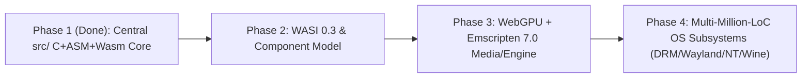

# Aphrody Native + WebAssembly Engineering Roadmap (`docs/native/ROADMAP.md`)

Generalist, tool-verified roadmap centered on [src](file:///C:/src/src) (Pure C `-std=gnu11` + Assembler + WebAssembly 3.0) and shared LLVM toolchains.

## Phase 1 — Central `src/` Core & Toolchain Validation (Completed 2026-11-14)

- Establish [src](file:///C:/src/src) (`arch/`, `kernel/`, `drivers/gpu/drm/`, `wayland/`, `nt/`, `wine/`, `wasm/`, `include/uapi/ay/`) as the central Layer-0 code tree.
- Fork and register 18 upstream `WebAssembly/*` and `emscripten-core/*` repositories in [forks.txt](file:///C:/src/third_party/forks.txt).
- Install and pin Binaryen `version_133`, WABT `1.0.42`, and WASI-SDK `34.0` alongside LLVM `clang` + `lld` + `wasm-ld`.
- Compile and validate `aysys.dll` (`7.6 KB`), `aysys.wasm` (`6.7 KB`, `v128` SIMD128), `ay-wasm-inspect.wasm` (`34.1 KB`, WASI-SDK 34), and `wayland.wasm` (`10.2 KB`) with `wasm-validate --enable-all` and [sys.test.ts](file:///C:/src/packages/core/test/sys.test.ts).
- Consolidate native specifications into [docs/native](file:///C:/src/docs/native) and purge 25+ redundant verbose docs.

## Phase 2 — WASI 0.3, `wasi-webgpu` & ThinLTO Build Acceleration

- Bind `WebAssembly/wasi-webgpu` WIT interfaces to [src/drivers/gpu/drm](file:///C:/src/src/drivers/gpu/drm) so identical C/WGSL compute & render passes run on Linux DRM/Mesa, Windows D3D12, and browser WebGPU.
- Migrate heavy utility logic out of slow procedural-macro Rust crates into `src/` C objects linked via LLVM ThinLTO (`-flto=thin`), shrinking cold CI compile times on `fr1`.

## Phase 3 — Emscripten 7.0.0 & Media/Creative Engine Pipeline

- Compile FFmpeg (`crates/tv-*` C codecs) and Wayland/WebGPU viewport clients with Emscripten `7.0.0` + JSPI (`WebAssembly/js-promise-integration`) + Shared-Everything Threads.
- Expose zero-copy linear-memory ringbuffers between `wayland.wasm`, WebGPU `OffscreenCanvas` workers, and native desktop hosts.

## Phase 4 — OS Compatibility Scaling (`src/{wayland,nt,wine}`)

- Expand `src/wayland/` (`wl_*`, `xcb_*`, `xwm_*`) and `src/nt/` + `src/wine/` (`nt_*`, `wine_*`) directly against upstream `wayland 1.26`, `xwayland 26.0.99`, and `wine` patches without language-wrapper overhead.
