# Graph Report - next.js

## Corpus Check
- **Nodes:** 197690 · **Edges:** 330475 · **Communities:** 19635
- **Extraction Engine:** 100% Native Tree-Sitter AST & Justfile Integration

## God Nodes (Most connected abstractions)
1. `react` [import] - 3766 connections (apps/bundle-analyzer/app/error.tsx:L4)
2. `Ok()` [function] - 3329 connections (crates/next-api/build.rs:L13)
3. `expect()` [function] - 2992 connections (evals/evals/agent-000-app-router-migration-simple/EVAL.ts:L21)
4. `it()` [function] - 2597 connections (examples/with-cypress/components/about-component.cy.tsx:L9-L19)
5. `describe()` [function] - 2160 connections (examples/with-cypress/components/about-component.cy.tsx:L8-L20)
6. `font-data.json` [file] - 1967 connections (packages/font/src/google/font-data.json:L1)
7. `e2e-utils` [import] - 1915 connections (test/development/acceptance/error-recovery.test.ts:L3)
8. `nextTestSetup()` [function] - 1897 connections (test/development/acceptance/error-recovery.test.ts:L9-L12)
9. `rspack-build-tests-manifest.json` [file] - 1627 connections (test/rspack-build-tests-manifest.json:L1)
10. `require()` [function] - 1582 connections (bench/fuzzponent/bin/fuzzponent.js:L2)
11. `Some()` [function] - 1574 connections (crates/next-api/src/additional_roots.rs:L284)
12. `rspack-dev-tests-manifest.json` [file] - 1557 connections (test/rspack-dev-tests-manifest.json:L1)

## Key Structural Connections
- `page.tsx` --[defines]--> `AnalyzePage` (Extracted)
- `page.tsx` --[imports]--> `@/components/analyzer` (Extracted)
- `page.tsx` --[defines]--> `ComparePage` (Extracted)
- `page.tsx` --[imports]--> `@/components/analyzer` (Extracted)
- `error.tsx` --[defines]--> `Error` (Extracted)
- `error.tsx` --[imports]--> `@/components/error-state` (Extracted)
- `error.tsx` --[imports]--> `react` (Extracted)
- `Error` --[calls]--> `useEffect()` (Inferred)
- `Error` --[calls]--> `console.error()` (Inferred)
- `layout.tsx` --[defines]--> `RootLayout` (Extracted)
- `layout.tsx` --[imports]--> `next` (Extracted)
- `layout.tsx` --[imports]--> `react` (Extracted)
- `layout.tsx` --[imports]--> `@/components/theme-provider` (Extracted)
- `layout.tsx` --[imports]--> `./globals.css` (Extracted)
- `page.tsx` --[defines]--> `HomePage` (Extracted)
- `page.tsx` --[imports]--> `@/components/route-summary` (Extracted)
- `analyzer.tsx` --[defines]--> `SingleAnalyzer` (Extracted)
- `analyzer.tsx` --[defines]--> `SingleAnalyzerController` (Extracted)
- `analyzer.tsx` --[defines]--> `CompareAnalyzer` (Extracted)
- `analyzer.tsx` --[defines]--> `CompareAnalyzerController` (Extracted)

## Architecture Diagram (Mermaid Preview)

```mermaid
flowchart TD
    file_AGENTS_md["AGENTS.md"]
    file_apps_bundle_analyzer_AGENTS_md["AGENTS.md"]
    file_apps_bundle_analyzer_app_analyze_page_tsx["page.tsx"]
    function_apps_bundle_analyzer_app_analyze_page_tsx_AnalyzePage["AnalyzePage"]
    mod___components_analyzer["@/components/analyzer"]
    file_apps_bundle_analyzer_app_compare_page_tsx["page.tsx"]
    function_apps_bundle_analyzer_app_compare_page_tsx_ComparePage["ComparePage"]
    file_apps_bundle_analyzer_app_error_tsx["error.tsx"]
    function_apps_bundle_analyzer_app_error_tsx_Error["Error"]
    mod___components_error_state["@/components/error-state"]
    mod_react["react"]
    fn_useEffect["useEffect"]
    fn_console_error["console.error"]
    file_apps_bundle_analyzer_app_globals_css["globals.css"]
    file_apps_bundle_analyzer_app_layout_tsx["layout.tsx"]
    function_apps_bundle_analyzer_app_layout_tsx_RootLayout["RootLayout"]
    mod_next["next"]
    mod___components_theme_provider["@/components/theme-provider"]
    mod___globals_css["./globals.css"]
    file_apps_bundle_analyzer_app_page_tsx["page.tsx"]
    function_apps_bundle_analyzer_app_page_tsx_HomePage["HomePage"]
    mod___components_route_summary["@/components/route-summary"]
    file_apps_bundle_analyzer_components_analyzer_tsx["analyzer.tsx"]
    function_apps_bundle_analyzer_components_analyzer_tsx_SingleAnalyzer["SingleAnalyzer"]
    function_apps_bundle_analyzer_components_analyzer_tsx_SingleAnalyzerController["SingleAnalyzerController"]
    function_apps_bundle_analyzer_components_analyzer_tsx_CompareAnalyzer["CompareAnalyzer"]
    function_apps_bundle_analyzer_components_analyzer_tsx_CompareAnalyzerController["CompareAnalyzerController"]
    function_apps_bundle_analyzer_components_analyzer_tsx_AnalyzerBoundary["AnalyzerBoundary"]
    function_apps_bundle_analyzer_components_analyzer_tsx_AnalyzerFallback["AnalyzerFallback"]
    function_apps_bundle_analyzer_components_analyzer_tsx_useAnalyzerModel["useAnalyzerModel"]
    type_apps_bundle_analyzer_components_analyzer_tsx_AnalyzerModel["AnalyzerModel"]
    function_apps_bundle_analyzer_components_analyzer_tsx_AnalyzerFrame["AnalyzerFrame"]
    function_apps_bundle_analyzer_components_analyzer_tsx_AnalyzerTopBar["AnalyzerTopBar"]
    function_apps_bundle_analyzer_components_analyzer_tsx_CompareAnalyzerView["CompareAnalyzerView"]
    function_apps_bundle_analyzer_components_analyzer_tsx_ValidComparison["ValidComparison"]
    file_apps_bundle_analyzer_app_analyze_page_tsx -->|defines| function_apps_bundle_analyzer_app_analyze_page_tsx_AnalyzePage
    file_apps_bundle_analyzer_app_analyze_page_tsx -->|imports| mod___components_analyzer
    file_apps_bundle_analyzer_app_compare_page_tsx -->|defines| function_apps_bundle_analyzer_app_compare_page_tsx_ComparePage
    file_apps_bundle_analyzer_app_compare_page_tsx -->|imports| mod___components_analyzer
    file_apps_bundle_analyzer_app_error_tsx -->|defines| function_apps_bundle_analyzer_app_error_tsx_Error
    file_apps_bundle_analyzer_app_error_tsx -->|imports| mod___components_error_state
    file_apps_bundle_analyzer_app_error_tsx -->|imports| mod_react
    function_apps_bundle_analyzer_app_error_tsx_Error -->|calls| fn_useEffect
    function_apps_bundle_analyzer_app_error_tsx_Error -->|calls| fn_console_error
    file_apps_bundle_analyzer_app_layout_tsx -->|defines| function_apps_bundle_analyzer_app_layout_tsx_RootLayout
    file_apps_bundle_analyzer_app_layout_tsx -->|imports| mod_next
    file_apps_bundle_analyzer_app_layout_tsx -->|imports| mod_react
    file_apps_bundle_analyzer_app_layout_tsx -->|imports| mod___components_theme_provider
    file_apps_bundle_analyzer_app_layout_tsx -->|imports| mod___globals_css
    file_apps_bundle_analyzer_app_page_tsx -->|defines| function_apps_bundle_analyzer_app_page_tsx_HomePage
    file_apps_bundle_analyzer_app_page_tsx -->|imports| mod___components_route_summary
    file_apps_bundle_analyzer_components_analyzer_tsx -->|defines| function_apps_bundle_analyzer_components_analyzer_tsx_SingleAnalyzer
    file_apps_bundle_analyzer_components_analyzer_tsx -->|defines| function_apps_bundle_analyzer_components_analyzer_tsx_SingleAnalyzerController
    file_apps_bundle_analyzer_components_analyzer_tsx -->|defines| function_apps_bundle_analyzer_components_analyzer_tsx_CompareAnalyzer
    file_apps_bundle_analyzer_components_analyzer_tsx -->|defines| function_apps_bundle_analyzer_components_analyzer_tsx_CompareAnalyzerController
    file_apps_bundle_analyzer_components_analyzer_tsx -->|defines| function_apps_bundle_analyzer_components_analyzer_tsx_AnalyzerBoundary
    file_apps_bundle_analyzer_components_analyzer_tsx -->|defines| function_apps_bundle_analyzer_components_analyzer_tsx_AnalyzerFallback
    file_apps_bundle_analyzer_components_analyzer_tsx -->|defines| function_apps_bundle_analyzer_components_analyzer_tsx_useAnalyzerModel
    file_apps_bundle_analyzer_components_analyzer_tsx -->|defines| type_apps_bundle_analyzer_components_analyzer_tsx_AnalyzerModel
    file_apps_bundle_analyzer_components_analyzer_tsx -->|defines| function_apps_bundle_analyzer_components_analyzer_tsx_AnalyzerFrame
    file_apps_bundle_analyzer_components_analyzer_tsx -->|defines| function_apps_bundle_analyzer_components_analyzer_tsx_AnalyzerTopBar
    file_apps_bundle_analyzer_components_analyzer_tsx -->|defines| function_apps_bundle_analyzer_components_analyzer_tsx_CompareAnalyzerView
    file_apps_bundle_analyzer_components_analyzer_tsx -->|defines| function_apps_bundle_analyzer_components_analyzer_tsx_ValidComparison
    file_apps_bundle_analyzer_components_analyzer_tsx -->|imports| mod_react
    function_apps_bundle_analyzer_components_analyzer_tsx_SingleAnalyzerController -->|calls| function_apps_bundle_analyzer_components_analyzer_tsx_useAnalyzerModel
    function_apps_bundle_analyzer_components_analyzer_tsx_CompareAnalyzerController -->|calls| function_apps_bundle_analyzer_components_analyzer_tsx_useAnalyzerModel
    function_apps_bundle_analyzer_components_analyzer_tsx_useAnalyzerModel -->|calls| fn_useEffect

```

