# Graph Report - auto

## Corpus Check
- **Nodes:** 15215 · **Edges:** 24824 · **Communities:** 663
- **Extraction Engine:** 100% Native Tree-Sitter AST & Justfile Integration

## God Nodes (Most connected abstractions)
1. `openapi.json` [file] - 911 connections (docs/openapi.json:L1)
2. `noeuds.ts` [file] - 322 connections (packages/automate/src/noeuds.ts:L1)
3. `__wbg_get_imports` [function] - 283 connections (apps/web/public/craft/word/wordcraft_web.js:L23-L3020)
4. `__wbg_get_imports` [function] - 280 connections (apps/web/public/craft/pdf/pdfcraft_web.js:L23-L2985)
5. `__wbg_get_imports` [function] - 278 connections (apps/web/public/craft/grid/gridcraft_web.js:L23-L2947)
6. `parcours.test.ts` [file] - 180 connections (apps/web/e2e/parcours.test.ts:L1)
7. `JSON.stringify()` [function] - 179 connections (packages/native/src/index.ts:L54)
8. `serveur.test.ts` [file] - 167 connections (apps/web/src/serveur.test.ts:L1)
9. `automatisations.test.ts` [file] - 135 connections (apps/api/src/automatisations.test.ts:L1)
10. `conformite.test.ts` [file] - 130 connections (apps/api/src/conformite.test.ts:L1)
11. `arrivages.test.ts` [file] - 129 connections (apps/api/src/modules/arrivages.test.ts:L1)
12. `automatisations.test.ts` [file] - 127 connections (apps/web/e2e/automatisations.test.ts:L1)

## Key Structural Connections
- `package.json` --[defines]--> `name` (Extracted)
- `package.json` --[defines]--> `version` (Extracted)
- `package.json` --[defines]--> `private` (Extracted)
- `package.json` --[defines]--> `license` (Extracted)
- `package.json` --[defines]--> `workspaces` (Extracted)
- `package.json` --[defines]--> `type` (Extracted)
- `package.json` --[defines]--> `scripts` (Extracted)
- `package.json` --[defines]--> `dev` (Extracted)
- `package.json` --[defines]--> `migrate` (Extracted)
- `package.json` --[defines]--> `worker` (Extracted)
- `package.json` --[defines]--> `openapi` (Extracted)
- `package.json` --[defines]--> `test` (Extracted)
- `package.json` --[defines]--> `check` (Extracted)
- `package.json` --[defines]--> `lint` (Extracted)
- `package.json` --[defines]--> `fmt` (Extracted)
- `package.json` --[defines]--> `n8n:provision` (Extracted)
- `package.json` --[defines]--> `e2e:n8n` (Extracted)
- `package.json` --[defines]--> `gates` (Extracted)
- `package.json` --[defines]--> `gates:rust` (Extracted)
- `package.json` --[defines]--> `craft:web` (Extracted)

## Architecture Diagram (Mermaid Preview)

```mermaid
flowchart TD
    file_bun_lock["bun.lock"]
    file_package_json["package.json"]
    constant_package_json_name["name"]
    constant_package_json_version["version"]
    constant_package_json_private["private"]
    constant_package_json_license["license"]
    constant_package_json_workspaces["workspaces"]
    constant_package_json_type["type"]
    constant_package_json_scripts["scripts"]
    constant_package_json_dev["dev"]
    constant_package_json_migrate["migrate"]
    constant_package_json_worker["worker"]
    constant_package_json_openapi["openapi"]
    constant_package_json_test["test"]
    constant_package_json_check["check"]
    constant_package_json_lint["lint"]
    constant_package_json_fmt["fmt"]
    constant_package_json_n8n_provision["n8n:provision"]
    constant_package_json_e2e_n8n["e2e:n8n"]
    constant_package_json_gates["gates"]
    constant_package_json_gates_rust["gates:rust"]
    constant_package_json_craft_web["craft:web"]
    constant_package_json_validate_facturx["validate:facturx"]
    constant_package_json_build_native["build:native"]
    constant_package_json_build_desktop["build:desktop"]
    constant_package_json_build_android["build:android"]
    constant_package_json_release_vps["release:vps"]
    constant_package_json_build_standalone["build:standalone"]
    constant_package_json_build_all["build:all"]
    constant_package_json_prod["prod"]
    constant_package_json_video_doctor["video:doctor"]
    constant_package_json_video_captures["video:captures"]
    constant_package_json_video_preparer["video:preparer"]
    constant_package_json_video_planches["video:planches"]
    constant_package_json_video_studio["video:studio"]
    file_package_json -->|defines| constant_package_json_name
    file_package_json -->|defines| constant_package_json_version
    file_package_json -->|defines| constant_package_json_private
    file_package_json -->|defines| constant_package_json_license
    file_package_json -->|defines| constant_package_json_workspaces
    file_package_json -->|defines| constant_package_json_type
    file_package_json -->|defines| constant_package_json_scripts
    file_package_json -->|defines| constant_package_json_dev
    file_package_json -->|defines| constant_package_json_migrate
    file_package_json -->|defines| constant_package_json_worker
    file_package_json -->|defines| constant_package_json_openapi
    file_package_json -->|defines| constant_package_json_test
    file_package_json -->|defines| constant_package_json_check
    file_package_json -->|defines| constant_package_json_lint
    file_package_json -->|defines| constant_package_json_fmt
    file_package_json -->|defines| constant_package_json_n8n_provision
    file_package_json -->|defines| constant_package_json_e2e_n8n
    file_package_json -->|defines| constant_package_json_gates
    file_package_json -->|defines| constant_package_json_gates_rust
    file_package_json -->|defines| constant_package_json_craft_web
    file_package_json -->|defines| constant_package_json_validate_facturx
    file_package_json -->|defines| constant_package_json_build_native
    file_package_json -->|defines| constant_package_json_build_desktop
    file_package_json -->|defines| constant_package_json_build_android
    file_package_json -->|defines| constant_package_json_release_vps
    file_package_json -->|defines| constant_package_json_build_standalone
    file_package_json -->|defines| constant_package_json_build_all
    file_package_json -->|defines| constant_package_json_prod
    file_package_json -->|defines| constant_package_json_video_doctor
    file_package_json -->|defines| constant_package_json_video_captures
    file_package_json -->|defines| constant_package_json_video_preparer
    file_package_json -->|defines| constant_package_json_video_planches
    file_package_json -->|defines| constant_package_json_video_studio

```

