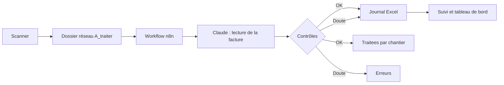

# Codebase Digest: auto

- Files analyzed: 657
- Total lines: 16068
- Total size: 1.04 MB
- Git branch: `main`
- Git HEAD commit: `2261394b (chore: commit pending work)`
- Digest mode: `AST-Smart Outline`

## Directory Structure

```text
auto/
├── .env.production.example (17 lines, 929 B, ~230 tokens)
├── AY_FIELD_TEST.md (17 lines, 3.6 KB, ~951 tokens)
├── CONTRIBUTING.md (15 lines, 833 B, ~218 tokens)
├── Cargo.toml (44 lines, 1.9 KB, ~547 tokens)
├── LICENSE (202 lines, 11.1 KB, ~2.6k tokens)
├── MIGRATION.md (182 lines, 16.4 KB, ~4.8k tokens)
├── NOTICE (4 lines, 95 B, ~24 tokens)
├── README.md (119 lines, 12.0 KB, ~3.1k tokens)
├── SECURITY.md (5 lines, 392 B, ~96 tokens)
├── UI_PLAN.md (42 lines, 5.7 KB, ~1.5k tokens)
├── apps/
│   ├── admin/
│   │   ├── package.json (19 lines, 581 B, ~222 tokens)
│   │   ├── public/
│   │   │   └── index.html (1 lines, 35 B, ~11 tokens)
│   │   └── src/
│   │       ├── console.css (1 lines, 35 B, ~11 tokens)
│   │       ├── console.tsx (21 lines, 891 B, ~257 tokens)
│   │       ├── index.ts (2 lines, 54 B, ~17 tokens)
│   │       ├── manquants.ts (1 lines, 34 B, ~10 tokens)
│   │       ├── serveur.test.ts (4 lines, 96 B, ~29 tokens)
│   │       └── serveur.ts (6 lines, 231 B, ~66 tokens)
│   ├── api/
│   │   ├── e2e/
│   │   │   └── n8n.ts (8 lines, 302 B, ~99 tokens)
│   │   ├── package.json (22 lines, 720 B, ~267 tokens)
│   │   └── src/
│   │       ├── admin.test.ts (5 lines, 216 B, ~66 tokens)
│   │       ├── app.test.ts (7 lines, 244 B, ~74 tokens)
│   │       ├── app.ts (34 lines, 1.0 KB, ~307 tokens)
│   │       ├── auth.test.ts (9 lines, 398 B, ~113 tokens)
│   │       ├── automatisations.test.ts (9 lines, 337 B, ~98 tokens)
│   │       ├── conformite.test.ts (9 lines, 263 B, ~79 tokens)
│   │       ├── connaissance.test.ts (10 lines, 444 B, ~129 tokens)
│   │       ├── devis-public.test.ts (7 lines, 247 B, ~74 tokens)
│   │       ├── encaissement.test.ts (5 lines, 187 B, ~57 tokens)
│   │       ├── gabarit.test.ts (8 lines, 324 B, ~95 tokens)
│   │       ├── imports.test.ts (6 lines, 177 B, ~54 tokens)
│   │       ├── index.ts (7 lines, 181 B, ~55 tokens)
│   │       ├── modules/
│   │       │   ├── abonnement.test.ts (8 lines, 282 B, ~86 tokens)
│   │       │   ├── abonnement.ts (25 lines, 1.2 KB, ~349 tokens)
│   │       │   ├── admin.ts (10 lines, 348 B, ~100 tokens)
│   │       │   ├── agents-admin.ts (5 lines, 116 B, ~36 tokens)
│   │       │   ├── appareil.test.ts (5 lines, 166 B, ~52 tokens)
│   │       │   ├── arrivages.test.ts (12 lines, 421 B, ~126 tokens)
│   │       │   ├── arrivages.ts (12 lines, 342 B, ~102 tokens)
│   │       │   ├── atelier.test.ts (7 lines, 269 B, ~82 tokens)
│   │       │   ├── atelier.ts (11 lines, 428 B, ~125 tokens)
│   │       │   ├── automatisations.ts (10 lines, 279 B, ~83 tokens)
│   │       │   ├── chantiers.test.ts (6 lines, 210 B, ~65 tokens)
│   │       │   ├── chantiers.ts (9 lines, 246 B, ~73 tokens)
│   │       │   ├── comptes.ts (10 lines, 285 B, ~85 tokens)
│   │       │   ├── conformite.ts (6 lines, 152 B, ~47 tokens)
│   │       │   ├── courrier.test.ts (6 lines, 212 B, ~65 tokens)
│   │       │   ├── courrier.ts (7 lines, 172 B, ~52 tokens)
│   │       │   ├── devis-public.ts (10 lines, 285 B, ~86 tokens)
│   │       │   ├── encaissement.ts (11 lines, 374 B, ~109 tokens)
│   │       │   ├── gabarit.ts (6 lines, 169 B, ~51 tokens)
│   │       │   ├── imports-fichiers.test.ts (14 lines, 470 B, ~139 tokens)
│   │       │   ├── imports-fichiers.ts (9 lines, 272 B, ~84 tokens)
│   │       │   ├── imports.ts (10 lines, 277 B, ~83 tokens)
│   │       │   ├── ingest.test.ts (9 lines, 381 B, ~112 tokens)
│   │       │   ├── ingest.ts (7 lines, 176 B, ~54 tokens)
│   │       │   ├── mail.test.ts (7 lines, 213 B, ~66 tokens)
│   │       │   ├── mail.ts (7 lines, 172 B, ~53 tokens)
│   │       │   ├── pa.test.ts (8 lines, 294 B, ~88 tokens)
│   │       │   ├── pa.ts (8 lines, 192 B, ~60 tokens)
│   │       │   └── webhooks.ts (7 lines, 178 B, ~54 tokens)
│   │       ├── modules.ts (8 lines, 318 B, ~93 tokens)
│   │       ├── observabilite.ts (11 lines, 522 B, ~145 tokens)
│   │       ├── openapi-outils.ts (5 lines, 161 B, ~50 tokens)
│   │       ├── openapi.test.ts (6 lines, 136 B, ~42 tokens)
│   │       ├── openapi.ts (7 lines, 259 B, ~73 tokens)
│   │       └── workflows.test.ts (6 lines, 184 B, ~55 tokens)
│   ├── cli/
│   │   ├── package.json (16 lines, 517 B, ~189 tokens)
│   │   └── src/
│   │       ├── cli.ts (5 lines, 197 B, ~61 tokens)
│   │       └── mcp.test.ts (5 lines, 179 B, ~54 tokens)
│   ├── desktop/
│   │   ├── package.json (10 lines, 373 B, ~129 tokens)
│   │   └── src-tauri/
│   │       ├── Cargo.toml (34 lines, 842 B, ~254 tokens)
│   │       ├── build.rs (2 lines, 54 B, ~19 tokens)
│   │       ├── capabilities/
│   │       │   └── default.json (6 lines, 304 B, ~93 tokens)
│   │       ├── examples/
│   │       │   ├── qualifier_updater.manifest (5 lines, 494 B, ~141 tokens)
│   │       │   └── qualifier_updater.rs (5 lines, 119 B, ~37 tokens)
│   │       ├── src/
│   │       │   ├── lib.rs (17 lines, 648 B, ~188 tokens)
│   │       │   ├── main.rs (2 lines, 54 B, ~19 tokens)
│   │       │   └── mise_a_jour.rs (7 lines, 305 B, ~84 tokens)
│   │       └── tauri.conf.json (32 lines, 1.3 KB, ~410 tokens)
│   ├── extension/
│   │   ├── CHROMEWEBSTORE.md (138 lines, 11.7 KB, ~2.9k tokens)
│   │   ├── e2e/
│   │   │   └── extension.test.ts (11 lines, 349 B, ~103 tokens)
│   │   ├── package.json (17 lines, 571 B, ~204 tokens)
│   │   ├── scripts/
│   │   │   ├── captures.ts (7 lines, 192 B, ~56 tokens)
│   │   │   ├── construire.test.ts (3 lines, 77 B, ~23 tokens)
│   │   │   └── construire.ts (3 lines, 101 B, ~31 tokens)
│   │   ├── src/
│   │   │   ├── lib.test.ts (3 lines, 70 B, ~22 tokens)
│   │   │   ├── lib.ts (9 lines, 534 B, ~145 tokens)
│   │   │   ├── popup.ts (4 lines, 179 B, ~50 tokens)
│   │   │   └── service-worker.ts (6 lines, 295 B, ~83 tokens)
│   │   └── static/
│   │       ├── manifest.json (27 lines, 1.1 KB, ~372 tokens)
│   │       ├── popup.css (1 lines, 36 B, ~11 tokens)
│   │       └── popup.html (1 lines, 35 B, ~11 tokens)
│   ├── plugin/
│   │   ├── package.json (8 lines, 216 B, ~81 tokens)
│   │   ├── plugin.test.ts (2 lines, 54 B, ~17 tokens)
│   │   └── skills/
│   │       └── auto/
│   │           └── SKILL.md (36 lines, 2.6 KB, ~679 tokens)
│   ├── standalone/
│   │   ├── DISTRIBUTION.txt (59 lines, 2.9 KB, ~706 tokens)
│   │   ├── package.json (13 lines, 415 B, ~152 tokens)
│   │   └── src/
│   │       └── index.ts (2 lines, 62 B, ~18 tokens)
│   ├── web/
│   │   ├── e2e/
│   │   │   ├── accessibilite.test.ts (12 lines, 343 B, ~104 tokens)
│   │   │   ├── accueil.test.ts (6 lines, 144 B, ~44 tokens)
│   │   │   ├── appareil.test.ts (3 lines, 74 B, ~23 tokens)
│   │   │   ├── arrivages.test.ts (8 lines, 180 B, ~56 tokens)
│   │   │   ├── audit.ts (2 lines, 75 B, ~23 tokens)
│   │   │   ├── auth.test.ts (4 lines, 99 B, ~30 tokens)
│   │   │   ├── automatisations.test.ts (7 lines, 157 B, ~48 tokens)
│   │   │   ├── chantiers.test.ts (5 lines, 115 B, ~36 tokens)
│   │   │   ├── courrier.test.ts (4 lines, 97 B, ~30 tokens)
│   │   │   ├── craft-qualification.ts (3 lines, 77 B, ~23 tokens)
│   │   │   ├── devis-en-ligne.test.ts (4 lines, 92 B, ~29 tokens)
│   │   │   ├── equipe-sessions.test.ts (4 lines, 99 B, ~30 tokens)
│   │   │   ├── import-fichiers.test.ts (7 lines, 166 B, ~50 tokens)
│   │   │   ├── navigation.test.ts (3 lines, 74 B, ~23 tokens)
│   │   │   ├── paiement-en-ligne.test.ts (4 lines, 93 B, ~29 tokens)
│   │   │   ├── paiement-relance.test.ts (3 lines, 74 B, ~23 tokens)
│   │   │   ├── parcours-reel.ts (7 lines, 187 B, ~56 tokens)
│   │   │   ├── parcours.test.ts (10 lines, 253 B, ~78 tokens)
│   │   │   ├── publiques.test.ts (4 lines, 93 B, ~29 tokens)
│   │   │   ├── recues.test.ts (13 lines, 544 B, ~156 tokens)
│   │   │   ├── support.ts (10 lines, 320 B, ~95 tokens)
│   │   │   └── windows-local-reel.ts (7 lines, 230 B, ~70 tokens)
│   │   ├── package.json (43 lines, 1.5 KB, ~602 tokens)
│   │   ├── public/
│   │   │   ├── app.html (1 lines, 35 B, ~11 tokens)
│   │   │   ├── brands/
│   │   │   │   └── README.md (8 lines, 836 B, ~211 tokens)
│   │   │   ├── confidentialite.html (1 lines, 36 B, ~11 tokens)
│   │   │   ├── craft/
│   │   │   │   ├── grid/
│   │   │   │   │   ├── auto-start.js (2 lines, 63 B, ~19 tokens)
│   │   │   │   │   ├── gridcraft_web.js (44 lines, 2.4 KB, ~616 tokens)
│   │   │   │   │   ├── index.html (1 lines, 35 B, ~11 tokens)
│   │   │   │   │   ├── licenses/
│   │   │   │   │   │   ├── fonts/
│   │   │   │   │   │   │   ├── biz-ud-mincho/
│   │   │   │   │   │   │   │   └── OFL.txt (93 lines, 4.3 KB, ~1.1k tokens)
│   │   │   │   │   │   │   ├── biz-ud-pgothic/
│   │   │   │   │   │   │   │   └── OFL.txt (93 lines, 4.3 KB, ~1.1k tokens)
│   │   │   │   │   │   │   ├── latin-manifest.txt (4 lines, 776 B, ~185 tokens)
│   │   │   │   │   │   │   ├── manifest.txt (11 lines, 2.4 KB, ~595 tokens)
│   │   │   │   │   │   │   ├── noto-sans-arabic/
│   │   │   │   │   │   │   │   └── OFL.txt (93 lines, 4.3 KB, ~1.1k tokens)
│   │   │   │   │   │   │   ├── noto-sans-cjk-sc/
│   │   │   │   │   │   │   │   └── OFL.txt (92 lines, 4.2 KB, ~1.1k tokens)
│   │   │   │   │   │   │   ├── noto-sans-thai/
│   │   │   │   │   │   │   │   └── OFL.txt (93 lines, 4.3 KB, ~1.1k tokens)
│   │   │   │   │   │   │   └── shippori-mincho/
│   │   │   │   │   │   │       └── OFL.txt (93 lines, 4.3 KB, ~1.1k tokens)
│   │   │   │   │   │   └── packages/
│   │   │   │   │   │       └── m3-fonts/
│   │   │   │   │   │           └── fonts/
│   │   │   │   │   │               ├── RobotoFlex-OFL.txt (93 lines, 4.3 KB, ~1.1k tokens)
│   │   │   │   │   │               └── RobotoMono-OFL.txt (93 lines, 4.3 KB, ~1.1k tokens)
│   │   │   │   │   └── theme.css (1 lines, 36 B, ~11 tokens)
│   │   │   │   ├── manifest.json (166 lines, 8.0 KB, ~2.2k tokens)
│   │   │   │   ├── pdf/
│   │   │   │   │   ├── auto-start.js (2 lines, 62 B, ~19 tokens)
│   │   │   │   │   ├── index.html (1 lines, 35 B, ~11 tokens)
│   │   │   │   │   ├── licenses/
│   │   │   │   │   │   ├── fonts/
│   │   │   │   │   │   │   ├── biz-ud-mincho/
│   │   │   │   │   │   │   │   └── OFL.txt (93 lines, 4.3 KB, ~1.1k tokens)
│   │   │   │   │   │   │   ├── biz-ud-pgothic/
│   │   │   │   │   │   │   │   └── OFL.txt (93 lines, 4.3 KB, ~1.1k tokens)
│   │   │   │   │   │   │   ├── latin-manifest.txt (4 lines, 776 B, ~185 tokens)
│   │   │   │   │   │   │   ├── manifest.txt (11 lines, 2.4 KB, ~595 tokens)
│   │   │   │   │   │   │   ├── noto-sans-arabic/
│   │   │   │   │   │   │   │   └── OFL.txt (93 lines, 4.3 KB, ~1.1k tokens)
│   │   │   │   │   │   │   ├── noto-sans-cjk-sc/
│   │   │   │   │   │   │   │   └── OFL.txt (92 lines, 4.2 KB, ~1.1k tokens)
│   │   │   │   │   │   │   ├── noto-sans-thai/
│   │   │   │   │   │   │   │   └── OFL.txt (93 lines, 4.3 KB, ~1.1k tokens)
│   │   │   │   │   │   │   └── shippori-mincho/
│   │   │   │   │   │   │       └── OFL.txt (93 lines, 4.3 KB, ~1.1k tokens)
│   │   │   │   │   │   └── packages/
│   │   │   │   │   │       └── m3-fonts/
│   │   │   │   │   │           └── fonts/
│   │   │   │   │   │               ├── RobotoFlex-OFL.txt (93 lines, 4.3 KB, ~1.1k tokens)
│   │   │   │   │   │               └── RobotoMono-OFL.txt (93 lines, 4.3 KB, ~1.1k tokens)
│   │   │   │   │   ├── pdfcraft_web.js (44 lines, 2.4 KB, ~617 tokens)
│   │   │   │   │   └── theme.css (1 lines, 36 B, ~11 tokens)
│   │   │   │   └── word/
│   │   │   │       ├── auto-start.js (2 lines, 63 B, ~19 tokens)
│   │   │   │       ├── index.html (1 lines, 35 B, ~11 tokens)
│   │   │   │       ├── licenses/
│   │   │   │       │   ├── fonts/
│   │   │   │       │   │   ├── biz-ud-mincho/
│   │   │   │       │   │   │   └── OFL.txt (93 lines, 4.3 KB, ~1.1k tokens)
│   │   │   │       │   │   ├── biz-ud-pgothic/
│   │   │   │       │   │   │   └── OFL.txt (93 lines, 4.3 KB, ~1.1k tokens)
│   │   │   │       │   │   ├── latin-manifest.txt (4 lines, 776 B, ~185 tokens)
│   │   │   │       │   │   ├── manifest.txt (11 lines, 2.4 KB, ~595 tokens)
│   │   │   │       │   │   ├── noto-sans-arabic/
│   │   │   │       │   │   │   └── OFL.txt (93 lines, 4.3 KB, ~1.1k tokens)
│   │   │   │       │   │   ├── noto-sans-cjk-sc/
│   │   │   │       │   │   │   └── OFL.txt (92 lines, 4.2 KB, ~1.1k tokens)
│   │   │   │       │   │   ├── noto-sans-thai/
│   │   │   │       │   │   │   └── OFL.txt (93 lines, 4.3 KB, ~1.1k tokens)
│   │   │   │       │   │   └── shippori-mincho/
│   │   │   │       │   │       └── OFL.txt (93 lines, 4.3 KB, ~1.1k tokens)
│   │   │   │       │   └── packages/
│   │   │   │       │       └── m3-fonts/
│   │   │   │       │           └── fonts/
│   │   │   │       │               ├── RobotoFlex-OFL.txt (93 lines, 4.3 KB, ~1.1k tokens)
│   │   │   │       │               └── RobotoMono-OFL.txt (93 lines, 4.3 KB, ~1.1k tokens)
│   │   │   │       ├── theme.css (1 lines, 36 B, ~11 tokens)
│   │   │   │       └── wordcraft_web.js (46 lines, 2.5 KB, ~652 tokens)
│   │   │   ├── devis.html (1 lines, 36 B, ~11 tokens)
│   │   │   ├── facture.html (1 lines, 36 B, ~11 tokens)
│   │   │   ├── index.html (1 lines, 35 B, ~11 tokens)
│   │   │   ├── mentions-legales.html (1 lines, 35 B, ~11 tokens)
│   │   │   ├── tarifs.html (1 lines, 36 B, ~11 tokens)
│   │   │   └── telechargements.html (1 lines, 36 B, ~11 tokens)
│   │   ├── scripts/
│   │   │   ├── icones.ts (2 lines, 55 B, ~17 tokens)
│   │   │   ├── images.ts (5 lines, 114 B, ~35 tokens)
│   │   │   └── vitrine.ts (14 lines, 591 B, ~176 tokens)
│   │   └── src/
│   │       ├── client/
│   │       │   ├── api.test.ts (6 lines, 192 B, ~58 tokens)
│   │       │   ├── app.tsx (18 lines, 503 B, ~150 tokens)
│   │       │   ├── auth.ts (9 lines, 348 B, ~101 tokens)
│   │       │   ├── craft-bridge.test.ts (3 lines, 79 B, ~24 tokens)
│   │       │   ├── craft-bridge.ts (3 lines, 99 B, ~29 tokens)
│   │       │   ├── ecrans/
│   │       │   │   ├── absences.tsx (11 lines, 369 B, ~113 tokens)
│   │       │   │   ├── administration.tsx (7 lines, 291 B, ~90 tokens)
│   │       │   │   ├── affectations.tsx (9 lines, 295 B, ~83 tokens)
│   │       │   │   ├── appareil.tsx (10 lines, 391 B, ~109 tokens)
│   │       │   │   ├── arrivages.tsx (15 lines, 461 B, ~133 tokens)
│   │       │   │   ├── atelier.tsx (14 lines, 413 B, ~123 tokens)
│   │       │   │   ├── automatisations/
│   │       │   │   │   ├── champs.tsx (22 lines, 804 B, ~227 tokens)
│   │       │   │   │   ├── commun.tsx (12 lines, 505 B, ~146 tokens)
│   │       │   │   │   ├── editeur.tsx (28 lines, 900 B, ~260 tokens)
│   │       │   │   │   ├── executions.tsx (11 lines, 317 B, ~94 tokens)
│   │       │   │   │   ├── formulaire.test.ts (5 lines, 126 B, ~38 tokens)
│   │       │   │   │   ├── formulaire.ts (13 lines, 740 B, ~201 tokens)
│   │       │   │   │   ├── graphe.test.ts (6 lines, 142 B, ~43 tokens)
│   │       │   │   │   ├── graphe.ts (23 lines, 1.5 KB, ~414 tokens)
│   │       │   │   │   ├── liste.tsx (26 lines, 974 B, ~281 tokens)
│   │       │   │   │   ├── noeud.tsx (7 lines, 173 B, ~51 tokens)
│   │       │   │   │   ├── palette.tsx (9 lines, 310 B, ~89 tokens)
│   │       │   │   │   └── panneau.tsx (16 lines, 462 B, ~137 tokens)
│   │       │   │   ├── autorisation.tsx (9 lines, 255 B, ~77 tokens)
│   │       │   │   ├── chantiers.tsx (20 lines, 703 B, ~196 tokens)
│   │       │   │   ├── clients.tsx (13 lines, 441 B, ~129 tokens)
│   │       │   │   ├── connexion.tsx (18 lines, 611 B, ~179 tokens)
│   │       │   │   ├── courrier.tsx (13 lines, 516 B, ~154 tokens)
│   │       │   │   ├── detail.tsx (15 lines, 504 B, ~149 tokens)
│   │       │   │   ├── editeur-craft.tsx (14 lines, 409 B, ~121 tokens)
│   │       │   │   ├── editeur.tsx (14 lines, 523 B, ~150 tokens)
│   │       │   │   ├── employes.tsx (16 lines, 537 B, ~152 tokens)
│   │       │   │   ├── equipe.tsx (16 lines, 552 B, ~167 tokens)
│   │       │   │   ├── exports.tsx (9 lines, 237 B, ~73 tokens)
│   │       │   │   ├── import-fichiers.tsx (17 lines, 714 B, ~202 tokens)
│   │       │   │   ├── imports.tsx (11 lines, 376 B, ~112 tokens)
│   │       │   │   ├── invitation.tsx (10 lines, 295 B, ~87 tokens)
│   │       │   │   ├── liste.tsx (12 lines, 416 B, ~122 tokens)
│   │       │   │   ├── logo-fournisseur.tsx (3 lines, 100 B, ~29 tokens)
│   │       │   │   ├── marque.tsx (3 lines, 92 B, ~29 tokens)
│   │       │   │   ├── onboarding.tsx (13 lines, 399 B, ~118 tokens)
│   │       │   │   ├── parametres.tsx (18 lines, 590 B, ~174 tokens)
│   │       │   │   ├── pieces-chantier.tsx (13 lines, 397 B, ~115 tokens)
│   │       │   │   ├── plateforme-agreee.tsx (7 lines, 232 B, ~67 tokens)
│   │       │   │   ├── produits.tsx (11 lines, 324 B, ~96 tokens)
│   │       │   │   ├── recherche-gestion.tsx (6 lines, 169 B, ~50 tokens)
│   │       │   │   ├── recues.tsx (12 lines, 384 B, ~117 tokens)
│   │       │   │   ├── revue-devis.tsx (13 lines, 505 B, ~152 tokens)
│   │       │   │   ├── securite.tsx (20 lines, 683 B, ~202 tokens)
│   │       │   │   └── tableau.tsx (10 lines, 268 B, ~83 tokens)
│   │       │   ├── import-fichiers.test.ts (4 lines, 126 B, ~38 tokens)
│   │       │   ├── import-fichiers.ts (5 lines, 331 B, ~87 tokens)
│   │       │   ├── main.tsx (4 lines, 102 B, ~32 tokens)
│   │       │   └── session.tsx (6 lines, 176 B, ~52 tokens)
│   │       ├── construction.tsx (11 lines, 489 B, ~136 tokens)
│   │       ├── craft.test.ts (6 lines, 137 B, ~43 tokens)
│   │       ├── craft.ts (4 lines, 147 B, ~41 tokens)
│   │       ├── distributions.test.ts (3 lines, 81 B, ~24 tokens)
│   │       ├── distributions.ts (8 lines, 388 B, ~104 tokens)
│   │       ├── fichier-public.test.ts (3 lines, 81 B, ~25 tokens)
│   │       ├── fichier-public.ts (3 lines, 115 B, ~32 tokens)
│   │       ├── index.ts (3 lines, 92 B, ~28 tokens)
│   │       ├── polices.ts (10 lines, 410 B, ~116 tokens)
│   │       ├── securite.ts (7 lines, 482 B, ~131 tokens)
│   │       ├── serveur.test.ts (11 lines, 290 B, ~90 tokens)
│   │       ├── serveur.ts (29 lines, 1.1 KB, ~312 tokens)
│   │       ├── site/
│   │       │   ├── accueil-client.tsx (6 lines, 137 B, ~43 tokens)
│   │       │   ├── accueil-ilots.ts (3 lines, 69 B, ~22 tokens)
│   │       │   ├── accueil.tsx (14 lines, 439 B, ~132 tokens)
│   │       │   ├── bac-a-sable.tsx (13 lines, 513 B, ~148 tokens)
│   │       │   ├── devis.ts (5 lines, 153 B, ~47 tokens)
│   │       │   ├── facture.ts (5 lines, 152 B, ~47 tokens)
│   │       │   ├── icones.gen.ts (1 lines, 35 B, ~11 tokens)
│   │       │   ├── ilots.ts (4 lines, 194 B, ~54 tokens)
│   │       │   ├── images.gen.ts (1 lines, 35 B, ~11 tokens)
│   │       │   ├── medias.tsx (6 lines, 152 B, ~47 tokens)
│   │       │   ├── parcours.tsx (4 lines, 127 B, ~38 tokens)
│   │       │   ├── site.ts (1 lines, 35 B, ~11 tokens)
│   │       │   └── telechargements.ts (5 lines, 213 B, ~61 tokens)
│   │       └── styles/
│   │           ├── accueil.css (1 lines, 37 B, ~11 tokens)
│   │           ├── app.css (1 lines, 36 B, ~11 tokens)
│   │           ├── atelier.css (1 lines, 35 B, ~11 tokens)
│   │           ├── automatisations.css (1 lines, 37 B, ~11 tokens)
│   │           ├── chantiers.css (1 lines, 35 B, ~11 tokens)
│   │           ├── courrier.css (1 lines, 36 B, ~11 tokens)
│   │           ├── import-fichiers.css (1 lines, 35 B, ~11 tokens)
│   │           ├── responsive.css (1 lines, 35 B, ~11 tokens)
│   │           ├── site.css (1 lines, 36 B, ~11 tokens)
│   │           └── telechargements.css (1 lines, 36 B, ~11 tokens)
│   └── worker/
│       ├── package.json (18 lines, 585 B, ~210 tokens)
│       └── src/
│           ├── automatisations.test.ts (8 lines, 249 B, ~75 tokens)
│           ├── automatisations.ts (9 lines, 446 B, ~125 tokens)
│           ├── expediteur.test.ts (7 lines, 185 B, ~56 tokens)
│           ├── expediteur.ts (11 lines, 406 B, ~119 tokens)
│           ├── index.ts (8 lines, 215 B, ~62 tokens)
│           ├── pa-synchro.test.ts (8 lines, 296 B, ~90 tokens)
│           ├── planification.test.ts (7 lines, 169 B, ~51 tokens)
│           ├── planification.ts (27 lines, 1.3 KB, ~373 tokens)
│           ├── relances-mail.test.ts (9 lines, 335 B, ~101 tokens)
│           ├── webhooks.test.ts (8 lines, 290 B, ~88 tokens)
│           ├── worker.test.ts (5 lines, 125 B, ~39 tokens)
│           └── worker.ts (12 lines, 519 B, ~147 tokens)
├── box/
│   ├── Caddyfile (28 lines, 439 B, ~124 tokens)
│   ├── README.md (89 lines, 5.5 KB, ~1.5k tokens)
│   ├── compose.gpu.yaml (11 lines, 346 B, ~80 tokens)
│   ├── compose.yaml (262 lines, 8.3 KB, ~2.2k tokens)
│   ├── console/
│   │   ├── Cargo.toml (90 lines, 2.4 KB, ~775 tokens)
│   │   ├── Dockerfile (1 lines, 35 B, ~11 tokens)
│   │   ├── public/
│   │   │   └── robots.txt (2 lines, 26 B, ~8 tokens)
│   │   ├── src/
│   │   │   ├── app.rs (45 lines, 2.3 KB, ~656 tokens)
│   │   │   ├── lib.rs (5 lines, 131 B, ~43 tokens)
│   │   │   ├── main.rs (12 lines, 308 B, ~92 tokens)
│   │   │   ├── serveur/
│   │   │   │   ├── docker.rs (24 lines, 1.1 KB, ~346 tokens)
│   │   │   │   ├── mod.rs (16 lines, 508 B, ~163 tokens)
│   │   │   │   ├── ollama.rs (21 lines, 821 B, ~250 tokens)
│   │   │   │   ├── preparer.rs (22 lines, 975 B, ~302 tokens)
│   │   │   │   ├── services.rs (12 lines, 465 B, ~146 tokens)
│   │   │   │   └── session.rs (23 lines, 823 B, ~261 tokens)
│   │   │   └── types.rs (17 lines, 560 B, ~168 tokens)
│   │   └── style/
│   │       └── console.css (1 lines, 36 B, ~11 tokens)
│   ├── initdb/
│   │   └── 01-n8n.sql (2 lines, 127 B, ~33 tokens)
│   ├── installer.ps1 (58 lines, 3.0 KB, ~898 tokens)
│   └── installer.sh (3 lines, 64 B, ~22 tokens)
├── bun.lock (680 lines, 54.3 KB, ~17.3k tokens)
├── bunfig.toml (8 lines, 390 B, ~116 tokens)
├── compose.production.yaml (90 lines, 2.3 KB, ~628 tokens)
├── compose.yaml (123 lines, 4.1 KB, ~1.1k tokens)
├── crates/
│   ├── auto-connaissance/
│   │   ├── Cargo.toml (12 lines, 367 B, ~95 tokens)
│   │   └── src/
│   │       └── lib.rs (13 lines, 486 B, ~138 tokens)
│   ├── auto-docs/
│   │   ├── Cargo.toml (21 lines, 595 B, ~164 tokens)
│   │   ├── examples/
│   │   │   └── apercu.rs (3 lines, 78 B, ~24 tokens)
│   │   ├── src/
│   │   │   └── lib.rs (25 lines, 1.2 KB, ~398 tokens)
│   │   └── tests/
│   │       └── rendu.rs (12 lines, 499 B, ~139 tokens)
│   ├── auto-facturx/
│   │   ├── Cargo.toml (16 lines, 428 B, ~120 tokens)
│   │   ├── examples/
│   │   │   └── echantillons.rs (4 lines, 167 B, ~52 tokens)
│   │   ├── src/
│   │   │   ├── cii.rs (20 lines, 901 B, ~295 tokens)
│   │   │   ├── lib.rs (8 lines, 253 B, ~79 tokens)
│   │   │   └── pdf.rs (10 lines, 482 B, ~148 tokens)
│   │   └── tests/
│   │       └── facturx.rs (11 lines, 392 B, ~112 tokens)
│   ├── auto-ffi/
│   │   ├── Cargo.toml (20 lines, 653 B, ~195 tokens)
│   │   └── src/
│   │       └── lib.rs (24 lines, 1.1 KB, ~379 tokens)
│   ├── auto-fichiers/
│   │   ├── Cargo.toml (28 lines, 861 B, ~231 tokens)
│   │   └── src/
│   │       ├── caviardage.rs (23 lines, 835 B, ~264 tokens)
│   │       ├── lib.rs (49 lines, 2.2 KB, ~712 tokens)
│   │       ├── presentation.rs (24 lines, 966 B, ~278 tokens)
│   │       └── signature.rs (15 lines, 567 B, ~174 tokens)
│   ├── auto-modele/
│   │   ├── Cargo.toml (11 lines, 290 B, ~78 tokens)
│   │   └── src/
│   │       └── lib.rs (35 lines, 1.3 KB, ~426 tokens)
│   └── auto-sheets/
│       ├── Cargo.toml (16 lines, 446 B, ~119 tokens)
│       ├── examples/
│       │   └── exemple.rs (2 lines, 56 B, ~19 tokens)
│       ├── src/
│       │   └── lib.rs (22 lines, 924 B, ~270 tokens)
│       └── tests/
│           └── tableur.rs (6 lines, 197 B, ~58 tokens)
├── docker/
│   ├── app-maj.Dockerfile (16 lines, 721 B, ~190 tokens)
│   ├── app.Dockerfile (87 lines, 4.3 KB, ~1.2k tokens)
│   ├── auto-ia-tunnel.service (16 lines, 549 B, ~156 tokens)
│   ├── desktop.Dockerfile (9 lines, 545 B, ~154 tokens)
│   ├── llm.Dockerfile (29 lines, 1.5 KB, ~467 tokens)
│   └── rust.Dockerfile (6 lines, 234 B, ~72 tokens)
├── docs/
│   ├── AGENT.md (121 lines, 7.7 KB, ~2.2k tokens)
│   ├── APPAREILS.md (46 lines, 3.5 KB, ~878 tokens)
│   ├── ARCHITECTURE.md (203 lines, 19.2 KB, ~5.0k tokens)
│   ├── ARRIVAGES.md (110 lines, 6.6 KB, ~1.6k tokens)
│   ├── AUTH.md (209 lines, 23.5 KB, ~6.0k tokens)
│   ├── AUTOMATISATIONS.md (166 lines, 18.4 KB, ~5.0k tokens)
│   ├── CAHIER-DES-CHARGES-AUDIO.md (35 lines, 3.5 KB, ~844 tokens)
│   ├── CHANTIERS.md (116 lines, 8.6 KB, ~2.1k tokens)
│   ├── CONCURRENTS.md (113 lines, 25.9 KB, ~6.1k tokens)
│   ├── COURRIER.md (111 lines, 7.9 KB, ~1.9k tokens)
│   ├── CRAFT.md (41 lines, 4.9 KB, ~1.2k tokens)
│   ├── DEPLOIEMENT.md (126 lines, 10.5 KB, ~2.8k tokens)
│   ├── DISTRIBUTION.md (127 lines, 15.4 KB, ~3.8k tokens)
│   ├── MAIL.md (149 lines, 11.1 KB, ~3.1k tokens)
│   ├── N8N.md (74 lines, 4.4 KB, ~1.2k tokens)
│   ├── OPEN-SOURCE.md (55 lines, 5.5 KB, ~1.4k tokens)
│   ├── PA.md (103 lines, 11.4 KB, ~2.9k tokens)
│   ├── PRODUCTION.md (276 lines, 20.5 KB, ~5.1k tokens)
│   ├── RESEND.md (75 lines, 4.4 KB, ~1.2k tokens)
│   ├── STACK.md (55 lines, 8.8 KB, ~2.3k tokens)
│   ├── STRIPE.md (154 lines, 10.7 KB, ~2.8k tokens)
│   ├── SUITE.md (101 lines, 11.8 KB, ~3.1k tokens)
│   ├── TARIFS.md (52 lines, 3.2 KB, ~902 tokens)
│   ├── UI.md (162 lines, 13.4 KB, ~3.5k tokens)
│   ├── VIDEO.md (98 lines, 10.4 KB, ~2.6k tokens)
│   ├── WINDOWS-LOCAL.md (49 lines, 4.6 KB, ~1.1k tokens)
│   ├── conformite/
│   │   ├── README.md (47 lines, 4.0 KB, ~1.0k tokens)
│   │   ├── cgu.md (62 lines, 2.8 KB, ~689 tokens)
│   │   ├── cgv.md (56 lines, 2.2 KB, ~574 tokens)
│   │   ├── dpa.md (73 lines, 3.8 KB, ~971 tokens)
│   │   ├── mentions-legales.md (32 lines, 1.1 KB, ~301 tokens)
│   │   ├── politique-confidentialite.md (49 lines, 2.8 KB, ~720 tokens)
│   │   ├── registre-traitements.md (88 lines, 6.9 KB, ~1.8k tokens)
│   │   └── sous-traitants.md (21 lines, 2.0 KB, ~565 tokens)
│   ├── design/
│   │   └── DESIGN-SYSTEM.md (114 lines, 10.2 KB, ~2.7k tokens)
│   ├── modeles/
│   │   └── automatisation-factures/
│   │       ├── README.md (72 lines, 4.4 KB, ~1.2k tokens)
│   │       ├── guides/
│   │       │   ├── GUIDE_MISE_EN_SERVICE.md (54 lines, 3.9 KB, ~1.1k tokens)
│   │       │   └── GUIDE_SIMPLE.html (1 lines, 36 B, ~11 tokens)
│   │       ├── outils/
│   │       │   ├── creer_classeur.py (16 lines, 607 B, ~174 tokens)
│   │       │   ├── creer_video.py (21 lines, 802 B, ~281 tokens)
│   │       │   ├── creer_workflow.py (8 lines, 284 B, ~94 tokens)
│   │       │   └── workflow.test.ts (3 lines, 96 B, ~30 tokens)
│   │       └── workflow/
│   │           └── Workflow_n8n_Factures_Fournisseurs.json (390 lines, 14.8 KB, ~4.9k tokens)
│   └── recon/
│       ├── README.md (19 lines, 3.6 KB, ~899 tokens)
│       ├── avis.md (140 lines, 21.2 KB, ~5.3k tokens)
│       ├── features.csv (44 lines, 3.0 KB, ~808 tokens)
│       ├── recon.md (73 lines, 10.9 KB, ~2.4k tokens)
│       └── tests.md (80 lines, 6.1 KB, ~1.6k tokens)
├── infra/
│   ├── n8n/
│   │   └── workflows/
│   │       ├── auto-evenements.json (147 lines, 4.6 KB, ~1.6k tokens)
│   │       └── auto-relances.json (74 lines, 3.0 KB, ~984 tokens)
│   └── usa/
│       ├── auto-sauvegarde.service (8 lines, 184 B, ~50 tokens)
│       ├── auto-sauvegarde.timer (9 lines, 146 B, ~45 tokens)
│       └── sauvegarde.sh (1 lines, 35 B, ~11 tokens)
├── licenses/
│   └── bun/
│       ├── 169d8c5ea17b/
│       │   └── LICENSE.md (120 lines, 66.0 KB, ~12.1k tokens)
│       └── 633fd8a28f47/
│           └── LICENSE.md (120 lines, 66.0 KB, ~12.1k tokens)
├── package.json (44 lines, 2.5 KB, ~821 tokens)
├── packages/
│   ├── agent/
│   │   ├── package.json (14 lines, 430 B, ~160 tokens)
│   │   └── src/
│   │       ├── agent.test.ts (9 lines, 217 B, ~69 tokens)
│   │       ├── agent.ts (8 lines, 290 B, ~83 tokens)
│   │       ├── api.ts (7 lines, 310 B, ~91 tokens)
│   │       ├── index.ts (1 lines, 34 B, ~10 tokens)
│   │       ├── mcp.ts (10 lines, 388 B, ~115 tokens)
│   │       ├── outils.ts (11 lines, 458 B, ~142 tokens)
│   │       └── test-api.ts (7 lines, 286 B, ~86 tokens)
│   ├── automate/
│   │   ├── package.json (11 lines, 298 B, ~116 tokens)
│   │   └── src/
│   │       ├── essais.test.ts (7 lines, 202 B, ~62 tokens)
│   │       ├── expressions.ts (12 lines, 705 B, ~200 tokens)
│   │       ├── index.ts (1 lines, 34 B, ~10 tokens)
│   │       ├── integrations.test.ts (8 lines, 285 B, ~84 tokens)
│   │       ├── modeles.ts (3 lines, 83 B, ~25 tokens)
│   │       ├── moteur.test.ts (8 lines, 259 B, ~80 tokens)
│   │       ├── moteur.ts (15 lines, 707 B, ~199 tokens)
│   │       ├── n8n.test.ts (3 lines, 73 B, ~23 tokens)
│   │       ├── n8n.ts (6 lines, 212 B, ~59 tokens)
│   │       ├── noeuds.ts (34 lines, 1.6 KB, ~461 tokens)
│   │       └── schema.ts (7 lines, 305 B, ~89 tokens)
│   ├── billing/
│   │   ├── package.json (9 lines, 268 B, ~99 tokens)
│   │   └── src/
│   │       ├── index.test.ts (3 lines, 72 B, ~22 tokens)
│   │       ├── index.ts (1 lines, 34 B, ~10 tokens)
│   │       ├── plans.ts (10 lines, 521 B, ~154 tokens)
│   │       ├── quotas.ts (13 lines, 802 B, ~236 tokens)
│   │       └── stripe.ts (19 lines, 1018 B, ~287 tokens)
│   ├── client/
│   │   ├── package.json (13 lines, 397 B, ~148 tokens)
│   │   └── src/
│   │       ├── api.ts (36 lines, 1.5 KB, ~415 tokens)
│   │       ├── pa.test.ts (4 lines, 99 B, ~32 tokens)
│   │       └── proxy.ts (2 lines, 85 B, ~25 tokens)
│   ├── domain/
│   │   ├── package.json (7 lines, 203 B, ~76 tokens)
│   │   └── src/
│   │       ├── compta.test.ts (3 lines, 72 B, ~22 tokens)
│   │       ├── compta.ts (11 lines, 592 B, ~161 tokens)
│   │       ├── index.test.ts (3 lines, 73 B, ~23 tokens)
│   │       ├── index.ts (21 lines, 1.3 KB, ~365 tokens)
│   │       ├── rh.test.ts (3 lines, 69 B, ~22 tokens)
│   │       └── rh.ts (11 lines, 765 B, ~216 tokens)
│   ├── ingest/
│   │   ├── package.json (12 lines, 356 B, ~134 tokens)
│   │   └── src/
│   │       ├── cii.ts (9 lines, 480 B, ~135 tokens)
│   │       ├── devis.ts (7 lines, 264 B, ~77 tokens)
│   │       ├── facture.ts (11 lines, 532 B, ~159 tokens)
│   │       ├── index.test.ts (5 lines, 119 B, ~37 tokens)
│   │       ├── index.ts (12 lines, 566 B, ~156 tokens)
│   │       ├── llm.ts (12 lines, 481 B, ~133 tokens)
│   │       └── ocr.ts (8 lines, 367 B, ~111 tokens)
│   ├── mail/
│   │   ├── package.json (9 lines, 261 B, ~99 tokens)
│   │   └── src/
│   │       ├── chiffrement.ts (6 lines, 501 B, ~137 tokens)
│   │       ├── classement.ts (4 lines, 128 B, ~39 tokens)
│   │       ├── courrier-oauth.test.ts (3 lines, 81 B, ~25 tokens)
│   │       ├── courrier-oauth.ts (7 lines, 448 B, ~116 tokens)
│   │       ├── envoyeur.test.ts (3 lines, 75 B, ~23 tokens)
│   │       ├── envoyeur.ts (15 lines, 700 B, ~199 tokens)
│   │       ├── flux.ts (20 lines, 831 B, ~243 tokens)
│   │       ├── fournisseurs.ts (3 lines, 84 B, ~25 tokens)
│   │       ├── greenmail.test.ts (7 lines, 148 B, ~46 tokens)
│   │       ├── greenmail.ts (6 lines, 237 B, ~70 tokens)
│   │       ├── imap.ts (18 lines, 847 B, ~246 tokens)
│   │       ├── index.ts (1 lines, 34 B, ~10 tokens)
│   │       ├── mime.test.ts (8 lines, 182 B, ~54 tokens)
│   │       ├── mime.ts (27 lines, 1.4 KB, ~403 tokens)
│   │       ├── resend.test.ts (4 lines, 94 B, ~29 tokens)
│   │       ├── resend.ts (6 lines, 203 B, ~58 tokens)
│   │       └── smtp.ts (11 lines, 693 B, ~198 tokens)
│   ├── native/
│   │   ├── package.json (7 lines, 203 B, ~76 tokens)
│   │   └── src/
│   │       ├── craft.test.ts (3 lines, 72 B, ~22 tokens)
│   │       ├── index.test.ts (3 lines, 73 B, ~23 tokens)
│   │       └── index.ts (27 lines, 1.3 KB, ~366 tokens)
│   ├── pa/
│   │   ├── package.json (7 lines, 199 B, ~76 tokens)
│   │   └── src/
│   │       ├── b2brouter.ts (17 lines, 652 B, ~185 tokens)
│   │       ├── chiffrement.ts (5 lines, 405 B, ~112 tokens)
│   │       ├── index.ts (7 lines, 276 B, ~74 tokens)
│   │       ├── mock.ts (22 lines, 1.0 KB, ~295 tokens)
│   │       ├── pa.test.ts (3 lines, 73 B, ~23 tokens)
│   │       └── types.ts (13 lines, 474 B, ~128 tokens)
│   ├── services/
│   │   ├── package.json (20 lines, 662 B, ~244 tokens)
│   │   └── src/
│   │       ├── atelier.ts (10 lines, 597 B, ~153 tokens)
│   │       ├── automatisations.ts (24 lines, 1.0 KB, ~293 tokens)
│   │       ├── connaissance.ts (8 lines, 290 B, ~84 tokens)
│   │       ├── courrier.test.ts (5 lines, 119 B, ~37 tokens)
│   │       ├── courrier.ts (12 lines, 732 B, ~197 tokens)
│   │       ├── devis-public.ts (6 lines, 350 B, ~97 tokens)
│   │       ├── devis-recus.ts (8 lines, 289 B, ~83 tokens)
│   │       ├── encaissement.ts (11 lines, 562 B, ~157 tokens)
│   │       ├── evenements.test.ts (3 lines, 77 B, ~23 tokens)
│   │       ├── evenements.ts (8 lines, 440 B, ~125 tokens)
│   │       ├── garde-url.test.ts (3 lines, 82 B, ~24 tokens)
│   │       ├── gestion.ts (6 lines, 232 B, ~64 tokens)
│   │       ├── imports-fichiers.ts (8 lines, 251 B, ~74 tokens)
│   │       ├── ingest.ts (8 lines, 360 B, ~104 tokens)
│   │       ├── mail.ts (22 lines, 1011 B, ~286 tokens)
│   │       ├── media.test.ts (5 lines, 126 B, ~37 tokens)
│   │       ├── media.ts (10 lines, 503 B, ~141 tokens)
│   │       ├── pa.ts (19 lines, 1.1 KB, ~308 tokens)
│   │       ├── renouvellement.test.ts (6 lines, 177 B, ~52 tokens)
│   │       ├── renouvellement.ts (8 lines, 286 B, ~83 tokens)
│   │       ├── script-worker.ts (2 lines, 54 B, ~17 tokens)
│   │       ├── script.test.ts (4 lines, 98 B, ~30 tokens)
│   │       ├── script.ts (7 lines, 248 B, ~67 tokens)
│   │       ├── sources-fichiers.test.ts (7 lines, 170 B, ~52 tokens)
│   │       ├── sources-fichiers.ts (15 lines, 699 B, ~194 tokens)
│   │       └── webhooks.ts (3 lines, 161 B, ~46 tokens)
│   ├── store/
│   │   ├── migrations/
│   │   │   ├── 001_init.sql (172 lines, 6.5 KB, ~1.8k tokens)
│   │   │   ├── 002_fichier.sql (19 lines, 899 B, ~216 tokens)
│   │   │   ├── 003_paiements_relances.sql (67 lines, 3.3 KB, ~830 tokens)
│   │   │   ├── 004_employes.sql (46 lines, 2.1 KB, ~558 tokens)
│   │   │   ├── 005_outbox.sql (59 lines, 2.6 KB, ~681 tokens)
│   │   │   ├── 006_comptes.sql (47 lines, 2.5 KB, ~596 tokens)
│   │   │   ├── 008_pa.sql (95 lines, 4.2 KB, ~1.1k tokens)
│   │   │   ├── 009_mail.sql (75 lines, 2.9 KB, ~751 tokens)
│   │   │   ├── 010_ingest.sql (53 lines, 2.0 KB, ~516 tokens)
│   │   │   ├── 011_abonnement.sql (68 lines, 3.3 KB, ~851 tokens)
│   │   │   ├── 012_conformite.sql (68 lines, 3.5 KB, ~867 tokens)
│   │   │   ├── 013_gabarit.sql (17 lines, 898 B, ~228 tokens)
│   │   │   ├── 014_webhooks.sql (22 lines, 1.1 KB, ~270 tokens)
│   │   │   ├── 015_admin.sql (4 lines, 290 B, ~68 tokens)
│   │   │   ├── 016_encaissement.sql (19 lines, 1.1 KB, ~267 tokens)
│   │   │   ├── 017_automatisation.sql (62 lines, 3.0 KB, ~778 tokens)
│   │   │   ├── 018_automatisation_memoire.sql (2 lines, 189 B, ~47 tokens)
│   │   │   ├── 019_connaissance.sql (26 lines, 1.6 KB, ~400 tokens)
│   │   │   ├── 020_better_auth.sql (319 lines, 12.7 KB, ~3.0k tokens)
│   │   │   ├── 021_automatisation_version.sql (23 lines, 1.2 KB, ~286 tokens)
│   │   │   ├── 022_chantiers.sql (73 lines, 4.6 KB, ~1.1k tokens)
│   │   │   ├── 023_arrivages_segments.sql (50 lines, 3.5 KB, ~876 tokens)
│   │   │   ├── 024_atelier_craft.sql (26 lines, 1.8 KB, ~451 tokens)
│   │   │   ├── 024_courrier_unifie.sql (39 lines, 2.9 KB, ~741 tokens)
│   │   │   ├── 025_agents_admin.sql (14 lines, 992 B, ~225 tokens)
│   │   │   ├── 026_connexion_appareil.sql (9 lines, 592 B, ~142 tokens)
│   │   │   └── 027_imports_massifs.sql (2 lines, 150 B, ~33 tokens)
│   │   ├── package.json (12 lines, 369 B, ~135 tokens)
│   │   └── src/
│   │       ├── abonnement.ts (15 lines, 1001 B, ~268 tokens)
│   │       ├── arrivages.ts (8 lines, 382 B, ~106 tokens)
│   │       ├── atelier.ts (14 lines, 841 B, ~233 tokens)
│   │       ├── automatisations.ts (35 lines, 2.3 KB, ~627 tokens)
│   │       ├── chantiers.test.ts (8 lines, 220 B, ~66 tokens)
│   │       ├── chantiers.ts (36 lines, 2.1 KB, ~594 tokens)
│   │       ├── comptes.ts (1 lines, 34 B, ~10 tokens)
│   │       ├── conformite.ts (16 lines, 1.1 KB, ~291 tokens)
│   │       ├── connaissance.ts (11 lines, 451 B, ~121 tokens)
│   │       ├── courrier.test.ts (4 lines, 90 B, ~28 tokens)
│   │       ├── courrier.ts (5 lines, 208 B, ~57 tokens)
│   │       ├── db.ts (10 lines, 496 B, ~149 tokens)
│   │       ├── encaissement.ts (7 lines, 409 B, ~110 tokens)
│   │       ├── gabarit.ts (8 lines, 291 B, ~82 tokens)
│   │       ├── gestion.test.ts (4 lines, 96 B, ~30 tokens)
│   │       ├── gestion.ts (24 lines, 1.4 KB, ~395 tokens)
│   │       ├── imports-fichiers.ts (4 lines, 142 B, ~42 tokens)
│   │       ├── imports.ts (18 lines, 977 B, ~271 tokens)
│   │       ├── index.test.ts (4 lines, 96 B, ~30 tokens)
│   │       ├── index.ts (22 lines, 1.2 KB, ~354 tokens)
│   │       ├── ingest.ts (18 lines, 942 B, ~267 tokens)
│   │       ├── mail.ts (17 lines, 840 B, ~229 tokens)
│   │       ├── migrate.ts (2 lines, 49 B, ~16 tokens)
│   │       ├── migration-concurrence.test.ts (4 lines, 83 B, ~26 tokens)
│   │       ├── outbox.test.ts (3 lines, 73 B, ~23 tokens)
│   │       ├── outbox.ts (21 lines, 1.3 KB, ~389 tokens)
│   │       ├── pa.ts (26 lines, 1.4 KB, ~407 tokens)
│   │       ├── recherche-gestion.ts (5 lines, 151 B, ~43 tokens)
│   │       ├── rh.test.ts (4 lines, 95 B, ~29 tokens)
│   │       ├── rh.ts (18 lines, 982 B, ~271 tokens)
│   │       ├── sauvegarde.test.ts (9 lines, 229 B, ~73 tokens)
│   │       ├── sources-fichiers.ts (13 lines, 787 B, ~217 tokens)
│   │       └── webhooks.ts (11 lines, 504 B, ~143 tokens)
│   ├── tenancy/
│   │   ├── auth.cli.ts (3 lines, 77 B, ~25 tokens)
│   │   ├── package.json (22 lines, 731 B, ~284 tokens)
│   │   └── src/
│   │       ├── auth.ts (27 lines, 1000 B, ~289 tokens)
│   │       ├── chiffrement.ts (5 lines, 384 B, ~105 tokens)
│   │       ├── commun.ts (1 lines, 34 B, ~10 tokens)
│   │       ├── comptes.test.ts (6 lines, 188 B, ~56 tokens)
│   │       ├── deuxfacteurs.ts (11 lines, 612 B, ~172 tokens)
│   │       ├── droits.ts (5 lines, 240 B, ~72 tokens)
│   │       ├── erreurs.ts (5 lines, 197 B, ~61 tokens)
│   │       ├── fournisseurs.test.ts (3 lines, 79 B, ~23 tokens)
│   │       ├── fournisseurs.ts (3 lines, 164 B, ~45 tokens)
│   │       ├── index.ts (49 lines, 3.1 KB, ~890 tokens)
│   │       ├── invitations.ts (14 lines, 669 B, ~189 tokens)
│   │       ├── jetons-oauth.test.ts (6 lines, 144 B, ~44 tokens)
│   │       ├── kysely-bun.ts (28 lines, 1.5 KB, ~410 tokens)
│   │       ├── legacy.ts (13 lines, 483 B, ~140 tokens)
│   │       ├── mail.ts (6 lines, 350 B, ~99 tokens)
│   │       ├── operateurs.test.ts (4 lines, 99 B, ~30 tokens)
│   │       ├── operateurs.ts (3 lines, 159 B, ~42 tokens)
│   │       ├── reseau-admin.test.ts (3 lines, 79 B, ~24 tokens)
│   │       ├── reseau-admin.ts (3 lines, 92 B, ~27 tokens)
│   │       ├── segments.ts (6 lines, 367 B, ~101 tokens)
│   │       ├── super-admin.ts (6 lines, 242 B, ~69 tokens)
│   │       ├── totp.test.ts (4 lines, 95 B, ~29 tokens)
│   │       └── totp.ts (9 lines, 464 B, ~135 tokens)
│   ├── ui/
│   │   ├── package.json (28 lines, 1001 B, ~381 tokens)
│   │   ├── scripts/
│   │   │   └── symboles.ts (2 lines, 56 B, ~17 tokens)
│   │   └── src/
│   │       ├── base.css (1 lines, 36 B, ~11 tokens)
│   │       ├── format.test.ts (4 lines, 97 B, ~30 tokens)
│   │       ├── format.ts (20 lines, 1.1 KB, ~298 tokens)
│   │       ├── gen.ts (2 lines, 53 B, ~16 tokens)
│   │       ├── icone.ts (5 lines, 217 B, ~62 tokens)
│   │       ├── polices-repli.css (1 lines, 35 B, ~11 tokens)
│   │       ├── react/
│   │       │   ├── composants.tsx (28 lines, 1.0 KB, ~302 tokens)
│   │       │   ├── index.ts (1 lines, 34 B, ~10 tokens)
│   │       │   ├── routeur.tsx (8 lines, 384 B, ~109 tokens)
│   │       │   ├── symboles.gen.ts (1 lines, 36 B, ~11 tokens)
│   │       │   └── symboles.tsx (5 lines, 212 B, ~62 tokens)
│   │       ├── tokens.css (1 lines, 36 B, ~11 tokens)
│   │       ├── tokens.test.ts (3 lines, 73 B, ~23 tokens)
│   │       └── tokens.ts (13 lines, 616 B, ~176 tokens)
│   └── video/
│       ├── package.json (8 lines, 221 B, ~84 tokens)
│       └── src/
│           ├── catalogue.ts (3 lines, 129 B, ~37 tokens)
│           ├── composition.css (1 lines, 36 B, ~11 tokens)
│           ├── composition.html (1 lines, 35 B, ~11 tokens)
│           ├── composition.js (5 lines, 187 B, ~57 tokens)
│           ├── scenario.ts (2 lines, 63 B, ~19 tokens)
│           ├── timeline.test.ts (4 lines, 96 B, ~29 tokens)
│           └── timeline.ts (5 lines, 224 B, ~63 tokens)
├── rustfmt.toml (2 lines, 45 B, ~11 tokens)
├── scripts/
│   ├── administration-provisionner.ts (3 lines, 89 B, ~27 tokens)
│   ├── arrivages.ts (5 lines, 191 B, ~58 tokens)
│   ├── build-android.ts (2 lines, 55 B, ~17 tokens)
│   ├── build-desktop.sh (1 lines, 34 B, ~10 tokens)
│   ├── build-desktop.ts (2 lines, 49 B, ~15 tokens)
│   ├── build-native.ts (3 lines, 75 B, ~23 tokens)
│   ├── build-standalone.ts (2 lines, 49 B, ~15 tokens)
│   ├── bundle-windows.ts (2 lines, 55 B, ~17 tokens)
│   ├── cargo.sh (1 lines, 34 B, ~10 tokens)
│   ├── cargo.ts (3 lines, 75 B, ~23 tokens)
│   ├── container.test.ts (3 lines, 68 B, ~21 tokens)
│   ├── craft-web.ts (2 lines, 55 B, ~17 tokens)
│   ├── deployer-vps.ts (2 lines, 50 B, ~15 tokens)
│   ├── diagnostic.test.ts (3 lines, 77 B, ~23 tokens)
│   ├── diagnostic.ts (7 lines, 298 B, ~86 tokens)
│   ├── distributions-vps.ts (4 lines, 155 B, ~45 tokens)
│   ├── docker-racine.ts (3 lines, 121 B, ~34 tokens)
│   ├── empreinte.test.ts (4 lines, 90 B, ~27 tokens)
│   ├── empreinte.ts (2 lines, 124 B, ~34 tokens)
│   ├── migrer-auth.ts (3 lines, 110 B, ~34 tokens)
│   ├── n8n.ts (5 lines, 282 B, ~78 tokens)
│   ├── neon.ts (14 lines, 1022 B, ~272 tokens)
│   ├── openapi.ts (5 lines, 139 B, ~45 tokens)
│   ├── prod.ts (9 lines, 326 B, ~92 tokens)
│   ├── provisionner-qa.ts (1 lines, 35 B, ~11 tokens)
│   ├── publier-distributions.ts (3 lines, 127 B, ~38 tokens)
│   ├── publier-media.ts (2 lines, 87 B, ~26 tokens)
│   ├── publier.ts (5 lines, 129 B, ~38 tokens)
│   ├── qualifier-updater.ts (3 lines, 107 B, ~32 tokens)
│   ├── release-recette-vps.ts (2 lines, 58 B, ~17 tokens)
│   ├── release-vps.ts (9 lines, 497 B, ~144 tokens)
│   ├── restauration.ts (5 lines, 207 B, ~56 tokens)
│   ├── sauvegarde.ts (6 lines, 381 B, ~104 tokens)
│   ├── signer-android.ts (3 lines, 107 B, ~32 tokens)
│   ├── standalone.test.ts (4 lines, 110 B, ~34 tokens)
│   ├── stripe-provisionner.ts (4 lines, 231 B, ~66 tokens)
│   ├── test-mail.test.ts (4 lines, 117 B, ~36 tokens)
│   ├── test-mail.ts (6 lines, 298 B, ~87 tokens)
│   ├── test-resend.ts (5 lines, 185 B, ~57 tokens)
│   ├── validate-facturx.ts (2 lines, 49 B, ~15 tokens)
│   ├── verifier-production-vps.ts (3 lines, 128 B, ~40 tokens)
│   ├── video-lancement-captures.ts (3 lines, 102 B, ~32 tokens)
│   ├── video-lancement-chatterbox.py (7 lines, 159 B, ~44 tokens)
│   ├── video-lancement-mix.ts (4 lines, 130 B, ~40 tokens)
│   ├── video-lancement-outils.ps1 (14 lines, 1.1 KB, ~284 tokens)
│   ├── video-lancement-production.ts (2 lines, 87 B, ~25 tokens)
│   ├── video-lancement-voix.ps1 (33 lines, 1.9 KB, ~505 tokens)
│   ├── video-lancement-voix.ts (7 lines, 268 B, ~81 tokens)
│   ├── video-lancement.ts (13 lines, 654 B, ~191 tokens)
│   ├── video-voice/
│   │   └── pyproject.toml (15 lines, 520 B, ~166 tokens)
│   ├── vps-sauvegarde.sh (1 lines, 35 B, ~11 tokens)
│   └── windows-local.ts (8 lines, 256 B, ~77 tokens)
├── tools/
│   └── validate_cii.py (6 lines, 132 B, ~41 tokens)
└── tsconfig.json (12 lines, 411 B, ~138 tokens)
```

## Source Files

================================================
FILE: README.md
================================================

# auto

Plateforme d'automatisation multi-tenant pour indépendants et TPE : workflows visuels type n8n (déclencheurs sur
événement, cron ou webhook ; HTTP, web, RSS, tableurs, Slack, Discord, Telegram, mail, modèles d'IA, actions sur les
données), avec la gestion de l'entreprise intégrée comme source d'événements : facturation électronique, achats, mail,
employés, documents bureautiques, agents IA. Une seule API `/v1`, plusieurs surfaces : application web, application de bureau,
application mobile, CLI, serveur MCP, plugin Claude Code et extension Chrome.

## Surfaces

Distribution serveur autonome, images Docker et Compose de production : [docs/DISTRIBUTION.md](docs/DISTRIBUTION.md).
Production : serveur OVH `vps` (conteneurs Docker derrière Cloudflare Tunnel) et base PostgreSQL **Neon**
(projet `auto`, `aws-eu-central-1`) : [docs/DEPLOIEMENT.md](docs/DEPLOIEMENT.md).

| Surface                | Pour qui, pour quoi                                                         | Dossier                    |
| ---------------------- | --------------------------------------------------------------------------- | -------------------------- |
| Application web (SaaS) | Site public, inscription, application complète sur https://auto.aphrody.com | `apps/web`                 |
| Console opérateur      | Entreprises, suspension, outbox, audit                                      | `apps/admin`               |
| Application de bureau  | Coque native Tauri 2 (Windows, macOS, Linux) sur l'application web          | `apps/desktop`             |
| Application mobile     | APK Android (même coque Tauri) et application web installable (PWA)         | `apps/desktop`, `apps/web` |
| CLI `auto`             | Agent, serveur MCP, workflows en code (`auto flux`, import n8n)             | `apps/cli`                 |
| Plugin Claude Code     | Serveur MCP distant `auto` (OAuth) et compétence d'usage                    | `apps/plugin`              |
| Extension Chrome       | Clic droit sur une facture fournisseur en ligne : envoyée à auto            | `apps/extension`           |
| API et worker          | API HTTP `/v1` documentée en OpenAPI ; file de jobs, relances, relèves      | `apps/api`, `apps/worker`  |

## Périmètre

En ligne : https://auto.aphrody.com (production sur serveur OVH, voir `docs/DEPLOIEMENT.md`). API documentée en OpenAPI
3.1 : `GET /v1/openapi.json` et `docs/openapi.json`.

| Domaine                      | Contenu                                                                                                                                           | Brique                                                       | État                                                |
| ---------------------------- | ------------------------------------------------------------------------------------------------------------------------------------------------- | ------------------------------------------------------------ | --------------------------------------------------- |
| Automatisations              | Workflows visuels, 27 nœuds, expressions, secrets chiffrés, historique, modèles, import n8n (`docs/AUTOMATISATIONS.md`)                           | `packages/automate`, `/v1/automatisations`                   | en place                                            |
| Facturation                  | Devis, factures, acomptes, avoirs partiels, remises, clients et produits, paiements, relances J+7/J+30, Factur-X EN 16931 figé à l'émission       | `packages/domain`, `crates/auto-facturx`, `crates/auto-docs` | en place                                            |
| Gabarits                     | Couleur d'accent, logo, pied de page par entreprise, PDF/A-3b préservé                                                                            | `/v1/parametres/gabarit`                                     | en place                                            |
| Facturation électronique     | Plateforme agréée : dépôt, statuts du cycle de vie, réception, annuaire, e-reporting ; adaptateurs `mock` et B2Brouter                            | `packages/pa`, `/v1/pa`                                      | en place (à qualifier en bac à sable, `docs/PA.md`) |
| Mail                         | Boîte IMAP/SMTP de l'entreprise (préréglages OVH, Google, Microsoft…), relève classée, envoi des documents, relais transactionnel                 | `packages/mail`, `/v1/mail`                                  | en place                                            |
| Factures fournisseurs        | Factur-X lu directement, sinon OCR + LLM local contraint par schéma, contrôles, file « à vérifier » ; alimentées par l'API, le mail et la PA      | `packages/ingest`, `/v1/factures-recues`                     | en place                                            |
| Excel et comptabilité        | Imports guidés (clients, produits), journal des ventes, créances, FEC                                                                             | `crates/auto-sheets`, `/v1/imports`, `/v1/exports`           | en place                                            |
| Employés                     | Fiches et contrats, absences avec validation, jours fériés, solde de congés payés ; notes de frais et documents RH à venir                        | `rh.ts`, `/v1/employes`, `/v1/absences`                      | en place (partiel)                                  |
| Comptes                      | Better Auth : inscription (Sirene), entreprises, rôles, invitations, 2FA, passkeys, lien magique, clés d'API, OAuth MCP ([AUTH.md](docs/AUTH.md)) | `packages/tenancy`                                           | en place                                            |
| Abonnement                   | Plans Gratuit, Pro (14 € HT), Business (39 € HT), quotas, Stripe, factures d'abonnement en Factur-X                                               | `packages/billing`, `/v1/abonnement`                         | en place (Stripe en mode test)                      |
| Devis et paiement en ligne   | Lien signé : le client accepte ou refuse un devis, télécharge le PDF et paie ses factures par carte sur le compte Stripe de l'entreprise          | `/v1/public`, `apps/web` (`/devis`, `/facture`)              | en place (Stripe en test)                           |
| Agents                       | CLI `auto agent` et serveur MCP `auto mcp` sur l'API, avec les droits de l'utilisateur                                                            | `apps/cli`, `apps/plugin` (`docs/AGENT.md`)                  | en place                                            |
| Extension Chrome             | Clic droit sur une facture PDF ou Factur-X en ligne : envoyée à auto ; compteur des factures à vérifier                                           | `apps/extension` (`CHROMEWEBSTORE.md`)                       | en place (soumission au store à faire)              |
| Automatisation               | Outbox d'événements signés, worker avec nouvel essai, `Bun.cron` ; n8n opérateur et abonnements webhook par entreprise                            | `apps/worker`, `infra/n8n`, `/v1/webhooks`                   | en place                                            |
| Conformité                   | Export et suppression d'un tenant (conservation légale 10 ans), archivage S3 verrouillé, sauvegardes, métriques, documents RGPD                   | `/v1/conformite`, `docs/conformite/`                         | en place (documents à valider par un juriste)       |
| Word, PowerPoint, vidéo, RAG | Documents et présentations générés, vidéos de présentation, recherche sur les données de l'entreprise                                             | wordcraft, deckcraft, `Bun.Video`, `aphrody-rag-core`        | prévu                                               |

Briques de la suite : voir `docs/SUITE.md`. Invariants et décisions techniques : voir `docs/ARCHITECTURE.md`.

Vidéos de présentation depuis les écrans et la base réels : `bun run video:tout`, voir [docs/VIDEO.md](docs/VIDEO.md).

Fournisseurs, chantiers, affectations analytiques, bons de livraison et confirmations de commande :
voir [docs/CHANTIERS.md](docs/CHANTIERS.md).

## Dépôt

Organisation du dépôt : `apps/` ne contient que des points d'entrée minces (une surface ou un service déployé) ;
tout ce qui est partagé vit dans `packages/` (TypeScript) ou `crates/` (Rust). Une app ne dépend jamais d'une
autre app, sauf en dépendance de test (`@auto/api/app` pour monter l'API dans un test de bout en bout).
`apps/standalone` est l’exception de distribution : son lanceur assemble les points d’entrée existants dans un
exécutable avec runtime embarqué, sans réimplémenter leur logique.

| Dossier                                                                               | Contenu                                                                      |
| ------------------------------------------------------------------------------------- | ---------------------------------------------------------------------------- |
| `packages/domain`                                                                     | Règles métier, totaux, TVA, RH, écritures comptables et FEC                  |
| `packages/store`                                                                      | Postgres (Bun.sql), migrations, RLS, outbox                                  |
| `packages/tenancy`                                                                    | Comptes, rôles, invitations, 2FA, chiffrement des secrets                    |
| `packages/services`                                                                   | Services partagés par l'API et le worker : événements, dépôts, mail, PA      |
| `packages/pa`, `packages/mail`, `packages/ingest`, `packages/billing`                 | Plateforme agréée, protocoles mail, ingestion, abonnement                    |
| `packages/agent`                                                                      | Outils de l'API, boucle d'agent LLM, serveur MCP (CLI et plugin)             |
| `packages/client`                                                                     | Client HTTP typé de l'API et proxy de même origine (web, admin)              |
| `packages/ui`                                                                         | Design system Material 3 : jetons, composants React, formats, styles de base |
| `crates/auto-facturx`, `crates/auto-docs`, `crates/auto-modele`, `crates/auto-sheets` | Factur-X, rendu PDF, modèle partagé, tableurs                                |
| `crates/auto-ffi`, `packages/native`                                                  | Pont bun:ffi vers le Rust                                                    |
| `infra/n8n`, `docker/`                                                                | Workflows n8n, images de production et de compilation                        |
| `docs/`                                                                               | Architecture, déploiement, PA, mail, agent, tarifs, conformité, OpenAPI      |

## Démarrer

```sh
docker compose up -d postgres   # Postgres 18 sur le port 5433
bun install
bun run build:native   # bibliothèque auto-ffi (Docker), requise par l'API
bun run migrate
bun run dev
```

Authentification (Better Auth, rôles, 2FA, clés d'API, MCP distant) : voir `docs/AUTH.md`.

Claude Code sur le serveur MCP distant d'auto (connexion OAuth dans le navigateur, aucun jeton à copier) :

```sh
claude mcp add --transport http auto https://auto.aphrody.com/mcp
```

ou le plugin `apps/plugin`, qui déclare ce serveur et la compétence d'usage.

Automatisation (n8n sur http://localhost:5678) : voir `docs/N8N.md`.

```sh
docker compose up -d --wait n8n
bun run e2e:n8n       # facture émise → n8n → Factur-X archivé
```

## Gates

```sh
bun run gates        # check, lint, fmt, tests (Postgres requis)
bun run gates:rust   # fmt, clippy, tests Rust dans le conteneur Linux
bun run validate:facturx
```

Runtime : [Aphrody](https://aphrody.app) (fork de Bun) pour `bun check`, `bun lint` et `bun fmt` natifs.

## Licence

Apache-2.0 (voir `LICENSE` et `NOTICE`). Paquets npm publiés sous `@aphrody/auto-*`.

================================================
FILE: apps/web/public/brands/README.md
================================================

# Assets des fournisseurs

Assets officiels téléchargés le 25 octobre 2026, conservés sans recoloration :

- `google.svg` : https://developers.google.com/static/identity/images/branding_guideline_sample_lt_sq_sl.svg — https://developers.google.com/identity/branding-guidelines
- `microsoft.svg` : https://learn.microsoft.com/en-us/entra/identity-platform/media/howto-add-branding-in-apps/ms-symbollockup_mssymbol_19.svg — https://learn.microsoft.com/en-us/entra/identity-platform/howto-add-branding-in-apps

Les marques restent la propriété de leurs titulaires. Les logos identifient uniquement le fournisseur du compte. Ils sont servis localement ; aucun chargement depuis un tiers ni suivi n’est nécessaire. Les icônes de commandes utilisent Material Symbols Rounded, Apache-2.0, déjà inclus dans `@auto/ui/symboles`.

================================================
FILE: box/README.md
================================================

# Aphrody Box

Une seule commande installe sur votre machine ou votre serveur un ensemble prêt à l'emploi :

| Application  | Rôle                                                                                        | Adresse                  |
| ------------ | ------------------------------------------------------------------------------------------- | ------------------------ |
| **Console**  | Tableau de bord : état de chaque service, journaux, redémarrage, modèles d'IA, identifiants | `http://<machine>:8080`  |
| **Auto**     | Automatisations, factures et devis                                                          | `http://<machine>:8081`  |
| **n8n**      | Éditeur de workflows (plus de 400 applications)                                             | `http://<machine>:5678`  |
| **Hermes**   | Assistant IA qui agit pour vous : mémoire, outils, Telegram, Discord, Slack                 | `http://<machine>:9119`  |
| **Obsidian** | Vos notes dans le navigateur                                                                | `https://<machine>:3001` |
| **Courrier** | Les courriels envoyés par la boîte                                                          | `http://<machine>:8025`  |

Tout fonctionne sur la machine : les modèles d'IA sont servis par **Ollama**, aucune donnée ne part chez un
fournisseur d'IA.

## Installer

Il faut [Docker](https://docs.docker.com/engine/install/) (Docker Desktop sous Windows et macOS), 16 Go de mémoire
conseillés et 25 Go de disque libre.

Sans carte graphique, Hermes est lent : chaque tour lui envoie environ 12 000 jetons d'instructions et d'outils, que
le processeur traite en plusieurs minutes. Une carte NVIDIA, ou un modèle distant compatible OpenAI réglé dans
`donnees/hermes/config.yaml`, le rend interactif. Hermes exige un modèle d'au moins 64 000 jetons de contexte
(`qwen3:4b`, le modèle par défaut, en accepte 262 144).

Linux et macOS :

```sh
curl -fsSL https://raw.githubusercontent.com/aphrody-labs/auto/main/box/installer.sh | sh
```

Windows (PowerShell) :

```powershell
irm https://raw.githubusercontent.com/aphrody-labs/auto/main/box/installer.ps1 | iex
```

À la fin, le script affiche l'adresse de la console et son mot de passe. Les identifiants de chaque application sont
dans la console, section « Accès ».

Le premier démarrage télécharge les images et le modèle `qwen3:4b` (2,5 Go) : comptez quelques minutes. La console
montre chaque service passer de « Démarre » à « En marche ».

## Ce qui est déjà prêt

- **n8n** : compte propriétaire créé (votre e-mail et le mot de passe affiché dans « Accès »), identifiants
  « Ollama de la boîte » et « Hermes de la boîte » déjà enregistrés, dossier `coffre` lisible et inscriptible
  (`/coffre`).
- **Hermes** : branché sur Ollama, tableau de bord protégé par mot de passe, API compatible OpenAI sur le port 8642
  (clé dans « Accès »), coffre visible dans `/opt/data/coffre`.
- **Obsidian** : le coffre `coffre` est ouvert d'office ; ce sont des fichiers Markdown du dossier `coffre` de la
  boîte, que vous pouvez sauvegarder ou synchroniser.
- **Auto** : nœuds IA reliés à Ollama ; les courriels (inscription, factures) arrivent dans « Courrier » tant
  qu'aucun relais réel n'est configuré.
- **Services de la maison** : les workflows d'Auto pilotent Home Assistant, déposent dans Nextcloud et notifient
  par ntfy, Gotify, Matrix ou Mastodon. Pour atteindre des appareils du réseau local, ajoutez
  `BOX_RESEAU_LOCAL='permis'` dans `.env`, seulement si vous contrôlez tous les comptes de la boîte.
- **Carte graphique NVIDIA** détectée et utilisée par Ollama si le NVIDIA Container Toolkit est installé.

## Sur un domaine, en HTTPS

Faites pointer `*.mondomaine.fr` vers la machine (ports 80 et 443 ouverts), puis :

```sh
BOX_DOMAINE=mondomaine.fr BOX_EMAIL=vous@mondomaine.fr sh installer.sh
```

Chaque application a son sous-domaine (`console.`, `auto.`, `n8n.`, `agent.`, `notes.`, `courrier.`), avec des
certificats Let's Encrypt renouvelés automatiquement.

## Au quotidien

| Besoin                     | Commande, dans le dossier de la boîte                                                                         |
| -------------------------- | ------------------------------------------------------------------------------------------------------------- |
| Arrêter                    | `docker compose stop`                                                                                         |
| Relancer                   | `docker compose up -d`                                                                                        |
| Mettre à jour              | `BOX_MAJ=1 sh installer.sh` (vos données et `.env` sont conservés)                                            |
| Sauvegarder                | copier `.env`, `coffre/` et `donnees/`, et `docker compose exec postgres pg_dumpall -U auto > sauvegarde.sql` |
| Envoyer de vrais courriels | renseigner `AUTO_SMTP_*` dans `.env`, puis `docker compose up -d`                                             |

Le fichier `.env` contient tous les secrets de la boîte : ne le partagez pas.

## Pour les développeurs

La console est écrite en Rust : [Leptos](https://leptos.dev) (rendu serveur puis hydratation WebAssembly), axum,
client du moteur Docker par son socket Unix. `console/` se construit avec `cargo leptos build --release` ou
`docker build console` ; `cargo test --features ssr --lib` lance ses tests. Le préparateur des secrets est la
sous-commande `aphrody-box preparer`.

================================================
FILE: docs/ARCHITECTURE.md
================================================

# Architecture

## Couches

| Couche           | Rôle                                                                                                                      | Emplacement                                                                                       |
| ---------------- | ------------------------------------------------------------------------------------------------------------------------- | ------------------------------------------------------------------------------------------------- |
| API              | `Bun.serve`, routes `/v1`, authentification, transaction par requête                                                      | `apps/api`                                                                                        |
| Worker           | File de jobs Postgres : livraison de l'outbox, tâches `Bun.cron`                                                          | `apps/worker`                                                                                     |
| Règles métier    | Mentions légales, totaux, numérotation, remises, avoirs, RH                                                               | `packages/domain`                                                                                 |
| Comptes          | Better Auth ([AUTH.md](AUTH.md)) : sessions, entreprises, rôles, invitations, 2FA, passkeys, clés d'API, OAuth MCP, SIREN | `packages/tenancy`                                                                                |
| Stockage         | Postgres via `Bun.sql`, migrations, RLS, audit                                                                            | `packages/store`                                                                                  |
| Pont natif       | `bun:ffi` vers `auto-ffi`                                                                                                 | `packages/native`, `crates/auto-ffi`                                                              |
| Conformité       | XML CII EN 16931, PDF/A-3b, rendu PDF                                                                                     | `crates/auto-facturx`, `crates/auto-docs`, `crates/auto-modele`                                   |
| Ingestion, agent | Factures reçues (Factur-X, OCR + LLM), CLI `auto agent` et `auto mcp` ([AGENT.md](AGENT.md))                              | `packages/ingest`, `packages/agent`, `apps/cli`, `apps/plugin`, `packages/services/src/ingest.ts` |
| Automatisation   | n8n : workflows sur événements signés, rappels de l'API par jeton                                                         | `infra/n8n`, `apps/api/src/evenements.ts`                                                         |
| PA               | Contrat `Plateforme`, adaptateurs `mock` et B2Brouter, chiffrement                                                        | `packages/pa`, `apps/api/src/modules/pa.ts`                                                       |
| Suite Aphrody    | pdfcraft (cos, preflight, fonts, model, create)                                                                           | `vendor/suite` (clone partiel)                                                                    |

Le TypeScript porte le SaaS (tenants, droits, état, API). Le Rust porte les formats et la conformité,
sous forme de fonctions pures sans état ni notion de tenant.

## Invariants

- **Isolation des tenants.** Chaque transaction métier passe par `withTenant` : `SET LOCAL ROLE auto_app`
  (rôle soumis à la RLS) et `app.tenant` local à la transaction. RLS forcée sur toutes les tables
  métier ; sans tenant posé, aucune ligne. Les clés étrangères entre tables métier sont composites
  `(tenant_id, id)`, car une clé étrangère ne passe pas par la RLS.
- **Numérotation.** Un brouillon n'a pas de numéro. L'émission prend le compteur `(tenant, série, année)`
  sous verrou dans la transaction : numéros continus, sans trou ni doublon. Séries : `D` devis,
  `F` factures et acomptes, `A` avoirs.
- **Immuabilité.** Un document émis ne change plus que de statut (déclencheur `document_fige`) ;
  les corrections passent par un avoir. `audit`, `fichier`, `paiement` et `relance` sont en ajout seul.
- **Piste d'audit.** Chaque action écrit une entrée chaînée par SHA-256 par tenant (déclencheur
  `audit_chaine`) ; `GET /v1/audit/verification` vérifie la chaîne.
- **Exemplaire figé.** À l'émission, dans la même transaction : rendu PDF (Inter embarquée), Factur-X
  PDF/A-3b, contrôle `pdfcraft-preflight`, puis comparaison du TTC du XML au TTC enregistré. Le moindre
  écart annule l'émission. Le fichier est stocké avec son SHA-256 (ETag de `/pdf`).
- **Montants.** Entiers en centimes ; TVA en dixièmes de pourcent ; remises en points de base. Les
  totaux sont calculés en TS (`@auto/domain`) et en Rust (`auto-modele`) dans le même ordre
  d'opérations, avec l'arrondi de `Math.round`.
- **Avoirs et paiements.** Cumul des avoirs ≤ TTC de la facture ; avoir soldant une facture non payée :
  facture annulée. Reste dû = TTC − avoirs − paiements ; à zéro, la facture passe au statut payé.

## Émission d'une facture

```
POST /v1/documents/:id/emettre
  withTenant
    emettre            verifier() → contrôle avoir → compteur → statut emis
    facturx (ffi)      rendre → convert PDF/A-3b → factur-x.xml /AF Alternative → verify
    contrôle TTC       GrandTotalAmount du XML == ttc_cents
    enregistrerFichier fichier (facturx, sha256) + audit
  COMMIT
```

## Outbox, worker et planification

```
POST /v1/documents/:id/emettre
  withTenant
    emettre … enregistrerFichier
    publier(tx, "document.emis", data)   evenement (corps JSON figé) + job evenement.livrer
  COMMIT                                 l'événement existe si et seulement si l'action est validée
worker (bun run worker)
  prendreJobs                            FOR UPDATE SKIP LOCKED, bail de 60 s, reprise d'un bail expiré
  evenement.livrer                       POST signé → livre | nouvel essai 2 s × 2^(n−1), ≤ 1 h | echec (15 essais)
```

- **Outbox** (table `evenement`, migration 005). Ajout dans la transaction métier par `publier(tx, type, data)`
  (`ajouterEvenement`), sous RLS. Le corps `{ id, type, tenantId, date, data }` est figé à l'insertion : la
  signature est identique d'un essai à l'autre. Statuts `a_livrer`, `livre`, `echec` ; essais et dernière erreur
  conservés. Livraison au moins une fois : le récepteur dédoublonne par `id` (UUID v7, dans le corps signé et
  dans l'en-tête `x-auto-evenement`).
- **Jobs** (table `job`). File Postgres générique : `type`, `payload`, `cle` unique (dédoublonnage), `essais` /
  `max_essais`, `executer_apres`, `bail_jusqua`. Un job dont le worker meurt est repris à l'expiration du bail ;
  un traitement plus long que le bail est abandonné et réessayé. Plusieurs workers se partagent la file.
- **Rôle `auto_worker`.** Le worker lit l'outbox et les jobs de tous les tenants par une politique RLS dédiée
  (`TO auto_worker`) ; la RLS reste forcée et `auto_app` ne voit que son tenant. Les tâches métier du worker
  repassent par `withTenant`.
- **Planification** (`apps/worker/src/planification.ts`, `Bun.cron` en processus, fuseau Europe/Paris). Un
  déclenchement n'ajoute qu'un job système à clé unique (`relances:<jour>`, `export:<mois>`), éclaté en un job
  par tenant (`<clé>:<tenant>`) : plusieurs workers planifiés ne doublent rien, un tenant en erreur est réessayé
  seul.

| Tâche          | Cron (Paris) | Effet                                                                                         |
| -------------- | ------------ | --------------------------------------------------------------------------------------------- |
| relances       | `0 8 * * *`  | par facture de `aRelancer` : `marquerRelance` (mail) et `relance.a_envoyer`, même transaction |
| export-mensuel | `0 6 1 * *`  | récapitulatif par type des documents émis le mois précédent : `export.mensuel`                |

Sans `N8N_WEBHOOK_URL`, le worker ne livre pas : les événements attendent dans l'outbox. `AUTO_PLANIFICATION=0`
désactive les tâches périodiques d'un worker (les autres continuent de consommer la file).

## Décisions

- **Suite Aphrody vendorisée.** Le dépôt amont `bun-distribution` n'existe plus : les crates utilisés
  (pdfcraft, gridcraft, wordcraft, deckcraft, aphrody-rag-core, hayro et lopdf corrigés) et leur fermeture
  `path` sont versionnés dans `vendor/suite`, hors workspace. Un correctif se fait directement là.
- **Rust en conteneur.** `scripts/cargo.sh` compile dans `docker/rust.Dockerfile` (Linux, cible de
  production). La bibliothèque Windows du poste de dev est obtenue par compilation croisée MinGW
  (`bun run build:native`), la chaîne MSVC locale étant incomplète.
- **Formatage.** `cargo fmt` sans `--all` (sinon il reformate les crates de `vendor/`) ;
  `bun fmt` et `bun lint` limités à `apps packages scripts docs`.
- **Automatisation par n8n.** L'API publie `document.emis`, `document.statut`, `paiement.enregistre`,
  `absence.demandee` et `absence.decidee` dans la transaction (outbox), livrés par le worker en webhook
  HMAC-SHA256 (`x-auto-signature`). n8n rappelle l'API avec un jeton stocké chiffré dans ses credentials ; il n'a pas
  accès à la base de l'API (base `n8n` séparée). Image officielle `n8nio/n8n` en compose.
- **Plateforme agréée (L6).** auto est une solution compatible : chaque tenant connecte une PA
  (`PUT /v1/pa`, avec le mandat), choisie parmi `mock` et `b2brouter` (choix et sources : `docs/PA.md`).
  Identifiants chiffrés en AES-256-GCM, clé HKDF-SHA256 de `AUTO_CLE_MAITRE` et du tenant (aussi donnée
  authentifiée). Le dépôt relit l'exemplaire Factur-X figé, sous verrou du document. Les statuts XP Z12-012
  (200 à 214) sont en ajout seul (`pa_statut`, idempotent sur statut et horodatage) et reportés sur le
  document : déposée → `depose`, rejetée → `rejete`, refusée → `refuse`, encaissée → `paye`.
  Le webhook `POST /v1/pa/webhook/:tenant` est public. La signature est vérifiée par l'adaptateur avec le
  secret du tenant, sinon 401. Les factures reçues sont stockées telles quelles (`pa_recue`, ajout seul),
  avec le XML extrait par `extraireXml`. Événements `pa.statut` et `facture.recue`, à ajouter à
  `TypeEvenement` (fichier du lot outbox) lors de la fusion. B2Brouter reste inactif sans `cleApi`,
  `compte` et `secretWebhook`. `AUTO_PA_B2BROUTER_URL` remplace l'URL de l'API (bac à sable, tests).
- **OpenAPI.** `apps/api/src/openapi.ts` décrit chaque route `/v1` (OpenAPI 3.1, webhooks sortants compris),
  servie sur `GET /v1/openapi.json` et écrite dans `docs/openapi.json` par `bun run openapi`. `openapi.test.ts`
  échoue si une route de `creerApp` n'est pas décrite ou si `docs/openapi.json` n'est pas à jour.
- **Validation officielle.** `bun run validate:facturx` passe des échantillons au XSD CII D16B et au
  Schematron EN 16931 (ConnectingEurope 1.3.17).
- **Authentification.** Better Auth 1.7 sur le pool `Bun.SQL` (dialecte Kysely `kysely-bun.ts`), monté sur
  `/api/auth/*` et `/.well-known/*` ; plugins organization (tenant), twoFactor, passkey, apiKey, bearer, admin,
  magicLink, openAPI, jwt, mcp, cimd. `authentifierRequete` résout session, clé d'API ou jeton OAuth en
  `{ userId, tenantId, role }` pour `withTenant`. Détails, flux, MCP distant et migration : [AUTH.md](AUTH.md).
- **Invitations.** Plugin organization : lien `/app/invitation?id=…`, 7 jours, usage unique ; mails par
  `brancherEnvoyeur` (SMTP de l'opérateur au démarrage de l'API, sinon journalisés ; expéditeur
  `AUTO_MAIL_EXPEDITEUR`, défaut contact@aphrody.com) et événement `invitation.creee`.
- **MCP distant.** `POST /mcp` : outils de `packages/agent`, jeton OAuth 2.1 vérifié par `requireMcpAuth`,
  lié à l'entreprise choisie au consentement ; les outils rappellent `/v1` avec ce jeton (mêmes droits et RLS).
- **Chiffrement au repos.** AES-256-GCM, clé HKDF-SHA256 de `AUTO_CLE_MAITRE` avec un `info` par usage
  (`totp:<utilisateur>`, `sauvegarde:<base>`), aussi donnée authentifiée. Sans variable : clé de dev
  `CLE_DEV`, refusée si `NODE_ENV=production`.
- **Conformité.** Export, suppression (délai de grâce 30 jours), conservation 10 ans des pièces
  comptables puis purge : règles dans `packages/store/src/conformite.ts` (`CONSERVATION`) et
  [docs/conformite](conformite/README.md). Un lot dont une table relève d'une conservation légale l'ajoute
  à `CONSERVATION.conserver` ; sinon elle est effacée à la suppression.
- **Archivage objet.** `Bun.s3` vers un S3 à verrou d'objet (MinIO en compose, port 9010, seau
  `auto-archives`, rétention par défaut 11 ans) ; table `archive_objet` en ajout seul.
- **Sauvegardes.** `bun scripts/sauvegarde.ts` (pg_dump dans `AUTO_PG_CONTENEUR`, chiffré, rotation
  `AUTO_SAUVEGARDES_GARDER`) et `bun scripts/restauration.ts` vers une base neuve.
- **Observabilité.** `instrumenter` (`apps/api/src/observabilite.ts`) : un journal JSON par requête
  (route en motif, méthode, statut, durée, tenant), compteurs et histogrammes par route sur `/metrics`.

## API `/v1`

| Route                                                                                                                 | Méthodes                           |
| --------------------------------------------------------------------------------------------------------------------- | ---------------------------------- |
| `/auth/inscription`, `/auth/connexion`, `/auth/deconnexion`, `/entreprises` (façades Better Auth)                     | POST                               |
| `/moi`, `/siren/:siren`, `/auth/methodes`                                                                             | GET                                |
| `/jetons`, `/jetons/:id`, `/membres`, `/membres/:id`                                                                  | GET, POST, DELETE                  |
| `/clients`, `/clients/:id`, `/produits`                                                                               | GET, POST, PUT                     |
| `/documents`, `/documents/:id`                                                                                        | GET, POST, PUT, DELETE (brouillon) |
| `/documents/:id/emettre`, `/documents/:id/statut`                                                                     | POST                               |
| `/documents/:id/pdf`, `/documents/:id/xml`                                                                            | GET                                |
| `/documents/:id/paiements`, `/documents/:id/relances`, `/relances`                                                    | GET, POST                          |
| `/employes`, `/employes/:id`, `/employes/:id/absences`, `/employes/:id/conges`, `/absences`, `/absences/:id/decision` | droit `rh`                         |
| `/audit/verification`, `/openapi.json`                                                                                | GET                                |
| `/pa`                                                                                                                 | GET, PUT, DELETE (`parametres`)    |
| `/pa/depots`, `/pa/depots/:id`, `/pa/depots/:id/statut`, `/pa/synchroniser`                                           | GET, POST                          |
| `/pa/recues`, `/pa/recues/:id`, `/pa/recues/:id/pdf`, `/pa/annuaire/:siren`, `/pa/ereporting`                         | GET, POST                          |
| `/pa/webhook/:tenant`                                                                                                 | POST (public, signé)               |
| `/invitations` (droit `membres`), `/invitations/:id`, `/invitations/acceptation`                                      | GET, POST, DELETE                  |
| `/auth/2fa`, `/2fa/enrolement`, `/2fa/confirmation`, `/2fa/codes-secours`, `/2fa/desactivation`                       | POST                               |
| `/conformite/export`, `/conformite/suppression` (owner), `/conformite/archivage`                                      | GET, POST, DELETE                  |
| `/metrics` (hors `/v1`, Prometheus, jeton `AUTO_METRICS_JETON`)                                                       | GET                                |
| `/api/auth/*`, `/.well-known/*` (hors `/v1`, Better Auth), `/mcp` (hors `/v1`, MCP distant OAuth)                     | GET, POST                          |

## Limites connues

- Les polices Inter sont embarquées complètes (environ 900 Ko par Factur-X) : `pdfcraft-fonts` n'en
  fait pas de sous-ensemble.
- OCR d'image des factures reçues seulement si `aphrody-ocr` ou `tesseract` est installé (voir AGENT.md).
- Connecteur B2Brouter testé sur un serveur simulé seulement : à qualifier en bac à sable (points ouverts
  dans `docs/PA.md`). L'état de la PA `mock` est en mémoire, perdu au redémarrage, et la PA reste
  sélectionnable en production. Le dépôt appelle la PA dans la transaction, sous verrou du document.
  Aucune relève périodique : `POST /v1/pa/synchroniser` reste à brancher sur `Bun.cron` ou n8n.
- Outbox : pas encore de relivraison manuelle d'un événement en échec ni de purge des jobs terminés.
- Un jeton n8n appartient à un tenant : pas encore d'instance n8n multi-tenant ni d'abonnement par tenant.
- Fork n8n : build complet non qualifié sous Windows (addon natif lié à `node.exe`), image Docker du fork
  à construire en CI Linux ; scripts Docker du fork encore sur `pnpm deploy`.

## Lots parallèles

Chaque lot a ses points d'entrée réservés, pour que plusieurs branches avancent sans conflit :

| Lot                                        | Routes API                        | Stockage                       | Migration |
| ------------------------------------------ | --------------------------------- | ------------------------------ | --------- |
| Outbox des événements                      | `apps/api/src/evenements.ts`      | `packages/store/src/outbox.ts` | 005       |
| L1 comptes (invitations, 2FA, Sirene)      | `apps/api/src/modules/comptes.ts` | `comptes.ts`                   | 006       |
| L3 imports, exports, FEC                   | `modules/imports.ts`              | `imports.ts`                   | 007       |
| L6 plateforme agréée                       | `modules/pa.ts`                   | `pa.ts`                        | 008       |
| L7 mail                                    | `modules/mail.ts`                 | `mail.ts`                      | 009       |
| L8 ingestion et agent                      | `modules/ingest.ts`               | `ingest.ts`                    | 010       |
| L10 abonnement                             | `modules/abonnement.ts`           | `abonnement.ts`                | 011       |
| L12 conformité (RGPD, export, suppression) | `modules/conformite.ts`           | `conformite.ts`                | 012       |
| L4 gabarit des documents                   | `modules/gabarit.ts`              | `gabarit.ts`                   | 013       |

Un module exporte `routes: Module` (voir `apps/api/src/modules.ts`) : il reçoit `sql`, `publier`, `pub`
et `auth`, et renvoie des routes au format `Bun.serve`. `publier(tx, type, data)` s'appelle dans la transaction
`withTenant` de l'action. Le module documente ses routes par `export const openapi: Chemins` (fusionné dans
`/v1/openapi.json`) ; un nouveau type de job s'ajoute aux `Traitements` du worker.

================================================
FILE: docs/conformite/README.md
================================================

# Conformité

> **À faire valider par un juriste.** Ces documents sont des modèles rédigés à partir du fonctionnement
> réel du produit ; ils ne constituent pas un avis juridique. Les mentions entre crochets sont à compléter.

Opérateur : [raison sociale de l'éditeur], contact et exercice des droits : **contact@aphrody.com**.

| Document                                                     | Objet                                                       |
| ------------------------------------------------------------ | ----------------------------------------------------------- |
| [Registre des traitements](registre-traitements.md)          | Art. 30 RGPD : traitements de l'éditeur et du sous-traitant |
| [Sous-traitants](sous-traitants.md)                          | Sous-traitants ultérieurs, localisation, garanties          |
| [Accord de traitement (DPA)](dpa.md)                         | Art. 28 RGPD : contrat entre le client et l'éditeur         |
| [CGU](cgu.md)                                                | Conditions d'utilisation du service                         |
| [CGV](cgv.md)                                                | Conditions de vente de l'abonnement                         |
| [Mentions légales](mentions-legales.md)                      | LCEN art. 6                                                 |
| [Politique de confidentialité](politique-confidentialite.md) | Information des personnes (art. 13 et 14 RGPD)              |

## Règles mises en œuvre dans le code

- **Isolation** : chaque entreprise (tenant) est isolée par la sécurité au niveau des lignes de Postgres
  (`docs/ARCHITECTURE.md`, invariants).
- **Export** (portabilité, art. 20) : `GET /v1/conformite/export`, archive `tar.gz` avec un JSON par
  table, les exemplaires figés en PDF, un manifeste avec les SHA-256 ; aucun secret (hash de mot de
  passe, jetons, secret 2FA).
- **Suppression** (effacement, art. 17) : `POST /v1/conformite/suppression` par le owner, avec le nom
  exact de l'entreprise et son mot de passe ; délai de grâce de 30 jours, annulable
  (`DELETE /v1/conformite/suppression`). À l'échéance (`executerSuppressionsEchues`, tâche quotidienne) :
  comptes, membres, invitations, brouillons, produits, salariés et absences, clients non facturés sont
  effacés ; les fiches clients facturés sont pseudonymisées.
- **Conservation légale** : les pièces comptables (factures, acomptes, avoirs émis, exemplaires
  Factur-X, paiements, relances, piste d'audit, compteurs) sont conservées **10 ans à compter de la
  clôture de l'exercice** (art. L123-22 du Code de commerce ; le délai fiscal de 6 ans de l'art. L102 B
  du LPF est couvert). Une facture n'est pas pseudonymisée : ses mentions, nom du client compris, sont
  obligatoires (art. L441-9 C. com., art. 242 nonies A annexe II CGI) et l'obligation légale fonde leur
  conservation (art. 17.3.b RGPD). Elles ne sont plus reliées à aucun compte. Au 1er janvier suivant la
  fin de conservation (`purgerConservationsEchues`), le tenant est effacé définitivement ; c'est la seule
  exception à l'immuabilité (fonction SQL `purge_autorisee`).
- **Données RH** : supprimées avec le tenant ; leurs durées propres (registre du personnel 5 ans après
  le départ, bulletins de paie) relèvent de l'employeur, qui exporte ses données avant la suppression.
- **Archivage** : `POST /v1/conformite/archivage` copie les exemplaires figés dans un seau S3 à verrou
  d'objet (rétention par défaut 11 ans, mode COMPLIANCE en production) ; l'empreinte relue est comparée.
- **Sauvegardes** : `bun scripts/sauvegarde.ts` (pg_dump, AES-256-GCM, rotation) et
  `bun scripts/restauration.ts` ; restauration testée sur une base jetable.
- **Journaux et métriques** : un journal JSON par requête (route en motif, statut, durée, tenant opaque),
  `GET /metrics` Prometheus ; ni email, ni IP, ni contenu.
- **Chiffrement au repos** : secrets 2FA et sauvegardes chiffrés par AES-256-GCM, clé dérivée (HKDF) de
  `AUTO_CLE_MAITRE`.

================================================
FILE: docs/modeles/automatisation-factures/README.md
================================================

# Modèle : factures fournisseurs, paiements et analytique de chantier (Excel + n8n)

Modèle autonome pour une petite entreprise du bâtiment qui veut suivre ses factures fournisseurs, leurs paiements et le
coût de ses chantiers avec **Excel** et **n8n**, sans passer par l'application auto. Les factures scannées déposées dans
un dossier du réseau local sont lues par Claude, inscrites dans le classeur, puis rangées par chantier.

Pour la même fonction dans l'application, voir `packages/ingest` (factures reçues), `docs/AUTOMATISATIONS.md`
(workflows natifs ; `auto flux importer` convertit ce workflow n8n et signale les nœuds à remplacer) et `docs/N8N.md`.

## Contenu

| Dossier     | Fichier                                   | Rôle                                                                                  |
| ----------- | ----------------------------------------- | ------------------------------------------------------------------------------------- |
| `classeur/` | `Classeur_Factures_Fournisseurs.xlsx`     | Journal, paiements, suivi, tableau de bord, exports comptables (11 onglets)           |
| `workflow/` | `Workflow_n8n_Factures_Fournisseurs.json` | Workflow n8n à importer : lecture des scans, ajout au Journal, rangement, relances    |
| `guides/`   | `GUIDE_SIMPLE.html`                       | Guide pas à pas pour un utilisateur non technicien (à ouvrir dans un navigateur)      |
| `guides/`   | `GUIDE_MISE_EN_SERVICE.md`                | Mise en service du classeur et du workflow, pour la personne qui installe             |
| `video/`    | `video_automatisation_factures.mp4`       | Présentation du procédé, 1080p, voix off française (4 min 10)                         |
| `outils/`   | `creer_*.py`, `workflow.test.ts`          | Scripts qui régénèrent les fichiers ci-dessus et testent le code embarqué du workflow |

Les guides désignent les fichiers par leur nom seul : ils se trouvent dans les sous-dossiers ci-dessus.

## Fonctionnement



- Le **Journal** et les **Paiements** sont les seuls onglets à alimenter. Le **Suivi** calcule le reste dû, les retards,
  les statuts (À payer, Partiellement payée, En retard, Payée, Litige, Trop payé, Doublon) et neutralise les doublons.
- Les exports `Export_compta` (achats) et `Export_banque` (règlements) produisent des écritures prêtes à importer.
- Le workflow envoie chaque matin un récapitulatif des factures en retard, à payer sous 7 jours ou à vérifier.

## Mise en service rapide

1. Utiliser d'abord le classeur seul (partie 1 de `guides/GUIDE_SIMPLE.html`), après avoir supprimé les lignes dont la
   colonne _Source_ vaut `EXEMPLE`.
2. Pour automatiser : placer le classeur dans OneDrive, définir `NODES_EXCLUDE=[]` dans n8n 2.x (les nœuds _Local File
   Trigger_ et _Execute Command_ sont désactivés par défaut), importer le workflow, puis relier les credentials
   (en-tête `x-api-key` pour l'API Anthropic, Microsoft Excel OAuth2, SMTP).

## Régénérer les fichiers

```sh
python outils/creer_classeur.py     # nécessite : pip install openpyxl
python outils/creer_workflow.py
bun test outils                     # code JavaScript embarqué du workflow
python outils/creer_video.py        # Windows ; nécessite : pip install pillow imageio-ffmpeg
```

Les formules du classeur ont été vérifiées avec LibreOffice (aucune erreur, équilibre débit/crédit à 0). Le code
JavaScript du workflow est testé par `outils/workflow.test.ts` (inclus dans `bun test`).

## Limites connues

- Le workflow n'a pas été exécuté sur une instance n8n : faire un essai sur quelques factures réelles avant usage.
- Le classeur n'a pas été ouvert dans Excel lui-même : les valeurs se calculent à l'ouverture.
- Les factures sont envoyées à l'API Anthropic pour lecture : vérifier la confidentialité et le RGPD. Chaque lecture
  coûte quelques centimes.
- Un scan est traité par exécution, et une référence de chantier lue sur la facture qui ne correspond à aucun code du
  classeur place la facture en `A_AFFECTER`.
- Les données du classeur sont des **exemples fictifs** (colonne _Source_ = `EXEMPLE`). Ne jamais y mettre de donnée
  client réelle dans ce dépôt.

================================================
FILE: docs/recon/README.md
================================================

# Recon : référence UX facturation (Pennylane principal, Abby secondaire)

Méthode clean-room : fonctionnalités et schémas d'usage uniquement, sources publiques, aucune capture ni code réutilisé. Rien du contenu, des marques ou des visuels de Pennylane/Abby n'est repris.

Fichiers : `recon.md` (écrans, flux, composants, modèle inféré vs `@auto/domain`), `features.csv` (matrice must/should/could).

## Sources (consultées le 2026-10-22)

| Source                                    | URL                                                                                                                                                                     | Apport                                                                                   | Fiabilité      |
| ----------------------------------------- | ----------------------------------------------------------------------------------------------------------------------------------------------------------------------- | ---------------------------------------------------------------------------------------- | -------------- |
| Pennylane, blog nouveautés devis/factures | https://www.pennylane.com/fr/blog/contenu-dirigeants/nouveautes-devis-factures                                                                                          | modèles de documents, limites par plan                                                   | éditeur (2024) |
| Pennylane, blog automatisation des ventes | https://www.pennylane.com/fr/blog/produit/automatisez-gestion-ventes                                                                                                    | vues À traiter / À venir / En retard / Encaissées, relances                              | éditeur        |
| Pennylane, fiche relances                 | https://www.pennylane.com/fr/fiches-pratiques/facturation/relances-factures-quelle-est-la-procedure-a-suivre                                                            | séquences de relance                                                                     | éditeur        |
| Pennylane, abonnements                    | https://www.pennylane.com/fr/blog/produit/gestion-abonnements-factures-recurrentes                                                                                      | factures récurrentes                                                                     | éditeur        |
| Synthèses tierces                         | https://digitiz.fr/pennylane-facturation-electronique/ , https://www.glitter.io/guides/comment-creer-une-facture-sur-pennylane , https://independant.io/avis/pennylane/ | devis, facture, avoir, proforma ; conversion ; avoir seule voie de correction ; Factur-X | secondaire     |
| Abby, accueil                             | https://abby.fr/                                                                                                                                                        | fonctions, plans Basique 0 / Start 9 / Pro 15 / Business 33 EUR HT par mois              | marketing      |
| Abby, auto-entrepreneur / indépendant     | https://abby.fr/auto-entreprise , https://abby.fr/pour-qui/independant                                                                                                  | URSSAF, seuils TVA, signature, paiement carte                                            | marketing      |

Limites : le centre d'aide Pennylane n'a pas été trouvé par la recherche (définitions officielles de « brouillon » et de « en retard » non confirmées) ; aucune fiche App Store/Play lue ; aucune capture. À compléter avec le compte de l'utilisateur si souhaité.

================================================
FILE: Cargo.toml
================================================

[workspace]
resolver = "2"
members = ["crates/*"]
exclude = ["vendor"]

[workspace.package]
edition = "2024"
rust-version = "1.97"
license = "Apache-2.0"

[workspace.dependencies]

# Suite Aphrody vendorisée dans vendor/suite (amont bun-distribution disparu).

# Sans la fonctionnalité oxc (découpeur JS/TS) : seuls les découpeurs prose et Markdown servent.

aphrody-rag-core = { path = "vendor/suite/crates/aphrody-rag-core", default-features = false }
deckcraft-model = { path = "vendor/suite/crates/deckcraft-model" }
deckcraft-pdf = { path = "vendor/suite/crates/deckcraft-pdf" }
deckcraft-pptx = { path = "vendor/suite/crates/deckcraft-pptx" }
gridcraft-core = { path = "vendor/suite/crates/gridcraft-core" }
gridcraft-calc = { path = "vendor/suite/crates/gridcraft-calc" }
gridcraft-model = { path = "vendor/suite/crates/gridcraft-model" }
gridcraft-xlsx = { path = "vendor/suite/crates/gridcraft-xlsx" }
pdfcraft-annot = { path = "vendor/suite/crates/pdfcraft-annot" }
pdfcraft-cos = { path = "vendor/suite/crates/pdfcraft-cos" }
pdfcraft-create = { path = "vendor/suite/crates/pdfcraft-create" }
pdfcraft-fonts = { path = "vendor/suite/crates/pdfcraft-fonts" }
pdfcraft-model = { path = "vendor/suite/crates/pdfcraft-model" }
pdfcraft-organize = { path = "vendor/suite/crates/pdfcraft-organize" }
pdfcraft-preflight = { path = "vendor/suite/crates/pdfcraft-preflight" }
pdfcraft-redact = { path = "vendor/suite/crates/pdfcraft-redact" }
pdfcraft-render = { path = "vendor/suite/crates/pdfcraft-render" }
pdfcraft-sign = { path = "vendor/suite/crates/pdfcraft-sign" }
wordcraft-doc = { path = "vendor/suite/crates/wordcraft-doc" }
wordcraft-docx = { path = "vendor/suite/crates/wordcraft-docx" }
wordcraft-pdf = { path = "vendor/suite/crates/wordcraft-pdf" }

serde = { version = "1", features = ["derive"] }
serde_json = "1"
thiserror = "2"

[profile.release]
strip = true
lto = "fat"
codegen-units = 1

================================================
FILE: apps/admin/package.json
================================================

// [OUTLINE - 18 symbols, 24 lines]
// L2: "name": "@auto/admin"
// L3: "version": "0.0.0"
// L4: "private": true
// L5: "license": "Apache-2.0"
// L6: "type": "module"
// L7-L9: "exports":
// L8: ".": "./src/serveur.ts"
// L10-L13: "scripts":
// L11: "dev": "bun --hot src/index.ts"
// L12: "start": "bun src/index.ts"
// L14-L19: "dependencies":
// L15: "@auto/client": "workspace:_"
// L16: "@auto/ui": "workspace:_"
// L17: "react": "^19.3.1"
// L18: "react-dom": "^19.3.1"
// L20-L23: "devDependencies":
// L21: "@types/react": "^19.3.0"
// L22: "@types/react-dom": "^19.3.0"

================================================
FILE: apps/api/package.json
================================================

// [OUTLINE - 21 symbols, 25 lines]
// L2: "name": "@auto/api"
// L3: "version": "0.0.0"
// L4: "private": true
// L5: "license": "Apache-2.0"
// L6: "type": "module"
// L7-L9: "exports":
// L8: "./app": "./src/app.ts"
// L10-L24: "dependencies":
// L11: "@auto/agent": "workspace:_"
// L12: "@auto/automate": "workspace:_"
// L13: "@auto/billing": "workspace:_"
// L14: "@auto/domain": "workspace:_"
// L15: "@auto/ingest": "workspace:_"
// L16: "@auto/mail": "workspace:_"
// L17: "@auto/native": "workspace:_"
// L18: "@auto/pa": "workspace:_"
// L19: "@auto/services": "workspace:_"
// L20: "@auto/store": "workspace:_"
// L21: "@auto/tenancy": "workspace:*"
// L22: "@better-auth/mcp": "1.7.16"
// L23: "zod": "^4"

================================================
FILE: apps/cli/package.json
================================================

// [OUTLINE - 15 symbols, 21 lines]
// L2: "name": "@auto/cli"
// L3: "version": "0.1.0"
// L4: "private": true
// L5: "license": "Apache-2.0"
// L6-L8: "bin":
// L7: "auto": "src/cli.ts"
// L9: "type": "module"
// L10-L12: "scripts":
// L11: "build": "bun build --compile src/cli.ts --outfile ../../dist/auto"
// L13-L16: "dependencies":
// L14: "@auto/agent": "workspace:_"
// L15: "@auto/ingest": "workspace:_"
// L17-L20: "devDependencies":
// L18: "@auto/api": "workspace:_"
// L19: "@auto/store": "workspace:_"

================================================
FILE: apps/desktop/package.json
================================================

// [OUTLINE - 9 symbols, 12 lines]
// L2: "name": "@auto/desktop"
// L3: "version": "0.1.0"
// L4: "private": true
// L5: "license": "Apache-2.0"
// L6-L11: "scripts":
// L7: "dev": "cargo tauri dev"
// L8: "build": "cargo tauri build"
// L9: "test": "cargo test --manifest-path src-tauri/Cargo.toml --lib"
// L10: "icones": "cargo tauri icon icone.svg -o src-tauri/icons"

================================================
FILE: apps/desktop/src-tauri/Cargo.toml
================================================

# Coque de bureau Tauri 2 : une fenêtre WebView2 / WKWebView / WebKitGTK sur le front web d'auto.

# Hors du workspace Cargo racine (dépendances Tauri lourdes) : `gates:rust` ne la compile pas.

[package]
name = "auto-desktop"
version = "0.2.0"
edition = "2024"
rust-version = "1.97"
license = "Apache-2.0"
publish = false

[workspace]

[lib]
name = "auto_desktop"
crate-type = ["staticlib", "cdylib", "rlib"]

[build-dependencies]
tauri-build = { version = "2", features = [] }

[dependencies]
tauri = { version = "2", features = [] }
tauri-plugin-opener = { version = "2", default-features = false }
url = "2"
serde_json = "1"

[target.'cfg(not(any(target_os = "android", target_os = "ios")))'.dependencies]
tauri-plugin-updater = "2"
tauri-plugin-dialog = "2"

[profile.release]
strip = true
lto = "thin"
codegen-units = 1
panic = "abort"

================================================
FILE: apps/extension/package.json
================================================

// [OUTLINE - 16 symbols, 21 lines]
// L2: "name": "@auto/extension"
// L3: "version": "0.1.0"
// L4: "private": true
// L5: "license": "Apache-2.0"
// L6: "type": "module"
// L7-L11: "scripts":
// L8: "build": "bun scripts/construire.ts"
// L9: "paquet": "bun scripts/construire.ts --zip"
// L10: "captures": "bun scripts/captures.ts"
// L12-L14: "dependencies":
// L13: "@auto/ui": "workspace:_"
// L15-L20: "devDependencies":
// L16: "@auto/api": "workspace:_"
// L17: "@auto/store": "workspace:*"
// L18: "@types/chrome": "^0.3.6"
// L19: "playwright-core": "1.64.1"

================================================
FILE: apps/plugin/package.json
================================================

// [OUTLINE - 7 symbols, 10 lines]
// L2: "name": "@auto/plugin"
// L3: "version": "0.1.0"
// L4: "private": true
// L5: "license": "Apache-2.0"
// L6: "type": "module"
// L7-L9: "scripts":
// L8: "test": "bun test"

================================================
FILE: apps/standalone/package.json
================================================

// [OUTLINE - 12 symbols, 15 lines]
// L2: "name": "@auto/standalone"
// L3: "version": "0.1.0"
// L4: "private": true
// L5: "license": "Apache-2.0"
// L6: "type": "module"
// L7-L14: "dependencies":
// L8: "@auto/api": "workspace:_"
// L9: "@auto/cli": "workspace:_"
// L10: "@auto/store": "workspace:_"
// L11: "@auto/web": "workspace:_"
// L12: "@auto/worker": "workspace:*"
// L13: "reflect-metadata": "0.2.2"

================================================
FILE: apps/web/package.json
================================================

// [OUTLINE - 42 symbols, 48 lines]
// L2: "name": "@auto/web"
// L3: "version": "0.0.0"
// L4: "private": true
// L5: "license": "Apache-2.0"
// L6: "type": "module"
// L7-L9: "exports":
// L8: ".": "./src/serveur.ts"
// L10-L15: "scripts":
// L11: "dev": "bun --cwd ../.. --hot apps/web/src/index.ts"
// L12: "start": "bun --cwd ../.. apps/web/src/index.ts"
// L13: "captures": "bun e2e/captures.ts"
// L14: "vitrine": "bun scripts/vitrine.ts"
// L16-L38: "dependencies":
// L17: "@aphrody/m3-react": "1.4.7"
// L18: "@aphrody/m3-tailwind": "1.4.7"
// L19: "@aphrody/m3-tokens": "1.4.7"
// L20: "@aphrody/material-web": "3.3.3"
// L21: "@auto/automate": "workspace:_"
// L22: "@auto/client": "workspace:_"
// L23: "@auto/domain": "workspace:_"
// L24: "@auto/tenancy": "workspace:_"
// L25: "@auto/ui": "workspace:_"
// L26: "@base-ui/react": "^1.9.0"
// L27: "@better-auth/api-key": "1.7.16"
// L28: "@better-auth/oauth-provider": "1.7.16"
// L29: "@better-auth/passkey": "1.7.16"
// L30: "@fontsource/inter": "^5.3.0"
// L31: "@fontsource/material-symbols-rounded": "5.3.9"
// L32: "@fontsource/plus-jakarta-sans": "^5.3.0"
// L33: "@xyflow/react": "^12.12.0"
// L34: "better-auth": "1.7.16"
// L35: "react": "^19.3.1"
// L36: "react-dom": "^19.3.1"
// L37: "tailwindcss": "4.3.3"
// L39-L47: "devDependencies":
// L40: "@aphrody/bun-plugin-tailwind": "1.4.7"
// L41: "@auto/api": "workspace:_"
// L42: "@auto/billing": "workspace:_"
// L43: "@auto/store": "workspace:_"
// L44: "@types/react": "^19.3.0"
// L45: "@types/react-dom": "^19.3.0"
// L46: "playwright-core": "1.64.1"

================================================
FILE: apps/worker/package.json
================================================

// [OUTLINE - 17 symbols, 22 lines]
// L2: "name": "@auto/worker"
// L3: "version": "0.0.0"
// L4: "private": true
// L5: "license": "Apache-2.0"
// L6: "type": "module"
// L7-L9: "scripts":
// L8: "worker": "bun src/index.ts"
// L10-L18: "dependencies":
// L11: "@auto/automate": "workspace:_"
// L12: "@auto/domain": "workspace:_"
// L13: "@auto/mail": "workspace:_"
// L14: "@auto/pa": "workspace:_"
// L15: "@auto/services": "workspace:_"
// L16: "@auto/store": "workspace:_"
// L17: "@auto/tenancy": "workspace:_"
// L19-L21: "devDependencies":
// L20: "@auto/api": "workspace:_"

================================================
FILE: box/console/Cargo.toml
================================================

[package]
name = "aphrody-box"
version = "0.1.0"
edition = "2024"
license = "Apache-2.0"
publish = false
description = "Console d'administration de l'Aphrody Box (Leptos, rendu serveur et hydratation WebAssembly)"

# Projet autonome, hors du workspace d'auto : son arbre (Leptos, axum) ne touche ni le Cargo.lock ni l'image native.

[workspace]

[lib]
crate-type = ["cdylib", "rlib"]

[[bin]]
name = "aphrody-box"
path = "src/main.rs"
required-features = ["ssr"]

[dependencies]
leptos = "0.8"
leptos_meta = "0.8"
serde = { version = "1", features = ["derive"] }

console_error_panic_hook = { version = "0.1", optional = true }
wasm-bindgen = { version = "0.2", optional = true }

axum = { version = "0.8", optional = true }
leptos_axum = { version = "0.8", optional = true }
tokio = { version = "1", features = ["rt-multi-thread", "macros", "net", "sync", "time", "fs"], optional = true }
hyper = { version = "1", features = ["client", "http1"], optional = true }
hyper-util = { version = "0.1", features = ["tokio"], optional = true }
http-body-util = { version = "0.1", optional = true }
reqwest = { version = "0.12", default-features = false, features = ["json", "stream"], optional = true }
futures-util = { version = "0.3", optional = true }
serde_json = { version = "1", optional = true }
hmac = { version = "0.12", optional = true }
sha2 = { version = "0.10", optional = true }
base64 = { version = "0.22", optional = true }
getrandom = { version = "0.3", optional = true }
bcrypt = { version = "0.17", optional = true }
libc = { version = "0.2", optional = true }

[features]
hydrate = ["leptos/hydrate", "dep:console_error_panic_hook", "dep:wasm-bindgen"]
ssr = [
"leptos/ssr",
"leptos_meta/ssr",
"dep:leptos_axum",
"dep:axum",
"dep:tokio",
"dep:hyper",
"dep:hyper-util",
"dep:http-body-util",
"dep:reqwest",
"dep:futures-util",
"dep:serde_json",
"dep:hmac",
"dep:sha2",
"dep:base64",
"dep:getrandom",
"dep:bcrypt",
"dep:libc",
]

[profile.release]
strip = true
lto = "thin"
codegen-units = 1

[profile.wasm-release]
inherits = "release"
opt-level = "z"
lto = true
panic = "abort"

[package.metadata.leptos]
output-name = "aphrody-box"
site-root = "target/site"
site-pkg-dir = "pkg"
style-file = "style/console.css"
assets-dir = "public"
site-addr = "0.0.0.0:8080"
reload-port = 3011
env = "PROD"
bin-features = ["ssr"]
bin-default-features = false
lib-features = ["hydrate"]
lib-default-features = false
lib-profile-release = "wasm-release"

================================================
FILE: crates/auto-connaissance/Cargo.toml
================================================

[package]
name = "auto-connaissance"
version = "0.0.0"
edition.workspace = true
rust-version.workspace = true
license.workspace = true
description = "Base de connaissances des automatisations : découpage de documents et recherche par similarité (aphrody-rag-core)"

[dependencies]
aphrody-rag-core.workspace = true
serde.workspace = true
thiserror.workspace = true

================================================
FILE: crates/auto-docs/Cargo.toml
================================================

[package]
name = "auto-docs"
version = "0.0.0"
edition.workspace = true
rust-version.workspace = true
license.workspace = true
description = "Rendu PDF des devis, factures, acomptes et avoirs (A4, polices Inter embarquées)"

[dependencies]
auto-modele = { path = "../auto-modele" }
pdfcraft-cos.workspace = true
pdfcraft-create.workspace = true
pdfcraft-fonts.workspace = true
pdfcraft-model.workspace = true
thiserror.workspace = true

[dev-dependencies]
auto-facturx = { path = "../auto-facturx" }
pdfcraft-model.workspace = true
pdfcraft-cos.workspace = true
pdfcraft-fonts.workspace = true

================================================
FILE: crates/auto-facturx/Cargo.toml
================================================

[package]
name = "auto-facturx"
version = "0.0.0"
edition.workspace = true
rust-version.workspace = true
license.workspace = true
description = "Factur-X (profil EN 16931) : XML CII, PDF/A-3b avec XML embarqué, extraction"

[dependencies]
auto-modele = { path = "../auto-modele" }
pdfcraft-cos.workspace = true
pdfcraft-preflight.workspace = true
thiserror.workspace = true

[dev-dependencies]
pdfcraft-create.workspace = true

================================================
FILE: crates/auto-ffi/Cargo.toml
================================================

[package]
name = "auto-ffi"
version = "0.0.0"
edition.workspace = true
rust-version.workspace = true
license.workspace = true
description = "Bibliothèque C ABI pour bun:ffi : rendu PDF, Factur-X, XML CII, extraction, contrôle PDF/A, tableurs, PDF et Word, base de connaissances"

[lib]
crate-type = ["cdylib", "rlib"]

[dependencies]
auto-docs = { path = "../auto-docs" }
auto-connaissance = { path = "../auto-connaissance" }
auto-facturx = { path = "../auto-facturx" }
auto-fichiers = { path = "../auto-fichiers" }
auto-modele = { path = "../auto-modele" }
auto-sheets = { path = "../auto-sheets" }
serde.workspace = true
serde_json.workspace = true

================================================
FILE: crates/auto-fichiers/Cargo.toml
================================================

[package]
name = "auto-fichiers"
version = "0.0.0"
edition.workspace = true
rust-version.workspace = true
license.workspace = true
description = "Fichiers des automatisations : PDF (fusion, pages, texte, caviardage, signature), Word (gabarit, création, export PDF), présentations"

[dependencies]
deckcraft-model.workspace = true
deckcraft-pdf.workspace = true
deckcraft-pptx.workspace = true
pdfcraft-annot.workspace = true
pdfcraft-cos.workspace = true
pdfcraft-organize.workspace = true
pdfcraft-redact.workspace = true
pdfcraft-render.workspace = true
pdfcraft-sign.workspace = true
wordcraft-doc.workspace = true
wordcraft-docx.workspace = true
wordcraft-pdf.workspace = true
serde.workspace = true
serde_json.workspace = true
thiserror.workspace = true

[dev-dependencies]
auto-docs = { path = "../auto-docs" }
auto-modele = { path = "../auto-modele" }

================================================
FILE: crates/auto-modele/Cargo.toml
================================================

[package]
name = "auto-modele"
version = "0.0.0"
edition.workspace = true
rust-version.workspace = true
license.workspace = true
description = "Modèle des documents commerciaux (JSON de @auto/domain) et calcul des totaux"

[dependencies]
serde.workspace = true
serde_json.workspace = true

================================================
FILE: crates/auto-sheets/Cargo.toml
================================================

[package]
name = "auto-sheets"
version = "0.0.0"
edition.workspace = true
rust-version.workspace = true
license.workspace = true
description = "Tableurs : lecture xlsx/xls/xlsb/ods/csv et écriture xlsx typée (gridcraft)"

[dependencies]
gridcraft-core.workspace = true
gridcraft-calc.workspace = true
gridcraft-model.workspace = true
gridcraft-xlsx.workspace = true
serde.workspace = true
serde_json.workspace = true
thiserror.workspace = true

================================================
FILE: package.json
================================================

// [OUTLINE - 43 symbols, 51 lines]
// L2: "name": "auto"
// L3: "version": "2026.11.5"
// L4: "private": true
// L5: "license": "Apache-2.0"
// L6-L9: "workspaces": [
// L10: "type": "module"
// L11-L44: "scripts":
// L12: "dev": "bun --watch apps/api/src/index.ts"
// L13: "migrate": "bun packages/store/src/migrate.ts"
// L14: "worker": "bun apps/worker/src/index.ts"
// L15: "openapi": "bun scripts/openapi.ts"
// L16: "test": "bun test --timeout 30000"
// L17: "check": "bun check"
// L18: "lint": "bun lint apps packages scripts"
// L19: "fmt": "bun fmt apps packages scripts docs"
// L20: "n8n:provision": "bun scripts/n8n.ts"
// L21: "e2e:n8n": "bun apps/api/e2e/n8n.ts"
// L22: "gates": "bun run build:native && bun check && bun lint apps packages scripts && bun fmt --check apps packages scripts docs && bun test --timeout 30000"
// L23: "gates:rust": "bun scripts/cargo.ts fmt -- --check && bun scripts/cargo.ts clippy --workspace --all-targets --locked -- -D warnings && bun scripts/cargo.ts test --workspace --locked"
// L24: "craft:web": "bun scripts/craft-web.ts"
// L25: "validate:facturx": "bun scripts/validate-facturx.ts"
// L26: "build:native": "bun scripts/build-native.ts"
// L27: "build:desktop": "bun scripts/build-desktop.ts"
// L28: "build:android": "bun scripts/build-android.ts"
// L29: "release:vps": "bun scripts/deployer-vps.ts"
// L30: "build:standalone": "bun scripts/build-standalone.ts"
// L31: "build:all": "bun run build:native && bun run build:standalone && bun run build:desktop && bun --cwd apps/extension run build"
// L32: "prod": "bun scripts/prod.ts"
// L33: "video:doctor": "bun scripts/video-lancement.ts doctor"
// L34: "video:captures": "bun scripts/video-lancement-captures.ts"
// L35: "video:preparer": "bun scripts/video-lancement.ts preparer"
// L36: "video:planches": "bun scripts/video-lancement.ts planches"
// L37: "video:studio": "bun scripts/video-lancement.ts servir"
// L38: "video:rendre": "bun scripts/video-lancement.ts rendre"
// L39: "video:verifier": "bun scripts/video-lancement.ts verifier"
// L40: "video:outils": "powershell -NoProfile -ExecutionPolicy Bypass -File scripts/video-lancement-outils.ps1"
// L41: "video:voix": "bun scripts/video-lancement-voix.ts"
// L42: "video:mix": "bun scripts/video-lancement-mix.ts"
// L43: "video:tout": "bun run video:captures && bun run video:preparer && bun run video:voix && bun run video:rendre && bun run video:mix && bun run video:verifier"
// L45-L47: "dependencies":
// L46: "@aphrody/bun-plugin-tailwind": "1.4.7"
// L48-L50: "devDependencies":
// L49: "@aphrody/bun-types": "1.4.7"

================================================
FILE: packages/agent/package.json
================================================

// [OUTLINE - 13 symbols, 18 lines]
// L2: "name": "@auto/agent"
// L3: "version": "0.1.0"
// L4: "private": true
// L5: "license": "Apache-2.0"
// L6: "type": "module"
// L7-L10: "exports":
// L8: ".": "./src/index.ts"
// L9: "./test-api": "./src/test-api.ts"
// L11-L13: "dependencies":
// L12: "@auto/ingest": "workspace:_"
// L14-L17: "devDependencies":
// L15: "@auto/api": "workspace:_"
// L16: "@auto/store": "workspace:*"

================================================
FILE: packages/automate/package.json
================================================

// [OUTLINE - 10 symbols, 14 lines]
// L2: "name": "@auto/automate"
// L3: "version": "0.0.0"
// L4: "private": true
// L5: "license": "Apache-2.0"
// L6: "type": "module"
// L7-L10: "exports":
// L8: ".": "./src/index.ts"
// L9: "./_": "./src/_.ts"
// L11-L13: "dependencies":
// L12: "zod": "^4"

================================================
FILE: packages/billing/package.json
================================================

// [OUTLINE - 8 symbols, 11 lines]
// L2: "name": "@auto/billing"
// L3: "version": "0.0.0"
// L4: "private": true
// L5: "license": "Apache-2.0"
// L6: "type": "module"
// L7: "exports": "./src/index.ts"
// L8-L10: "dependencies":
// L9: "@auto/store": "workspace:*"

================================================
FILE: packages/client/package.json
================================================

// [OUTLINE - 12 symbols, 16 lines]
// L2: "name": "@auto/client"
// L3: "version": "0.0.0"
// L4: "private": true
// L5: "license": "Apache-2.0"
// L6: "type": "module"
// L7-L10: "exports":
// L8: ".": "./src/api.ts"
// L9: "./proxy": "./src/proxy.ts"
// L11-L15: "dependencies":
// L12: "@auto/automate": "workspace:_"
// L13: "@auto/domain": "workspace:_"
// L14: "@auto/store": "workspace:*"

================================================
FILE: packages/domain/package.json
================================================

// [OUTLINE - 6 symbols, 8 lines]
// L2: "name": "@auto/domain"
// L3: "version": "0.0.0"
// L4: "private": true
// L5: "license": "Apache-2.0"
// L6: "type": "module"
// L7: "exports": "./src/index.ts"

================================================
FILE: packages/ingest/package.json
================================================

// [OUTLINE - 11 symbols, 15 lines]
// L2: "name": "@auto/ingest"
// L3: "version": "0.0.0"
// L4: "private": true
// L5: "license": "Apache-2.0"
// L6: "type": "module"
// L7-L10: "exports":
// L8: ".": "./src/index.ts"
// L9: "./llm": "./src/llm.ts"
// L11-L14: "dependencies":
// L12: "@auto/domain": "workspace:_"
// L13: "@auto/native": "workspace:_"

================================================
FILE: packages/mail/package.json
================================================

// [OUTLINE - 8 symbols, 11 lines]
// L2: "name": "@auto/mail"
// L3: "version": "0.0.0"
// L4: "private": true
// L5: "license": "Apache-2.0"
// L6: "type": "module"
// L7-L10: "exports":
// L8: ".": "./src/index.ts"
// L9: "./greenmail": "./src/greenmail.ts"

================================================
FILE: packages/native/package.json
================================================

// [OUTLINE - 6 symbols, 8 lines]
// L2: "name": "@auto/native"
// L3: "version": "0.0.0"
// L4: "private": true
// L5: "license": "Apache-2.0"
// L6: "type": "module"
// L7: "exports": "./src/index.ts"

================================================
FILE: packages/pa/package.json
================================================

// [OUTLINE - 6 symbols, 8 lines]
// L2: "name": "@auto/pa"
// L3: "version": "0.0.0"
// L4: "private": true
// L5: "license": "Apache-2.0"
// L6: "type": "module"
// L7: "exports": "./src/index.ts"

================================================
FILE: packages/services/package.json
================================================

// [OUTLINE - 19 symbols, 23 lines]
// L2: "name": "@auto/services"
// L3: "version": "0.0.0"
// L4: "private": true
// L5: "license": "Apache-2.0"
// L6: "type": "module"
// L7-L10: "exports":
// L8: ".": "./src/evenements.ts"
// L9: "./_": "./src/_.ts"
// L11-L22: "dependencies":
// L12: "@auto/automate": "workspace:_"
// L13: "@auto/billing": "workspace:_"
// L14: "@auto/domain": "workspace:_"
// L15: "@auto/ingest": "workspace:_"
// L16: "@auto/mail": "workspace:_"
// L17: "@auto/native": "workspace:_"
// L18: "@auto/pa": "workspace:_"
// L19: "@auto/store": "workspace:_"
// L20: "@auto/tenancy": "workspace:*"
// L21: "quickjs-emscripten": "^0.32.0"

================================================
FILE: packages/store/package.json
================================================

// [OUTLINE - 11 symbols, 15 lines]
// L2: "name": "@auto/store"
// L3: "version": "0.0.0"
// L4: "private": true
// L5: "license": "Apache-2.0"
// L6: "type": "module"
// L7: "exports": "./src/index.ts"
// L8-L10: "scripts":
// L9: "migrate": "bun src/migrate.ts"
// L11-L14: "dependencies":
// L12: "@auto/domain": "workspace:_"
// L13: "@auto/ingest": "workspace:_"

================================================
FILE: packages/tenancy/package.json
================================================

// [OUTLINE - 21 symbols, 25 lines]
// L2: "name": "@auto/tenancy"
// L3: "version": "0.0.0"
// L4: "private": true
// L5: "license": "Apache-2.0"
// L6: "type": "module"
// L7-L11: "exports":
// L8: ".": "./src/index.ts"
// L9: "./droits": "./src/droits.ts"
// L10: "./segments": "./src/segments.ts"
// L12-L24: "dependencies":
// L13: "@auto/domain": "workspace:_"
// L14: "@auto/store": "workspace:_"
// L15: "@better-auth/api-key": "1.7.16"
// L16: "@better-auth/cimd": "1.7.16"
// L17: "@better-auth/mcp": "1.7.16"
// L18: "@better-auth/oauth-provider": "1.7.16"
// L19: "@better-auth/passkey": "1.7.16"
// L20: "@better-auth/utils": "0.5.1"
// L21: "better-auth": "1.7.16"
// L22: "jose": "6.2.13"
// L23: "kysely": "0.29.7"

================================================
FILE: packages/ui/package.json
================================================

// [OUTLINE - 27 symbols, 33 lines]
// L2: "name": "@auto/ui"
// L3: "version": "0.0.0"
// L4: "private": true
// L5: "license": "Apache-2.0"
// L6: "type": "module"
// L7-L17: "exports":
// L8: ".": "./src/tokens.ts"
// L9: "./tokens.css": "./src/tokens.css"
// L10: "./base.css": "./src/base.css"
// L11: "./polices-repli.css": "./src/polices-repli.css"
// L12: "./react": "./src/react/index.ts"
// L13: "./format": "./src/format.ts"
// L14: "./icone": "./src/icone.ts"
// L15: "./symboles": "./src/react/symboles.tsx"
// L16: "./traces": "./src/react/symboles.gen.ts"
// L18-L20: "scripts":
// L19: "symboles": "bun scripts/symboles.ts"
// L21-L28: "dependencies":
// L22: "@aphrody/m3-tokens": "1.4.7"
// L23: "@auto/domain": "workspace:*"
// L24: "@fontsource/inter": "^5.3.0"
// L25: "@fontsource/plus-jakarta-sans": "^5.3.0"
// L26: "pattern.css": "1.0.0"
// L27: "react": "^19.3.1"
// L29-L32: "devDependencies":
// L30: "@material-symbols/svg-400": "0.48.1"
// L31: "@types/react": "^19.3.0"

================================================
FILE: packages/video/package.json
================================================

// [OUTLINE - 7 symbols, 10 lines]
// L2: "name": "@auto/video"
// L3: "version": "0.0.0"
// L4: "private": true
// L5: "license": "Apache-2.0"
// L6: "type": "module"
// L7-L9: "exports":
// L8: ".": "./src/scenario.ts"

================================================
FILE: scripts/video-voice/pyproject.toml
================================================

[project]
name = "auto-video-voice"
version = "0.1.0"
description = "Voix locale en français pour la vidéo de présentation Auto"
requires-python = ">=3.12,<3.13"
dependencies = ["chatterbox-tts==0.1.7", "torch==2.6.0", "torchaudio==2.6.0"]

[[tool.uv.index]]
name = "pytorch-cu124"
url = "https://download.pytorch.org/whl/cu124"
explicit = true

[tool.uv.sources]
torch = [{ index = "pytorch-cu124", marker = "sys_platform == 'win32'" }]
torchaudio = [{ index = "pytorch-cu124", marker = "sys_platform == 'win32'" }]

================================================
FILE: apps/admin/src/index.ts
================================================

// [OUTLINE - 0 symbols, 9 lines]
// import ./serveur

================================================
FILE: apps/api/src/index.ts
================================================

// [OUTLINE - 1 symbols, 50 lines]
// import @auto/mail
// import @auto/store
// import @auto/tenancy
// import ./app
// import ./observabilite
// L36-L48: async function arreter()

================================================
FILE: apps/desktop/src-tauri/src/lib.rs
================================================

// [OUTLINE - 11 symbols, 188 lines]
// import tauri
// import tauri_plugin_opener
// import url
// import tauri
// import super
// L12: mod mise_a_jour;
// L21-L30: pub fn url_application(instance: &str) -> Result<Url, String>
// L33-L35: pub fn meme_origine(instance: &Url, cible: &Url) -> bool
// L38-L56: pub fn verification_appareil(instance: &Url, cible: &Url) -> bool
// L59-L63: pub enum Navigation
// L65-L80: pub fn destination(instance: &Url, cible: &Url) -> Navigation
// L84-L140: pub fn lancer()
// L143-L188: mod tests
// L147-L152: fn url_de_l_application()
// L155-L160: fn origine()
// L163-L187: fn verification_native_stricte()

================================================
FILE: apps/desktop/src-tauri/src/main.rs
================================================

// [OUTLINE - 1 symbols, 6 lines]
// L4-L6: fn main()

================================================
FILE: apps/standalone/src/index.ts
================================================

// [OUTLINE - 0 symbols, 39 lines]
// import reflect-metadata

================================================
FILE: apps/web/src/index.ts
================================================

// [OUTLINE - 1 symbols, 25 lines]
// import ./serveur
// L13-L23: async function arreter()

================================================
FILE: apps/worker/src/index.ts
================================================

// [OUTLINE - 1 symbols, 74 lines]
// import @auto/services
// import @auto/store
// import ./automatisations
// import ./expediteur
// import ./planification
// import ./worker
// L64-L71: async function arreter()

================================================
FILE: box/console/src/lib.rs
================================================

// [OUTLINE - 4 symbols, 18 lines]
// L7: pub mod app;
// L8: pub mod types;
// L11: pub mod serveur;
// L15-L18: pub fn hydrate()

================================================
FILE: box/console/src/main.rs
================================================

// [OUTLINE - 4 symbols, 113 lines]
// import tokio
// import aphrody_box
// import aphrody_box
// import aphrody_box
// import axum
// import leptos
// import leptos_axum
// L5-L17: async fn main()
// L20-L31: async fn sante() -> bool
// L33-L65: fn preparer(args: &[String])
// L67-L113: async fn servir()

================================================
FILE: crates/auto-connaissance/src/lib.rs
================================================

// [OUTLINE - 9 symbols, 164 lines]
// import aphrody_rag_core
// import serde
// import super
// L22-L37: pub enum Erreur
// L41-L47: pub struct Morceau
// L50-L75: pub fn decouper(source: &str, texte: &str, taille: Option<usize>) -> Result<Vec<Morceau>, Erreur>
// L79-L82: pub struct Proche
// L87-L119: pub fn plus_proches(
// L122-L164: mod tests
// L126-L136: fn prose_decoupee_par_phrases()
// L139-L146: fn markdown_par_sections()
// L149-L163: fn plus_proches_cosinus_et_mmr()

================================================
FILE: crates/auto-docs/src/lib.rs
================================================

// [OUTLINE - 20 symbols, 448 lines]
// import auto_modele
// import pdfcraft_cos
// import pdfcraft_fonts
// import std
// L20-L25: pub enum Erreur
// L27-L30: struct Police
// L33-L43: fn hex(&self, s: &str) -> String
// L45-L48: fn largeur(&self, s: &str, taille: f64) -> f64
// L51-L78: fn couper(&self, texte: &str, taille: f64, max: f64) -> Vec<String>
// L81-L83: struct Page
// L85-L92: struct Rendu
// L96: struct St(bool, f64, f64);
// L99-L102: enum Align
// L105-L107: fn page(&mut self) -> &mut String
// L109-L117: fn texte(&mut self, St(gras, taille, gris): St, x: f64, y: f64, align: Align, s: &str)
// L120-L129: fn fond(&mut self, x: f64, y: f64, w: f64, h: f64)
// L131-L133: fn rect(&mut self, gris: f64, x: f64, y: f64, w: f64, h: f64)
// L135-L137: fn trait_h(&mut self, x1: f64, x2: f64, y: f64)
// L139-L142: fn nouvelle_page(&mut self)
// L145-L154: fn bloc(&mut self, x: f64, mut y: f64, max: f64, lignes: &[(bool, f64, String)]) -> f64
// L164-L167: fn quantite(q: f64) -> String
// L169-L174: fn embarquer(doc: &mut Document, fonts: &mut Dict, bytes: &[u8], famille: &str) -> Result<Police, Erreur>
// L177-L393: pub fn rendre(f: &Facture) -> Result<Vec<u8>, Erreur>
// L395-L448: fn assembler(

================================================
FILE: crates/auto-facturx/src/lib.rs
================================================

// [OUTLINE - 4 symbols, 32 lines]
// import auto_modele
// import cii
// import pdf
// L6: mod cii;
// L7: mod pdf;
// L14-L21: pub enum Erreur
// L24-L32: pub fn generer(facture: &Facture, pdf_visuel: &[u8], date_unix: i64) -> Result<Vec<u8>, Erreur>

================================================
FILE: crates/auto-ffi/src/lib.rs
================================================

// [OUTLINE - 20 symbols, 403 lines]
// import auto_modele
// import std
// import super
// L31-L41: fn trames(mut entree: &[u8]) -> Result<Vec<&[u8]>, String>
// L44-L51: fn en_trames(parties: &[&[u8]]) -> Vec<u8>
// L53-L55: fn json<T: serde::de::DeserializeOwned>(o: &[u8]) -> Result<T, String>
// L57-L59: fn docx(o: &[u8]) -> Result<auto_fichiers::Docx, String>
// L62-L68: fn f32s(o: &[u8]) -> Result<Vec<f32>, String>
// L70-L72: fn facture(entree: &[u8]) -> Result<Facture, String>
// L75-L200: pub fn appeler(op: &str, entree: &[u8]) -> Result<Vec<u8>, String>
// L173-L177: struct Entree
// L185-L189: struct Parametres
// L202-L210: fn tampon(etat: u8, charge: &[u8], sortie_len: *mut usize) -> *mut u8
// L216-L235: pub unsafe extern "C" fn auto_call(
// L240-L245: pub unsafe extern "C" fn auto_free(ptr: *mut u8, len: usize)
// L248-L403: mod tests
// L257-L263: fn appel(op: &str, entree: &[u8]) -> (u8, Vec<u8>)
// L266-L276: fn abi_facturx_extraire()
// L279-L287: fn abi_erreurs()
// L289-L292: fn trame(v: &mut Vec<u8>, o: &[u8])
// L295-L329: fn abi_fichiers()
// L332-L371: fn abi_caviarder_signer_presentation()
// L374-L402: fn abi_connaissance()

================================================
FILE: crates/auto-fichiers/src/lib.rs
================================================

// [OUTLINE - 36 symbols, 414 lines]
// import caviardage
// import presentation
// import signature
// import pdfcraft_cos
// import serde
// import std
// import std
// import wordcraft_doc
// import wordcraft_doc
// import wordcraft_doc
// import pdfcraft_render
// import super
// L10: mod caviardage;
// L11: mod presentation;
// L12: mod signature;
// L30-L51: pub enum Erreur
// L58-L60: pub(crate) fn ouvrir(octets: &[u8]) -> R<Pdf>
// L62-L64: pub(crate) fn enregistrer(doc: &Pdf) -> R<Vec<u8>>
// L69-L76: pub fn fusionner(pdfs: &[(&str, &[u8])]) -> R<Vec<u8>>
// L79-L81: pub fn nombre_pages(pdf: &[u8]) -> R<usize>
// L84-L89: pub fn extraire_pages(pdf: &[u8], pages: &[usize]) -> R<Vec<u8>>
// L92-L107: pub fn texte_pdf(pdf: &[u8]) -> R<Vec<String>>
// L113-L120: pub struct Para
// L124-L129: pub struct Nouveau
// L131-L139: fn style(s: Option<&str>) -> Option<&'static str>
// L141-L148: fn paragraphe(texte: &str, style: Option<&str>, gras: bool) -> Arc<Block>
// L151-L172: pub fn creer_docx(n: &Nouveau) -> R<Docx>
// L174-L176: pub fn lire_docx(octets: &[u8]) -> R<Docx>
// L178-L180: pub fn ecrire_docx(d: &Docx) -> R<Vec<u8>>
// L182-L184: pub fn docx_en_pdf(d: &Docx) -> R<Vec<u8>>
// L187-L189: pub fn texte_docx(d: &Docx) -> String
// L192-L206: fn champs_de(texte: &str) -> Vec<(usize, usize, String)>
// L209-L235: fn chaque_para(d: &mut Docx, f: &mut dyn FnMut(&mut Paragraph) -> R<()>) -> R<()>
// L210-L229: fn blocs(bl: &mut Blocks, f: &mut dyn FnMut(&mut Paragraph) -> R<()>) -> R<()>
// L238-L257: pub fn champs_docx(d: &Docx) -> Vec<String>
// L239-L252: fn blocs(bl: &Blocks, noms: &mut Vec<String>)
// L261-L286: pub fn remplir_docx(d: &mut Docx, valeurs: &BTreeMap<String, String>) -> R<usize>
// L290-L293: pub struct Remplacement
// L296-L325: pub fn remplacer_docx(d: &mut Docx, remplacements: &[Remplacement]) -> R<usize>
// L328-L414: mod tests
// L331-L336: fn nouveau(titre: &str, lignes: &[&str]) -> Nouveau
// L338-L340: fn pdf(titre: &str, lignes: &[&str]) -> Vec<u8>
// L343-L352: fn docx_cree_relu_et_exporte()
// L355-L369: fn gabarit_rempli()
// L372-L375: fn champs_mal_formes()
// L378-L391: fn pdf_fusion_pages_texte()
// L394-L405: fn pdf_de_facture()
// L408-L413: fn erreurs()

================================================
FILE: crates/auto-modele/src/lib.rs
================================================

// [OUTLINE - 29 symbols, 298 lines]
// import serde
// import std
// import super
// import super
// import super
// L9-L17: pub struct Partie
// L21-L31: pub struct Ligne
// L35-L37: pub fn brut_cents(&self) -> i64
// L40-L42: pub fn ht_cents(&self) -> i64
// L47-L52: pub enum TypeDocument
// L56-L63: pub fn code(self) -> Option<&'static str>
// L65-L72: pub fn libelle(self) -> &'static str
// L77-L99: pub struct Facture
// L104-L110: pub struct Gabarit
// L114-L119: pub struct Logo
// L123-L130: pub fn rvb(&self) -> Option<(f64, f64, f64)>
// L134-L154: pub fn base64(s: &str) -> Option<Vec<u8>>
// L157-L163: pub struct Totaux
// L166-L168: pub fn round_js(x: f64) -> i64
// L171: pub struct ErreurJson(pub String);
// L174-L176: fn fmt(&self, f: &mut std::fmt::Formatter<'_>) -> std::fmt::Result
// L185-L187: pub fn depuis_json(json: &str) -> Result<Self, ErreurJson>
// L189-L191: pub fn type_document(&self) -> TypeDocument
// L193-L205: pub fn totaux(&self) -> Totaux
// L209-L220: pub fn eur(c: i64) -> String
// L223-L225: pub fn pourcent(t: i64) -> String
// L228-L231: pub fn pourcent_bp(bp: i64) -> String
// L234-L240: pub fn date_fr(d: &str) -> String
// L243-L258: mod tests
// L247-L257: fn formats_fr()
// L261-L280: mod remises
// L266-L279: fn totaux_avec_remises()
// L283-L298: mod tests_gabarit
// L287-L297: fn base64_et_couleur()

================================================
FILE: crates/auto-sheets/src/lib.rs
================================================

// [OUTLINE - 14 symbols, 250 lines]
// import gridcraft_core
// import gridcraft_model
// import gridcraft_xlsx
// import serde
// import std
// import serde_json
// import gridcraft_model
// L12-L19: pub enum Erreur
// L24-L28: pub struct Feuille
// L31-L35: pub struct Lecture
// L37-L45: fn valeur(v: &Value) -> serde_json::Value
// L50-L75: pub fn lire(octets: &[u8]) -> Result<Lecture, Erreur>
// L81-L91: pub enum TypeColonne
// L94-L100: pub struct Colonne
// L103-L107: pub struct FeuilleSpec
// L110-L112: pub struct Classeur
// L121-L142: fn cellule(t: TypeColonne, v: &serde_json::Value) -> Result<Value, Erreur>
// L144-L185: fn feuille(wb: &mut Workbook, spec: &FeuilleSpec) -> Result<Sheet, Erreur>
// L187-L199: pub fn ecrire(c: &Classeur) -> Result<Vec<u8>, Erreur>
// L204-L211: pub struct EditionCellule
// L213-L250: pub fn modifier(octets: &[u8], editions: &[EditionCellule]) -> Result<Vec<u8>, Erreur>

================================================
FILE: packages/agent/src/index.ts
================================================

// [OUTLINE - 0 symbols, 6 lines]

================================================
FILE: packages/automate/src/index.ts
================================================

// [OUTLINE - 0 symbols, 6 lines]

================================================
FILE: packages/billing/src/index.ts
================================================

// [OUTLINE - 0 symbols, 4 lines]

================================================
FILE: packages/domain/src/index.ts
================================================

// [OUTLINE - 20 symbols, 202 lines]
// L1: type Tva = 0 | 21 | 55 | 100 | 200;
// L3-L11: interface Ligne
// L13-L20: interface Partie
// L23: type Type = "devis" | "facture" | "acompte" | "avoir";
// L25: type Statut = "brouillon" | "emis" | "envoye" | "accepte" | "refuse" | "depose" | "rejete" | "paye" | "annule";
// L27-L48: interface Document
// L55-L59: interface Gabarit
// L61-L66: interface Totaux
// L75-L91: function totaux(lignes: Ligne[]): Totaux
// L93-L104: function luhn(s: string): boolean
// L107-L110: function siretValide(siret: string): boolean
// L113-L116: function sirenValide(siren: string): boolean
// L119-L123: function tvaIntracomFr(siren: string): string
// L126-L128: function serie(type: Type): "D" | "F" | "A"
// L131-L133: function numero(type: Type, annee: number, seq: number): string
// L138-L164: function verifier(doc: Document): string[]
// L167-L175: function avecMentionsParDefaut(doc: Document): Document
// L178-L182: function devisVersFacture(devis: Document, numeroDevis: string, date: string, echeance: string): Document
// L185-L189: function avoirTotal(facture: Document, numeroFacture: string, date: string): Document
// L192-L197: function avoirPartiel(facture: Document, numeroFacture: string, date: string, lignes: Ligne[]): Document

================================================
FILE: packages/ingest/src/index.ts
================================================

// [OUTLINE - 6 symbols, 104 lines]
// import @auto/native
// import ./cii
// import ./facture
// import ./llm
// import ./ocr
// L16: type StatutRecue = "a_verifier" | "validee" | "rejetee";
// L18-L23: interface Resultat
// L25-L32: interface OptionsIngestion
// L43-L46: function conclure(source: Source, f: FactureRecue, anomalies: string[], aujourdhui?: string): Resultat
// L49-L66: async function extraireParLlm(llm: ClientLlm, texte: string, max = 24_000): Promise<FactureRecue>
// L69-L104: async function ingerer(fichier: Uint8Array, o: OptionsIngestion =

================================================
FILE: packages/mail/src/index.ts
================================================

// [OUTLINE - 0 symbols, 9 lines]

================================================
FILE: packages/native/src/index.ts
================================================

// [OUTLINE - 24 symbols, 315 lines]
// import bun:ffi
// import node:fs
// L13-L20: function chemin(): string
// L24-L32: function ouvrir()
// L34: class ErreurNative extends Error
// L39-L52: function appeler(op: string, entree: Uint8Array): Uint8Array<ArrayBuffer>
// L60-L66: function facturx(doc: unknown, date = new Date()): Uint8Array<ArrayBuffer>
// L72-L75: function extraireXml(pdf: Uint8Array): string | null
// L82-L87: function totalTtcCents(xml: string): number | null
// L89: type CelluleLue = string | number | boolean | null;
// L90-L94: interface Lecture
// L100: type TypeColonne = "texte" | "nombre" | "euros" | "date" | "pourcent";
// L101-L108: interface Classeur
// L112-L118: interface EditionCellule
// L126-L128: function dateExcel(serie: number): string
// L133-L143: function trames(parties: Uint8Array[]): Uint8Array
// L160-L163: interface DocumentSimple
// L185-L194: function lireTrames(o: Uint8Array): Uint8Array[]
// L196: type MotifCaviardage = "iban" | "email" | "telephone" | "carte" | "date";
// L198-L204: interface OptionsCaviardage
// L206-L215: interface RapportCaviardage
// L218-L221: function caviarderPdf(pdf: Uint8Array, o: OptionsCaviardage)
// L223-L236: interface OptionsSignature
// L245-L261: interface SignatureVerifiee
// L267-L271: interface NouvellePresentation
// L281-L289: interface Morceau

================================================
FILE: packages/pa/src/index.ts
================================================

// [OUTLINE - 3 symbols, 36 lines]
// import ./b2brouter
// import ./mock
// import ./types
// L19: type Identifiants = IdentifiantsMock | IdentifiantsB2brouter;
// L21-L24: interface Options
// L27-L36: function plateforme(nom: NomPlateforme, ids: Identifiants, o: Options =

================================================
FILE: packages/store/src/index.ts
================================================

// [OUTLINE - 19 symbols, 263 lines]
// import @auto/domain
// import ./db
// L26-L38: interface Ligne
// L40-L52: interface Row
// L68-L76: class ErreurMetier extends Error
// L69-L75: constructor(
// L78-L86: async function journaliser(
// L89-L101: async function creerBrouillon(
// L104-L119: async function modifierBrouillon(
// L125-L145: async function emettre(tx: Tx, actor: string | null, id: string): Promise<Ligne>
// L151-L168: async function controlerAvoir(tx: Tx, origine: string, ttcCents: number)
// L182-L190: async function changerStatut(tx: Tx, actor: string | null, id: string, statut: Statut): Promise<Ligne>
// L192-L196: async function supprimerBrouillon(tx: Tx, actor: string | null, id: string): Promise<void>
// L198-L201: async function lire(tx: Tx, id: string): Promise<Ligne | null>
// L203-L208: async function lister(tx: Tx, type?: Type, limite = 100): Promise<Ligne[]>
// L211-L213: async function documentsGestion(tx: Tx): Promise<Ligne[]>
// L216-L223: async function documentsChantier(tx: Tx, chantierId: string): Promise<Ligne[]>
// L226-L234: async function verifierAudit(tx: Tx): Promise<
// L236: type TypeFichier = "facturx" | "pdf";
// L239-L251: async function enregistrerFichier(
// L253-L261: async function lireFichier(

================================================
FILE: packages/tenancy/src/index.ts
================================================

// [OUTLINE - 39 symbols, 583 lines]
// import @auto/domain
// import @auto/store
// import better-auth/crypto
// import jose
// import ./auth
// import ./commun
// import ./droits
// import ./segments
// import ./erreurs
// L27-L32: interface Auth
// L33-L36: function exigerSegments(a: Auth, req: Request)
// L38-L40: function exiger(auth: Auth, action: Action)
// L45-L60: async function resoudre(sql: Sql, userId: string, tenantId: string | null | undefined): Promise<Auth | null>
// L66-L71: async function parCle(sql: Sql, auth: AuthAuto, cle: string): Promise<Auth | null>
// L79-L89: async function verifierJetonOAuth(auth: AuthAuto, jeton: string)
// L91-L94: async function parOAuth(sql: Sql, auth: AuthAuto, jeton: string): Promise<Auth | null>
// L101-L114: async function authentifierRequete(sql: Sql, headers: Headers, auth = authDe(sql)): Promise<Auth | null>
// L119-L123: function appelant(sql: Sql, req: Request): Promise<Auth | null>
// L126-L132: async function cookieSession(sql: Sql, token: string)
// L135-L138: function authentifier(sql: Sql, token: string | null | undefined): Promise<Auth | null>
// L144-L152: async function auNomDe<T>(sql: Sql, a: Auth, fn: (h: Headers) => Promise<T>): Promise<T>
// L154-L159: interface Inscription
// L161-L168: interface Session
// L173-L199: async function creerEntreprise(sql: Sql, userId: string, e: Inscription["entreprise"])
// L202-L231: async function inscrire(sql: Sql, i: Inscription): Promise<Session>
// L233-L236: type Connexion =
// L239-L246: function lireCookie(cookies: string[], nom: string)
// L248-L250: async function nomCookie(sql: Sql, nom: string)
// L253-L263: async function activer(sql: Sql, token: string, userId: string, tenantId?: string): Promise<string>
// L269-L294: async function connecter(sql: Sql, email: string, motDePasse: string, tenantId?: string): Promise<Connexion>
// L297-L315: async function validerDeuxFacteurs(sql: Sql, defiBrut: string, code: string): Promise<Session>
// L318-L325: async function verifierMotDePasse(sql: Sql, userId: string, motDePasse: string)
// L327-L332: async function deconnecter(sql: Sql, headers: Headers): Promise<string[]>
// L335-L354: async function creerJetonApi(
// L360-L369: async function cleTemporaire(sql: Sql, tenantId: string, userId: string, nom: string, minutes = 15)
// L371-L380: interface JetonApi
// L383-L409: async function listerJetons(sql: Sql, auth: Auth): Promise<JetonApi[]>
// L411-L416: async function revoquerJeton(sql: Sql, auth: Auth, id: string): Promise<void>
// L418-L425: interface Membre
// L428-L442: async function listerMembres(sql: Sql, auth: Auth): Promise<Membre[]>
// L445-L459: async function ajouterMembre(sql: Sql, auth: Auth, email: string, role: Role)
// L462-L468: async function retirerMembre(sql: Sql, auth: Auth, memberId: string)
// L470-L478: interface Entreprise
// L480-L502: async function entreprise(sql: Sql, tenantId: string): Promise<Entreprise>
// L505-L511: async function entreprisesDe(sql: Sql, userId: string)
// L513-L528: interface FicheSirene
// L530-L545: interface ResultatAnnuaire
// L551-L581: async function rechercherSiren(identifiant: string, fetcher: typeof fetch = fetch): Promise<FicheSirene | null>

================================================
FILE: packages/ui/src/react/index.ts
================================================

// [OUTLINE - 0 symbols, 2 lines]

================================================
FILE: .env.production.example
================================================

# Copier vers .env.production ; ne jamais versionner les secrets.

AUTO_DB_PASSWORD=remplacer-par-un-secret-aleatoire
AUTO_CLE_MAITRE=remplacer-par-64-caracteres-hexadecimaux
AUTO_URL_APP=https://auto.exemple.fr
AUTO_BIND=127.0.0.1
AUTO_PORT=3001

# Relais SMTP réel, obligatoire au démarrage de l’API en production.

AUTO_SMTP_HOTE=smtp.exemple.fr
AUTO_SMTP_PORT=587
AUTO_SMTP_SECURITE=starttls
AUTO_SMTP_UTILISATEUR=auto@exemple.fr
AUTO_SMTP_MOT_DE_PASSE=remplacer

# Production auto.aphrody.com (~/auto/prod.env sur le VPS, voir docs/DEPLOIEMENT.md) : base Neon, sans le service

# postgres de compose. Noms seulement ; les valeurs viennent de `bun scripts/neon.ts env <fichier>`.

# DATABASE_URL= # URL poolée (-pooler) : API et worker

# DATABASE_URL_DIRECT= # URL directe : migrations et pg_dump

# S3_ENDPOINT= S3_BUCKET= S3_ACCESS_KEY_ID= S3_SECRET_ACCESS_KEY= S3_REGION= # stockage objet S3 de l'archivage

================================================
FILE: AY_FIELD_TEST.md
================================================

# Essai terrain de `ay` sur auto

2026-11-12, poste Windows, `ay` construit depuis `crates/ay` (`RUSTC_WRAPPER= cargo build -p aphrody`).

| Commande                                                           | Attendu                                  | Obtenu                                                                                          | Correctif                                                                                       |
| ------------------------------------------------------------------ | ---------------------------------------- | ----------------------------------------------------------------------------------------------- | ----------------------------------------------------------------------------------------------- |
| `ay build -t linux-musl --release -- -p auto-ffi` (dans apps/auto) | construit le workspace auto              | cargo lancé à la racine `C:\src` : `package ID specification auto-ffi did not match`            | corrigé : `cargo locate-project --workspace` depuis le dossier courant (`build.rs`)             |
| `ay build -t linux-musl --dry-run`                                 | `--workspace`                            | `--exclude stack-bench ...` (crates de la racine) : avertissements cargo                        | corrigé : exclusions et `-p` des préréglages seulement dans le workspace racine                 |
| `ay build -t wasm32`                                               | workspace courant                        | `-p gamescope-web-wasm` imposé                                                                  | corrigé (même cause) ; construit en 1 min                                                       |
| `ay build -t linux-musl --release`                                 | `libauto_ffi.so` (cdylib pour `bun:ffi`) | succès mais `warning: dropping unsupported crate type cdylib` : aucun `.so`                     | ajouté : `--dylib` (`CARGO_TARGET_<TRIPLE>_RUSTFLAGS=-C target-feature=-crt-static`), .so 36 Mo |
| `ay build -t windows-msvc --release -- -p auto-ffi`                | `auto_ffi.dll`                           | succès, 2 min 51                                                                                | -                                                                                               |
| `ay build ...` avec sccache actif                                  | build sans réglage                       | rustc plante sous sccache ; `RUSTC_WRAPPER=` à fournir à la main (sauf wasm32)                  | à faire : option `--no-wrapper` ou détection du plantage                                        |
| `ay ssh exec fr1 -- <cmd>`                                         | lecture seule des conteneurs             | fonctionne ; quotes imbriquées fragiles (arguments joints par des espaces)                      | contourné par `"$(cat script.sh)"` ; à faire : `ay ssh exec --script <fichier>`                 |
| `aphrody-infra probe` / `aphrody-infra ovh email audit`            | équivalent `ay`                          | absents de `ay` ; `scripts/prod.ts` passé à `ay ssh` + `fetch`, audit courriel retiré           | à faire : `ay probe <url>` et audit MX/SPF/DKIM/DMARC                                           |
| `ay rt ls`                                                         | Bun 1.4.6+ attendu par auto              | seul Bun 1.4.4 : `bun lint` absent (le script `lint` se rappelle en boucle), `Bun.Video` absent | à faire : `ay rt install bun@1.4.6` quand le fork publie ses releases                           |

Tests après correctifs : `cargo test -p aphrody` 21/21, `cargo test --workspace` d'auto 39/39.

================================================
FILE: CONTRIBUTING.md
================================================

# Contribuer

## Environnement

- Runtime [Aphrody](https://aphrody.app) (fork de Bun) : `bun check`, `bun lint` et `bun fmt` sont natifs.
- Postgres de dev : `docker compose up -d postgres` (port 5433), puis `bun run migrate`.
- Rust : compilé et testé dans le conteneur Linux (`scripts/cargo.sh`).

## Règles

- Code, commentaires, commits et documentation en français.
- Une branche par sujet, PR fusionnée en squash ; message de commit à l'impératif décrivant le résultat.
- Les gates passent avant toute PR : `bun run gates`, et `bun run gates:rust` si du Rust change.
- Migrations SQL : nouveau fichier numéroté dans `packages/store/migrations/`, jamais de modification d'une migration appliquée, RLS sur toute table de tenant.
- Pas de secret ni de donnée client réelle dans le dépôt, les tests ou les issues.

================================================
FILE: LICENSE
================================================

                                 Apache License
                           Version 2.0, January 2004
                        http://www.apache.org/licenses/

TERMS AND CONDITIONS FOR USE, REPRODUCTION, AND DISTRIBUTION

1.  Definitions.

    "License" shall mean the terms and conditions for use, reproduction,
    and distribution as defined by Sections 1 through 9 of this document.

    "Licensor" shall mean the copyright owner or entity authorized by
    the copyright owner that is granting the License.

    "Legal Entity" shall mean the union of the acting entity and all
    other entities that control, are controlled by, or are under common
    control with that entity. For the purposes of this definition,
    "control" means (i) the power, direct or indirect, to cause the
    direction or management of such entity, whether by contract or
    otherwise, or (ii) ownership of fifty percent (50%) or more of the
    outstanding shares, or (iii) beneficial ownership of such entity.

    "You" (or "Your") shall mean an individual or Legal Entity
    exercising permissions granted by this License.

    "Source" form shall mean the preferred form for making modifications,
    including but not limited to software source code, documentation
    source, and configuration files.

    "Object" form shall mean any form resulting from mechanical
    transformation or translation of a Source form, including but
    not limited to compiled object code, generated documentation,
    and conversions to other media types.

    "Work" shall mean the work of authorship, whether in Source or
    Object form, made available under the License, as indicated by a
    copyright notice that is included in or attached to the work
    (an example is provided in the Appendix below).

    "Derivative Works" shall mean any work, whether in Source or Object
    form, that is based on (or derived from) the Work and for which the
    editorial revisions, annotations, elaborations, or other modifications
    represent, as a whole, an original work of authorship. For the purposes
    of this License, Derivative Works shall not include works that remain
    separable from, or merely link (or bind by name) to the interfaces of,
    the Work and Derivative Works thereof.

    "Contribution" shall mean any work of authorship, including
    the original version of the Work and any modifications or additions
    to that Work or Derivative Works thereof, that is intentionally
    submitted to Licensor for inclusion in the Work by the copyright owner
    or by an individual or Legal Entity authorized to submit on behalf of
    the copyright owner. For the purposes of this definition, "submitted"
    means any form of electronic, verbal, or written communication sent
    to the Licensor or its representatives, including but not limited to
    communication on electronic mailing lists, source code control systems,
    and issue tracking systems that are managed by, or on behalf of, the
    Licensor for the purpose of discussing and improving the Work, but
    excluding communication that is conspicuously marked or otherwise
    designated in writing by the copyright owner as "Not a Contribution."

    "Contributor" shall mean Licensor and any individual or Legal Entity
    on behalf of whom a Contribution has been received by Licensor and
    subsequently incorporated within the Work.

2.  Grant of Copyright License. Subject to the terms and conditions of
    this License, each Contributor hereby grants to You a perpetual,
    worldwide, non-exclusive, no-charge, royalty-free, irrevocable
    copyright license to reproduce, prepare Derivative Works of,
    publicly display, publicly perform, sublicense, and distribute the
    Work and such Derivative Works in Source or Object form.

3.  Grant of Patent License. Subject to the terms and conditions of
    this License, each Contributor hereby grants to You a perpetual,
    worldwide, non-exclusive, no-charge, royalty-free, irrevocable
    (except as stated in this section) patent license to make, have made,
    use, offer to sell, sell, import, and otherwise transfer the Work,
    where such license applies only to those patent claims licensable
    by such Contributor that are necessarily infringed by their
    Contribution(s) alone or by combination of their Contribution(s)
    with the Work to which such Contribution(s) was submitted. If You
    institute patent litigation against any entity (including a
    cross-claim or counterclaim in a lawsuit) alleging that the Work
    or a Contribution incorporated within the Work constitutes direct
    or contributory patent infringement, then any patent licenses
    granted to You under this License for that Work shall terminate
    as of the date such litigation is filed.

4.  Redistribution. You may reproduce and distribute copies of the
    Work or Derivative Works thereof in any medium, with or without
    modifications, and in Source or Object form, provided that You
    meet the following conditions:

    (a) You must give any other recipients of the Work or
    Derivative Works a copy of this License; and

    (b) You must cause any modified files to carry prominent notices
    stating that You changed the files; and

    (c) You must retain, in the Source form of any Derivative Works
    that You distribute, all copyright, patent, trademark, and
    attribution notices from the Source form of the Work,
    excluding those notices that do not pertain to any part of
    the Derivative Works; and

    (d) If the Work includes a "NOTICE" text file as part of its
    distribution, then any Derivative Works that You distribute must
    include a readable copy of the attribution notices contained
    within such NOTICE file, excluding those notices that do not
    pertain to any part of the Derivative Works, in at least one
    of the following places: within a NOTICE text file distributed
    as part of the Derivative Works; within the Source form or
    documentation, if provided along with the Derivative Works; or,
    within a display generated by the Derivative Works, if and
    wherever such third-party notices normally appear. The contents
    of the NOTICE file are for informational purposes only and
    do not modify the License. You may add Your own attribution
    notices within Derivative Works that You distribute, alongside
    or as an addendum to the NOTICE text from the Work, provided
    that such additional attribution notices cannot be construed
    as modifying the License.

    You may add Your own copyright statement to Your modifications and
    may provide additional or different license terms and conditions
    for use, reproduction, or distribution of Your modifications, or
    for any such Derivative Works as a whole, provided Your use,
    reproduction, and distribution of the Work otherwise complies with
    the conditions stated in this License.

5.  Submission of Contributions. Unless You explicitly state otherwise,
    any Contribution intentionally submitted for inclusion in the Work
    by You to the Licensor shall be under the terms and conditions of
    this License, without any additional terms or conditions.
    Notwithstanding the above, nothing herein shall supersede or modify
    the terms of any separate license agreement you may have executed
    with Licensor regarding such Contributions.

6.  Trademarks. This License does not grant permission to use the trade
    names, trademarks, service marks, or product names of the Licensor,
    except as required for reasonable and customary use in describing the
    origin of the Work and reproducing the content of the NOTICE file.

7.  Disclaimer of Warranty. Unless required by applicable law or
    agreed to in writing, Licensor provides the Work (and each
    Contributor provides its Contributions) on an "AS IS" BASIS,
    WITHOUT WARRANTIES OR CONDITIONS OF ANY KIND, either express or
    implied, including, without limitation, any warranties or conditions
    of TITLE, NON-INFRINGEMENT, MERCHANTABILITY, or FITNESS FOR A
    PARTICULAR PURPOSE. You are solely responsible for determining the
    appropriateness of using or redistributing the Work and assume any
    risks associated with Your exercise of permissions under this License.

8.  Limitation of Liability. In no event and under no legal theory,
    whether in tort (including negligence), contract, or otherwise,
    unless required by applicable law (such as deliberate and grossly
    negligent acts) or agreed to in writing, shall any Contributor be
    liable to You for damages, including any direct, indirect, special,
    incidental, or consequential damages of any character arising as a
    result of this License or out of the use or inability to use the
    Work (including but not limited to damages for loss of goodwill,
    work stoppage, computer failure or malfunction, or any and all
    other commercial damages or losses), even if such Contributor
    has been advised of the possibility of such damages.

9.  Accepting Warranty or Additional Liability. While redistributing
    the Work or Derivative Works thereof, You may choose to offer,
    and charge a fee for, acceptance of support, warranty, indemnity,
    or other liability obligations and/or rights consistent with this
    License. However, in accepting such obligations, You may act only
    on Your own behalf and on Your sole responsibility, not on behalf
    of any other Contributor, and only if You agree to indemnify,
    defend, and hold each Contributor harmless for any liability
    incurred by, or claims asserted against, such Contributor by reason
    of your accepting any such warranty or additional liability.

END OF TERMS AND CONDITIONS

APPENDIX: How to apply the Apache License to your work.

      To apply the Apache License to your work, attach the following
      boilerplate notice, with the fields enclosed by brackets "[]"
      replaced with your own identifying information. (Don't include
      the brackets!)  The text should be enclosed in the appropriate
      comment syntax for the file format. We also recommend that a
      file or class name and description of purpose be included on the
      same "printed page" as the copyright notice for easier
      identification within third-party archives.

Copyright [yyyy] [name of copyright owner]

Licensed under the Apache License, Version 2.0 (the "License");
you may not use this file except in compliance with the License.
You may obtain a copy of the License at

       http://www.apache.org/licenses/LICENSE-2.0

Unless required by applicable law or agreed to in writing, software
distributed under the License is distributed on an "AS IS" BASIS,
WITHOUT WARRANTIES OR CONDITIONS OF ANY KIND, either express or implied.
See the License for the specific language governing permissions and
limitations under the License.

================================================
FILE: MIGRATION.md
================================================

# Migration de auto : fr1 vers usa

Relevé en lecture seule le 2026-11-12 (`ay ssh exec fr1|usa|fr2`), puis bascule faite le même jour (section 5). Les
valeurs secrètes ne figurent nulle part ici : seulement les noms de variables.

## 5. Bascule réalisée (2026-11-12, 11:25-11:50 UTC)

État : auto tourne sur usa uniquement, entièrement auto-hébergé (plus de Neon, R2 ni tunnel SSH) ; fr1 est désinstallé.

- Données : `pg_dump` final depuis Neon refusé (`exceeded the quota`). Restauration du dump nocturne
  `auto-2026-11-09T03-15-43-749Z.dump.chiffre` : données arrêtées au **2026-11-09 03:15:43 UTC** (dernier job créé
  03:15:00). Rôles `auto_app` et `auto_worker` créés avant `pg_restore` ; ACL par défaut propres à Neon (`cloud_admin`,
  `neon_superuser`) écartées de la liste TOC. 73 tables, 580 Mo.
- Conteneurs usa, réseau `auto-prod` (172.19.0.0/16), aucun port publié, données sous `/srv/auto` :

  | Conteneur       | Image                                       | Taille  | Rôle                                                       |
  | --------------- | ------------------------------------------- | ------- | ---------------------------------------------------------- |
  | `auto-postgres` | `postgres:18-alpine` (18.6)                 | 434 Mo  | base `auto`, `/srv/auto/postgres`                          |
  | `auto-s3`       | `rustfs/rustfs:1.0.5`                       | 486 Mo  | S3 (`auto-archives`), `/srv/auto/s3`                       |
  | `auto-llm`      | `auto-llm:v0.9.0` (`docker/llm.Dockerfile`) | 62 Mo   | llama.cpp v0.9.0, alias `auto-extraction`, 3 CPU, 6 Go     |
  | `auto-api`      | `auto-app:20261112T112714Z-alpine`          | 1,76 Go | API, `/srv/auto/arrivages` en lecture                      |
  | `auto-worker`   | `auto-app:20261112T112714Z-alpine`          | 1,76 Go | worker (seul worker actif)                                 |
  | `auto-web`      | `auto-web:20261112T112714Z-alpine`          | 503 Mo  | front, `/srv/auto/media` et `/srv/auto/distributions`      |
  | `auto-tunnel`   | `cloudflare/cloudflared:latest` (2026.10.6) | 99 Mo   | tunnel `auto-usa` `6df6fb40-...` -> `http://auto-web:3001` |

- Images : `docker/app.Dockerfile` sur `oven/bun:1.4.4-alpine` (Bun.Image, Bun.WebView présents ; Bun.Video absent,
  les nœuds vidéo échouent proprement), Chromium et OCR par `apk`, natif musl de
  `ay build -t linux-musl --release --dylib -- -p auto-ffi` (FFI vérifiée dans le conteneur). Construites sur usa.
- S3 : seul l'archivage probant (`archiverFichiers`) utilise `S3_*` ; `media/` et `distributions/` restent des
  montages en lecture seule (copiés de fr1 par rsync).
- n8n : non déployé. La production n'a pas de `N8N_WEBHOOK_URL` (le worker journalise « livraison désactivée ») ; le
  moteur Rust de workflows n'existe pas encore.
- IA : `AUTO_LLM_URL=http://auto-llm:8080/v1`. Le llama-server de shenron (127.0.0.1:8799) sert un LoRA propre à
  shenron (`shenron-chat-v2`, une seule file) : non réutilisé. `auto-llm` charge une copie du même modèle de base
  Qwen3 4B Q4 (`/srv/auto/llm/model.gguf`), sans LoRA, raisonnement désactivé. Pas d'image llama.cpp officielle
  (Ubuntu) : compilé sur Alpine.
- DNS : CNAME proxifié `auto.aphrody.com` -> `6df6fb40-b493-4888-9add-f3e5b1377a71.cfargotunnel.com` ; ancien tunnel
  `auto` (`f8ba0d09-...`) supprimé. Tunnels de shenron non modifiés.
- Sauvegarde : `infra/usa/sauvegarde.sh` installé en `/srv/auto/sauvegarde.sh`, unité `auto-sauvegarde.timer`
  (03:15 UTC) : image `auto-sauvegarde` (pg_dump 18, `AUTO_PG_LOCAL=1`, chiffré par `AUTO_CLE_MAITRE`) et archive
  `s3-*.tar.zst` du seau, 14 de chaque, dans `/srv/auto/sauvegardes`. Premier passage 11:42 UTC vérifié (déchiffré,
  73 tables). Copie finale conservée : `/srv/auto/sauvegardes/fr1-final/` (dump du 09/11, `prod.env` et `tunnel.env`
  de fr1 chiffrés par la clé maître, info `archive:fr1:<nom>`), plus `/srv/offsite/vps/auto-sauvegardes`.
- Vérifié : `https://auto.aphrody.com/health` (version `20261112T112714Z-alpine`), `/` et `/app` 200,
  `/api/auth/get-session` 200, connexion par mot de passe faux 401 (base lue), jobs `automatisations.planifier`
  traités, extraction JSON par `auto-llm` en 4 s.
- fr1 : conteneurs `auto-*`, images `auto-app:*`, `auto-web:*`, `cloudflare/cloudflared:latest`, réseau `auto-prod`,
  cron `sauvegarde.sh`, `auto-ia-tunnel.service`, `~/apps/auto` et le lien `~/auto` supprimés. L'ancienne pile
  Aphrody (fin de la section 4) n'a pas été touchée.
- Exploitation : `bun run prod etat|deployer` vise `prd` (usa par IP publique ; le maillage 10.200.77.5 ne répondait
  pas depuis le poste ni depuis fr1 pendant la bascule).
- Retour arrière : plus de fr1 ; restaurer depuis `/srv/auto/sauvegardes` avec l'image `auto-sauvegarde`
  (`bun scripts/restauration.ts <fichier> <base>`, `AUTO_PG_LOCAL=1`).

## 0. Bloquants à lever avant la bascule

| Bloquant                       | Constat                                                                                                                                 | Action propriétaire                                                                                      |
| ------------------------------ | --------------------------------------------------------------------------------------------------------------------------------------- | -------------------------------------------------------------------------------------------------------- |
| Base Neon hors quota           | Requête depuis `auto-api` : `PostgresError: Your account or project has exceeded the quota`. `/health` répond 200 (sans base).          | Relever le quota Neon, ou basculer sur le Postgres local de usa (étape 3, option B).                     |
| Sauvegardes nocturnes en échec | Dernier dump chiffré réussi : `auto-2026-11-09T03-15-43-749Z.dump.chiffre` (275 Mo), copié sur usa `/srv/offsite/vps/auto-sauvegardes`. | Faire un dump frais dès que la base répond ; la clé `AUTO_CLE_MAITRE` est nécessaire pour le déchiffrer. |
| Bun du Dockerfile introuvable  | `docker/app.Dockerfile` télécharge `aphrody-labs/bun` release `bun-v1.4.6` : le dépôt n'a aucune release.                               | Publier la release du fork (glibc et musl) ou fixer une autre source de Bun 1.4.6+.                      |
| Moteur IA hors service         | `AUTO_LLM_URL` vise `172.26.0.1:18799`, tunnel SSH `auto-ia-tunnel.service` vers `dbfr:8799`, unité `inactive`.                         | Décider du moteur IA cible sur usa (même machine que `dbfr` ?).                                          |
| Stockage S3 inexistant         | `S3_ENDPOINT` vise `auto-minio`, conteneur absent ; `~/auto/minio.env` reste.                                                           | Choisir R2 (bucket dédié) ou supprimer les variables `S3_*` si les médias restent sur disque.            |

## 1. Ce qui tourne sur fr1 aujourd'hui

Hôte `fr1` (`ssh vps`, ubuntu), répertoire `/home/ubuntu/auto` (aussi `~/apps/auto`), 4,0 Go, pas un dépôt git.
Conteneurs lancés par `docker run` (`scripts/prod.ts`, `scripts/release-vps.ts`), sans compose.

| Conteneur     | Image                                | Taille  | Commande                       | Réseau      | Montages                                                                                        | Santé                       |
| ------------- | ------------------------------------ | ------- | ------------------------------ | ----------- | ----------------------------------------------------------------------------------------------- | --------------------------- |
| `auto-api`    | `auto-app:20261105T134013Z-88f036fd` | 1,94 Go | `bun apps/api/src/index.ts`    | `auto-prod` | `~/auto/arrivages` -> `/mnt/arrivages` (8 Ko)                                                   | `/health` sur 3000          |
| `auto-worker` | `auto-app:20261105T134013Z-88f036fd` | 1,94 Go | `bun apps/worker/src/index.ts` | `auto-prod` | `~/auto/arrivages` -> `/mnt/arrivages`                                                          | aucune (`--no-healthcheck`) |
| `auto-web`    | `auto-web:20261105T134013Z-88f036fd` | 754 Mo  | `bun apps/web/src/index.ts`    | `auto-prod` | `~/auto/media` -> `/mnt/media` (65 Mo), `~/auto/distributions` -> `/mnt/distributions` (533 Mo) | `/health` sur 3001          |
| `auto-tunnel` | `cloudflare/cloudflared:latest`      | 99 Mo   | `tunnel --no-autoupdate run`   | `auto-prod` | aucun                                                                                           | -                           |

Tous en `restart=unless-stopped`, utilisateur `10001:10001` (cloudflared : `65532`), aucun port publié. Réseau
`auto-prod` : `172.26.0.0/16`, passerelle `172.26.0.1`. Aucun volume Docker nommé. Version en ligne :
`~/auto/current-release.json` -> `20261105T134013Z-88f036fd`, commit source `95d163aa` (dépôt
`aphrody-labs/auto`, supprimé depuis).

Tunnel Cloudflare : `f8ba0d09-4ce8-4a9b-977d-b2e64acd2b2d`, géré à distance (jeton `TUNNEL_TOKEN` dans
`~/auto/tunnel.env` et `~/auto/tunnel.token`). Entrées : `auto.aphrody.com` -> `http://auto-web:3001`, reste ->
`http_status:404`. Le DNS `auto.aphrody.com` est proxifié par Cloudflare (CNAME du tunnel).

Base de données : Neon, projet `NEON_PROJECT_ID` (endpoint `ep-plain-hall-b9lk3cjs`, `eu-central-1`), via le
pooler (`DATABASE_URL`) et en direct (`DATABASE_URL_DIRECT`). Taille non mesurable : quota dépassé (section 0).
Base n8n : aucune en production (n8n n'est que dans `compose.yaml` de développement).

Fichiers d'environnement (valeurs non lues) :

- `prod.env` (chargé par les trois conteneurs applicatifs) : `DATABASE_URL`, `DATABASE_URL_DIRECT`,
  `AUTO_CLE_MAITRE`, `AUTO_URL_APP`, `AUTO_API_URL`, `AUTO_EMAIL_OPERATEUR`, `NODE_ENV`, `S3_ACCESS_KEY_ID`,
  `S3_SECRET_ACCESS_KEY`, `S3_ENDPOINT`, `S3_BUCKET`, `S3_REGION`, `AUTO_GOOGLE_CLIENT_ID`,
  `AUTO_GOOGLE_CLIENT_SECRET`, `AUTO_MICROSOFT_CLIENT_ID`, `AUTO_MICROSOFT_CLIENT_SECRET`,
  `AUTO_MICROSOFT_TENANT_ID`, `AUTO_SMTP_HOTE`, `AUTO_SMTP_PORT`, `AUTO_SMTP_SECURITE`, `AUTO_SMTP_UTILISATEUR`,
  `AUTO_SMTP_MOT_DE_PASSE`, `AUTO_SMTP_EXPEDITEUR`, `AUTO_MAIL_EXPEDITEUR`, `AUTO_IMAP_HOTE`,
  `AUTO_MAIL_FOURNISSEUR`, `AUTO_RESEND_CLE_API`, `AUTO_RESEND_EXPEDITEUR`, `AUTO_RESEND_REPONDRE_A`,
  `AUTO_COURRIER_PROPRIETAIRE`, `AUTO_SUPER_ADMIN_EMAILS`, `AUTO_CONNEXION_APPAREIL`, `AUTO_ADMIN_IP_SOURCE`,
  `AUTO_ADMIN_IPS`, `AUTO_LLM_URL`, `AUTO_LLM_MODEL`, `AUTO_LLM_TIMEOUT_MS`, `AUTO_DOSSIERS_PARENT`,
  `AUTO_MEDIA_DIR`, `AUTO_DISTRIBUTIONS_DIR`, `AUTO_VERSION`, `AUTO_COMMIT`, `AUTO_CHROME_ARGS`, `PORT`.
  SMTP et IMAP : OVH mail.
- `tunnel.env` : `TUNNEL_TOKEN`. `neon.env` : `NEON_API_KEY`, `NEON_ORG_ID`, `NEON_PROJECT_ID`.
  `pg.env` : `POSTGRES_PASSWORD`. `minio.env` : `MINIO_ROOT_USER`, `MINIO_ROOT_PASSWORD`.
- 12 copies `prod.env.avant-*` / `prod.env.before-*` et `pg.env.avant-*` : historiques, à ne pas recopier.

Tâches : cron utilisateur `15 3 * * * ~/auto/sauvegarde.sh` (pg_dump chiffré dans `~/auto/sauvegardes`, 14
gardés, 1,6 Go, puis `rsync` vers `offsite` = usa `10.200.77.5:/srv/offsite/vps/auto-sauvegardes`). Unité
systemd `auto-ia-tunnel.service` (inactive). Livraisons : `~/auto/releases` (19 versions, 1,6 Go).

usa et fr2 : aucun conteneur, unité ni répertoire auto (seules les sauvegardes copiées sur usa).

## 2. Image cible (politique conteneurs : Alpine)

1. Bibliothèque native, depuis le poste :
   `ay build -t linux-musl --release --dylib -- -p auto-ffi`
   -> `target/x86_64-unknown-linux-musl/release/libauto_ffi.so` (ELF x86-64 dynamique musl, 36 Mo).
   `--dylib` est obligatoire : sans lui la cible musl abandonne le type `cdylib` (voir `AY_FIELD_TEST.md`).
2. `docker/app.Dockerfile` à réécrire sur `alpine:3.23` : Bun musl (`bun-linux-x64-musl`, fork 1.4.6+), paquets
   `chromium`, `font-dejavu`, `poppler-utils`, `tesseract-ocr`, `tesseract-ocr-data-fra`, `ca-certificates` ;
   utilisateur `10001` ; étage `web` sans Chromium ni OCR ; étage `precompiled` qui copie le `.so` musl dans
   `dist/native/linux-x64/`. Plus d'étage Rust dans l'image (le natif vient de l'étape 1). `hadolint` avant envoi.
3. Construire sur usa (`docker build --target precompiled` et `--target web`), étiquettes `auto-app:<version>` et
   `auto-web:<version>`, versions identiques à `current-release.json`.

## 3. Bascule vers usa

Prérequis : section 0 levée, image de l'étape 2 construite sur usa.

1. Préparer `/srv/auto` sur usa (root:10001, 0750) : `prod.env` recopié depuis fr1 par
   `ay ssh cp` (jamais affiché), `AUTO_LLM_URL` et `S3_*` corrigés ; `media/` et `distributions/` copiés par
   `rsync -a` (600 Mo) ; `arrivages/` créé (2770, groupe 1000).
2. Réseau `docker network create auto-prod` sur usa.
3. Base :
   - option A (Neon conservé) : rien à copier, les deux hôtes partagent la base ;
   - option B (Postgres local, `postgres:18-alpine`, volume `auto-pg`) : figer les écritures sur fr1
     (`docker stop auto-worker auto-api`), dump final par `DATABASE_URL_DIRECT`, restauration sur usa,
     `bun run migrate`, puis `DATABASE_URL` et `DATABASE_URL_DIRECT` pointés sur `auto-pg`.
4. Démarrer sur usa `auto-api` puis `auto-web` (mêmes options que `scripts/prod.ts`), vérifier les deux `/health`
   depuis le réseau `auto-prod`.
5. Démarrer `auto-tunnel` sur usa avec le même `TUNNEL_TOKEN` : Cloudflare répartit alors entre les connecteurs
   de fr1 et de usa ; vérifier `https://auto.aphrody.com/health` (champ `version`) et une connexion réelle.
6. Arrêter sur fr1 `auto-tunnel`, `auto-worker`, `auto-web`, `auto-api` (dans cet ordre), puis démarrer
   `auto-worker` sur usa : un seul worker à la fois, sinon les tâches planifiées partent en double.
7. DNS : rien à changer tant que le tunnel est réutilisé. Pour suivre la décision « tout le DNS vers usa » :
   enregistrement proxifié `auto.aphrody.com` -> `72.60.186.43`, Caddy sur usa vers `auto-web:3001`, puis
   suppression de l'entrée du tunnel dans Cloudflare.
8. Sauvegarde : installer `sauvegarde.sh` et le cron sur usa (destination locale `/srv/auto/sauvegardes`, copie
   hors site vers fr1 `/srv/build` ou R2) ; retirer le cron de fr1.
9. `AUTO_HOTE=usa` pour `bun run prod etat|deployer` ; mettre à jour `docs/INFRA_MATRIX.md` (service auto sur usa).

Retour arrière (tant que fr1 n'est pas désinstallé) : arrêter `auto-worker` puis `auto-tunnel` sur usa, relancer
sur fr1 `auto-api`, `auto-web`, `auto-worker`, `auto-tunnel` (images et `prod.env` intacts). Avec l'option B,
restaurer d'abord sur Neon le dump pris sur usa si des écritures y ont eu lieu.

## 4. À désinstaller sur fr1 après validation

Auto :

- conteneurs `auto-api`, `auto-worker`, `auto-web`, `auto-tunnel` ; images `auto-app:*`, `auto-web:*`,
  `cloudflare/cloudflared:latest` ; réseau `auto-prod` ;
- cron `sauvegarde.sh` ; `/etc/systemd/system/auto-ia-tunnel.service` ;
- `/home/ubuntu/auto` en entier (4,0 Go : `releases/`, `sauvegardes/`, `src/` copie partielle du 23 octobre,
  `outils/`, `*-patch/`, `activation-arrivages-*`, `arrivages-code.tgz`, `neon-migration/`, `recette/`,
  `credentials/`, tous les `*.env` et leurs copies) après archivage chiffré de `prod.env` hors serveur.

Ancienne pile Aphrody (relevé du jour, à confirmer service par service) :

- nginx `/etc/nginx/conf.d/` : `aphrody.conf` (aphrody.com, aphrody.app, api.aphrody.com ; amonts 3000, 3010,
  8788-8797, 8810, 29030 : aucun n'écoute, seul 3100 répond), `cdn.aphrody.com.conf`, `creator.aphrody.com.conf`,
  `downloads.aphrody.com.conf`, `fleet-api.conf`, `sites-enabled/omar.aphrody.com` ; les vhosts rosegriffon
  (`rosegriffon.fr`, `achillea`, `azalee`, `rg-core`, `rpbey.fr`) relèvent de rosegriffon, pas de cette liste ;
- unités utilisateur : `bunos-auto-*` (coordinator, deliver, guard, health, status, nightly, deps-*, en échec),
  `bunos-native-publish`, `bunos-sync`, `bun-os-*`, `aphrody-gpu-depot`, `aphrody-vnc`, `commons-relay`,
  `yolo-worker`, `yolo-lightpanda`, `yolo-git-sync`, `yolo-cluster.target`, `vps-health`, `sync-checkouts` ;
  unité système `rg-cdn-sync` (rosegriffon, à arbitrer) ;
- conteneurs du projet compose `nie-sre-service` (`nie-bridge-service`, `nie-lua-pipeline`, `nie-cfg-pipeline`) ;
- répertoires `~/apps/` : `aphrody`, `api-releases`, `bunos-status`, `bun-video`, `cdn`, `chat`, `control`,
  `craft-web`, `creator`, `downloads`, `komodo`, `nie`, `redis`, `remote-desktop`, `store`, `webos`,
  `compose.yaml` et `compose.yaml.bunos-auto-backup` (`rg` = rosegriffon, à garder jusqu'à sa propre bascule).

Les rôles de build de fr1 (Chromium, AOSP, noyau, `/opt/*` sysroots et SDK, `/srv/build`) restent en place.

================================================
FILE: NOTICE
================================================

auto
Copyright 2026 Aphrody

Ce produit est distribué sous licence Apache 2.0 (voir LICENSE).

================================================
FILE: SECURITY.md
================================================

# Sécurité

Signalez toute vulnérabilité en privé via [un avis de sécurité GitHub](https://github.com/aphrody-labs/auto/security/advisories/new), jamais dans une issue. Réponse sous 72 heures ouvrées.

Périmètre prioritaire : isolation entre tenants (RLS), authentification et rôles, intégrité de la numérotation et de l'audit chaîné, Factur-X, données personnelles (RGPD).

================================================
FILE: UI_PLAN.md
================================================

# Plan UI d'auto : piles Rust natives et web

Évaluation du 2026-11-12, sans réécriture. Surfaces actuelles : `apps/web` (React, Tailwind 4, Material 3, servi par
`Bun.serve`), `apps/desktop` (Tauri, WebView), `apps/extension` (Chrome MV3), build Android par Tauri. Étoiles et
dernier push relevés sur l'API GitHub le jour même ; miroirs locaux : `third_party/dioxus`,
`third_party/dioxus-labs/{blitz,parley,vello}`, `third_party/gpui-component`.

## Couverture et maturité

| Projet             | Rôle                                        | Plates-formes                                                           | Version (miroir)   | Étoiles | Dernier push | Licence           |
| ------------------ | ------------------------------------------- | ----------------------------------------------------------------------- | ------------------ | ------: | ------------ | ----------------- |
| dioxus             | framework réactif (RSX, signaux, fullstack) | web (wasm), SSR, desktop et mobile (WebView), natif via blitz           | 0.8.0-alpha.3      |  39 731 | 2026-11-11   | MIT ou Apache-2.0 |
| blitz              | moteur HTML/CSS natif (Stylo, Taffy)        | Windows, macOS, Linux, Android ; iOS en cours                           | 0.3.0-beta.4       |   4 450 | 2026-11-12   | MIT ou Apache-2.0 |
| taffy              | mise en page flexbox, grid, block           | toutes (bibliothèque pure)                                              | stable             |   3 774 | 2026-11-11   | MIT               |
| vello              | rendu 2D GPU (wgpu, compute)                | toutes où wgpu tourne, web par WebGPU                                   | 0.11.0             |   4 490 | 2026-11-11   | MIT ou Apache-2.0 |
| parley             | mise en forme et édition de texte           | toutes (bibliothèque pure)                                              | 0.12.0             |     785 | 2026-11-12   | MIT ou Apache-2.0 |
| anyrender          | abstraction de rendu 2D (vello, skia, CPU)  | toutes                                                                  | -                  |     119 | 2026-11-12   | Apache-2.0        |
| dioxus-components  | composants accessibles (style shadcn)       | celles de dioxus                                                        | -                  |     355 | 2026-10-24   | Apache-2.0        |
| gpui-kit           | composants GPUI (ex gpui-component), 75+    | Windows, macOS, Linux ; web en wasm32                                   | 0.9.1              |  20 467 | 2026-11-12   | Apache-2.0        |
| gpui-fast          | GPUI extrait de Zed, publié seul            | Windows, macOS, Linux (Vulkan), web                                     | 0.1.14 (crates.io) |     593 | 2026-11-12   | Apache-2.0        |
| nsh (Native Shell) | UI déclarative rendue en vues natives       | iOS 15+, Android 8+, macOS 14+, Windows 10, Linux GTK 4, web, GPUI, TUI | -                  |   2 601 | 2026-11-12   | Apache-2.0        |

## Adéquation par surface

| Surface d'auto                   | Dioxus (web, WebView, blitz)                                                             | gpui-kit / gpui-fast                                                   | nsh                                                               |
| -------------------------------- | ---------------------------------------------------------------------------------------- | ---------------------------------------------------------------------- | ----------------------------------------------------------------- |
| Tableau de bord web              | bon : wasm + SSR, mais réécrit React, Material 3 et la suite Craft (wasm déjà)           | faible : rendu canvas en wasm, SEO, accessibilité web et liens limités | moyen : sortie HTML, jeune côté web                               |
| Application de bureau            | bon en WebView (même code que le web) ; blitz encore en bêta pour les formulaires denses | très bon : natif, rapide, éditeurs, tableaux virtualisés, AccessKit    | moyen : vues natives par OS, backend GPUI en développement        |
| Mobile (iOS, Android)            | moyen : WebView par dioxus-mobile ; blitz Android utilisable, iOS non                    | absent                                                                 | très bon : UIKit et Android views, intégrable dans une app native |
| Extension navigateur             | moyen : wasm possible, mais le popup HTML actuel est plus simple                         | inadapté                                                               | inadapté                                                          |
| Écrans d'automatisation (graphe) | bon : canvas vello ou SVG, état partagé avec le web                                      | très bon : canvas GPU, performances d'éditeur                          | moyen : primitives canvas                                         |

## Recommandation

1. Web : garder la pile actuelle (React, Tailwind, M3) ; aucun gain à réécrire le tableau de bord tant que le moteur Rust
   d'automatisation n'existe pas.
2. Bureau : prototyper un client gpui-kit (sur gpui-fast) pour la boîte de réception, les factures et l'éditeur de
   workflows, au-dessus de l'API HTTP existante ; il remplacerait Tauri là où la WebView limite (listes longues, OCR).
3. Mobile : évaluer nsh pour une app de capture (photos de factures, notifications), seul candidat natif iOS et Android.
4. Dioxus et blitz : à suivre ; choix à revoir quand blitz sort de bêta et quand dioxus 0.8 est stable. Taffy, parley et
   vello restent utiles comme bibliothèques (mise en page et rendu des PDF et du graphe), quel que soit le framework.
5. Toute surface suit la règle Design-First du dépôt (cahier des charges et `DESIGN.md` avant le code).

================================================
FILE: apps/admin/public/index.html
================================================

// [OUTLINE - 0 symbols, 16 lines]

================================================
FILE: apps/admin/src/console.css
================================================

// [OUTLINE - 0 symbols, 27 lines]

================================================
FILE: apps/admin/src/console.tsx
================================================

// [OUTLINE - 14 symbols, 547 lines]
// import @auto/client
// import @auto/ui/format
// import @auto/ui/react
// import @auto/ui/symboles
// import react
// import react-dom/client
// L22-L100: function Connexion(
// L30-L50: async function soumettre(e: FormEvent)
// L102-L110: interface TenantAdmin
// L113-L124: async function admin<T>(chemin: string, corps?: unknown): Promise<T>
// L126-L247: function Entreprises()
// L141-L154: async function envoyer(t: TenantAdmin, motif?: string)
// L156-L160: function basculer(t: TenantAdmin)
// L161-L167: function confirmer(e: FormEvent)
// L249-L312: function Operateur(
// L314-L323: interface Utilisateur
// L326-L336: async function adminAuth<T>(chemin: string, corps?: unknown): Promise<T>
// L339-L438: function Utilisateurs()
// L352-L360: async function agir(u: Utilisateur, f: () => Promise<unknown>)
// L440-L540: function Console()

================================================
FILE: apps/admin/src/manquants.ts
================================================

// [OUTLINE - 0 symbols, 2 lines]

================================================
FILE: apps/admin/src/serveur.test.ts
================================================

// [OUTLINE - 0 symbols, 32 lines]
// import bun:test
// import ./manquants
// import ./serveur

================================================
FILE: apps/admin/src/serveur.ts
================================================

// [OUTLINE - 3 symbols, 30 lines]
// import @auto/client/proxy
// import ../public/index.html
// L6-L9: interface OptionsAdmin
// L11-L20: function routesAdmin(o: OptionsAdmin)
// L22-L30: function demarrerAdmin(o: OptionsAdmin &

================================================
FILE: apps/api/e2e/n8n.ts
================================================

// [OUTLINE - 1 symbols, 90 lines]
// import @auto/store
// import @auto/native
// import ../src/app
// import ../../worker/src/expediteur
// import ../../worker/src/worker
// import ../../../scripts/n8n
// L27-L35: async function api<T = any>(path: string, token?: string, body?: unknown): Promise<T>

================================================
FILE: apps/api/src/admin.test.ts
================================================

// [OUTLINE - 1 symbols, 141 lines]
// import bun:test
// import @auto/store
// import ./app
// L20-L28: async function api(path: string, token?: string, body?: unknown, method = body === undefined ? "GET" : "POST")

================================================
FILE: apps/api/src/app.test.ts
================================================

// [OUTLINE - 2 symbols, 271 lines]
// import bun:test
// import @auto/store
// import @auto/native
// import ./app
// L25-L33: async function api(path: string, token?: string, init:
// L35-L38: async function brut(path: string, token: string)

================================================
FILE: apps/api/src/app.ts
================================================

// [OUTLINE - 5 symbols, 471 lines]
// import @auto/domain
// import @auto/store
// import @auto/tenancy
// import @auto/native
// import bun
// import @auto/services
// import ./openapi
// import ./modules
// import ./observabilite
// import ./modules/comptes
// import ./modules/imports
// import ./modules/pa
// import ./modules/mail
// import ./modules/courrier
// import ./modules/ingest
// import ./modules/abonnement
// import ./modules/conformite
// import ./modules/gabarit
// import ./modules/webhooks
// import ./modules/admin
// import ./modules/agents-admin
// import ./modules/devis-public
// import ./modules/encaissement
// import ./modules/automatisations
// import ./modules/chantiers
// import ./modules/arrivages
// import ./modules/atelier
// import ./modules/imports-fichiers
// L112-L117: function erreur(e: unknown): Response
// L129-L141: function csrfRefuse(req: Request): boolean
// L143-L146: interface OptionsApp
// L148-L471: function creerApp(sql: Sql, publier: Emetteur = outbox, options: OptionsApp =
// L177-L206: async function normaliser(

================================================
FILE: apps/api/src/auth.test.ts
================================================

// [OUTLINE - 5 symbols, 351 lines]
// import bun:test
// import @auto/store
// import ./app
// L30-L48: async function http(chemin: string, init: RequestInit &
// L57-L64: async function entreprise(email: string, nom: string)
// L133-L139: async function pkce()
// L142-L219: async function jetonMcp(cookie: string)
// L221-L229: async function mcp(jeton: string, method: string, params: object =

================================================
FILE: apps/api/src/automatisations.test.ts
================================================

// [OUTLINE - 2 symbols, 556 lines]
// import bun:test
// import @auto/automate
// import @auto/native
// import @auto/services/automatisations
// import @auto/store
// import ./app
// L34-L41: async function api(path: string, token?: string, body?: unknown, method?: string)
// L43-L50: async function entreprise(nom = "Atelier Morel")

================================================
FILE: apps/api/src/conformite.test.ts
================================================

// [OUTLINE - 1 symbols, 231 lines]
// import bun:test
// import @auto/store
// import @auto/tenancy
// import ./app
// import @auto/services
// import ./modules/comptes
// import ./observabilite
// L43-L51: async function api(path: string, token?: string, init:

================================================
FILE: apps/api/src/connaissance.test.ts
================================================

// [OUTLINE - 4 symbols, 220 lines]
// import bun:test
// import @auto/automate
// import @auto/native
// import @auto/store
// import ./app
// L18-L27: function vecteur(texte: string): number[]
// L68-L75: async function api(path: string, token?: string, body?: unknown, method?: string)
// L77-L86: async function entreprise(nom: string)
// L93-L102: async function essai(session: string, type: string, parametres: object, donnees?: unknown)

================================================
FILE: apps/api/src/devis-public.test.ts
================================================

// [OUTLINE - 2 symbols, 111 lines]
// import bun:test
// import @auto/services/devis-public
// import @auto/store
// import ./app
// L25-L33: async function api(path: string, token?: string, body?: unknown)
// L43-L51: async function devisEmis()

================================================
FILE: apps/api/src/encaissement.test.ts
================================================

// [OUTLINE - 1 symbols, 131 lines]
// import bun:test
// import @auto/store
// import ./app
// L66-L74: async function api(path: string, token?: string, body?: unknown, method?: string)

================================================
FILE: apps/api/src/gabarit.test.ts
================================================

// [OUTLINE - 2 symbols, 112 lines]
// import bun:test
// import node:zlib
// import @auto/store
// import @auto/native
// import ./app
// L29-L42: async function api(method: string, path: string, body?: unknown)
// L45-L77: function png(largeur: number, hauteur: number, rvba: [number, number, number, number]): Uint8Array

================================================
FILE: apps/api/src/imports.test.ts
================================================

// [OUTLINE - 1 symbols, 107 lines]
// import bun:test
// import @auto/store
// import @auto/native
// import ./app
// L27-L39: async function api(path: string, body?: unknown)

================================================
FILE: apps/api/src/modules/abonnement.test.ts
================================================

// [OUTLINE - 3 symbols, 330 lines]
// import bun:test
// import @auto/billing
// import @auto/store
// import ../app
// L29-L46: async fetch(req)
// L66-L74: async function api(path: string, token?: string, init:
// L76-L84: async function webhook(evt: object, signature?: string)

================================================
FILE: apps/api/src/modules/abonnement.ts
================================================

// [AST-Smart Truncation: Full content exceeds budget, outline shown below]
// [OUTLINE - 0 symbols, 25 lines]
