# Graph Report - r2b

## Corpus Check
- **Nodes:** 175107 · **Edges:** 382909 · **Communities:** 2475
- **Extraction Engine:** 100% Native Tree-Sitter AST & Justfile Integration

## God Nodes (Most connected abstractions)
1. `expect()` [function] - 3546 connections (src/replica/replica-test/e2e.example.spec.ts:L25-L27)
2. `vitest` [import] - 3539 connections (src/rea/tests/support/artifactClientScope.ts:L1)
3. `it()` [function] - 2460 connections (src/rea/tests/support/jsonClientRegistrationContract.ts:L47-L78)
4. `node:fs/promises` [import] - 2336 connections (src/rea/tests/support/reverseEngineeringCompositionFixtures.ts:L1)
5. `node:path` [import] - 2303 connections (src/rea/vitest.config.ts:L3)
6. `join()` [function] - 2207 connections (src/rea/vitest.config.ts:L22)
7. `JSON.stringify()` [function] - 2200 connections (src/rea/tests/support/analysis-efficiency/retained-query-calls.mjs:L40)
8. `writeFile()` [function] - 1820 connections (src/rea/tests/support/reverseEngineeringCompositionFixtures.ts:L12)
9. `String()` [function] - 1787 connections (src/rea/vitest.config.ts:L154)
10. `it.each()` [function] - 1754 connections (src/rea/tests/support/ownedRizinCommandEvidenceTests.ts:L15-L56)
11. `createTestTempDirectory()` [function] - 1586 connections (src/rea/tests/support/desktopExportPython.ts:L87)
12. `ok()` [function] - 1195 connections (src/rea/tests/support/cli/apktoolCli.ts:L21-L26)

## Key Structural Connections
- `package.json` --[defines]--> `name` (Extracted)
- `package.json` --[defines]--> `version` (Extracted)
- `package.json` --[defines]--> `private` (Extracted)
- `package.json` --[defines]--> `description` (Extracted)
- `package.json` --[defines]--> `license` (Extracted)
- `package.json` --[defines]--> `type` (Extracted)
- `package.json` --[defines]--> `workspaces` (Extracted)
- `package.json` --[defines]--> `engines` (Extracted)
- `package.json` --[defines]--> `bun` (Extracted)
- `package.json` --[defines]--> `scripts` (Extracted)
- `package.json` --[defines]--> `check` (Extracted)
- `package.json` --[defines]--> `build` (Extracted)
- `package.json` --[defines]--> `build:bin` (Extracted)
- `package.json` --[defines]--> `rea` (Extracted)
- `package.json` --[defines]--> `test` (Extracted)
- `package.json` --[defines]--> `test:py` (Extracted)
- `package.json` --[defines]--> `test:all` (Extracted)
- `g4cm_reel.rs` --[defines]--> `corpus` (Extracted)
- `g4cm_reel.rs` --[defines]--> `g4cm_reels_round_trip_byte_exact` (Extracted)
- `g4cm_reel.rs` --[defines]--> `decode_json_porte_les_canaux` (Extracted)

## Architecture Diagram (Mermaid Preview)

```mermaid
flowchart TD
    file_bun_lock["bun.lock"]
    file_package_json["package.json"]
    constant_package_json_name["name"]
    constant_package_json_version["version"]
    constant_package_json_private["private"]
    constant_package_json_description["description"]
    constant_package_json_license["license"]
    constant_package_json_type["type"]
    constant_package_json_workspaces["workspaces"]
    constant_package_json_engines["engines"]
    constant_package_json_bun["bun"]
    constant_package_json_scripts["scripts"]
    constant_package_json_check["check"]
    constant_package_json_build["build"]
    constant_package_json_build_bin["build:bin"]
    constant_package_json_rea["rea"]
    constant_package_json_test["test"]
    constant_package_json_test_py["test:py"]
    constant_package_json_test_all["test:all"]
    file_crates_criware_Cargo_toml["Cargo.toml"]
    file_crates_criware_tests_g4cm_reel_rs["g4cm_reel.rs"]
    function_crates_criware_tests_g4cm_reel_rs_corpus["corpus"]
    function_crates_criware_tests_g4cm_reel_rs_g4cm_reels_round_trip_byte_exact["g4cm_reels_round_trip_byte_exact"]
    function_crates_criware_tests_g4cm_reel_rs_decode_json_porte_les_canaux["decode_json_porte_les_canaux"]
    mod_aphrody_nie_formats["aphrody_nie_formats"]
    fn_vfs__open_game["vfs::open_game"]
    fn_Some["Some"]
    fn_vfs__________iter____________map___p______p_to_string_____________filter__p__p_ends_with___g4cm_____________collect["vfs
        .iter
        .map|p, _| p.to_string
        .filter|p| p.ends_with.g4cm
        .collect"]
    fn_vfs__________iter____________map___p______p_to_string_____________filter["vfs
        .iter
        .map|p, _| p.to_string
        .filter"]
    fn_vfs__________iter____________map["vfs
        .iter
        .map"]
    fn_vfs__________iter["vfs
        .iter"]
    fn_p_to_string["p.to_string"]
    fn_p_ends_with["p.ends_with"]
    fn_chemins_sort_unstable["chemins.sort_unstable"]
    fn_chemins_is_empty["chemins.is_empty"]
    file_package_json -->|defines| constant_package_json_name
    file_package_json -->|defines| constant_package_json_version
    file_package_json -->|defines| constant_package_json_private
    file_package_json -->|defines| constant_package_json_description
    file_package_json -->|defines| constant_package_json_license
    file_package_json -->|defines| constant_package_json_type
    file_package_json -->|defines| constant_package_json_workspaces
    file_package_json -->|defines| constant_package_json_engines
    file_package_json -->|defines| constant_package_json_bun
    file_package_json -->|defines| constant_package_json_scripts
    file_package_json -->|defines| constant_package_json_check
    file_package_json -->|defines| constant_package_json_build
    file_package_json -->|defines| constant_package_json_build_bin
    file_package_json -->|defines| constant_package_json_rea
    file_package_json -->|defines| constant_package_json_test
    file_package_json -->|defines| constant_package_json_test_py
    file_package_json -->|defines| constant_package_json_test_all
    file_crates_criware_tests_g4cm_reel_rs -->|defines| function_crates_criware_tests_g4cm_reel_rs_corpus
    file_crates_criware_tests_g4cm_reel_rs -->|defines| function_crates_criware_tests_g4cm_reel_rs_g4cm_reels_round_trip_byte_exact
    file_crates_criware_tests_g4cm_reel_rs -->|defines| function_crates_criware_tests_g4cm_reel_rs_decode_json_porte_les_canaux
    file_crates_criware_tests_g4cm_reel_rs -->|imports| mod_aphrody_nie_formats
    function_crates_criware_tests_g4cm_reel_rs_corpus -->|calls| fn_vfs__open_game
    function_crates_criware_tests_g4cm_reel_rs_corpus -->|calls| fn_Some
    function_crates_criware_tests_g4cm_reel_rs_g4cm_reels_round_trip_byte_exact -->|calls| function_crates_criware_tests_g4cm_reel_rs_corpus
    function_crates_criware_tests_g4cm_reel_rs_g4cm_reels_round_trip_byte_exact -->|calls| fn_vfs__________iter____________map___p______p_to_string_____________filter__p__p_ends_with___g4cm_____________collect
    function_crates_criware_tests_g4cm_reel_rs_g4cm_reels_round_trip_byte_exact -->|calls| fn_vfs__________iter____________map___p______p_to_string_____________filter
    function_crates_criware_tests_g4cm_reel_rs_g4cm_reels_round_trip_byte_exact -->|calls| fn_vfs__________iter____________map
    function_crates_criware_tests_g4cm_reel_rs_g4cm_reels_round_trip_byte_exact -->|calls| fn_vfs__________iter
    function_crates_criware_tests_g4cm_reel_rs_g4cm_reels_round_trip_byte_exact -->|calls| fn_p_to_string
    function_crates_criware_tests_g4cm_reel_rs_g4cm_reels_round_trip_byte_exact -->|calls| fn_p_ends_with
    function_crates_criware_tests_g4cm_reel_rs_g4cm_reels_round_trip_byte_exact -->|calls| fn_chemins_sort_unstable
    function_crates_criware_tests_g4cm_reel_rs_g4cm_reels_round_trip_byte_exact -->|calls| fn_chemins_is_empty
    function_crates_criware_tests_g4cm_reel_rs_decode_json_porte_les_canaux -->|calls| function_crates_criware_tests_g4cm_reel_rs_corpus
    function_crates_criware_tests_g4cm_reel_rs_decode_json_porte_les_canaux -->|calls| fn_vfs__________iter____________map
    function_crates_criware_tests_g4cm_reel_rs_decode_json_porte_les_canaux -->|calls| fn_vfs__________iter
    function_crates_criware_tests_g4cm_reel_rs_decode_json_porte_les_canaux -->|calls| fn_p_to_string
    function_crates_criware_tests_g4cm_reel_rs_decode_json_porte_les_canaux -->|calls| fn_p_ends_with

```

