# Graph Report - rosegriffon

## Corpus Check
- **Nodes:** 192490 · **Edges:** 306502 · **Communities:** 8477
- **Extraction Engine:** 100% Native Tree-Sitter AST & Justfile Integration

## God Nodes (Most connected abstractions)
1. `zukan-hashes.json` [file] - 5948 connections (packages/azalee/src/wiki/zukan-hashes.json:L1)
2. `zukan-hashes.json` [file] - 5948 connections (packages/inagle/src/zukan/zukan-hashes.json:L1)
3. `legacy_team_collation.json` [file] - 5415 connections (crates/aphrody-nie-wiki/src/legacy_team_collation.json:L1)
4. `fr.json` [file] - 4206 connections (apps/rg-website/public/locales/fr.json:L1)
5. `en.json` [file] - 4197 connections (apps/rg-website/public/locales/en.json:L1)
6. `ja.json` [file] - 4196 connections (apps/rg-website/public/locales/ja.json:L1)
7. `fr.json` [file] - 4176 connections (packages/rg-assets/public/locales/fr.json:L1)
8. `en.json` [file] - 4167 connections (packages/rg-assets/public/locales/en.json:L1)
9. `ja.json` [file] - 4166 connections (packages/rg-assets/public/locales/ja.json:L1)
10. `Ok()` [function] - 1669 connections (crates/aphrody-nie-launcher/src/eac.rs:L66-L70)
11. `Some()` [function] - 1490 connections (crates/aphrody-nie-mcp/tests/stdio_smoke.rs:L19)
12. `Vec::new()` [function] - 1010 connections (crates/aphrody-nie-launcher/src/eac.rs:L49)

## Key Structural Connections
- `package.json` --[defines]--> `name` (Extracted)
- `package.json` --[defines]--> `version` (Extracted)
- `package.json` --[defines]--> `private` (Extracted)
- `package.json` --[defines]--> `description` (Extracted)
- `package.json` --[defines]--> `license` (Extracted)
- `package.json` --[defines]--> `repository` (Extracted)
- `package.json` --[defines]--> `type` (Extracted)
- `package.json` --[defines]--> `url` (Extracted)
- `package.json` --[defines]--> `packageManager` (Extracted)
- `package.json` --[defines]--> `engines` (Extracted)
- `package.json` --[defines]--> `bun` (Extracted)
- `package.json` --[defines]--> `workspaces` (Extracted)
- `package.json` --[defines]--> `catalog` (Extracted)
- `package.json` --[defines]--> `@aphrody/agent-browser` (Extracted)
- `package.json` --[defines]--> `@aphrody/bun-plugin-tailwind` (Extracted)
- `package.json` --[defines]--> `@aphrody/canvas` (Extracted)
- `package.json` --[defines]--> `@aphrody/discord-kit` (Extracted)
- `package.json` --[defines]--> `@aphrody/m3-tokens` (Extracted)
- `package.json` --[defines]--> `@aphrody/next-bun` (Extracted)
- `package.json` --[defines]--> `@aphrody/paths` (Extracted)

## Architecture Diagram (Mermaid Preview)

```mermaid
flowchart TD
    file_bun_lock["bun.lock"]
    file_package_json["package.json"]
    constant_package_json_name["name"]
    constant_package_json_version["version"]
    constant_package_json_private["private"]
    constant_package_json_description["description"]
    constant_package_json_license["license"]
    constant_package_json_repository["repository"]
    constant_package_json_type["type"]
    constant_package_json_url["url"]
    constant_package_json_packageManager["packageManager"]
    constant_package_json_engines["engines"]
    constant_package_json_bun["bun"]
    constant_package_json_workspaces["workspaces"]
    constant_package_json_catalog["catalog"]
    constant_package_json__aphrody_agent_browser["@aphrody/agent-browser"]
    constant_package_json__aphrody_bun_plugin_tailwind["@aphrody/bun-plugin-tailwind"]
    constant_package_json__aphrody_canvas["@aphrody/canvas"]
    constant_package_json__aphrody_discord_kit["@aphrody/discord-kit"]
    constant_package_json__aphrody_m3_tokens["@aphrody/m3-tokens"]
    constant_package_json__aphrody_next_bun["@aphrody/next-bun"]
    constant_package_json__aphrody_paths["@aphrody/paths"]
    constant_package_json__aphrody_sql["@aphrody/sql"]
    constant_package_json__aphrody_x["@aphrody/x"]
    constant_package_json__base_ui_react["@base-ui/react"]
    constant_package_json__better_auth_agent_auth["@better-auth/agent-auth"]
    constant_package_json__better_auth_api_key["@better-auth/api-key"]
    constant_package_json__better_auth_oauth_provider["@better-auth/oauth-provider"]
    constant_package_json__better_auth_passkey["@better-auth/passkey"]
    constant_package_json__casl_ability["@casl/ability"]
    constant_package_json__colyseus_bun_websockets["@colyseus/bun-websockets"]
    constant_package_json__colyseus_core["@colyseus/core"]
    constant_package_json__colyseus_schema["@colyseus/schema"]
    constant_package_json__colyseus_sdk["@colyseus/sdk"]
    constant_package_json__dnd_kit_core["@dnd-kit/core"]
    file_package_json -->|defines| constant_package_json_name
    file_package_json -->|defines| constant_package_json_version
    file_package_json -->|defines| constant_package_json_private
    file_package_json -->|defines| constant_package_json_description
    file_package_json -->|defines| constant_package_json_license
    file_package_json -->|defines| constant_package_json_repository
    file_package_json -->|defines| constant_package_json_type
    file_package_json -->|defines| constant_package_json_url
    file_package_json -->|defines| constant_package_json_packageManager
    file_package_json -->|defines| constant_package_json_engines
    file_package_json -->|defines| constant_package_json_bun
    file_package_json -->|defines| constant_package_json_workspaces
    file_package_json -->|defines| constant_package_json_catalog
    file_package_json -->|defines| constant_package_json__aphrody_agent_browser
    file_package_json -->|defines| constant_package_json__aphrody_bun_plugin_tailwind
    file_package_json -->|defines| constant_package_json__aphrody_canvas
    file_package_json -->|defines| constant_package_json__aphrody_discord_kit
    file_package_json -->|defines| constant_package_json__aphrody_m3_tokens
    file_package_json -->|defines| constant_package_json__aphrody_next_bun
    file_package_json -->|defines| constant_package_json__aphrody_paths
    file_package_json -->|defines| constant_package_json__aphrody_sql
    file_package_json -->|defines| constant_package_json__aphrody_x
    file_package_json -->|defines| constant_package_json__base_ui_react
    file_package_json -->|defines| constant_package_json__better_auth_agent_auth
    file_package_json -->|defines| constant_package_json__better_auth_api_key
    file_package_json -->|defines| constant_package_json__better_auth_oauth_provider
    file_package_json -->|defines| constant_package_json__better_auth_passkey
    file_package_json -->|defines| constant_package_json__casl_ability
    file_package_json -->|defines| constant_package_json__colyseus_bun_websockets
    file_package_json -->|defines| constant_package_json__colyseus_core
    file_package_json -->|defines| constant_package_json__colyseus_schema
    file_package_json -->|defines| constant_package_json__colyseus_sdk
    file_package_json -->|defines| constant_package_json__dnd_kit_core

```

