# Graph Report - apps

## Corpus Check

- **Nodes:** 6472 · **Edges:** 8691 · **Communities:** 323
- **Extraction Engine:** 100% Native Tree-Sitter AST & Justfile Integration

## God Nodes (Most connected abstractions)

1. `bun-graph.ts` [file] - 382 connections (nt/sdk/tools/bun-graph.ts:L1)
2. `main.ts` [file] - 241 connections (nt/sdk/tools/msindex/main.ts:L1)
3. `seo.test.ts` [file] - 165 connections (aphrody/tests/seo.test.ts:L1)
4. `aphrody.test.ts` [file] - 153 connections (aphrody/tests/aphrody.test.ts:L1)
5. `startStage` [function] - 114 connections (aphrody/src/immersive/stage.ts:L80-L414)
6. `feature-graph.json` [file] - 111 connections (nt/docs/bun/feature-graph.json:L1)
7. `nt.ts` [file] - 93 connections (nt/modules/web/nt.ts:L1)
8. `lock.json` [file] - 92 connections (nt/docs/msindex/lock.json:L1)
9. `server.ts` [file] - 84 connections (nt/sdk/tools/host/server.ts:L1)
10. `facts.json` [file] - 83 connections (nt/docs/research/facts.json:L1)
11. `indexSources` [function] - 78 connections (nt/sdk/tools/msindex/idl.ts:L12-L209)
12. `build.ts` [file] - 75 connections (aphrody/build.ts:L1)

## Key Structural Connections

- `package.json` --[defines]--> `name` (Extracted)
- `package.json` --[defines]--> `version` (Extracted)
- `package.json` --[defines]--> `private` (Extracted)
- `package.json` --[defines]--> `type` (Extracted)
- `package.json` --[defines]--> `description` (Extracted)
- `package.json` --[defines]--> `scripts` (Extracted)
- `package.json` --[defines]--> `start` (Extracted)
- `package.json` --[defines]--> `test` (Extracted)
- `package.json` --[defines]--> `check` (Extracted)
- `entry.cf.ts` --[defines]--> `Env` (Extracted)
- `entry.cf.ts` --[defines]--> `fetch` (Extracted)
- `entry.cf.ts` --[imports]--> `@aphrody/deploy/src/serve.ts` (Extracted)
- `entry.cf.ts` --[imports]--> `./app` (Extracted)
- `fetch` --[calls]--> `handle()` (Inferred)
- `app.ts` --[defines]--> `Vars` (Extracted)
- `app.ts` --[defines]--> `parseRange` (Extracted)
- `app.ts` --[defines]--> `storageBucket` (Extracted)
- `app.ts` --[defines]--> `get` (Extracted)
- `app.ts` --[defines]--> `handle` (Extracted)
- `app.ts` --[imports]--> `@aphrody/deploy/src/serve.ts` (Extracted)

## Architecture Diagram (Mermaid Preview)

```mermaid
flowchart TD
    file_DEPS_rules["DEPS.rules"]
    file_r2_site_wrangler_creator_aphrody_com_toml["creator.aphrody.com.toml"]
    file_r2_site_wrangler_downloads_aphrody_com_toml["downloads.aphrody.com.toml"]
    file_r2_site_wrangler_cdn_aphrody_com_toml["cdn.aphrody.com.toml"]
    file_r2_site_wrangler_shell_aphrody_app_toml["shell.aphrody.app.toml"]
    file_r2_site_package_json["package.json"]
    constant_r2_site_package_json_name["name"]
    constant_r2_site_package_json_version["version"]
    constant_r2_site_package_json_private["private"]
    constant_r2_site_package_json_type["type"]
    constant_r2_site_package_json_description["description"]
    constant_r2_site_package_json_scripts["scripts"]
    constant_r2_site_package_json_start["start"]
    constant_r2_site_package_json_test["test"]
    constant_r2_site_package_json_check["check"]
    file_r2_site_src_entry_cf_ts["entry.cf.ts"]
    type_r2_site_src_entry_cf_ts_Env["Env"]
    method_r2_site_src_entry_cf_ts_fetch["fetch"]
    mod__aphrody_deploy_src_serve_ts["@aphrody/deploy/src/serve.ts"]
    mod___app["./app"]
    fn_handle["handle"]
    file_r2_site_src_app_ts["app.ts"]
    interface_r2_site_src_app_ts_Vars["Vars"]
    function_r2_site_src_app_ts_parseRange["parseRange"]
    function_r2_site_src_app_ts_storageBucket["storageBucket"]
    method_r2_site_src_app_ts_get["get"]
    function_r2_site_src_app_ts_handle["handle"]
    mod__aphrody_runtime_adapter["@aphrody/runtime-adapter"]
    fn_h__match["h?.match"]
    fn_Number["Number"]
    fn_hs__get["hs?.get"]
    fn_s_get["s.get"]
    fn_h_set["h.set"]
    fn_new_Response_o_body__text["new Responseo.body.text"]
    fn_s_put["s.put"]
    file_r2_site_package_json -->|defines| constant_r2_site_package_json_name
    file_r2_site_package_json -->|defines| constant_r2_site_package_json_version
    file_r2_site_package_json -->|defines| constant_r2_site_package_json_private
    file_r2_site_package_json -->|defines| constant_r2_site_package_json_type
    file_r2_site_package_json -->|defines| constant_r2_site_package_json_description
    file_r2_site_package_json -->|defines| constant_r2_site_package_json_scripts
    file_r2_site_package_json -->|defines| constant_r2_site_package_json_start
    file_r2_site_package_json -->|defines| constant_r2_site_package_json_test
    file_r2_site_package_json -->|defines| constant_r2_site_package_json_check
    file_r2_site_src_entry_cf_ts -->|defines| type_r2_site_src_entry_cf_ts_Env
    file_r2_site_src_entry_cf_ts -->|defines| method_r2_site_src_entry_cf_ts_fetch
    file_r2_site_src_entry_cf_ts -->|imports| mod__aphrody_deploy_src_serve_ts
    file_r2_site_src_entry_cf_ts -->|imports| mod___app
    method_r2_site_src_entry_cf_ts_fetch -->|calls| fn_handle
    file_r2_site_src_app_ts -->|defines| interface_r2_site_src_app_ts_Vars
    file_r2_site_src_app_ts -->|defines| function_r2_site_src_app_ts_parseRange
    file_r2_site_src_app_ts -->|defines| function_r2_site_src_app_ts_storageBucket
    file_r2_site_src_app_ts -->|defines| method_r2_site_src_app_ts_get
    file_r2_site_src_app_ts -->|defines| function_r2_site_src_app_ts_handle
    file_r2_site_src_app_ts -->|imports| mod__aphrody_deploy_src_serve_ts
    file_r2_site_src_app_ts -->|imports| mod__aphrody_runtime_adapter
    function_r2_site_src_app_ts_parseRange -->|calls| fn_h__match
    function_r2_site_src_app_ts_parseRange -->|calls| fn_Number
    method_r2_site_src_app_ts_get -->|calls| function_r2_site_src_app_ts_parseRange
    method_r2_site_src_app_ts_get -->|calls| fn_hs__get
    method_r2_site_src_app_ts_get -->|calls| fn_s_get
    method_r2_site_src_app_ts_get -->|calls| fn_h_set
    method_r2_site_src_app_ts_get -->|calls| fn_new_Response_o_body__text
    function_r2_site_src_app_ts_storageBucket -->|calls| fn_s_put
    file_r2_site_src_app_ts -->|calls| function_r2_site_src_app_ts_handle
    file_r2_site_src_app_ts -->|calls| function_r2_site_src_app_ts_storageBucket

```

