# Graph Report - artcraft

## Corpus Check

- **Nodes:** 63598 · **Edges:** 116529 · **Communities:** 4215
- **Extraction Engine:** 100% Native Tree-Sitter AST & Justfile Integration

## God Nodes (Most connected abstractions)

1. `Some()` [function] - 3834 connections (crates/desktop/artcraft/src/services/worldlabs/windows/worldlabs_login_window/worldlabs_login_window_thread.rs:L121)
2. `ammo.wasm.js` [file] - 3131 connections (frontend/apps/artcraft/app/public/jsm/libs/ammo.wasm.js:L1)
3. `Ok()` [function] - 2064 connections (crates/desktop/artcraft/src/lib.rs:L207)
4. `crate` [import] - 1824 connections (crates/desktop/artcraft/src/lib.rs:L1)
5. `super` [import] - 730 connections (crates/desktop/artcraft/src/services/storyteller/threads/storyteller_task_polling_thread/handle_storyteller_successful_job.rs:L10)
6. `std` [import] - 704 connections (crates/desktop/artcraft/src/services/worldlabs/windows/worldlabs_login_window/worldlabs_login_window_open.rs:L11)
7. `Err()` [function] - 666 connections (crates/desktop/artcraft/src/services/worldlabs/windows/worldlabs_login_window/worldlabs_login_window_open.rs:L38)
8. `react` [import] - 418 connections (frontend/apps/artcraft/app/src/index.tsx:L1)
9. `errors` [import] - 407 connections (crates/desktop/artcraft/src/services/worldlabs/windows/worldlabs_login_window/worldlabs_login_window_open.rs:L7)
10. `serde` [import] - 396 connections (crates/desktop/artcraft/src/services/storyteller/commands/login_bridge.rs:L14)
11. `tokens` [import] - 376 connections (crates/desktop/artcraft/src/services/worldlabs/threads/worldlabs_marble_task_polling.rs:L56)
12. `enums` [import] - 354 connections (crates/desktop/artcraft/src/services/worldlabs/windows/worldlabs_login_window/worldlabs_login_window_thread.rs:L20)

## Key Structural Connections

- `tauri-mac.conf.json` --[defines]--> `$schema` (Extracted)
- `tauri-mac.conf.json` --[defines]--> `productName` (Extracted)
- `tauri-mac.conf.json` --[defines]--> `version` (Extracted)
- `tauri-mac.conf.json` --[defines]--> `identifier` (Extracted)
- `tauri-mac.conf.json` --[defines]--> `build` (Extracted)
- `tauri-mac.conf.json` --[defines]--> `frontendDist` (Extracted)
- `tauri-mac.conf.json` --[defines]--> `devUrl` (Extracted)
- `tauri-mac.conf.json` --[defines]--> `beforeDevCommand` (Extracted)
- `tauri-mac.conf.json` --[defines]--> `beforeBuildCommand` (Extracted)
- `tauri-mac.conf.json` --[defines]--> `app` (Extracted)
- `tauri-mac.conf.json` --[defines]--> `withGlobalTauri` (Extracted)
- `tauri-mac.conf.json` --[defines]--> `windows` (Extracted)
- `tauri-mac.conf.json` --[defines]--> `security` (Extracted)
- `tauri-mac.conf.json` --[defines]--> `assetProtocol` (Extracted)
- `tauri-mac.conf.json` --[defines]--> `enable` (Extracted)
- `tauri-mac.conf.json` --[defines]--> `scope` (Extracted)
- `tauri-mac.conf.json` --[defines]--> `csp` (Extracted)
- `tauri-mac.conf.json` --[defines]--> `default-src` (Extracted)
- `tauri-mac.conf.json` --[defines]--> `connect-src` (Extracted)
- `tauri-mac.conf.json` --[defines]--> `font-src` (Extracted)

## Architecture Diagram (Mermaid Preview)

```mermaid
flowchart TD
    file__database_sql_artcraft_migrations_20250708000000_create_tasks_table_sql["20250708000000_create_tasks_table.sql"]
    file_sonar_project_properties["sonar-project.properties"]
    file_crates_desktop_artcraft_tauri_mac_conf_json["tauri-mac.conf.json"]
    constant_crates_desktop_artcraft_tauri_mac_conf_json__schema["$schema"]
    constant_crates_desktop_artcraft_tauri_mac_conf_json_productName["productName"]
    constant_crates_desktop_artcraft_tauri_mac_conf_json_version["version"]
    constant_crates_desktop_artcraft_tauri_mac_conf_json_identifier["identifier"]
    constant_crates_desktop_artcraft_tauri_mac_conf_json_build["build"]
    constant_crates_desktop_artcraft_tauri_mac_conf_json_frontendDist["frontendDist"]
    constant_crates_desktop_artcraft_tauri_mac_conf_json_devUrl["devUrl"]
    constant_crates_desktop_artcraft_tauri_mac_conf_json_beforeDevCommand["beforeDevCommand"]
    constant_crates_desktop_artcraft_tauri_mac_conf_json_beforeBuildCommand["beforeBuildCommand"]
    constant_crates_desktop_artcraft_tauri_mac_conf_json_app["app"]
    constant_crates_desktop_artcraft_tauri_mac_conf_json_withGlobalTauri["withGlobalTauri"]
    constant_crates_desktop_artcraft_tauri_mac_conf_json_windows["windows"]
    constant_crates_desktop_artcraft_tauri_mac_conf_json_security["security"]
    constant_crates_desktop_artcraft_tauri_mac_conf_json_assetProtocol["assetProtocol"]
    constant_crates_desktop_artcraft_tauri_mac_conf_json_enable["enable"]
    constant_crates_desktop_artcraft_tauri_mac_conf_json_scope["scope"]
    constant_crates_desktop_artcraft_tauri_mac_conf_json_csp["csp"]
    constant_crates_desktop_artcraft_tauri_mac_conf_json_default_src["default-src"]
    constant_crates_desktop_artcraft_tauri_mac_conf_json_connect_src["connect-src"]
    constant_crates_desktop_artcraft_tauri_mac_conf_json_font_src["font-src"]
    constant_crates_desktop_artcraft_tauri_mac_conf_json_img_src["img-src"]
    constant_crates_desktop_artcraft_tauri_mac_conf_json_script_src["script-src"]
    constant_crates_desktop_artcraft_tauri_mac_conf_json_style_src["style-src"]
    constant_crates_desktop_artcraft_tauri_mac_conf_json_bundle["bundle"]
    constant_crates_desktop_artcraft_tauri_mac_conf_json_active["active"]
    constant_crates_desktop_artcraft_tauri_mac_conf_json_targets["targets"]
    constant_crates_desktop_artcraft_tauri_mac_conf_json_icon["icon"]
    file_crates_desktop_artcraft_tauri_dev_static_conf_json["tauri-dev-static.conf.json"]
    constant_crates_desktop_artcraft_tauri_dev_static_conf_json_build["build"]
    constant_crates_desktop_artcraft_tauri_dev_static_conf_json_frontendDist["frontendDist"]
    constant_crates_desktop_artcraft_tauri_dev_static_conf_json_beforeDevCommand["beforeDevCommand"]
    constant_crates_desktop_artcraft_tauri_dev_static_conf_json_beforeBuildCommand["beforeBuildCommand"]
    file_crates_desktop_artcraft_tauri_mac_conf_json -->|defines| constant_crates_desktop_artcraft_tauri_mac_conf_json__schema
    file_crates_desktop_artcraft_tauri_mac_conf_json -->|defines| constant_crates_desktop_artcraft_tauri_mac_conf_json_productName
    file_crates_desktop_artcraft_tauri_mac_conf_json -->|defines| constant_crates_desktop_artcraft_tauri_mac_conf_json_version
    file_crates_desktop_artcraft_tauri_mac_conf_json -->|defines| constant_crates_desktop_artcraft_tauri_mac_conf_json_identifier
    file_crates_desktop_artcraft_tauri_mac_conf_json -->|defines| constant_crates_desktop_artcraft_tauri_mac_conf_json_build
    file_crates_desktop_artcraft_tauri_mac_conf_json -->|defines| constant_crates_desktop_artcraft_tauri_mac_conf_json_frontendDist
    file_crates_desktop_artcraft_tauri_mac_conf_json -->|defines| constant_crates_desktop_artcraft_tauri_mac_conf_json_devUrl
    file_crates_desktop_artcraft_tauri_mac_conf_json -->|defines| constant_crates_desktop_artcraft_tauri_mac_conf_json_beforeDevCommand
    file_crates_desktop_artcraft_tauri_mac_conf_json -->|defines| constant_crates_desktop_artcraft_tauri_mac_conf_json_beforeBuildCommand
    file_crates_desktop_artcraft_tauri_mac_conf_json -->|defines| constant_crates_desktop_artcraft_tauri_mac_conf_json_app
    file_crates_desktop_artcraft_tauri_mac_conf_json -->|defines| constant_crates_desktop_artcraft_tauri_mac_conf_json_withGlobalTauri
    file_crates_desktop_artcraft_tauri_mac_conf_json -->|defines| constant_crates_desktop_artcraft_tauri_mac_conf_json_windows
    file_crates_desktop_artcraft_tauri_mac_conf_json -->|defines| constant_crates_desktop_artcraft_tauri_mac_conf_json_security
    file_crates_desktop_artcraft_tauri_mac_conf_json -->|defines| constant_crates_desktop_artcraft_tauri_mac_conf_json_assetProtocol
    file_crates_desktop_artcraft_tauri_mac_conf_json -->|defines| constant_crates_desktop_artcraft_tauri_mac_conf_json_enable
    file_crates_desktop_artcraft_tauri_mac_conf_json -->|defines| constant_crates_desktop_artcraft_tauri_mac_conf_json_scope
    file_crates_desktop_artcraft_tauri_mac_conf_json -->|defines| constant_crates_desktop_artcraft_tauri_mac_conf_json_csp
    file_crates_desktop_artcraft_tauri_mac_conf_json -->|defines| constant_crates_desktop_artcraft_tauri_mac_conf_json_default_src
    file_crates_desktop_artcraft_tauri_mac_conf_json -->|defines| constant_crates_desktop_artcraft_tauri_mac_conf_json_connect_src
    file_crates_desktop_artcraft_tauri_mac_conf_json -->|defines| constant_crates_desktop_artcraft_tauri_mac_conf_json_font_src
    file_crates_desktop_artcraft_tauri_mac_conf_json -->|defines| constant_crates_desktop_artcraft_tauri_mac_conf_json_img_src
    file_crates_desktop_artcraft_tauri_mac_conf_json -->|defines| constant_crates_desktop_artcraft_tauri_mac_conf_json_script_src
    file_crates_desktop_artcraft_tauri_mac_conf_json -->|defines| constant_crates_desktop_artcraft_tauri_mac_conf_json_style_src
    file_crates_desktop_artcraft_tauri_mac_conf_json -->|defines| constant_crates_desktop_artcraft_tauri_mac_conf_json_bundle
    file_crates_desktop_artcraft_tauri_mac_conf_json -->|defines| constant_crates_desktop_artcraft_tauri_mac_conf_json_active
    file_crates_desktop_artcraft_tauri_mac_conf_json -->|defines| constant_crates_desktop_artcraft_tauri_mac_conf_json_targets
    file_crates_desktop_artcraft_tauri_mac_conf_json -->|defines| constant_crates_desktop_artcraft_tauri_mac_conf_json_icon
    file_crates_desktop_artcraft_tauri_dev_static_conf_json -->|defines| constant_crates_desktop_artcraft_tauri_dev_static_conf_json_build
    file_crates_desktop_artcraft_tauri_dev_static_conf_json -->|defines| constant_crates_desktop_artcraft_tauri_dev_static_conf_json_frontendDist
    file_crates_desktop_artcraft_tauri_dev_static_conf_json -->|defines| constant_crates_desktop_artcraft_tauri_dev_static_conf_json_beforeDevCommand
    file_crates_desktop_artcraft_tauri_dev_static_conf_json -->|defines| constant_crates_desktop_artcraft_tauri_dev_static_conf_json_beforeBuildCommand

```

