# Graph Report - crates

## Corpus Check

- **Nodes:** 136809 · **Edges:** 316724 · **Communities:** 6036
- **Extraction Engine:** 100% Native Tree-Sitter AST & Justfile Integration

## God Nodes (Most connected abstractions)

1. `Some()` [function] - 4670 connections (depot-forge/src/lib.rs:L20)
2. `Ok()` [function] - 4317 connections (depot-forge/src/http.rs:L44)
3. `Arc::new()` [function] - 2566 connections (lore-credential/src/token_store.rs:L548)
4. `Err()` [function] - 2184 connections (depot-forge/src/http.rs:L42)
5. `repository.clone()` [function] - 1814 connections (lore-integration-tests/tests/fuse_remote_test.rs:L612)
6. `Box::pin()` [function] - 1615 connections (lore-credential/src/token_store.rs:L1323)
7. `std` [import] - 1492 connections (depot-forge/src/error.rs:L1)
8. `Vec::new()` [function] - 1382 connections (depot-forge/src/github.rs:L61)
9. `crate` [import] - 1062 connections (depot-forge/src/http.rs:L9)
10. `test_store_create()` [function] - 874 connections (lore-server/tests/unit/auth/jwt_axum_middleware.rs:L113)
11. `LORE_CONTEXT.scope()` [function] - 843 connections (lore-integration-tests/tests/revision_graph/support.rs:L234)
12. `test_store_create().await.expect()` [function] - 837 connections (lore-server/tests/unit/auth/jwt_axum_middleware.rs:L113)

## Key Structural Connections

- `error.rs` --[defines]--> `ForgeError` (Extracted)
- `error.rs` --[defines]--> `fmt` (Extracted)
- `error.rs` --[imports]--> `std` (Extracted)
- `http.rs` --[defines]--> `get` (Extracted)
- `http.rs` --[defines]--> `post` (Extracted)
- `http.rs` --[defines]--> `CheckStatus` (Extracted)
- `http.rs` --[defines]--> `check` (Extracted)
- `http.rs` --[defines]--> `ReadBody` (Extracted)
- `http.rs` --[defines]--> `into_json` (Extracted)
- `http.rs` --[defines]--> `into_string` (Extracted)
- `http.rs` --[imports]--> `std` (Extracted)
- `http.rs` --[imports]--> `serde` (Extracted)
- `http.rs` --[imports]--> `ureq` (Extracted)
- `http.rs` --[imports]--> `crate` (Extracted)
- `http.rs` --[calls]--> `LazyLock::new()` (Inferred)
- `http.rs` --[calls]--> `ureq::Agent::config_builder()
    .http_status_as_error(false)
    .build()
    .into()` (Inferred)
- `http.rs` --[calls]--> `ureq::Agent::config_builder()
    .http_status_as_error(false)
    .build()` (Inferred)
- `http.rs` --[calls]--> `ureq::Agent::config_builder()
    .http_status_as_error()` (Inferred)
- `http.rs` --[calls]--> `ureq::Agent::config_builder()` (Inferred)
- `get` --[calls]--> `AGENT.get()` (Inferred)

## Architecture Diagram (Mermaid Preview)

```mermaid
flowchart TD
    file_DEPS_rules["DEPS.rules"]
    file_depot_forge_Cargo_toml["Cargo.toml"]
    file_depot_forge_src_error_rs["error.rs"]
    enum_depot_forge_src_error_rs_ForgeError["ForgeError"]
    method_depot_forge_src_error_rs_fmt["fmt"]
    mod_std["std"]
    file_depot_forge_src_http_rs["http.rs"]
    function_depot_forge_src_http_rs_get["get"]
    function_depot_forge_src_http_rs_post["post"]
    trait_depot_forge_src_http_rs_CheckStatus["CheckStatus"]
    method_depot_forge_src_http_rs_check["check"]
    trait_depot_forge_src_http_rs_ReadBody["ReadBody"]
    method_depot_forge_src_http_rs_into_json["into_json"]
    method_depot_forge_src_http_rs_into_string["into_string"]
    mod_serde["serde"]
    mod_ureq["ureq"]
    mod_crate["crate"]
    fn_LazyLock__new["LazyLock::new"]
    fn_ureq__Agent__config_builder____________http_status_as_error_false___________build____________into["ureq::Agent::config_builder
        .http_status_as_errorfalse
        .build
        .into"]
    fn_ureq__Agent__config_builder____________http_status_as_error_false___________build["ureq::Agent::config_builder
        .http_status_as_errorfalse
        .build"]
    fn_ureq__Agent__config_builder____________http_status_as_error["ureq::Agent::config_builder
        .http_status_as_error"]
    fn_ureq__Agent__config_builder["ureq::Agent::config_builder"]
    fn_AGENT_get["AGENT.get"]
    fn_AGENT_post["AGENT.post"]
    fn_self_map_err["self.map_err"]
    fn_ForgeError__Network["ForgeError::Network"]
    fn_resp_status___as_u16["resp.status.as_u16"]
    fn_resp_status["resp.status"]
    fn_resp__________________into_string____________________unwrap_or_else["resp
                .into_string
                .unwrap_or_else"]
    fn_resp__________________into_string["resp
                .into_string"]
    fn__Unknown_HTTP_error__to_string["Unknown HTTP error.to_string"]
    fn_Err["Err"]
    fn_ForgeError__Http["ForgeError::Http"]
    fn_Ok["Ok"]
    fn_self_into_body___read_json["self.into_body.read_json"]
    file_depot_forge_src_error_rs -->|defines| enum_depot_forge_src_error_rs_ForgeError
    file_depot_forge_src_error_rs -->|defines| method_depot_forge_src_error_rs_fmt
    file_depot_forge_src_error_rs -->|imports| mod_std
    file_depot_forge_src_http_rs -->|defines| function_depot_forge_src_http_rs_get
    file_depot_forge_src_http_rs -->|defines| function_depot_forge_src_http_rs_post
    file_depot_forge_src_http_rs -->|defines| trait_depot_forge_src_http_rs_CheckStatus
    file_depot_forge_src_http_rs -->|defines| method_depot_forge_src_http_rs_check
    file_depot_forge_src_http_rs -->|defines| trait_depot_forge_src_http_rs_ReadBody
    file_depot_forge_src_http_rs -->|defines| method_depot_forge_src_http_rs_into_json
    file_depot_forge_src_http_rs -->|defines| method_depot_forge_src_http_rs_into_string
    file_depot_forge_src_http_rs -->|imports| mod_std
    file_depot_forge_src_http_rs -->|imports| mod_serde
    file_depot_forge_src_http_rs -->|imports| mod_ureq
    file_depot_forge_src_http_rs -->|imports| mod_crate
    file_depot_forge_src_http_rs -->|calls| fn_LazyLock__new
    file_depot_forge_src_http_rs -->|calls| fn_ureq__Agent__config_builder____________http_status_as_error_false___________build____________into
    file_depot_forge_src_http_rs -->|calls| fn_ureq__Agent__config_builder____________http_status_as_error_false___________build
    file_depot_forge_src_http_rs -->|calls| fn_ureq__Agent__config_builder____________http_status_as_error
    file_depot_forge_src_http_rs -->|calls| fn_ureq__Agent__config_builder
    function_depot_forge_src_http_rs_get -->|calls| fn_AGENT_get
    function_depot_forge_src_http_rs_post -->|calls| fn_AGENT_post
    method_depot_forge_src_http_rs_check -->|calls| fn_self_map_err
    method_depot_forge_src_http_rs_check -->|calls| fn_ForgeError__Network
    method_depot_forge_src_http_rs_check -->|calls| fn_resp_status___as_u16
    method_depot_forge_src_http_rs_check -->|calls| fn_resp_status
    method_depot_forge_src_http_rs_check -->|calls| fn_resp__________________into_string____________________unwrap_or_else
    method_depot_forge_src_http_rs_check -->|calls| fn_resp__________________into_string
    method_depot_forge_src_http_rs_check -->|calls| fn__Unknown_HTTP_error__to_string
    method_depot_forge_src_http_rs_check -->|calls| fn_Err
    method_depot_forge_src_http_rs_check -->|calls| fn_ForgeError__Http
    method_depot_forge_src_http_rs_check -->|calls| fn_Ok
    method_depot_forge_src_http_rs_into_json -->|calls| fn_self_into_body___read_json

```

