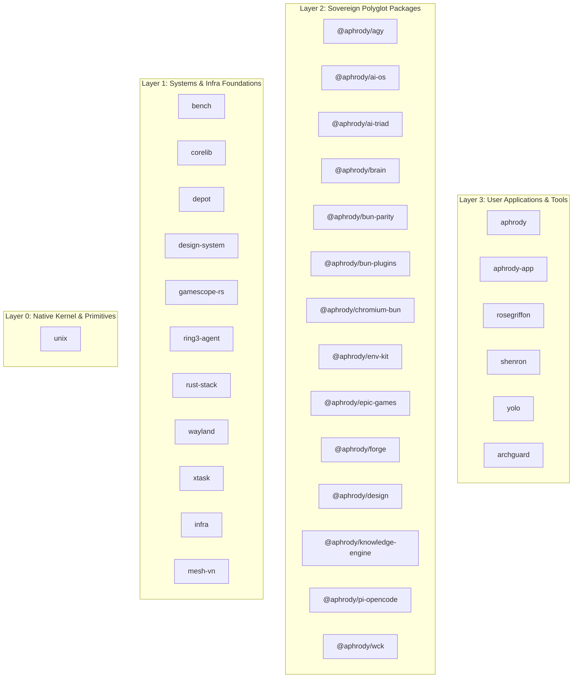

# Codebase Digest: crates

- Files analyzed: 2591
- Total lines: 115223
- Total size: 4.72 MB
- Git branch: `main`
- Git HEAD commit: `272c544f (docker: ship vendor icons, wallpaper thumbs and crates/game/assets to the bun-build stage (aphrody, r2-site, api-gateway images))`
- Digest mode: `AST-Smart Outline`

## Directory Structure

```text
crates/
├── DEPS.rules (24 lines, 1.0 KB, ~310 tokens)
├── adblock-capi/
│   ├── Cargo.toml (19 lines, 429 B, ~113 tokens)
│   ├── include/
│   │   └── aphrody_adblock.h (4 lines, 113 B, ~33 tokens)
│   └── src/
│       └── lib.rs (17 lines, 965 B, ~269 tokens)
├── agent-context/
│   ├── Cargo.toml (10 lines, 326 B, ~90 tokens)
│   ├── DEPS.rules (2 lines, 91 B, ~23 tokens)
│   └── src/
│       └── lib.rs (21 lines, 941 B, ~304 tokens)
├── agent-py/
│   ├── Cargo.toml (15 lines, 394 B, ~111 tokens)
│   ├── DEPS.rules (2 lines, 91 B, ~23 tokens)
│   └── src/
│       └── lib.rs (12 lines, 518 B, ~172 tokens)
├── aphrody-brand-gpu/
│   ├── Cargo.toml (18 lines, 668 B, ~180 tokens)
│   └── src/
│       └── lib.rs (25 lines, 1.1 KB, ~358 tokens)
├── aphrody-i18n/
│   ├── Cargo.toml (10 lines, 319 B, ~83 tokens)
│   ├── DEPS.rules (2 lines, 91 B, ~23 tokens)
│   ├── src/
│   │   └── lib.rs (34 lines, 1.9 KB, ~640 tokens)
│   └── tests/
│       └── shared.rs (9 lines, 319 B, ~90 tokens)
├── aphrody-ui/
│   ├── Cargo.toml (95 lines, 2.8 KB, ~813 tokens)
│   ├── fonts/
│   │   ├── google-sans-code/
│   │   │   └── OFL.txt (93 lines, 4.3 KB, ~1.1k tokens)
│   │   └── google-sans-flex/
│   │       └── OFL.txt (91 lines, 4.2 KB, ~1.1k tokens)
│   ├── src/
│   │   ├── bin/
│   │   │   └── aphrody-brand.rs (5 lines, 143 B, ~44 tokens)
│   │   ├── brand/
│   │   │   ├── mod.rs (72 lines, 3.7 KB, ~1.2k tokens)
│   │   │   ├── model.rs (11 lines, 433 B, ~143 tokens)
│   │   │   ├── pet.rs (19 lines, 825 B, ~271 tokens)
│   │   │   └── web.rs (46 lines, 2.5 KB, ~856 tokens)
│   │   ├── color/
│   │   │   ├── adaptive.rs (30 lines, 1.3 KB, ~385 tokens)
│   │   │   ├── blend.rs (10 lines, 427 B, ~117 tokens)
│   │   │   ├── cam16.rs (20 lines, 1.0 KB, ~311 tokens)
│   │   │   ├── color.rs (18 lines, 1.0 KB, ~281 tokens)
│   │   │   ├── color_math.rs (36 lines, 1.8 KB, ~589 tokens)
│   │   │   ├── component.rs (15 lines, 649 B, ~184 tokens)
│   │   │   ├── contrast.rs (12 lines, 541 B, ~163 tokens)
│   │   │   ├── dynamic.rs (14 lines, 525 B, ~159 tokens)
│   │   │   ├── elevation.rs (14 lines, 581 B, ~163 tokens)
│   │   │   ├── facade.rs (34 lines, 1.1 KB, ~316 tokens)
│   │   │   ├── gemini_brand.rs (27 lines, 1.4 KB, ~351 tokens)
│   │   │   ├── google_sans_code.rs (18 lines, 793 B, ~217 tokens)
│   │   │   ├── google_sans_flex.rs (19 lines, 845 B, ~227 tokens)
│   │   │   ├── hct.rs (34 lines, 1.8 KB, ~565 tokens)
│   │   │   ├── image.rs (11 lines, 546 B, ~150 tokens)
│   │   │   ├── mod.rs (40 lines, 1.0 KB, ~314 tokens)
│   │   │   ├── motion.rs (47 lines, 2.4 KB, ~664 tokens)
│   │   │   ├── palette.rs (17 lines, 753 B, ~221 tokens)
│   │   │   ├── presets.rs (21 lines, 1.1 KB, ~291 tokens)
│   │   │   ├── quantize.rs (4 lines, 251 B, ~77 tokens)
│   │   │   ├── quantize_map.rs (7 lines, 215 B, ~65 tokens)
│   │   │   ├── quantize_wsmeans.rs (10 lines, 390 B, ~128 tokens)
│   │   │   ├── quantize_wu.rs (21 lines, 1.1 KB, ~357 tokens)
│   │   │   ├── role.rs (1 lines, 36 B, ~11 tokens)
│   │   │   ├── scheme/
│   │   │   │   └── temperature.rs (13 lines, 682 B, ~216 tokens)
│   │   │   ├── scheme.rs (46 lines, 2.4 KB, ~709 tokens)
│   │   │   ├── score.rs (10 lines, 412 B, ~114 tokens)
│   │   │   ├── shape.rs (16 lines, 624 B, ~168 tokens)
│   │   │   ├── sheets.rs (28 lines, 1.4 KB, ~423 tokens)
│   │   │   ├── spaceui.rs (19 lines, 839 B, ~242 tokens)
│   │   │   ├── state.rs (10 lines, 376 B, ~102 tokens)
│   │   │   ├── theme.rs (28 lines, 1.3 KB, ~378 tokens)
│   │   │   ├── tonal.rs (15 lines, 651 B, ~167 tokens)
│   │   │   └── typography.rs (15 lines, 754 B, ~203 tokens)
│   │   ├── components/
│   │   │   ├── a11y.rs (18 lines, 753 B, ~219 tokens)
│   │   │   ├── components.rs (13 lines, 545 B, ~153 tokens)
│   │   │   ├── controls/
│   │   │   │   ├── buttons.rs (53 lines, 2.6 KB, ~806 tokens)
│   │   │   │   ├── card.rs (16 lines, 554 B, ~173 tokens)
│   │   │   │   ├── chip.rs (21 lines, 853 B, ~265 tokens)
│   │   │   │   ├── mod.rs (25 lines, 528 B, ~161 tokens)
│   │   │   │   ├── navigation.rs (25 lines, 985 B, ~307 tokens)
│   │   │   │   ├── overlay.rs (30 lines, 1.2 KB, ~391 tokens)
│   │   │   │   ├── progress.rs (15 lines, 520 B, ~161 tokens)
│   │   │   │   ├── selection.rs (33 lines, 1.4 KB, ~447 tokens)
│   │   │   │   ├── slider.rs (17 lines, 633 B, ~200 tokens)
│   │   │   │   └── tests.rs (30 lines, 1.5 KB, ~379 tokens)
│   │   │   ├── focus.rs (16 lines, 738 B, ~217 tokens)
│   │   │   ├── forms.rs (5 lines, 135 B, ~39 tokens)
│   │   │   ├── icons.rs (7 lines, 232 B, ~65 tokens)
│   │   │   ├── interaction.rs (13 lines, 532 B, ~146 tokens)
│   │   │   ├── keyboard.rs (15 lines, 634 B, ~187 tokens)
│   │   │   ├── layout.rs (38 lines, 1.9 KB, ~570 tokens)
│   │   │   ├── mod.rs (19 lines, 519 B, ~154 tokens)
│   │   │   ├── motion.rs (6 lines, 163 B, ~45 tokens)
│   │   │   ├── theme.rs (18 lines, 826 B, ~212 tokens)
│   │   │   └── visual.rs (39 lines, 1.9 KB, ~593 tokens)
│   │   ├── layout/
│   │   │   ├── calc.rs (10 lines, 424 B, ~126 tokens)
│   │   │   ├── mod.rs (21 lines, 427 B, ~132 tokens)
│   │   │   ├── parse.rs (68 lines, 3.8 KB, ~1.1k tokens)
│   │   │   ├── snap.rs (18 lines, 868 B, ~235 tokens)
│   │   │   ├── style.rs (34 lines, 1.3 KB, ~389 tokens)
│   │   │   ├── tailwind.rs (19 lines, 987 B, ~267 tokens)
│   │   │   ├── tests.rs (41 lines, 1.9 KB, ~494 tokens)
│   │   │   ├── to_bevy.rs (13 lines, 725 B, ~211 tokens)
│   │   │   ├── to_egui.rs (5 lines, 220 B, ~69 tokens)
│   │   │   ├── to_taffy.rs (28 lines, 1.5 KB, ~470 tokens)
│   │   │   ├── tokens.rs (8 lines, 359 B, ~116 tokens)
│   │   │   └── tree.rs (26 lines, 1.3 KB, ~386 tokens)
│   │   ├── lib.rs (8 lines, 202 B, ~64 tokens)
│   │   ├── next/
│   │   │   ├── cdn.rs (27 lines, 1.4 KB, ~396 tokens)
│   │   │   ├── config.rs (123 lines, 7.4 KB, ~2.2k tokens)
│   │   │   ├── emit_bun.rs (52 lines, 2.6 KB, ~774 tokens)
│   │   │   ├── emit_dioxus.rs (51 lines, 2.9 KB, ~873 tokens)
│   │   │   ├── emit_leptos.rs (50 lines, 2.4 KB, ~762 tokens)
│   │   │   ├── fonts.rs (78 lines, 4.4 KB, ~1.3k tokens)
│   │   │   ├── images.rs (67 lines, 3.5 KB, ~1.0k tokens)
│   │   │   ├── metadata.rs (63 lines, 3.7 KB, ~1.1k tokens)
│   │   │   ├── mod.rs (20 lines, 485 B, ~151 tokens)
│   │   │   ├── project.rs (14 lines, 702 B, ~210 tokens)
│   │   │   ├── proxy.rs (46 lines, 2.3 KB, ~684 tokens)
│   │   │   ├── report.rs (32 lines, 1.6 KB, ~465 tokens)
│   │   │   ├── routes.rs (79 lines, 4.1 KB, ~1.2k tokens)
│   │   │   ├── rsc.rs (97 lines, 6.1 KB, ~1.8k tokens)
│   │   │   ├── rules.rs (71 lines, 3.6 KB, ~1.1k tokens)
│   │   │   ├── segment.rs (42 lines, 2.2 KB, ~626 tokens)
│   │   │   ├── turbopack.rs (34 lines, 1.8 KB, ~518 tokens)
│   │   │   └── types.rs (91 lines, 3.7 KB, ~1.0k tokens)
│   │   ├── react/
│   │   │   ├── compiler.rs (16 lines, 707 B, ~195 tokens)
│   │   │   ├── mod.rs (13 lines, 455 B, ~113 tokens)
│   │   │   ├── react_native.rs (18 lines, 915 B, ~252 tokens)
│   │   │   └── rsc.rs (16 lines, 800 B, ~230 tokens)
│   │   └── shared/
│   │       └── mod.rs (72 lines, 3.9 KB, ~1.2k tokens)
│   └── tests/
│       ├── bevy_headless.rs (6 lines, 156 B, ~42 tokens)
│       ├── color_brand_theme_golden.rs (8 lines, 281 B, ~81 tokens)
│       ├── color_creator_theme_golden.rs (6 lines, 179 B, ~50 tokens)
│       ├── color_mcu_fidelity.rs (5 lines, 184 B, ~50 tokens)
│       ├── color_mcu_image_parity.rs (12 lines, 457 B, ~131 tokens)
│       ├── color_mcu_parity.rs (14 lines, 506 B, ~154 tokens)
│       ├── color_sheets_golden.rs (4 lines, 190 B, ~44 tokens)
│       ├── color_theme_export.rs (13 lines, 792 B, ~175 tokens)
│       ├── fixtures/
│       │   ├── brand-theme-high-contrast.json (106 lines, 3.7 KB, ~1.2k tokens)
│       │   ├── brand-theme.json (106 lines, 3.7 KB, ~1.2k tokens)
│       │   ├── creator-theme.json (106 lines, 3.7 KB, ~1.2k tokens)
│       │   ├── google/
│       │   │   ├── PROVENANCE.json (268 lines, 19.8 KB, ~5.5k tokens)
│       │   │   ├── compose-material3/
│       │   │   │   ├── ElevationTokens.kt (41 lines, 1.2 KB, ~336 tokens)
│       │   │   │   ├── ExpressiveMotionTokens.kt (34 lines, 1.3 KB, ~318 tokens)
│       │   │   │   ├── LICENSE.txt (178 lines, 9.9 KB, ~2.3k tokens)
│       │   │   │   ├── LoadingIndicatorTokens.kt (44 lines, 1.4 KB, ~354 tokens)
│       │   │   │   ├── MotionTokens.kt (69 lines, 2.6 KB, ~663 tokens)
│       │   │   │   ├── ShapeTokens.kt (82 lines, 2.9 KB, ~727 tokens)
│       │   │   │   ├── StandardMotionTokens.kt (32 lines, 1.3 KB, ~317 tokens)
│       │   │   │   ├── StateTokens.kt (26 lines, 935 B, ~231 tokens)
│       │   │   │   ├── TypeScaleTokens.kt (474 lines, 16.5 KB, ~4.2k tokens)
│       │   │   │   └── TypefaceTokens.kt (39 lines, 1.2 KB, ~302 tokens)
│       │   │   └── material-web/
│       │   │       ├── LICENSE (202 lines, 11.1 KB, ~2.6k tokens)
│       │   │       ├── _md-comp-assist-chip.scss (1 lines, 36 B, ~11 tokens)
│       │   │       ├── _md-comp-button-filled.scss (1 lines, 36 B, ~11 tokens)
│       │   │       ├── _md-comp-button-group-connected-small.scss (1 lines, 35 B, ~11 tokens)
│       │   │       ├── _md-comp-button-group-standard-small.scss (1 lines, 35 B, ~11 tokens)
│       │   │       ├── _md-comp-button-small.scss (1 lines, 35 B, ~11 tokens)
│       │   │       ├── _md-comp-checkbox.scss (1 lines, 36 B, ~11 tokens)
│       │   │       ├── _md-comp-dialog.scss (1 lines, 36 B, ~11 tokens)
│       │   │       ├── _md-comp-elevated-card.scss (1 lines, 35 B, ~11 tokens)
│       │   │       ├── _md-comp-fab-large.scss (1 lines, 35 B, ~11 tokens)
│       │   │       ├── _md-comp-fab-primary-container.scss (1 lines, 35 B, ~11 tokens)
│       │   │       ├── _md-comp-fab-small.scss (1 lines, 35 B, ~11 tokens)
│       │   │       ├── _md-comp-fab.scss (1 lines, 35 B, ~11 tokens)
│       │   │       ├── _md-comp-filled-card.scss (1 lines, 35 B, ~11 tokens)
│       │   │       ├── _md-comp-filter-chip.scss (1 lines, 36 B, ~11 tokens)
│       │   │       ├── _md-comp-icon-button-filled.scss (1 lines, 35 B, ~11 tokens)
│       │   │       ├── _md-comp-icon-button-outlined.scss (1 lines, 35 B, ~11 tokens)
│       │   │       ├── _md-comp-icon-button-small.scss (1 lines, 35 B, ~11 tokens)
│       │   │       ├── _md-comp-icon-button-standard.scss (1 lines, 35 B, ~11 tokens)
│       │   │       ├── _md-comp-icon-button-tonal.scss (1 lines, 35 B, ~11 tokens)
│       │   │       ├── _md-comp-input-chip.scss (1 lines, 36 B, ~11 tokens)
│       │   │       ├── _md-comp-loading-indicator.scss (1 lines, 35 B, ~11 tokens)
│       │   │       ├── _md-comp-menu.scss (1 lines, 36 B, ~11 tokens)
│       │   │       ├── _md-comp-nav-bar-item-vertical.scss (1 lines, 35 B, ~11 tokens)
│       │   │       ├── _md-comp-nav-bar.scss (1 lines, 35 B, ~11 tokens)
│       │   │       ├── _md-comp-outlined-card.scss (1 lines, 35 B, ~11 tokens)
│       │   │       ├── _md-comp-primary-navigation-tab.scss (1 lines, 36 B, ~11 tokens)
│       │   │       ├── _md-comp-radio-button.scss (1 lines, 35 B, ~11 tokens)
│       │   │       ├── _md-comp-slider.scss (1 lines, 36 B, ~11 tokens)
│       │   │       ├── _md-comp-split-button-small.scss (1 lines, 35 B, ~11 tokens)
│       │   │       ├── _md-comp-suggestion-chip.scss (1 lines, 36 B, ~11 tokens)
│       │   │       ├── _md-comp-switch.scss (1 lines, 36 B, ~11 tokens)
│       │   │       ├── _md-ref-typeface.scss (1 lines, 35 B, ~11 tokens)
│       │   │       ├── _md-sys-elevation.scss (1 lines, 35 B, ~11 tokens)
│       │   │       ├── _md-sys-motion.scss (1 lines, 36 B, ~11 tokens)
│       │   │       ├── _md-sys-shape.scss (1 lines, 35 B, ~11 tokens)
│       │   │       ├── _md-sys-state-focus-indicator.scss (1 lines, 35 B, ~11 tokens)
│       │   │       ├── _md-sys-state.scss (1 lines, 35 B, ~11 tokens)
│       │   │       ├── _md-sys-typescale-emphasized.scss (1 lines, 36 B, ~11 tokens)
│       │   │       └── _md-sys-typescale.scss (1 lines, 36 B, ~11 tokens)
│       │   ├── mcu-fidelity.json (8499 lines, 320.2 KB, ~85.9k tokens)
│       │   ├── mcu-image.json (47 lines, 1.5 KB, ~479 tokens)
│       │   ├── mcu-pet.json (411 lines, 14.6 KB, ~4.6k tokens)
│       │   ├── mcu.json (10079 lines, 383.8 KB, ~102.7k tokens)
│       │   ├── spaceui-color-token-names.txt (46 lines, 547 B, ~166 tokens)
│       │   └── visual/
│       │       ├── mark-64.sha256 (1 lines, 65 B, ~10 tokens)
│       │       └── tile-64.sha256 (1 lines, 65 B, ~10 tokens)
│       └── visual_regression.rs (11 lines, 354 B, ~105 tokens)
├── apm/
│   ├── Cargo.toml (31 lines, 671 B, ~187 tokens)
│   ├── README.md (39 lines, 4.4 KB, ~1.2k tokens)
│   ├── clippy.toml (21 lines, 3.2 KB, ~847 tokens)
│   ├── src/
│   │   ├── bin/
│   │   │   └── apm.rs (10 lines, 215 B, ~65 tokens)
│   │   ├── compile.rs (27 lines, 971 B, ~277 tokens)
│   │   ├── deploy.rs (47 lines, 2.2 KB, ~652 tokens)
│   │   ├── frontmatter.rs (14 lines, 447 B, ~135 tokens)
│   │   ├── hash.rs (20 lines, 870 B, ~252 tokens)
│   │   ├── install.rs (32 lines, 1.1 KB, ~307 tokens)
│   │   ├── lib.rs (12 lines, 309 B, ~96 tokens)
│   │   ├── lockfile.rs (44 lines, 2.0 KB, ~618 tokens)
│   │   ├── manifest.rs (23 lines, 764 B, ~224 tokens)
│   │   ├── reference.rs (26 lines, 1.0 KB, ~315 tokens)
│   │   ├── resolve.rs (33 lines, 1.1 KB, ~359 tokens)
│   │   ├── targets.rs (10 lines, 380 B, ~115 tokens)
│   │   └── yaml.rs (58 lines, 2.7 KB, ~867 tokens)
│   └── tests/
│       ├── install.rs (17 lines, 647 B, ~177 tokens)
│       └── upstream.rs (29 lines, 1.1 KB, ~287 tokens)
├── archguard/
│   ├── Cargo.toml (20 lines, 482 B, ~137 tokens)
│   ├── README.md (142 lines, 12.8 KB, ~3.1k tokens)
│   ├── archguard.rules.json (117 lines, 4.0 KB, ~1.3k tokens)
│   ├── baseline.json (11 lines, 428 B, ~146 tokens)
│   ├── src/
│   │   ├── cli.rs (13 lines, 369 B, ~113 tokens)
│   │   ├── constants.rs (14 lines, 677 B, ~199 tokens)
│   │   ├── graph.rs (24 lines, 1011 B, ~296 tokens)
│   │   ├── lib.rs (15 lines, 357 B, ~107 tokens)
│   │   ├── models.rs (11 lines, 327 B, ~99 tokens)
│   │   ├── report.rs (4 lines, 137 B, ~39 tokens)
│   │   └── rules/
│   │       ├── apps.rs (8 lines, 292 B, ~84 tokens)
│   │       ├── atlas.rs (6 lines, 186 B, ~53 tokens)
│   │       ├── chromium.rs (7 lines, 272 B, ~79 tokens)
│   │       ├── crates.rs (9 lines, 478 B, ~137 tokens)
│   │       ├── hygiene.rs (8 lines, 213 B, ~61 tokens)
│   │       ├── infra.rs (7 lines, 257 B, ~77 tokens)
│   │       ├── linux.rs (6 lines, 181 B, ~52 tokens)
│   │       ├── mod.rs (16 lines, 379 B, ~118 tokens)
│   │       ├── packages.rs (7 lines, 205 B, ~58 tokens)
│   │       ├── tools.rs (8 lines, 284 B, ~83 tokens)
│   │       ├── topology.rs (7 lines, 193 B, ~56 tokens)
│   │       └── versioning.rs (7 lines, 210 B, ~59 tokens)
│   └── tests/
│       ├── archguard_test.rs (24 lines, 1.4 KB, ~324 tokens)
│       └── workspace_inheritance.rs (7 lines, 269 B, ~65 tokens)
├── asset-test/
│   ├── Cargo.toml (38 lines, 1.6 KB, ~452 tokens)
│   ├── DEPS.rules (4 lines, 199 B, ~51 tokens)
│   └── src/
│       └── main.rs (23 lines, 937 B, ~299 tokens)
├── ay/
│   ├── Cargo.toml (61 lines, 2.3 KB, ~710 tokens)
│   ├── DEPS.rules (2 lines, 91 B, ~23 tokens)
│   ├── build.rs (2 lines, 56 B, ~19 tokens)
│   └── src/
│       ├── ai.rs (121 lines, 7.1 KB, ~2.2k tokens)
│       ├── build.rs (35 lines, 1.6 KB, ~475 tokens)
│       ├── bun/
│       │   ├── bump.rs (27 lines, 1.4 KB, ~429 tokens)
│       │   ├── install.rs (21 lines, 912 B, ~285 tokens)
│       │   ├── mod.rs (33 lines, 1.1 KB, ~362 tokens)
│       │   ├── schedule.rs (21 lines, 1.1 KB, ~354 tokens)
│       │   └── watch.rs (69 lines, 3.5 KB, ~1.1k tokens)
│       ├── chromium.rs (3 lines, 119 B, ~39 tokens)
│       ├── exec.rs (12 lines, 486 B, ~148 tokens)
│       ├── lib.rs (55 lines, 2.0 KB, ~604 tokens)
│       ├── low/
│       │   ├── agents.rs (9 lines, 339 B, ~112 tokens)
│       │   ├── chromium_chain.rs (21 lines, 877 B, ~274 tokens)
│       │   ├── docs.rs (18 lines, 645 B, ~197 tokens)
│       │   ├── engines.rs (12 lines, 503 B, ~158 tokens)
│       │   ├── flat.rs (28 lines, 1.3 KB, ~375 tokens)
│       │   ├── mod.rs (9 lines, 254 B, ~80 tokens)
│       │   └── steam.rs (25 lines, 1.0 KB, ~317 tokens)
│       ├── main.rs (2 lines, 54 B, ~19 tokens)
│       └── self_update.rs (11 lines, 453 B, ~130 tokens)
├── bench/
│   ├── BENCHMARK_REPORT.md (123 lines, 7.5 KB, ~2.3k tokens)
│   ├── Cargo.toml (22 lines, 598 B, ~157 tokens)
│   ├── results/
│   │   └── hardware-profile.json (123 lines, 5.1 KB, ~1.6k tokens)
│   ├── src/
│   │   ├── cli.rs (31 lines, 916 B, ~255 tokens)
│   │   ├── cold_start.rs (10 lines, 372 B, ~107 tokens)
│   │   ├── hardware.rs (13 lines, 459 B, ~139 tokens)
│   │   ├── lib.rs (20 lines, 583 B, ~169 tokens)
│   │   ├── picker.rs (7 lines, 390 B, ~112 tokens)
│   │   ├── public_bench.rs (17 lines, 751 B, ~197 tokens)
│   │   ├── tier1_cuda.rs (6 lines, 165 B, ~48 tokens)
│   │   ├── tier2_rust.rs (9 lines, 363 B, ~110 tokens)
│   │   ├── tier3_msvc.rs (6 lines, 165 B, ~48 tokens)
│   │   ├── tier4_dotnet.rs (6 lines, 165 B, ~48 tokens)
│   │   ├── tier5_bun.rs (5 lines, 151 B, ~43 tokens)
│   │   └── zerocopy_bench.rs (10 lines, 287 B, ~76 tokens)
│   ├── tests/
│   │   └── integration_tests.rs (5 lines, 174 B, ~47 tokens)
│   ├── tier1_cuda/
│   │   └── kernel.cu (10 lines, 450 B, ~127 tokens)
│   ├── tier3_msvc/
│   │   └── kernel.cpp (15 lines, 558 B, ~163 tokens)
│   ├── tier4_dotnet/
│   │   ├── Program.cs (188 lines, 7.5 KB, ~2.0k tokens)
│   │   └── tier4_dotnet.csproj (12 lines, 411 B, ~105 tokens)
│   └── tier5_bun/
│       └── wasm_kernel.rs (4 lines, 307 B, ~97 tokens)
├── build-helper.rs (3 lines, 113 B, ~35 tokens)
├── bun-flat/
│   ├── Cargo.toml (27 lines, 626 B, ~174 tokens)
│   ├── DEPS.rules (3 lines, 170 B, ~43 tokens)
│   ├── benches/
│   │   └── flat.rs (12 lines, 410 B, ~127 tokens)
│   ├── flat.toml (29 lines, 1.0 KB, ~300 tokens)
│   └── src/
│       ├── histogram.rs (26 lines, 1.3 KB, ~412 tokens)
│       ├── lib.rs (5 lines, 139 B, ~42 tokens)
│       ├── sort_by_number.rs (19 lines, 1.1 KB, ~316 tokens)
│       ├── sync.rs (48 lines, 2.9 KB, ~868 tokens)
│       └── wyhash.rs (71 lines, 3.3 KB, ~1.1k tokens)
├── conformance/
│   ├── Cargo.toml (24 lines, 628 B, ~166 tokens)
│   ├── clippy.toml (21 lines, 3.2 KB, ~847 tokens)
│   └── src/
│       ├── channels.rs (19 lines, 1012 B, ~310 tokens)
│       ├── cli.rs (9 lines, 426 B, ~132 tokens)
│       └── lib.rs (28 lines, 1.1 KB, ~343 tokens)
├── core/
│   ├── Cargo.toml (40 lines, 1.0 KB, ~283 tokens)
│   ├── DEPS.rules (2 lines, 91 B, ~23 tokens)
│   ├── build.rs (8 lines, 276 B, ~85 tokens)
│   ├── src/
│   │   ├── extractor.rs (10 lines, 358 B, ~114 tokens)
│   │   ├── grammars.rs (14 lines, 576 B, ~168 tokens)
│   │   ├── hash.rs (6 lines, 252 B, ~76 tokens)
│   │   ├── index.rs (16 lines, 547 B, ~163 tokens)
│   │   ├── languages.rs (8 lines, 343 B, ~103 tokens)
│   │   ├── lib.rs (33 lines, 1.1 KB, ~312 tokens)
│   │   ├── query.rs (9 lines, 233 B, ~64 tokens)
│   │   ├── registry_build.rs (8 lines, 438 B, ~133 tokens)
│   │   ├── rope.rs (16 lines, 743 B, ~220 tokens)
│   │   └── symbols.rs (12 lines, 442 B, ~132 tokens)
│   └── tests/
│       └── registry.rs (10 lines, 412 B, ~114 tokens)
├── core-capi/
│   ├── Cargo.toml (15 lines, 366 B, ~101 tokens)
│   ├── DEPS.rules (2 lines, 91 B, ~23 tokens)
│   ├── cbindgen.toml (4 lines, 174 B, ~45 tokens)
│   ├── include/
│   │   └── aphrody_core.h (8 lines, 219 B, ~64 tokens)
│   └── src/
│       └── lib.rs (26 lines, 1.2 KB, ~358 tokens)
├── corelib/
│   ├── Cargo.toml (48 lines, 1.4 KB, ~422 tokens)
│   ├── DEPS.rules (3 lines, 177 B, ~48 tokens)
│   ├── README.md (72 lines, 3.2 KB, ~878 tokens)
│   └── src/
│       ├── emulation/
│       │   └── mod.rs (18 lines, 798 B, ~242 tokens)
│       ├── epic/
│       │   └── mod.rs (17 lines, 753 B, ~220 tokens)
│       ├── error.rs (3 lines, 88 B, ~25 tokens)
│       ├── gpu/
│       │   └── mod.rs (14 lines, 670 B, ~199 tokens)
│       ├── lib.rs (29 lines, 886 B, ~242 tokens)
│       ├── re/
│       │   └── mod.rs (19 lines, 810 B, ~246 tokens)
│       ├── wasm/
│       │   └── mod.rs (8 lines, 324 B, ~98 tokens)
│       └── web.rs (23 lines, 1.1 KB, ~324 tokens)
├── cosmic-compat/
│   ├── Cargo.toml (16 lines, 435 B, ~118 tokens)
│   ├── DEPS.rules (2 lines, 91 B, ~23 tokens)
│   └── src/
│       ├── hidpi_protocols.rs (7 lines, 357 B, ~90 tokens)
│       ├── layer_shell.rs (10 lines, 418 B, ~118 tokens)
│       ├── lib.rs (21 lines, 694 B, ~176 tokens)
│       ├── session.rs (5 lines, 183 B, ~55 tokens)
│       ├── theme.rs (11 lines, 509 B, ~144 tokens)
│       ├── toplevel_manager.rs (10 lines, 390 B, ~110 tokens)
│       └── workspace_manager.rs (7 lines, 300 B, ~86 tokens)
├── craft-formats/
│   ├── Cargo.toml (23 lines, 1.2 KB, ~330 tokens)
│   └── src/
│       └── lib.rs (15 lines, 650 B, ~199 tokens)
├── depot-cas/
│   ├── Cargo.toml (16 lines, 492 B, ~132 tokens)
│   ├── DEPS.rules (2 lines, 91 B, ~23 tokens)
│   └── src/
│       └── lib.rs (30 lines, 1.3 KB, ~418 tokens)
├── depot-cipd/
│   ├── Cargo.toml (19 lines, 569 B, ~156 tokens)
│   └── src/
│       ├── api.rs (19 lines, 759 B, ~229 tokens)
│       ├── cli.rs (13 lines, 540 B, ~174 tokens)
│       ├── deploy.rs (55 lines, 2.5 KB, ~789 tokens)
│       ├── ensure_file.rs (33 lines, 1.5 KB, ~485 tokens)
│       ├── iid.rs (22 lines, 909 B, ~284 tokens)
│       └── lib.rs (32 lines, 1.4 KB, ~461 tokens)
├── depot-cli/
│   ├── Cargo.toml (25 lines, 647 B, ~182 tokens)
│   ├── DEPS.rules (2 lines, 91 B, ~23 tokens)
│   └── src/
│       ├── commands/
│       │   ├── analyze.rs (6 lines, 190 B, ~54 tokens)
│       │   ├── artifacts.rs (6 lines, 341 B, ~94 tokens)
│       │   ├── ast.rs (6 lines, 282 B, ~79 tokens)
│       │   ├── forge.rs (5 lines, 223 B, ~62 tokens)
│       │   ├── fork.rs (6 lines, 276 B, ~79 tokens)
│       │   ├── gix.rs (4 lines, 104 B, ~30 tokens)
│       │   ├── graph.rs (10 lines, 604 B, ~170 tokens)
│       │   ├── ignore.rs (4 lines, 171 B, ~47 tokens)
│       │   ├── info.rs (5 lines, 167 B, ~52 tokens)
│       │   ├── ingest.rs (5 lines, 123 B, ~35 tokens)
│       │   ├── just.rs (4 lines, 157 B, ~46 tokens)
│       │   ├── lua.rs (12 lines, 675 B, ~194 tokens)
│       │   ├── manifests.rs (5 lines, 178 B, ~52 tokens)
│       │   ├── migrate.rs (5 lines, 178 B, ~51 tokens)
│       │   ├── mod.rs (19 lines, 444 B, ~145 tokens)
│       │   ├── re.rs (5 lines, 179 B, ~52 tokens)
│       │   ├── rope.rs (5 lines, 184 B, ~54 tokens)
│       │   ├── slim.rs (6 lines, 218 B, ~66 tokens)
│       │   └── worktree.rs (7 lines, 305 B, ~86 tokens)
│       └── lib.rs (56 lines, 2.0 KB, ~544 tokens)
├── depot-core/
│   ├── Cargo.toml (21 lines, 510 B, ~139 tokens)
│   ├── DEPS.rules (2 lines, 91 B, ~23 tokens)
│   └── src/
│       ├── artifacts.rs (18 lines, 884 B, ~253 tokens)
│       ├── build_tools.rs (19 lines, 807 B, ~250 tokens)
│       ├── depot_tools.rs (14 lines, 587 B, ~179 tokens)
│       ├── ecosystems.rs (17 lines, 768 B, ~204 tokens)
│       ├── fork.rs (11 lines, 391 B, ~114 tokens)
│       ├── git_slim.rs (15 lines, 653 B, ~190 tokens)
│       ├── gitx.rs (21 lines, 1.1 KB, ~362 tokens)
│       ├── gix_engine.rs (13 lines, 601 B, ~166 tokens)
│       ├── ignore.rs (7 lines, 233 B, ~67 tokens)
│       ├── just_engine.rs (17 lines, 731 B, ~215 tokens)
│       ├── lib.rs (45 lines, 1.2 KB, ~344 tokens)
│       ├── magika.rs (12 lines, 537 B, ~152 tokens)
│       ├── path.rs (3 lines, 106 B, ~32 tokens)
│       ├── style.rs (8 lines, 291 B, ~97 tokens)
│       ├── sys.rs (25 lines, 977 B, ~290 tokens)
│       ├── vault.rs (7 lines, 291 B, ~89 tokens)
│       └── worktree.rs (10 lines, 425 B, ~127 tokens)
├── depot-forge/
│   ├── Cargo.toml (13 lines, 333 B, ~90 tokens)
│   └── src/
│       ├── auth.rs (10 lines, 435 B, ~137 tokens)
│       ├── error.rs (4 lines, 149 B, ~49 tokens)
│       ├── github.rs (22 lines, 870 B, ~256 tokens)
│       ├── gitlab.rs (17 lines, 831 B, ~248 tokens)
│       ├── http.rs (12 lines, 515 B, ~160 tokens)
│       ├── lib.rs (17 lines, 424 B, ~124 tokens)
│       └── models.rs (15 lines, 568 B, ~150 tokens)
├── depot-gclient/
│   ├── Cargo.toml (30 lines, 994 B, ~276 tokens)
│   ├── src/
│   │   ├── cl.rs (22 lines, 1013 B, ~315 tokens)
│   │   ├── cli.rs (21 lines, 884 B, ~283 tokens)
│   │   ├── condition.rs (12 lines, 483 B, ~146 tokens)
│   │   ├── deps.rs (12 lines, 483 B, ~143 tokens)
│   │   ├── edit.rs (31 lines, 1.5 KB, ~463 tokens)
│   │   ├── eval.rs (25 lines, 1.2 KB, ~391 tokens)
│   │   ├── fetch.rs (18 lines, 783 B, ~242 tokens)
│   │   ├── gcs.rs (43 lines, 2.1 KB, ~651 tokens)
│   │   ├── lib.rs (20 lines, 619 B, ~208 tokens)
│   │   ├── sync.rs (38 lines, 1.9 KB, ~591 tokens)
│   │   ├── tree.rs (49 lines, 2.5 KB, ~794 tokens)
│   │   └── value.rs (31 lines, 1.6 KB, ~512 tokens)
│   └── tests/
│       └── chromium.rs (15 lines, 550 B, ~154 tokens)
├── depot-graph/
│   ├── Cargo.toml (15 lines, 388 B, ~105 tokens)
│   └── src/
│       ├── export.rs (13 lines, 613 B, ~175 tokens)
│       ├── graph.rs (19 lines, 894 B, ~268 tokens)
│       ├── lib.rs (17 lines, 448 B, ~130 tokens)
│       ├── mcp.rs (11 lines, 381 B, ~107 tokens)
│       ├── parser.rs (10 lines, 338 B, ~98 tokens)
│       └── query.rs (10 lines, 452 B, ~137 tokens)
├── depot-ingest/
│   ├── Cargo.toml (16 lines, 415 B, ~111 tokens)
│   └── src/
│       ├── formatter.rs (15 lines, 476 B, ~137 tokens)
│       ├── lib.rs (21 lines, 713 B, ~201 tokens)
│       ├── scanner.rs (11 lines, 275 B, ~82 tokens)
│       ├── tokenizer.rs (4 lines, 182 B, ~53 tokens)
│       └── tree.rs (8 lines, 417 B, ~125 tokens)
├── depot-migrate/
│   ├── Cargo.toml (14 lines, 364 B, ~97 tokens)
│   └── src/
│       ├── archetype.rs (7 lines, 285 B, ~83 tokens)
│       ├── lib.rs (19 lines, 535 B, ~150 tokens)
│       ├── manifest.rs (4 lines, 202 B, ~60 tokens)
│       ├── rules.rs (3 lines, 85 B, ~25 tokens)
│       └── transformer.rs (10 lines, 378 B, ~100 tokens)
├── depot-re/
│   ├── Cargo.toml (12 lines, 299 B, ~83 tokens)
│   └── src/
│       ├── abi.rs (8 lines, 287 B, ~83 tokens)
│       ├── binary.rs (7 lines, 328 B, ~90 tokens)
│       ├── disasm.rs (8 lines, 315 B, ~86 tokens)
│       ├── lib.rs (20 lines, 602 B, ~178 tokens)
│       ├── lua.rs (41 lines, 2.0 KB, ~583 tokens)
│       └── rea.rs (4 lines, 181 B, ~48 tokens)
├── depot-vpython/
│   ├── Cargo.toml (11 lines, 320 B, ~90 tokens)
│   └── src/
│       └── lib.rs (19 lines, 782 B, ~236 tokens)
├── diffutils-flat/
│   ├── Cargo.toml (23 lines, 612 B, ~164 tokens)
│   ├── flat.toml (13 lines, 632 B, ~169 tokens)
│   └── src/
│       ├── bre.rs (22 lines, 931 B, ~271 tokens)
│       └── lib.rs (2 lines, 54 B, ~18 tokens)
├── docs/
│   ├── Cargo.toml (24 lines, 644 B, ~182 tokens)
│   └── src/
│       ├── lib.rs (55 lines, 2.8 KB, ~880 tokens)
│       └── schedule.rs (13 lines, 650 B, ~205 tokens)
├── dx12-hal/
│   ├── Cargo.toml (24 lines, 715 B, ~198 tokens)
│   ├── DEPS.rules (2 lines, 91 B, ~23 tokens)
│   └── src/
│       ├── adapter.rs (10 lines, 420 B, ~123 tokens)
│       ├── capi.rs (11 lines, 520 B, ~156 tokens)
│       ├── device.rs (11 lines, 359 B, ~100 tokens)
│       ├── direct_composition.rs (13 lines, 506 B, ~146 tokens)
│       ├── errors.rs (3 lines, 85 B, ~25 tokens)
│       ├── fence.rs (12 lines, 545 B, ~164 tokens)
│       ├── lib.rs (21 lines, 537 B, ~151 tokens)
│       ├── queue.rs (7 lines, 295 B, ~86 tokens)
│       └── shared_memory.rs (13 lines, 428 B, ~121 tokens)
├── factory/
│   ├── Cargo.toml (32 lines, 818 B, ~229 tokens)
│   └── src/
│       ├── config.rs (23 lines, 885 B, ~269 tokens)
│       ├── doctor.rs (26 lines, 1.1 KB, ~373 tokens)
│       ├── lib.rs (39 lines, 1.7 KB, ~535 tokens)
│       ├── main.rs (2 lines, 80 B, ~27 tokens)
│       ├── metrics.rs (12 lines, 435 B, ~143 tokens)
│       ├── plan.rs (26 lines, 1.2 KB, ~391 tokens)
│       ├── run.rs (22 lines, 1.0 KB, ~345 tokens)
│       ├── state.rs (21 lines, 831 B, ~263 tokens)
│       └── toolchain.rs (28 lines, 1.1 KB, ~361 tokens)
├── ffi/
│   ├── Cargo.toml (36 lines, 1001 B, ~285 tokens)
│   ├── DEPS.rules (2 lines, 91 B, ~23 tokens)
│   └── src/
│       ├── depot.rs (34 lines, 1.5 KB, ~411 tokens)
│       ├── lib.rs (3 lines, 79 B, ~25 tokens)
│       └── web.rs (10 lines, 538 B, ~159 tokens)
├── game/
│   ├── Cargo.toml (62 lines, 1.5 KB, ~433 tokens)
│   └── src/
│       ├── ambience.rs (15 lines, 477 B, ~143 tokens)
│       ├── bin/
│       │   └── gen-assets.rs (4 lines, 84 B, ~28 tokens)
│       ├── controls.rs (10 lines, 290 B, ~89 tokens)
│       ├── daynight.rs (18 lines, 577 B, ~176 tokens)
│       ├── lib.rs (14 lines, 310 B, ~98 tokens)
│       ├── main.rs (2 lines, 54 B, ~19 tokens)
│       ├── noise.rs (11 lines, 449 B, ~151 tokens)
│       ├── player.rs (18 lines, 503 B, ~148 tokens)
│       ├── procgen.rs (15 lines, 670 B, ~217 tokens)
│       ├── synth.rs (12 lines, 487 B, ~150 tokens)
│       ├── terrain.rs (16 lines, 527 B, ~152 tokens)
│       └── terrain_mesh.rs (11 lines, 444 B, ~136 tokens)
├── gamescope-cli/
│   ├── Cargo.toml (20 lines, 526 B, ~147 tokens)
│   ├── DEPS.rules (2 lines, 91 B, ~23 tokens)
│   └── src/
│       └── main.rs (23 lines, 637 B, ~189 tokens)
├── gamescope-core/
│   ├── Cargo.toml (16 lines, 412 B, ~117 tokens)
│   ├── DEPS.rules (2 lines, 91 B, ~23 tokens)
│   └── src/
│       ├── composition.rs (19 lines, 840 B, ~246 tokens)
│       ├── hdr.rs (17 lines, 744 B, ~221 tokens)
│       ├── lib.rs (9 lines, 201 B, ~60 tokens)
│       ├── pacing.rs (35 lines, 1.7 KB, ~491 tokens)
│       └── scaling.rs (17 lines, 757 B, ~221 tokens)
├── gamescope-web-wasm/
│   ├── Cargo.toml (32 lines, 858 B, ~242 tokens)
│   ├── DEPS.rules (2 lines, 91 B, ~23 tokens)
│   └── src/
│       └── lib.rs (11 lines, 561 B, ~154 tokens)
├── gamescope-wgsl/
│   ├── Cargo.toml (19 lines, 537 B, ~149 tokens)
│   ├── DEPS.rules (2 lines, 91 B, ~23 tokens)
│   └── src/
│       ├── lib.rs (7 lines, 220 B, ~60 tokens)
│       ├── pipeline.rs (18 lines, 823 B, ~233 tokens)
│       └── shaders/
│           ├── composite_hdr.wgsl (108 lines, 3.6 KB, ~1.0k tokens)
│           ├── easu.wgsl (141 lines, 4.7 KB, ~1.5k tokens)
│           └── rcas.wgsl (81 lines, 2.7 KB, ~803 tokens)
├── hypr-tiler/
│   ├── Cargo.toml (11 lines, 254 B, ~67 tokens)
│   ├── DEPS.rules (2 lines, 91 B, ~23 tokens)
│   └── src/
│       ├── animation.rs (13 lines, 640 B, ~190 tokens)
│       ├── dwindle.rs (14 lines, 738 B, ~213 tokens)
│       ├── geometry.rs (9 lines, 360 B, ~112 tokens)
│       ├── lib.rs (24 lines, 685 B, ~187 tokens)
│       ├── master_stack.rs (8 lines, 366 B, ~105 tokens)
│       ├── omarchy.rs (23 lines, 1.1 KB, ~319 tokens)
│       ├── rules.rs (11 lines, 465 B, ~138 tokens)
│       ├── window.rs (6 lines, 256 B, ~76 tokens)
│       └── workspace.rs (6 lines, 253 B, ~77 tokens)
├── lore/
│   ├── Cargo.toml (88 lines, 2.8 KB, ~809 tokens)
│   ├── LICENSE (18 lines, 1.0 KB, ~254 tokens)
│   ├── clippy.toml (38 lines, 6.1 KB, ~1.6k tokens)
│   ├── examples/
│   │   └── revision_tree_bench/
│   │       └── main.rs (68 lines, 2.0 KB, ~582 tokens)
│   ├── src/
│   │   ├── analytics.rs (17 lines, 434 B, ~117 tokens)
│   │   ├── args.rs (10 lines, 317 B, ~90 tokens)
│   │   ├── auth.rs (79 lines, 2.6 KB, ~686 tokens)
│   │   ├── branch.rs (114 lines, 3.9 KB, ~1.0k tokens)
│   │   ├── call.rs (39 lines, 1.4 KB, ~395 tokens)
│   │   ├── call_delegation.rs (53 lines, 2.2 KB, ~599 tokens)
│   │   ├── dependency.rs (41 lines, 1.2 KB, ~304 tokens)
│   │   ├── file.rs (112 lines, 3.7 KB, ~985 tokens)
│   │   ├── interface.rs (340 lines, 19.6 KB, ~5.1k tokens)
│   │   ├── layer/
│   │   │   ├── add.rs (11 lines, 262 B, ~69 tokens)
│   │   │   ├── list.rs (9 lines, 285 B, ~75 tokens)
│   │   │   └── remove.rs (11 lines, 265 B, ~69 tokens)
│   │   ├── layer.rs (31 lines, 915 B, ~244 tokens)
│   │   ├── lib.rs (43 lines, 1.3 KB, ~391 tokens)
│   │   ├── link.rs (37 lines, 1.1 KB, ~297 tokens)
│   │   ├── lock.rs (25 lines, 808 B, ~210 tokens)
│   │   ├── log.rs (30 lines, 878 B, ~239 tokens)
│   │   ├── notification.rs (13 lines, 392 B, ~103 tokens)
│   │   ├── remote/
│   │   │   ├── call.rs (27 lines, 733 B, ~196 tokens)
│   │   │   ├── command.rs (3 lines, 90 B, ~25 tokens)
│   │   │   ├── connection.rs (29 lines, 976 B, ~273 tokens)
│   │   │   ├── message.rs (27 lines, 1.2 KB, ~331 tokens)
│   │   │   ├── network/
│   │   │   │   ├── socket.rs (21 lines, 1004 B, ~293 tokens)
│   │   │   │   ├── stub.rs (16 lines, 804 B, ~238 tokens)
│   │   │   │   ├── unix.rs (9 lines, 324 B, ~96 tokens)
│   │   │   │   └── windows.rs (9 lines, 296 B, ~86 tokens)
│   │   │   ├── network.rs (22 lines, 492 B, ~142 tokens)
│   │   │   └── service_process.rs (92 lines, 3.9 KB, ~1.1k tokens)
│   │   ├── remote.rs (13 lines, 418 B, ~123 tokens)
│   │   ├── repository.rs (130 lines, 4.6 KB, ~1.2k tokens)
│   │   ├── revision.rs (124 lines, 4.6 KB, ~1.2k tokens)
│   │   ├── revision_tree/
│   │   │   ├── add.rs (85 lines, 3.0 KB, ~832 tokens)
│   │   │   ├── call.rs (36 lines, 1.1 KB, ~328 tokens)
│   │   │   ├── close.rs (21 lines, 539 B, ~148 tokens)
│   │   │   ├── commit.rs (45 lines, 1.2 KB, ~334 tokens)
│   │   │   ├── delete.rs (88 lines, 3.1 KB, ~898 tokens)
│   │   │   ├── handle.rs (49 lines, 2.4 KB, ~680 tokens)
│   │   │   ├── info.rs (24 lines, 664 B, ~179 tokens)
│   │   │   ├── list_children.rs (40 lines, 1.2 KB, ~319 tokens)
│   │   │   ├── load.rs (34 lines, 904 B, ~243 tokens)
│   │   │   ├── metadata_clear.rs (36 lines, 1.3 KB, ~337 tokens)
│   │   │   ├── metadata_get.rs (48 lines, 1.8 KB, ~494 tokens)
│   │   │   ├── metadata_set.rs (43 lines, 1.4 KB, ~380 tokens)
│   │   │   ├── mod.rs (26 lines, 866 B, ~250 tokens)
│   │   │   ├── modify.rs (51 lines, 1.6 KB, ~429 tokens)
│   │   │   ├── move_node.rs (60 lines, 2.0 KB, ~544 tokens)
│   │   │   ├── node_info.rs (30 lines, 859 B, ~227 tokens)
│   │   │   ├── node_path.rs (26 lines, 765 B, ~204 tokens)
│   │   │   └── resolve_path.rs (28 lines, 753 B, ~197 tokens)
│   │   ├── service/
│   │   │   ├── initialization.rs (25 lines, 748 B, ~186 tokens)
│   │   │   ├── service_main.rs (50 lines, 1.5 KB, ~411 tokens)
│   │   │   └── state.rs (5 lines, 131 B, ~33 tokens)
│   │   ├── service.rs (57 lines, 1.6 KB, ~429 tokens)
│   │   ├── shared_store.rs (33 lines, 954 B, ~246 tokens)
│   │   ├── storage/
│   │   │   ├── call.rs (19 lines, 434 B, ~120 tokens)
│   │   │   ├── close.rs (29 lines, 907 B, ~242 tokens)
│   │   │   ├── copy.rs (37 lines, 938 B, ~250 tokens)
│   │   │   ├── flush.rs (13 lines, 318 B, ~87 tokens)
│   │   │   ├── get.rs (39 lines, 1.1 KB, ~303 tokens)
│   │   │   ├── get_file.rs (32 lines, 833 B, ~227 tokens)
│   │   │   ├── get_file_resolved.rs (32 lines, 884 B, ~234 tokens)
│   │   │   ├── get_metadata.rs (36 lines, 889 B, ~235 tokens)
│   │   │   ├── get_resolved.rs (44 lines, 1.4 KB, ~374 tokens)
│   │   │   ├── handle.rs (16 lines, 825 B, ~237 tokens)
│   │   │   ├── lent.rs (22 lines, 720 B, ~214 tokens)
│   │   │   ├── mod.rs (53 lines, 2.2 KB, ~667 tokens)
│   │   │   ├── mutable_compare_and_swap.rs (28 lines, 726 B, ~186 tokens)
│   │   │   ├── mutable_list.rs (28 lines, 762 B, ~200 tokens)
│   │   │   ├── mutable_load.rs (28 lines, 682 B, ~180 tokens)
│   │   │   ├── mutable_store.rs (28 lines, 687 B, ~181 tokens)
│   │   │   ├── obliterate.rs (29 lines, 759 B, ~201 tokens)
│   │   │   ├── open.rs (35 lines, 830 B, ~214 tokens)
│   │   │   ├── put.rs (29 lines, 735 B, ~207 tokens)
│   │   │   ├── put_file.rs (27 lines, 721 B, ~200 tokens)
│   │   │   ├── put_file_resolved.rs (28 lines, 795 B, ~212 tokens)
│   │   │   ├── put_resolved.rs (28 lines, 764 B, ~208 tokens)
│   │   │   ├── store.rs (50 lines, 1.9 KB, ~540 tokens)
│   │   │   └── upload.rs (32 lines, 757 B, ~200 tokens)
│   │   └── util.rs (17 lines, 500 B, ~140 tokens)
│   └── tests/
│       ├── abandoned_loans.rs (10 lines, 405 B, ~108 tokens)
│       ├── calls_after_shutdown.rs (17 lines, 580 B, ~156 tokens)
│       ├── dispatch_runtime.rs (2 lines, 106 B, ~25 tokens)
│       ├── events.rs (32 lines, 1.1 KB, ~298 tokens)
│       ├── ffi_error_events.rs (44 lines, 1.7 KB, ~449 tokens)
│       ├── file_write.rs (20 lines, 535 B, ~141 tokens)
│       ├── in_memory.rs (24 lines, 652 B, ~173 tokens)
│       ├── metadata.rs (29 lines, 580 B, ~163 tokens)
│       ├── no_remote.rs (33 lines, 1.4 KB, ~369 tokens)
│       ├── relay_sizing.rs (2 lines, 115 B, ~27 tokens)
│       ├── remote_message.rs (73 lines, 2.3 KB, ~587 tokens)
│       ├── service_api.rs (73 lines, 3.3 KB, ~833 tokens)
│       ├── service_sizing.rs (3 lines, 127 B, ~31 tokens)
│       ├── shutdown.rs (16 lines, 401 B, ~111 tokens)
│       ├── state_scenarios/
│       │   ├── capi.rs (57 lines, 2.1 KB, ~611 tokens)
│       │   ├── h18.rs (74 lines, 3.4 KB, ~906 tokens)
│       │   ├── h8.rs (48 lines, 1.9 KB, ~482 tokens)
│       │   ├── hooks.rs (10 lines, 556 B, ~151 tokens)
│       │   ├── main.rs (23 lines, 580 B, ~178 tokens)
│       │   ├── park.rs (20 lines, 669 B, ~212 tokens)
│       │   └── slow_down.rs (25 lines, 933 B, ~236 tokens)
│       ├── test_util.rs (2 lines, 54 B, ~16 tokens)
│       └── unit/
│           ├── auth/
│           │   ├── mod.rs (3 lines, 108 B, ~28 tokens)
│           │   ├── resolve_auth_endpoint_tests.rs (14 lines, 633 B, ~155 tokens)
│           │   └── revoke_refresh_tokens.rs (31 lines, 1.2 KB, ~306 tokens)
│           ├── branch.rs (19 lines, 551 B, ~133 tokens)
│           ├── call/
│           │   └── test_support.rs (11 lines, 499 B, ~142 tokens)
│           ├── call.rs (30 lines, 1.5 KB, ~357 tokens)
│           ├── call_delegation.rs (63 lines, 3.2 KB, ~799 tokens)
│           ├── file.rs (5 lines, 206 B, ~52 tokens)
│           ├── log.rs (7 lines, 255 B, ~61 tokens)
│           ├── main.rs (15 lines, 359 B, ~111 tokens)
│           ├── remote/
│           │   ├── network.rs (18 lines, 670 B, ~182 tokens)
│           │   └── service_process.rs (32 lines, 1.8 KB, ~396 tokens)
│           ├── remote.rs (10 lines, 360 B, ~94 tokens)
│           ├── repository.rs (5 lines, 260 B, ~59 tokens)
│           ├── revision.rs (4 lines, 128 B, ~33 tokens)
│           ├── revision_tree/
│           │   ├── add.rs (64 lines, 2.8 KB, ~710 tokens)
│           │   ├── call.rs (33 lines, 1.0 KB, ~250 tokens)
│           │   ├── close.rs (31 lines, 1.2 KB, ~291 tokens)
│           │   ├── commit.rs (102 lines, 4.7 KB, ~1.2k tokens)
│           │   ├── delete.rs (118 lines, 6.1 KB, ~1.5k tokens)
│           │   ├── handle/
│           │   │   ├── mod.rs (3 lines, 113 B, ~31 tokens)
│           │   │   ├── synth_repository_context_tests.rs (8 lines, 251 B, ~60 tokens)
│           │   │   └── test_support.rs (13 lines, 381 B, ~100 tokens)
│           │   ├── info.rs (34 lines, 1.3 KB, ~328 tokens)
│           │   ├── list_children.rs (58 lines, 2.4 KB, ~622 tokens)
│           │   ├── load.rs (27 lines, 1.0 KB, ~260 tokens)
│           │   ├── metadata_clear.rs (50 lines, 2.1 KB, ~555 tokens)
│           │   ├── metadata_get.rs (54 lines, 2.5 KB, ~652 tokens)
│           │   ├── metadata_set.rs (53 lines, 2.3 KB, ~604 tokens)
│           │   ├── modify.rs (65 lines, 2.7 KB, ~707 tokens)
│           │   ├── move_node.rs (112 lines, 5.2 KB, ~1.3k tokens)
│           │   ├── node_info.rs (44 lines, 1.7 KB, ~423 tokens)
│           │   ├── node_path.rs (42 lines, 1.7 KB, ~433 tokens)
│           │   └── resolve_path.rs (55 lines, 1.9 KB, ~497 tokens)
│           ├── revision_tree.rs (69 lines, 1.7 KB, ~474 tokens)
│           ├── sandbox_tests.rs (3 lines, 154 B, ~37 tokens)
│           ├── service.rs (11 lines, 350 B, ~90 tokens)
│           ├── storage/
│           │   ├── call.rs (22 lines, 645 B, ~162 tokens)
│           │   ├── close.rs (25 lines, 759 B, ~188 tokens)
│           │   ├── get.rs (12 lines, 292 B, ~75 tokens)
│           │   ├── get_resolved.rs (14 lines, 393 B, ~97 tokens)
│           │   ├── handle.rs (14 lines, 522 B, ~134 tokens)
│           │   ├── held.rs (25 lines, 724 B, ~198 tokens)
│           │   ├── lent.rs (7 lines, 251 B, ~69 tokens)
│           │   ├── lock_interleave.rs (24 lines, 796 B, ~212 tokens)
│           │   ├── open.rs (16 lines, 582 B, ~148 tokens)
│           │   └── store.rs (18 lines, 791 B, ~189 tokens)
│           └── storage.rs (40 lines, 1.3 KB, ~341 tokens)
├── lore-aws/
│   ├── Cargo.toml (62 lines, 1.9 KB, ~552 tokens)
│   ├── DEPS.rules (2 lines, 91 B, ~23 tokens)
│   ├── LICENSE (18 lines, 1.0 KB, ~254 tokens)
│   ├── README.md (8 lines, 124 B, ~32 tokens)
│   ├── clippy.toml (21 lines, 3.2 KB, ~847 tokens)
│   ├── src/
│   │   ├── aws_error.rs (5 lines, 148 B, ~46 tokens)
│   │   ├── clients.rs (59 lines, 2.6 KB, ~703 tokens)
│   │   ├── dynamodb/
│   │   │   ├── cancellation_reason.rs (8 lines, 323 B, ~84 tokens)
│   │   │   └── query_output_accumulation.rs (6 lines, 234 B, ~65 tokens)
│   │   ├── dynamodb.rs (86 lines, 2.8 KB, ~779 tokens)
│   │   ├── lib.rs (38 lines, 1.1 KB, ~299 tokens)
│   │   ├── net_http_client.rs (22 lines, 817 B, ~200 tokens)
│   │   ├── s3.rs (46 lines, 1.3 KB, ~365 tokens)
│   │   ├── store/
│   │   │   ├── immutable_store/
│   │   │   │   └── metadata_migrator.rs (141 lines, 5.6 KB, ~1.4k tokens)
│   │   │   ├── immutable_store.rs (270 lines, 12.9 KB, ~3.3k tokens)
│   │   │   ├── lock_store.rs (97 lines, 3.1 KB, ~860 tokens)
│   │   │   ├── mod.rs (9 lines, 349 B, ~96 tokens)
│   │   │   ├── mutable_store.rs (132 lines, 4.8 KB, ~1.3k tokens)
│   │   │   ├── object_metadata.rs (25 lines, 1.2 KB, ~321 tokens)
│   │   │   ├── single_flight.rs (51 lines, 2.3 KB, ~670 tokens)
│   │   │   └── test_util.rs (97 lines, 3.9 KB, ~1.1k tokens)
│   │   └── telemetry/
│   │       ├── aws.rs (22 lines, 723 B, ~176 tokens)
│   │       └── mod.rs (3 lines, 65 B, ~21 tokens)
│   └── tests/
│       └── unit/
│           ├── dynamodb.rs (41 lines, 1.6 KB, ~430 tokens)
│           └── main.rs (2 lines, 55 B, ~17 tokens)
├── lore-base/
│   ├── Cargo.toml (91 lines, 2.6 KB, ~728 tokens)
│   ├── DEPS.rules (2 lines, 91 B, ~23 tokens)
│   ├── LICENSE (18 lines, 1.0 KB, ~254 tokens)
│   ├── build.rs (4 lines, 126 B, ~43 tokens)
│   ├── clippy.toml (21 lines, 3.2 KB, ~847 tokens)
│   ├── native/
│   │   └── thirdparty/
│   │       └── rpmalloc/
│   │           ├── LICENSE (21 lines, 1.0 KB, ~254 tokens)
│   │           ├── malloc.c (83 lines, 5.5 KB, ~1.4k tokens)
│   │           ├── rpmalloc.c (160 lines, 5.1 KB, ~1.5k tokens)
│   │           └── rpmalloc.h (8 lines, 308 B, ~77 tokens)
│   ├── src/
│   │   ├── allocator/
│   │   │   ├── growvec.rs (57 lines, 2.5 KB, ~799 tokens)
│   │   │   ├── heapbox.rs (15 lines, 618 B, ~200 tokens)
│   │   │   ├── heapbuf.rs (30 lines, 1.2 KB, ~408 tokens)
│   │   │   ├── mod.rs (47 lines, 1.9 KB, ~538 tokens)
│   │   │   ├── rpmalloc.rs (19 lines, 928 B, ~272 tokens)
│   │   │   └── tracking.rs (20 lines, 882 B, ~264 tokens)
│   │   ├── bin/
│   │   │   └── lore-stamp.rs (53 lines, 2.4 KB, ~672 tokens)
│   │   ├── directories.rs (3 lines, 119 B, ~33 tokens)
│   │   ├── env.rs (12 lines, 492 B, ~149 tokens)
│   │   ├── error.rs (68 lines, 2.6 KB, ~700 tokens)
│   │   ├── fs/
│   │   │   ├── lock.rs (26 lines, 1.5 KB, ~484 tokens)
│   │   │   ├── mod.rs (3 lines, 80 B, ~26 tokens)
│   │   │   └── win_path.rs (2 lines, 52 B, ~15 tokens)
│   │   ├── lib.rs (14 lines, 338 B, ~109 tokens)
│   │   ├── log/
│   │   │   ├── mod.rs (14 lines, 585 B, ~172 tokens)
│   │   │   └── rotate.rs (22 lines, 796 B, ~249 tokens)
│   │   ├── retry.rs (10 lines, 520 B, ~159 tokens)
│   │   ├── runtime.rs (89 lines, 4.5 KB, ~1.3k tokens)
│   │   ├── test_util.rs (26 lines, 987 B, ~311 tokens)
│   │   ├── text.rs (10 lines, 402 B, ~129 tokens)
│   │   ├── types/
│   │   │   ├── branch_types.rs (10 lines, 284 B, ~82 tokens)
│   │   │   ├── fragment_flags.rs (11 lines, 536 B, ~163 tokens)
│   │   │   ├── hasher.rs (5 lines, 174 B, ~56 tokens)
│   │   │   ├── lock_types.rs (5 lines, 134 B, ~39 tokens)
│   │   │   ├── mod.rs (159 lines, 7.9 KB, ~2.6k tokens)
│   │   │   ├── store_types.rs (4 lines, 192 B, ~61 tokens)
│   │   │   ├── typed_bytes.rs (16 lines, 771 B, ~244 tokens)
│   │   │   └── verify_types.rs (5 lines, 181 B, ~57 tokens)
│   │   ├── units.rs (2 lines, 99 B, ~28 tokens)
│   │   └── version.rs (8 lines, 292 B, ~89 tokens)
│   └── tests/
│       ├── default_runtime.rs (3 lines, 124 B, ~30 tokens)
│       ├── heapbuf.rs (10 lines, 447 B, ~107 tokens)
│       ├── node_block_heap.rs (10 lines, 339 B, ~94 tokens)
│       ├── observer/
│       │   └── mod.rs (13 lines, 500 B, ~141 tokens)
│       ├── runtime_shutdown.rs (13 lines, 311 B, ~80 tokens)
│       ├── serving_runtime.rs (3 lines, 143 B, ~33 tokens)
│       ├── stamp.rs (15 lines, 526 B, ~145 tokens)
│       ├── task_lifecycle_observer.rs (14 lines, 332 B, ~87 tokens)
│       ├── task_spawn_location.rs (14 lines, 318 B, ~85 tokens)
│       └── unit/
│           ├── allocator/
│           │   ├── counting.rs (17 lines, 557 B, ~143 tokens)
│           │   ├── growvec.rs (22 lines, 1.0 KB, ~275 tokens)
│           │   └── mod.rs (3 lines, 75 B, ~24 tokens)
│           ├── error.rs (22 lines, 926 B, ~240 tokens)
│           ├── fs/
│           │   ├── lock.rs (8 lines, 386 B, ~88 tokens)
│           │   ├── mod.rs (3 lines, 72 B, ~23 tokens)
│           │   └── win_path.rs (12 lines, 413 B, ~126 tokens)
│           ├── main.rs (10 lines, 211 B, ~70 tokens)
│           ├── retry.rs (8 lines, 398 B, ~94 tokens)
│           ├── runtime.rs (36 lines, 1.8 KB, ~413 tokens)
│           ├── test_util.rs (10 lines, 402 B, ~102 tokens)
│           ├── text.rs (7 lines, 318 B, ~75 tokens)
│           ├── types.rs (110 lines, 4.4 KB, ~1.1k tokens)
│           └── units.rs (4 lines, 194 B, ~45 tokens)
├── lore-capi/
│   ├── Cargo.toml (32 lines, 801 B, ~236 tokens)
│   ├── DEPS.rules (2 lines, 91 B, ~23 tokens)
│   ├── LICENSE (18 lines, 1.0 KB, ~254 tokens)
│   ├── build.rs (8 lines, 176 B, ~56 tokens)
│   ├── cbindgen.toml (663 lines, 41.3 KB, ~8.4k tokens)
│   ├── clippy.toml (21 lines, 3.2 KB, ~847 tokens)
│   └── src/
│       └── lib.rs (2 lines, 57 B, ~16 tokens)
├── lore-chaos-client/
│   ├── Cargo.toml (40 lines, 982 B, ~281 tokens)
│   ├── DEPS.rules (2 lines, 91 B, ~23 tokens)
│   ├── LICENSE (18 lines, 1.0 KB, ~254 tokens)
│   ├── README.md (83 lines, 2.5 KB, ~695 tokens)
│   ├── clippy.toml (21 lines, 3.2 KB, ~847 tokens)
│   ├── src/
│   │   ├── chaos/
│   │   │   ├── config.rs (11 lines, 390 B, ~111 tokens)
│   │   │   ├── files.rs (7 lines, 285 B, ~90 tokens)
│   │   │   ├── operation_context.rs (4 lines, 175 B, ~51 tokens)
│   │   │   ├── performer.rs (24 lines, 593 B, ~172 tokens)
│   │   │   ├── picker.rs (31 lines, 1.2 KB, ~345 tokens)
│   │   │   └── runner.rs (18 lines, 349 B, ~105 tokens)
│   │   ├── chaos.rs (7 lines, 185 B, ~57 tokens)
│   │   ├── chaos_main.rs (14 lines, 257 B, ~76 tokens)
│   │   ├── cli.rs (8 lines, 226 B, ~63 tokens)
│   │   ├── lib.rs (11 lines, 249 B, ~78 tokens)
│   │   ├── lore/
│   │   │   ├── interface.rs (50 lines, 1.4 KB, ~419 tokens)
│   │   │   └── state.rs (12 lines, 428 B, ~121 tokens)
│   │   ├── lore.rs (3 lines, 82 B, ~26 tokens)
│   │   ├── main.rs (2 lines, 54 B, ~19 tokens)
│   │   ├── operations/
│   │   │   └── writer.rs (9 lines, 304 B, ~88 tokens)
│   │   ├── operations.rs (17 lines, 660 B, ~174 tokens)
│   │   ├── parallel/
│   │   │   ├── config.rs (7 lines, 224 B, ~62 tokens)
│   │   │   └── runner.rs (14 lines, 362 B, ~106 tokens)
│   │   ├── parallel.rs (3 lines, 80 B, ~26 tokens)
│   │   ├── probability/
│   │   │   └── weighting.rs (14 lines, 527 B, ~153 tokens)
│   │   ├── probability.rs (28 lines, 1.1 KB, ~321 tokens)
│   │   └── tracing.rs (8 lines, 234 B, ~60 tokens)
│   └── tests/
│       └── unit/
│           ├── main.rs (2 lines, 58 B, ~18 tokens)
│           └── probability.rs (4 lines, 110 B, ~31 tokens)
├── lore-client/
│   ├── Cargo.toml (67 lines, 1.5 KB, ~429 tokens)
│   ├── DEPS.rules (2 lines, 91 B, ~23 tokens)
│   ├── LICENSE (18 lines, 1.0 KB, ~254 tokens)
│   ├── build.rs (3 lines, 100 B, ~34 tokens)
│   ├── clippy.toml (28 lines, 3.6 KB, ~954 tokens)
│   ├── src/
│   │   └── cli/
│   │       ├── cli.rs (33 lines, 1.1 KB, ~318 tokens)
│   │       ├── client_main.rs (16 lines, 427 B, ~121 tokens)
│   │       ├── commands/
│   │       │   ├── auth.rs (42 lines, 1.3 KB, ~358 tokens)
│   │       │   ├── branch.rs (125 lines, 5.2 KB, ~1.4k tokens)
│   │       │   ├── completions.rs (11 lines, 287 B, ~78 tokens)
│   │       │   ├── file.rs (114 lines, 5.4 KB, ~1.4k tokens)
│   │       │   ├── layer.rs (28 lines, 820 B, ~225 tokens)
│   │       │   ├── link.rs (50 lines, 1.7 KB, ~460 tokens)
│   │       │   ├── lock.rs (39 lines, 1.2 KB, ~336 tokens)
│   │       │   ├── logfile.rs (9 lines, 284 B, ~80 tokens)
│   │       │   ├── notification.rs (20 lines, 577 B, ~154 tokens)
│   │       │   ├── repository.rs (111 lines, 4.6 KB, ~1.2k tokens)
│   │       │   ├── revision.rs (159 lines, 6.5 KB, ~1.7k tokens)
│   │       │   ├── service.rs (65 lines, 2.4 KB, ~620 tokens)
│   │       │   └── shared_store.rs (29 lines, 1.0 KB, ~273 tokens)
│   │       ├── commands.rs (14 lines, 357 B, ~111 tokens)
│   │       ├── config.rs (14 lines, 423 B, ~126 tokens)
│   │       ├── lib.rs (19 lines, 453 B, ~139 tokens)
│   │       ├── logging.rs (14 lines, 498 B, ~134 tokens)
│   │       ├── main.rs (3 lines, 80 B, ~26 tokens)
│   │       ├── pager.rs (28 lines, 943 B, ~305 tokens)
│   │       ├── print_macros.rs (5 lines, 110 B, ~30 tokens)
│   │       ├── progress_bar/
│   │       │   ├── clone.rs (4 lines, 108 B, ~31 tokens)
│   │       │   ├── render.rs (8 lines, 538 B, ~155 tokens)
│   │       │   └── sync.rs (4 lines, 112 B, ~31 tokens)
│   │       ├── progress_bar.rs (57 lines, 2.0 KB, ~601 tokens)
│   │       ├── stats_display.rs (13 lines, 637 B, ~171 tokens)
│   │       ├── styling.rs (16 lines, 570 B, ~158 tokens)
│   │       ├── terminal_size.rs (19 lines, 440 B, ~126 tokens)
│   │       └── util.rs (51 lines, 2.1 KB, ~595 tokens)
│   └── tests/
│       ├── auth_mode_sources.rs (7 lines, 231 B, ~62 tokens)
│       └── unit/
│           ├── auth_mode.rs (14 lines, 518 B, ~130 tokens)
│           ├── client_main.rs (12 lines, 502 B, ~120 tokens)
│           ├── commands/
│           │   ├── file.rs (58 lines, 2.7 KB, ~645 tokens)
│           │   └── repository.rs (7 lines, 214 B, ~55 tokens)
│           ├── commands.rs (3 lines, 74 B, ~24 tokens)
│           ├── main.rs (7 lines, 170 B, ~52 tokens)
│           ├── secrets.rs (9 lines, 326 B, ~86 tokens)
│           ├── stats_display.rs (7 lines, 279 B, ~67 tokens)
│           └── util.rs (5 lines, 183 B, ~46 tokens)
├── lore-credential/
│   ├── Cargo.toml (60 lines, 1.6 KB, ~465 tokens)
│   ├── DEPS.rules (2 lines, 91 B, ~23 tokens)
│   ├── LICENSE (18 lines, 1.0 KB, ~254 tokens)
│   ├── clippy.toml (21 lines, 3.2 KB, ~847 tokens)
│   ├── src/
│   │   ├── jwt.rs (24 lines, 1.1 KB, ~318 tokens)
│   │   ├── lib.rs (23 lines, 398 B, ~119 tokens)
│   │   ├── token_store.rs (167 lines, 7.6 KB, ~2.2k tokens)
│   │   └── util.rs (9 lines, 377 B, ~106 tokens)
│   └── tests/
│       └── unit/
│           ├── jwt.rs (19 lines, 1.0 KB, ~242 tokens)
│           ├── main.rs (6 lines, 175 B, ~52 tokens)
│           ├── token_store.rs (83 lines, 3.9 KB, ~926 tokens)
│           └── util.rs (6 lines, 284 B, ~65 tokens)
├── lore-error-set/
│   ├── Cargo.toml (25 lines, 461 B, ~133 tokens)
│   ├── DEPS.rules (2 lines, 91 B, ~23 tokens)
│   ├── LICENSE (18 lines, 1.0 KB, ~254 tokens)
│   ├── clippy.toml (21 lines, 3.2 KB, ~847 tokens)
│   ├── src/
│   │   ├── ext.rs (27 lines, 1.5 KB, ~465 tokens)
│   │   ├── ffi.rs (2 lines, 66 B, ~20 tokens)
│   │   ├── internal.rs (19 lines, 783 B, ~248 tokens)
│   │   ├── lib.rs (39 lines, 761 B, ~216 tokens)
│   │   ├── location.rs (10 lines, 473 B, ~151 tokens)
│   │   ├── set.rs (20 lines, 779 B, ~246 tokens)
│   │   └── traced.rs (49 lines, 2.3 KB, ~747 tokens)
│   ├── tests/
│   │   ├── compile_fail/
│   │   │   ├── context_required.rs (13 lines, 392 B, ~122 tokens)
│   │   │   ├── context_required.stderr (15 lines, 465 B, ~135 tokens)
│   │   │   ├── ffi_derive_missing_attr.rs (3 lines, 73 B, ~24 tokens)
│   │   │   ├── ffi_derive_missing_attr.stderr (5 lines, 157 B, ~46 tokens)
│   │   │   ├── forward_strict_missing_variant.rs (16 lines, 566 B, ~174 tokens)
│   │   │   ├── forward_strict_missing_variant.stderr (34 lines, 1.7 KB, ~466 tokens)
│   │   │   ├── internal_forbidden_on_error_set.rs (10 lines, 332 B, ~106 tokens)
│   │   │   ├── internal_forbidden_on_error_set.stderr (18 lines, 916 B, ~236 tokens)
│   │   │   ├── internal_forbidden_on_traced.rs (4 lines, 149 B, ~44 tokens)
│   │   │   ├── internal_forbidden_on_traced.stderr (19 lines, 1.2 KB, ~333 tokens)
│   │   │   ├── internal_forbidden_ufcs.rs (10 lines, 298 B, ~96 tokens)
│   │   │   ├── internal_forbidden_ufcs.stderr (21 lines, 1.2 KB, ~354 tokens)
│   │   │   ├── missing_ffi_error.rs (8 lines, 224 B, ~72 tokens)
│   │   │   └── missing_ffi_error.stderr (17 lines, 614 B, ~178 tokens)
│   │   ├── compile_fail.rs (2 lines, 71 B, ~21 tokens)
│   │   ├── ergonomics.rs (28 lines, 1.3 KB, ~349 tokens)
│   │   ├── error_sets.rs (38 lines, 1.6 KB, ~493 tokens)
│   │   ├── features.rs (17 lines, 717 B, ~200 tokens)
│   │   ├── ffi.rs (19 lines, 719 B, ~209 tokens)
│   │   ├── filter.rs (38 lines, 1.6 KB, ~457 tokens)
│   │   ├── forward.rs (46 lines, 2.0 KB, ~554 tokens)
│   │   ├── forward_any.rs (15 lines, 611 B, ~159 tokens)
│   │   ├── forward_strict.rs (42 lines, 1.8 KB, ~497 tokens)
│   │   ├── interop.rs (30 lines, 1.2 KB, ~353 tokens)
│   │   ├── map_matched_err.rs (32 lines, 1.3 KB, ~376 tokens)
│   │   ├── mapping.rs (25 lines, 1.0 KB, ~305 tokens)
│   │   ├── matched.rs (40 lines, 1.8 KB, ~524 tokens)
│   │   ├── traced_internal.rs (19 lines, 684 B, ~197 tokens)
│   │   ├── tracing.rs (35 lines, 1.6 KB, ~407 tokens)
│   │   ├── unit/
│   │   │   ├── internal.rs (10 lines, 305 B, ~84 tokens)
│   │   │   ├── location.rs (7 lines, 229 B, ~63 tokens)
│   │   │   ├── main.rs (5 lines, 115 B, ~37 tokens)
│   │   │   ├── set.rs (13 lines, 413 B, ~119 tokens)
│   │   │   └── traced.rs (13 lines, 522 B, ~135 tokens)
│   │   └── wrap_internal.rs (22 lines, 936 B, ~262 tokens)
│   └── wip/
│       └── ffi_derive_missing_attr.stderr (5 lines, 157 B, ~46 tokens)
├── lore-error-set-macro/
│   ├── Cargo.toml (19 lines, 388 B, ~114 tokens)
│   ├── DEPS.rules (2 lines, 91 B, ~23 tokens)
│   ├── LICENSE (18 lines, 1.0 KB, ~254 tokens)
│   ├── clippy.toml (21 lines, 3.2 KB, ~847 tokens)
│   └── src/
│       ├── codegen.rs (28 lines, 1.4 KB, ~397 tokens)
│       ├── derive_ffi.rs (6 lines, 240 B, ~68 tokens)
│       └── lib.rs (7 lines, 267 B, ~74 tokens)
├── lore-fuse/
│   ├── Cargo.toml (32 lines, 898 B, ~267 tokens)
│   ├── DEPS.rules (2 lines, 91 B, ~23 tokens)
│   ├── LICENSE (18 lines, 1.0 KB, ~254 tokens)
│   ├── README.md (1831 lines, 257.4 KB, ~57.4k tokens)
│   ├── bench/
│   │   ├── m2/
│   │   │   ├── build.sh (2 lines, 67 B, ~20 tokens)
│   │   │   ├── cold-vfs.sh (1 lines, 35 B, ~11 tokens)
│   │   │   ├── common.sh (8 lines, 238 B, ~72 tokens)
│   │   │   ├── latency.sh (1 lines, 35 B, ~11 tokens)
│   │   │   ├── matrix.sh (2 lines, 59 B, ~19 tokens)
│   │   │   └── reset-real.sh (1 lines, 35 B, ~11 tokens)
│   │   └── m3/
│   │       ├── caps.sh (1 lines, 35 B, ~11 tokens)
│   │       ├── cold-build.sh (1 lines, 35 B, ~11 tokens)
│   │       ├── common.sh (2 lines, 69 B, ~20 tokens)
│   │       ├── compare.sh (1 lines, 35 B, ~11 tokens)
│   │       ├── contention.sh (1 lines, 35 B, ~11 tokens)
│   │       ├── final-measure.sh (2 lines, 50 B, ~17 tokens)
│   │       ├── fortnite-experiments.md (327 lines, 18.0 KB, ~5.0k tokens)
│   │       ├── fortnite-run.sh (11 lines, 279 B, ~93 tokens)
│   │       ├── quiet-run.sh (10 lines, 265 B, ~85 tokens)
│   │       ├── repeat-test.sh (1 lines, 35 B, ~11 tokens)
│   │       ├── verify.sh (2 lines, 54 B, ~18 tokens)
│   │       └── view-p4-client.sh (1 lines, 35 B, ~11 tokens)
│   ├── clippy.toml (21 lines, 3.2 KB, ~847 tokens)
│   ├── fuzz/
│   │   ├── Cargo.toml (21 lines, 314 B, ~99 tokens)
│   │   └── fuzz_targets/
│   │       └── decode_request.rs (2 lines, 58 B, ~16 tokens)
│   ├── src/
│   │   ├── abi/
│   │   │   ├── dir.rs (13 lines, 400 B, ~115 tokens)
│   │   │   ├── entry.rs (21 lines, 644 B, ~181 tokens)
│   │   │   ├── file.rs (20 lines, 584 B, ~165 tokens)
│   │   │   ├── header.rs (7 lines, 176 B, ~49 tokens)
│   │   │   ├── init.rs (7 lines, 172 B, ~49 tokens)
│   │   │   ├── mod.rs (49 lines, 994 B, ~301 tokens)
│   │   │   └── notify.rs (9 lines, 264 B, ~71 tokens)
│   │   ├── buffer.rs (13 lines, 489 B, ~153 tokens)
│   │   ├── codec/
│   │   │   ├── dirent.rs (18 lines, 687 B, ~212 tokens)
│   │   │   ├── mod.rs (8 lines, 176 B, ~53 tokens)
│   │   │   ├── reply.rs (16 lines, 578 B, ~174 tokens)
│   │   │   └── request.rs (38 lines, 1.2 KB, ~379 tokens)
│   │   ├── dispatch.rs (80 lines, 2.6 KB, ~786 tokens)
│   │   ├── error.rs (3 lines, 116 B, ~38 tokens)
│   │   ├── filesystem.rs (51 lines, 1.3 KB, ~416 tokens)
│   │   ├── init.rs (13 lines, 370 B, ~109 tokens)
│   │   ├── interrupt.rs (13 lines, 476 B, ~148 tokens)
│   │   ├── lib.rs (17 lines, 423 B, ~132 tokens)
│   │   ├── metrics.rs (25 lines, 1.1 KB, ~340 tokens)
│   │   ├── mount.rs (41 lines, 1.6 KB, ~472 tokens)
│   │   ├── notify.rs (17 lines, 539 B, ~161 tokens)
│   │   ├── reply.rs (13 lines, 425 B, ~125 tokens)
│   │   ├── session.rs (45 lines, 1.2 KB, ~352 tokens)
│   │   ├── test_support.rs (10 lines, 364 B, ~106 tokens)
│   │   └── transport/
│   │       ├── device.rs (33 lines, 1.2 KB, ~351 tokens)
│   │       ├── mock.rs (31 lines, 1.1 KB, ~328 tokens)
│   │       └── mod.rs (18 lines, 607 B, ~180 tokens)
│   └── tests/
│       ├── mount_read_write.rs (19 lines, 475 B, ~132 tokens)
│       ├── protocol_bench.rs (33 lines, 1.0 KB, ~292 tokens)
│       ├── support/
│       │   ├── memory_fs.rs (63 lines, 2.2 KB, ~680 tokens)
│       │   └── synthetic.rs (55 lines, 1.8 KB, ~535 tokens)
│       └── unit/
│           ├── abi/
│           │   ├── dir.rs (5 lines, 171 B, ~47 tokens)
│           │   ├── entry.rs (20 lines, 698 B, ~193 tokens)
│           │   ├── file.rs (16 lines, 634 B, ~163 tokens)
│           │   ├── mod.rs (14 lines, 460 B, ~126 tokens)
│           │   └── notify.rs (6 lines, 181 B, ~51 tokens)
│           ├── buffer.rs (7 lines, 286 B, ~68 tokens)
│           ├── codec/
│           │   ├── dirent.rs (13 lines, 517 B, ~122 tokens)
│           │   ├── mod.rs (4 lines, 91 B, ~30 tokens)
│           │   ├── reply.rs (23 lines, 689 B, ~170 tokens)
│           │   └── request.rs (51 lines, 2.1 KB, ~534 tokens)
│           ├── dispatch.rs (95 lines, 4.5 KB, ~1.1k tokens)
│           ├── error.rs (3 lines, 95 B, ~26 tokens)
│           ├── filesystem.rs (11 lines, 468 B, ~111 tokens)
│           ├── init.rs (21 lines, 957 B, ~225 tokens)
│           ├── interrupt.rs (52 lines, 1.8 KB, ~479 tokens)
│           ├── main.rs (22 lines, 503 B, ~156 tokens)
│           ├── metrics.rs (9 lines, 388 B, ~92 tokens)
│           ├── mount.rs (27 lines, 1.1 KB, ~266 tokens)
│           ├── mount_read_write.rs (28 lines, 710 B, ~206 tokens)
│           ├── mount_synthetic.rs (29 lines, 1.0 KB, ~277 tokens)
│           ├── notify.rs (18 lines, 510 B, ~131 tokens)
│           ├── protocol_bench.rs (20 lines, 634 B, ~168 tokens)
│           ├── reply.rs (3 lines, 111 B, ~29 tokens)
│           ├── session.rs (71 lines, 2.5 KB, ~690 tokens)
│           ├── test_stub.rs (82 lines, 3.1 KB, ~927 tokens)
│           ├── test_support.rs (4 lines, 142 B, ~35 tokens)
│           └── transport/
│               ├── device.rs (19 lines, 502 B, ~132 tokens)
│               ├── mock.rs (7 lines, 208 B, ~54 tokens)
│               └── mod.rs (7 lines, 206 B, ~54 tokens)
├── lore-hashicorp/
│   ├── Cargo.toml (33 lines, 858 B, ~238 tokens)
│   ├── DEPS.rules (2 lines, 91 B, ~23 tokens)
│   ├── LICENSE (18 lines, 1.0 KB, ~254 tokens)
│   ├── clippy.toml (21 lines, 3.2 KB, ~847 tokens)
│   ├── src/
│   │   ├── consul/
│   │   │   ├── README.md (2 lines, 137 B, ~34 tokens)
│   │   │   ├── client.rs (13 lines, 348 B, ~98 tokens)
│   │   │   └── service_peer_discovery.rs (38 lines, 1.3 KB, ~366 tokens)
│   │   ├── consul.rs (10 lines, 273 B, ~75 tokens)
│   │   ├── lib.rs (3 lines, 83 B, ~26 tokens)
│   │   └── telemetry/
│   │       ├── mod.rs (3 lines, 69 B, ~22 tokens)
│   │       └── nomad.rs (7 lines, 212 B, ~56 tokens)
│   └── tests/
│       └── unit/
│           ├── factory.rs (17 lines, 637 B, ~190 tokens)
│           ├── main.rs (5 lines, 129 B, ~39 tokens)
│           ├── mocks.rs (8 lines, 182 B, ~47 tokens)
│           ├── nomad.rs (7 lines, 263 B, ~62 tokens)
│           └── service_peer_discovery.rs (17 lines, 522 B, ~135 tokens)
├── lore-integration-tests/
│   ├── Cargo.toml (91 lines, 3.7 KB, ~1.0k tokens)
│   ├── DEPS.rules (2 lines, 91 B, ~23 tokens)
│   ├── LICENSE (18 lines, 1.0 KB, ~254 tokens)
│   ├── README.md (95 lines, 4.0 KB, ~1.1k tokens)
│   ├── clippy.toml (21 lines, 3.2 KB, ~847 tokens)
│   ├── compose.yaml (41 lines, 1.2 KB, ~334 tokens)
│   └── tests/
│       ├── aws_store_test.rs (141 lines, 5.8 KB, ~1.5k tokens)
│       ├── common/
│       │   └── mod.rs (131 lines, 5.1 KB, ~1.4k tokens)
│       ├── dynamodb_test.rs (83 lines, 3.0 KB, ~794 tokens)
│       ├── fuse_remote_test.rs (221 lines, 10.3 KB, ~2.8k tokens)
│       ├── hashicorp/
│       │   ├── consul/
│       │   │   ├── client.rs (10 lines, 288 B, ~76 tokens)
│       │   │   └── peer_discovery.rs (9 lines, 246 B, ~68 tokens)
│       │   └── consul.rs (10 lines, 327 B, ~91 tokens)
│       ├── hashicorp.rs (2 lines, 53 B, ~17 tokens)
│       ├── integration.rs (25 lines, 832 B, ~218 tokens)
│       ├── locks_test.rs (36 lines, 1.6 KB, ~479 tokens)
│       ├── presign_test.rs (22 lines, 540 B, ~140 tokens)
│       ├── remote_store_test.rs (73 lines, 3.0 KB, ~724 tokens)
│       ├── replicated_store_test.rs (21 lines, 529 B, ~135 tokens)
│       ├── replication_service_test.rs (49 lines, 1.5 KB, ~417 tokens)
│       ├── revision_graph/
│       │   ├── mod.rs (3 lines, 80 B, ~25 tokens)
│       │   ├── session_reuse.rs (9 lines, 413 B, ~100 tokens)
│       │   └── support.rs (85 lines, 2.8 KB, ~753 tokens)
│       ├── revision_tree_test.rs (423 lines, 15.0 KB, ~3.9k tokens)
│       ├── shared_store_test.rs (38 lines, 1.7 KB, ~455 tokens)
│       ├── storage_copy_on_write_test.rs (35 lines, 1.3 KB, ~328 tokens)
│       ├── storage_mutable_test.rs (64 lines, 2.6 KB, ~674 tokens)
│       ├── storage_remote_test.rs (768 lines, 22.3 KB, ~5.7k tokens)
│       ├── storage_test.rs (441 lines, 16.5 KB, ~4.0k tokens)
│       ├── store_fan_out_test.rs (49 lines, 2.9 KB, ~671 tokens)
│       ├── store_gc_trigger_test.rs (28 lines, 998 B, ~267 tokens)
│       ├── store_keep_alive_test.rs (20 lines, 687 B, ~188 tokens)
│       ├── store_retention/
│       │   ├── across_processes.rs (103 lines, 4.1 KB, ~1.2k tokens)
│       │   └── locks.rs (54 lines, 2.5 KB, ~674 tokens)
│       └── store_retention_test.rs (72 lines, 3.2 KB, ~861 tokens)
├── lore-io/
│   ├── BENCHMARKS.md (1205 lines, 89.4 KB, ~25.0k tokens)
│   ├── Cargo.toml (85 lines, 3.7 KB, ~977 tokens)
│   ├── DEPS.rules (2 lines, 91 B, ~23 tokens)
│   ├── LICENSE (18 lines, 1.0 KB, ~254 tokens)
│   ├── clippy.toml (21 lines, 3.2 KB, ~847 tokens)
│   ├── examples/
│   │   ├── bench.rs (135 lines, 6.6 KB, ~2.0k tokens)
│   │   ├── build-ab.sh (2 lines, 57 B, ~18 tokens)
│   │   ├── handle-fanout.rs (15 lines, 324 B, ~100 tokens)
│   │   └── pool-sweep.sh (1 lines, 35 B, ~11 tokens)
│   ├── src/
│   │   ├── buffer.rs (8 lines, 433 B, ~127 tokens)
│   │   ├── clone/
│   │   │   ├── apfs.rs (13 lines, 667 B, ~211 tokens)
│   │   │   ├── copy.rs (19 lines, 750 B, ~241 tokens)
│   │   │   ├── detect.rs (13 lines, 387 B, ~119 tokens)
│   │   │   ├── entry.rs (79 lines, 3.1 KB, ~958 tokens)
│   │   │   ├── mod.rs (45 lines, 1.1 KB, ~357 tokens)
│   │   │   ├── reflink.rs (10 lines, 331 B, ~104 tokens)
│   │   │   ├── refs.rs (31 lines, 950 B, ~278 tokens)
│   │   │   ├── source.rs (43 lines, 1.9 KB, ~634 tokens)
│   │   │   ├── volume.rs (29 lines, 1.0 KB, ~324 tokens)
│   │   │   └── walk.rs (64 lines, 2.5 KB, ~831 tokens)
│   │   ├── dir.rs (15 lines, 748 B, ~232 tokens)
│   │   ├── driver.rs (60 lines, 3.4 KB, ~1.0k tokens)
│   │   ├── file.rs (40 lines, 2.0 KB, ~638 tokens)
│   │   ├── find.rs (26 lines, 853 B, ~242 tokens)
│   │   ├── iocp.rs (98 lines, 4.2 KB, ~1.3k tokens)
│   │   ├── lib.rs (43 lines, 854 B, ~268 tokens)
│   │   ├── overlapped.rs (20 lines, 678 B, ~199 tokens)
│   │   ├── pool.rs (50 lines, 2.1 KB, ~679 tokens)
│   │   ├── priority.rs (34 lines, 1.4 KB, ~442 tokens)
│   │   ├── psync.rs (148 lines, 7.2 KB, ~2.2k tokens)
│   │   ├── rename.rs (11 lines, 502 B, ~162 tokens)
│   │   ├── stat.rs (13 lines, 561 B, ~171 tokens)
│   │   ├── uring.rs (92 lines, 4.4 KB, ~1.4k tokens)
│   │   └── win_path.rs (4 lines, 126 B, ~39 tokens)
│   └── tests/
│       ├── conformance.rs (102 lines, 5.8 KB, ~1.4k tokens)
│       ├── send_probe.rs (3 lines, 133 B, ~40 tokens)
│       └── unit/
│           ├── clone.rs (98 lines, 4.6 KB, ~1.1k tokens)
│           ├── driver.rs (8 lines, 409 B, ~95 tokens)
│           ├── find.rs (29 lines, 1.0 KB, ~251 tokens)
│           ├── iocp.rs (25 lines, 668 B, ~169 tokens)
│           ├── main.rs (10 lines, 206 B, ~69 tokens)
│           ├── pool.rs (33 lines, 1.7 KB, ~405 tokens)
│           ├── priority.rs (7 lines, 273 B, ~63 tokens)
│           ├── psync.rs (35 lines, 1.6 KB, ~407 tokens)
│           ├── rename.rs (5 lines, 201 B, ~48 tokens)
│           └── stat.rs (13 lines, 489 B, ~115 tokens)
├── lore-macro/
│   ├── Cargo.toml (21 lines, 500 B, ~142 tokens)
│   ├── DEPS.rules (2 lines, 91 B, ~23 tokens)
│   ├── LICENSE (18 lines, 1.0 KB, ~254 tokens)
│   ├── clippy.toml (21 lines, 3.2 KB, ~847 tokens)
│   └── src/
│       ├── lib.rs (16 lines, 667 B, ~183 tokens)
│       ├── lore_args.rs (7 lines, 190 B, ~53 tokens)
│       ├── lore_command.rs (8 lines, 205 B, ~57 tokens)
│       ├── lore_instrument.rs (9 lines, 310 B, ~88 tokens)
│       ├── test_pub.rs (8 lines, 214 B, ~60 tokens)
│       ├── validate_text.rs (9 lines, 363 B, ~96 tokens)
│       └── variant.rs (7 lines, 189 B, ~53 tokens)
├── lore-notification/
│   ├── Cargo.toml (33 lines, 839 B, ~237 tokens)
│   ├── LICENSE (18 lines, 1.0 KB, ~254 tokens)
│   ├── clippy.toml (21 lines, 3.2 KB, ~847 tokens)
│   ├── src/
│   │   ├── client.rs (51 lines, 1.6 KB, ~417 tokens)
│   │   └── lib.rs (7 lines, 165 B, ~50 tokens)
│   └── tests/
│       └── unit/
│           ├── client.rs (6 lines, 275 B, ~64 tokens)
│           └── main.rs (2 lines, 53 B, ~17 tokens)
├── lore-proto/
│   ├── Cargo.toml (27 lines, 705 B, ~193 tokens)
│   ├── LICENSE (18 lines, 1.0 KB, ~254 tokens)
│   ├── README.md (34 lines, 760 B, ~215 tokens)
│   ├── build.rs (10 lines, 289 B, ~91 tokens)
│   ├── clippy.toml (21 lines, 3.2 KB, ~847 tokens)
│   ├── package.json (6 lines, 181 B, ~64 tokens)
│   ├── proto/
│   │   ├── admin.proto (28 lines, 559 B, ~148 tokens)
│   │   ├── auth_api.proto (163 lines, 4.3 KB, ~977 tokens)
│   │   ├── environment.proto (9 lines, 181 B, ~48 tokens)
│   │   ├── epic_events.proto (13 lines, 290 B, ~78 tokens)
│   │   ├── lock.proto (99 lines, 2.2 KB, ~590 tokens)
│   │   ├── lore/
│   │   │   ├── environment/
│   │   │   │   └── v1/
│   │   │   │       └── environment.proto (109 lines, 4.2 KB, ~1.1k tokens)
│   │   │   ├── model/
│   │   │   │   └── v1/
│   │   │   │       └── model.proto (152 lines, 6.3 KB, ~1.6k tokens)
│   │   │   ├── repository/
│   │   │   │   └── v1/
│   │   │   │       └── repository.proto (156 lines, 6.7 KB, ~1.7k tokens)
│   │   │   ├── revision/
│   │   │   │   └── v1/
│   │   │   │       └── revision.proto (229 lines, 9.1 KB, ~2.3k tokens)
│   │   │   ├── storage/
│   │   │   │   └── v1/
│   │   │   │       └── storage.proto (206 lines, 8.5 KB, ~2.2k tokens)
│   │   │   ├── thin_client/
│   │   │   │   └── v1/
│   │   │   │       ├── model.proto (281 lines, 10.9 KB, ~2.9k tokens)
│   │   │   │       └── thin_client.proto (188 lines, 7.5 KB, ~1.9k tokens)
│   │   │   └── user/
│   │   │       └── v1/
│   │   │           └── user.proto (128 lines, 5.0 KB, ~1.3k tokens)
│   │   ├── lore_notification.proto (86 lines, 2.0 KB, ~512 tokens)
│   │   ├── model.proto (523 lines, 10.2 KB, ~2.6k tokens)
│   │   ├── notification.proto (96 lines, 2.1 KB, ~527 tokens)
│   │   ├── rebac_api.proto (19 lines, 474 B, ~110 tokens)
│   │   └── replication.proto (9 lines, 182 B, ~49 tokens)
│   ├── src/
│   │   ├── convert.rs (44 lines, 2.1 KB, ~674 tokens)
│   │   ├── epic/
│   │   │   └── mod.rs (2 lines, 57 B, ~18 tokens)
│   │   ├── grpc/
│   │   │   ├── epic.events.rs (4 lines, 194 B, ~62 tokens)
│   │   │   ├── epic_urc.rs (62 lines, 3.0 KB, ~767 tokens)
│   │   │   ├── lore.environment.v1.rs (51 lines, 2.8 KB, ~835 tokens)
│   │   │   ├── lore.model.v1.rs (28 lines, 1.4 KB, ~470 tokens)
│   │   │   ├── lore.notification.rs (65 lines, 3.4 KB, ~1.0k tokens)
│   │   │   ├── lore.repository.v1.rs (115 lines, 6.3 KB, ~1.8k tokens)
│   │   │   ├── lore.revision.v1.rs (141 lines, 7.5 KB, ~2.2k tokens)
│   │   │   ├── lore.storage.v1.rs (120 lines, 6.1 KB, ~1.9k tokens)
│   │   │   ├── lore.thin_client.v1.rs (125 lines, 6.5 KB, ~2.0k tokens)
│   │   │   ├── lore.user.v1.rs (103 lines, 5.5 KB, ~1.6k tokens)
│   │   │   ├── ucs.auth.rs (19 lines, 964 B, ~265 tokens)
│   │   │   ├── urc.lock.rs (107 lines, 5.6 KB, ~1.7k tokens)
│   │   │   ├── urc.model.rs (271 lines, 15.0 KB, ~4.7k tokens)
│   │   │   ├── urc.notification.rs (105 lines, 5.6 KB, ~1.7k tokens)
│   │   │   └── urc.rpc.rs (71 lines, 3.8 KB, ~1.1k tokens)
│   │   ├── lib.rs (18 lines, 331 B, ~106 tokens)
│   │   ├── lore/
│   │   │   ├── environment/
│   │   │   │   ├── mod.rs (2 lines, 53 B, ~17 tokens)
│   │   │   │   └── v1/
│   │   │   │       └── mod.rs (3 lines, 76 B, ~22 tokens)
│   │   │   ├── mod.rs (9 lines, 243 B, ~74 tokens)
│   │   │   ├── model/
│   │   │   │   ├── mod.rs (2 lines, 53 B, ~17 tokens)
│   │   │   │   └── v1/
│   │   │   │       └── mod.rs (3 lines, 76 B, ~22 tokens)
│   │   │   ├── repository/
│   │   │   │   ├── mod.rs (2 lines, 53 B, ~17 tokens)
│   │   │   │   └── v1/
│   │   │   │       └── mod.rs (3 lines, 76 B, ~22 tokens)
│   │   │   ├── revision/
│   │   │   │   ├── mod.rs (2 lines, 53 B, ~17 tokens)
│   │   │   │   └── v1/
│   │   │   │       └── mod.rs (3 lines, 76 B, ~22 tokens)
│   │   │   ├── storage/
│   │   │   │   ├── mod.rs (2 lines, 53 B, ~17 tokens)
│   │   │   │   └── v1/
│   │   │   │       └── mod.rs (3 lines, 76 B, ~22 tokens)
│   │   │   ├── thin_client/
│   │   │   │   ├── mod.rs (2 lines, 53 B, ~17 tokens)
│   │   │   │   └── v1/
│   │   │   │       └── mod.rs (3 lines, 76 B, ~22 tokens)
│   │   │   └── user/
│   │   │       ├── mod.rs (2 lines, 53 B, ~17 tokens)
│   │   │       └── v1/
│   │   │           └── mod.rs (3 lines, 76 B, ~22 tokens)
│   │   └── urc/
│   │       └── mod.rs (4 lines, 108 B, ~34 tokens)
│   └── tests/
│       ├── v1_lint.rs (11 lines, 462 B, ~126 tokens)
│       ├── v1_model.rs (8 lines, 219 B, ~58 tokens)
│       ├── v1_repository.rs (16 lines, 414 B, ~104 tokens)
│       ├── v1_revision.rs (21 lines, 517 B, ~130 tokens)
│       ├── v1_thin_client.rs (34 lines, 818 B, ~205 tokens)
│       └── v1_user.rs (33 lines, 1.0 KB, ~272 tokens)
├── lore-revision/
│   ├── Cargo.toml (161 lines, 5.6 KB, ~1.6k tokens)
│   ├── Dockerfile (1 lines, 35 B, ~11 tokens)
│   ├── LICENSE (18 lines, 1.0 KB, ~254 tokens)
│   ├── README-PROTOCOLS.md (250 lines, 5.8 KB, ~1.6k tokens)
│   ├── build.rs (6 lines, 160 B, ~49 tokens)
│   ├── clippy.toml (45 lines, 7.2 KB, ~1.9k tokens)
│   ├── examples/
│   │   ├── state_bench/
│   │   │   ├── main.rs (33 lines, 1.1 KB, ~352 tokens)
│   │   │   └── ops.rs (67 lines, 3.4 KB, ~1.0k tokens)
│   │   └── state_stress/
│   │       ├── args.rs (8 lines, 392 B, ~128 tokens)
│   │       ├── harness/
│   │       │   ├── catalogue/
│   │       │   │   ├── call.rs (110 lines, 4.8 KB, ~1.5k tokens)
│   │       │   │   ├── modelled.rs (32 lines, 954 B, ~282 tokens)
│   │       │   │   └── ops.rs (256 lines, 13.6 KB, ~4.0k tokens)
│   │       │   ├── catalogue.rs (11 lines, 323 B, ~102 tokens)
│   │       │   ├── chaos.rs (38 lines, 1.3 KB, ~402 tokens)
│   │       │   ├── faults.rs (41 lines, 1.6 KB, ~486 tokens)
│   │       │   ├── fixtures.rs (70 lines, 3.3 KB, ~985 tokens)
│   │       │   ├── invariants.rs (33 lines, 1.1 KB, ~321 tokens)
│   │       │   ├── log.rs (52 lines, 1.9 KB, ~611 tokens)
│   │       │   ├── mixes.rs (110 lines, 4.4 KB, ~1.4k tokens)
│   │       │   ├── mod.rs (10 lines, 257 B, ~80 tokens)
│   │       │   ├── model/
│   │       │   │   ├── calls.rs (69 lines, 2.8 KB, ~879 tokens)
│   │       │   │   ├── checkpoint.rs (30 lines, 1.0 KB, ~297 tokens)
│   │       │   │   ├── committed.rs (19 lines, 531 B, ~152 tokens)
│   │       │   │   ├── compare.rs (15 lines, 491 B, ~138 tokens)
│   │       │   │   ├── excuses.rs (13 lines, 613 B, ~184 tokens)
│   │       │   │   ├── fields.rs (27 lines, 1.1 KB, ~356 tokens)
│   │       │   │   ├── orphans.rs (10 lines, 255 B, ~73 tokens)
│   │       │   │   ├── outcomes.rs (130 lines, 5.9 KB, ~1.8k tokens)
│   │       │   │   ├── refusals.rs (20 lines, 842 B, ~239 tokens)
│   │       │   │   ├── snapshot.rs (22 lines, 927 B, ~268 tokens)
│   │       │   │   ├── successes.rs (27 lines, 1.1 KB, ~337 tokens)
│   │       │   │   └── sweeps.rs (22 lines, 826 B, ~247 tokens)
│   │       │   ├── model.rs (152 lines, 6.4 KB, ~2.0k tokens)
│   │       │   └── scheduler.rs (67 lines, 2.6 KB, ~826 tokens)
│   │       ├── main.rs (7 lines, 177 B, ~58 tokens)
│   │       └── rounds.rs (29 lines, 823 B, ~255 tokens)
│   ├── native/
│   │   └── swfs/
│   │       ├── README.md (4 lines, 198 B, ~50 tokens)
│   │       └── swfs.h (5 lines, 180 B, ~48 tokens)
│   ├── src/
│   │   ├── anchor.rs (18 lines, 437 B, ~125 tokens)
│   │   ├── auth/
│   │   │   ├── login.rs (63 lines, 1.8 KB, ~509 tokens)
│   │   │   └── userinfo.rs (42 lines, 1.5 KB, ~400 tokens)
│   │   ├── auth.rs (10 lines, 281 B, ~74 tokens)
│   │   ├── branch/
│   │   │   ├── create.rs (23 lines, 515 B, ~149 tokens)
│   │   │   ├── diff.rs (12 lines, 239 B, ~68 tokens)
│   │   │   ├── info.rs (24 lines, 551 B, ~160 tokens)
│   │   │   ├── latest.rs (13 lines, 310 B, ~85 tokens)
│   │   │   ├── merge.rs (206 lines, 7.2 KB, ~1.9k tokens)
│   │   │   ├── push.rs (159 lines, 6.5 KB, ~1.8k tokens)
│   │   │   └── reset.rs (25 lines, 545 B, ~157 tokens)
│   │   ├── branch.rs (269 lines, 10.4 KB, ~2.8k tokens)
│   │   ├── change.rs (56 lines, 2.7 KB, ~800 tokens)
│   │   ├── cluster/
│   │   │   ├── peer.rs (9 lines, 327 B, ~109 tokens)
│   │   │   └── topology.rs (10 lines, 276 B, ~78 tokens)
│   │   ├── cluster.rs (3 lines, 80 B, ~26 tokens)
│   │   ├── commit.rs (209 lines, 7.1 KB, ~2.0k tokens)
│   │   ├── dependency/
│   │   │   ├── add.rs (24 lines, 548 B, ~155 tokens)
│   │   │   ├── list.rs (20 lines, 509 B, ~145 tokens)
│   │   │   ├── mod.rs (62 lines, 2.5 KB, ~710 tokens)
│   │   │   ├── remove.rs (17 lines, 353 B, ~98 tokens)
│   │   │   └── resolve.rs (28 lines, 625 B, ~174 tokens)
│   │   ├── diff.rs (27 lines, 574 B, ~159 tokens)
│   │   ├── environment.rs (8 lines, 254 B, ~69 tokens)
│   │   ├── errors/
│   │   │   └── mod.rs (60 lines, 2.1 KB, ~599 tokens)
│   │   ├── event/
│   │   │   ├── metadata.rs (7 lines, 219 B, ~66 tokens)
│   │   │   └── revision_tree.rs (27 lines, 1.2 KB, ~281 tokens)
│   │   ├── event.rs (293 lines, 6.3 KB, ~1.8k tokens)
│   │   ├── file/
│   │   │   ├── audit.rs (78 lines, 2.9 KB, ~831 tokens)
│   │   │   ├── diff.rs (72 lines, 2.5 KB, ~729 tokens)
│   │   │   ├── dirty.rs (105 lines, 3.7 KB, ~1.0k tokens)
│   │   │   ├── dump.rs (16 lines, 434 B, ~122 tokens)
│   │   │   ├── hash.rs (23 lines, 570 B, ~164 tokens)
│   │   │   ├── history.rs (45 lines, 1.0 KB, ~302 tokens)
│   │   │   ├── info.rs (80 lines, 2.3 KB, ~644 tokens)
│   │   │   ├── obliterate/
│   │   │   │   └── impact.rs (36 lines, 994 B, ~282 tokens)
│   │   │   ├── obliterate.rs (30 lines, 761 B, ~214 tokens)
│   │   │   ├── reset.rs (117 lines, 3.5 KB, ~975 tokens)
│   │   │   ├── stage.rs (90 lines, 2.5 KB, ~712 tokens)
│   │   │   ├── unstage.rs (88 lines, 2.5 KB, ~685 tokens)
│   │   │   └── write.rs (41 lines, 1.1 KB, ~310 tokens)
│   │   ├── file.rs (27 lines, 651 B, ~196 tokens)
│   │   ├── filter.rs (158 lines, 8.2 KB, ~2.4k tokens)
│   │   ├── find.rs (47 lines, 1.4 KB, ~406 tokens)
│   │   ├── fragment.rs (5 lines, 181 B, ~53 tokens)
│   │   ├── fs/
│   │   │   ├── filesystem_provider.rs (203 lines, 8.9 KB, ~2.5k tokens)
│   │   │   ├── fuse/
│   │   │   │   ├── access_recorder.rs (17 lines, 580 B, ~175 tokens)
│   │   │   │   ├── attr.rs (28 lines, 1.1 KB, ~314 tokens)
│   │   │   │   ├── clock.rs (18 lines, 807 B, ~259 tokens)
│   │   │   │   ├── deletions.rs (37 lines, 1.4 KB, ~473 tokens)
│   │   │   │   ├── discover.rs (12 lines, 562 B, ~157 tokens)
│   │   │   │   ├── filesystem.rs (346 lines, 14.6 KB, ~4.3k tokens)
│   │   │   │   ├── fragment_cache/
│   │   │   │   │   └── prefetch.rs (80 lines, 2.8 KB, ~879 tokens)
│   │   │   │   ├── fragment_cache.rs (114 lines, 4.4 KB, ~1.3k tokens)
│   │   │   │   ├── inode.rs (63 lines, 2.7 KB, ~855 tokens)
│   │   │   │   ├── inode_number.rs (10 lines, 442 B, ~131 tokens)
│   │   │   │   ├── listing.rs (67 lines, 2.6 KB, ~810 tokens)
│   │   │   │   ├── listing_cache.rs (29 lines, 999 B, ~312 tokens)
│   │   │   │   ├── local_tree.rs (36 lines, 1.5 KB, ~507 tokens)
│   │   │   │   ├── mod.rs (31 lines, 799 B, ~239 tokens)
│   │   │   │   ├── mount.rs (61 lines, 1.9 KB, ~550 tokens)
│   │   │   │   ├── mount_manager.rs (56 lines, 2.2 KB, ~638 tokens)
│   │   │   │   ├── notifications.rs (30 lines, 1.1 KB, ~343 tokens)
│   │   │   │   ├── operation.rs (155 lines, 6.9 KB, ~2.0k tokens)
│   │   │   │   ├── prefetch.rs (51 lines, 1.7 KB, ~478 tokens)
│   │   │   │   ├── read.rs (29 lines, 809 B, ~229 tokens)
│   │   │   │   ├── served.rs (16 lines, 486 B, ~154 tokens)
│   │   │   │   ├── spelling.rs (14 lines, 646 B, ~195 tokens)
│   │   │   │   ├── swap.rs (83 lines, 2.7 KB, ~795 tokens)
│   │   │   │   ├── view.rs (20 lines, 818 B, ~231 tokens)
│   │   │   │   └── write.rs (342 lines, 16.1 KB, ~4.9k tokens)
│   │   │   ├── hold.rs (97 lines, 3.7 KB, ~1.1k tokens)
│   │   │   ├── invalid_filesystem_provider.rs (9 lines, 292 B, ~82 tokens)
│   │   │   ├── mod.rs (10 lines, 295 B, ~85 tokens)
│   │   │   ├── mount_manager.rs (42 lines, 1.2 KB, ~361 tokens)
│   │   │   ├── mount_manager_state.rs (10 lines, 330 B, ~95 tokens)
│   │   │   ├── os/
│   │   │   │   ├── clone.rs (41 lines, 1.1 KB, ~338 tokens)
│   │   │   │   └── mod.rs (83 lines, 3.3 KB, ~950 tokens)
│   │   │   ├── realize.rs (127 lines, 3.9 KB, ~1.1k tokens)
│   │   │   ├── swfs/
│   │   │   │   ├── api_interface/
│   │   │   │   │   ├── generated/
│   │   │   │   │   │   ├── swfs_api_full.rs (6 lines, 213 B, ~59 tokens)
│   │   │   │   │   │   └── swfs_api_types.rs (6 lines, 213 B, ~59 tokens)
│   │   │   │   │   └── swfs_api.rs (1 lines, 35 B, ~11 tokens)
│   │   │   │   ├── api_interface.rs (84 lines, 2.8 KB, ~824 tokens)
│   │   │   │   ├── callback_counters.rs (12 lines, 471 B, ~139 tokens)
│   │   │   │   ├── file.rs (17 lines, 512 B, ~159 tokens)
│   │   │   │   ├── filesystem.rs (57 lines, 2.2 KB, ~621 tokens)
│   │   │   │   ├── handle_gate.rs (12 lines, 411 B, ~127 tokens)
│   │   │   │   ├── mount_manager.rs (37 lines, 1.5 KB, ~432 tokens)
│   │   │   │   ├── mount_resources.rs (71 lines, 2.0 KB, ~561 tokens)
│   │   │   │   ├── panic_guard.rs (10 lines, 384 B, ~116 tokens)
│   │   │   │   ├── paths.rs (27 lines, 1.1 KB, ~320 tokens)
│   │   │   │   └── state.rs (19 lines, 391 B, ~109 tokens)
│   │   │   └── swfs.rs (11 lines, 311 B, ~92 tokens)
│   │   ├── global/
│   │   │   └── external_dir.rs (12 lines, 449 B, ~115 tokens)
│   │   ├── global.rs (45 lines, 1.9 KB, ~529 tokens)
│   │   ├── hash.rs (2 lines, 72 B, ~20 tokens)
│   │   ├── history.rs (34 lines, 1.3 KB, ~393 tokens)
│   │   ├── immutable.rs (93 lines, 3.4 KB, ~948 tokens)
│   │   ├── infer.rs (17 lines, 921 B, ~267 tokens)
│   │   ├── instance.rs (219 lines, 10.5 KB, ~2.9k tokens)
│   │   ├── interface/
│   │   │   └── encoding.rs (37 lines, 1.6 KB, ~507 tokens)
│   │   ├── interface.rs (176 lines, 7.4 KB, ~2.3k tokens)
│   │   ├── layer.rs (84 lines, 2.7 KB, ~774 tokens)
│   │   ├── lib.rs (59 lines, 1.4 KB, ~440 tokens)
│   │   ├── link/
│   │   │   ├── add.rs (40 lines, 708 B, ~203 tokens)
│   │   │   ├── info.rs (24 lines, 545 B, ~155 tokens)
│   │   │   ├── list.rs (19 lines, 544 B, ~149 tokens)
│   │   │   ├── remove.rs (34 lines, 684 B, ~192 tokens)
│   │   │   ├── reset.rs (21 lines, 491 B, ~136 tokens)
│   │   │   └── update.rs (23 lines, 439 B, ~127 tokens)
│   │   ├── link.rs (178 lines, 6.9 KB, ~1.9k tokens)
│   │   ├── lock/
│   │   │   ├── file/
│   │   │   │   ├── acquire.rs (36 lines, 802 B, ~224 tokens)
│   │   │   │   ├── query.rs (26 lines, 621 B, ~175 tokens)
│   │   │   │   ├── release.rs (34 lines, 766 B, ~214 tokens)
│   │   │   │   └── status.rs (35 lines, 781 B, ~218 tokens)
│   │   │   ├── file.rs (5 lines, 127 B, ~41 tokens)
│   │   │   └── util.rs (17 lines, 456 B, ~129 tokens)
│   │   ├── lock.rs (17 lines, 385 B, ~110 tokens)
│   │   ├── logging.rs (2 lines, 55 B, ~16 tokens)
│   │   ├── lore.rs (16 lines, 539 B, ~149 tokens)
│   │   ├── merge.rs (15 lines, 422 B, ~118 tokens)
│   │   ├── merge_carry.rs (24 lines, 667 B, ~186 tokens)
│   │   ├── metadata/
│   │   │   ├── branch.rs (50 lines, 1.3 KB, ~388 tokens)
│   │   │   ├── clear.rs (19 lines, 490 B, ~132 tokens)
│   │   │   ├── find.rs (20 lines, 419 B, ~122 tokens)
│   │   │   ├── get.rs (13 lines, 306 B, ~88 tokens)
│   │   │   ├── list.rs (12 lines, 262 B, ~75 tokens)
│   │   │   ├── repository.rs (49 lines, 1.3 KB, ~383 tokens)
│   │   │   └── set.rs (47 lines, 1014 B, ~290 tokens)
│   │   ├── metadata.rs (101 lines, 4.9 KB, ~1.5k tokens)
│   │   ├── nametable.rs (35 lines, 998 B, ~288 tokens)
│   │   ├── node.rs (2 lines, 50 B, ~15 tokens)
│   │   ├── notification.rs (45 lines, 1.9 KB, ~483 tokens)
│   │   ├── path.rs (13 lines, 323 B, ~90 tokens)
│   │   ├── progress.rs (5 lines, 168 B, ~46 tokens)
│   │   ├── projfs/
│   │   │   └── serve.rs (65 lines, 2.1 KB, ~601 tokens)
│   │   ├── projfs.rs (2 lines, 56 B, ~18 tokens)
│   │   ├── proto.rs (3 lines, 77 B, ~24 tokens)
│   │   ├── protocol.rs (45 lines, 1.6 KB, ~470 tokens)
│   │   ├── records.rs (65 lines, 2.9 KB, ~883 tokens)
│   │   ├── relay.rs (40 lines, 1.5 KB, ~437 tokens)
│   │   ├── repository/
│   │   │   ├── clone.rs (144 lines, 4.1 KB, ~1.2k tokens)
│   │   │   ├── create.rs (38 lines, 1.0 KB, ~291 tokens)
│   │   │   ├── delete.rs (9 lines, 255 B, ~73 tokens)
│   │   │   ├── dump.rs (13 lines, 271 B, ~80 tokens)
│   │   │   ├── info.rs (25 lines, 609 B, ~172 tokens)
│   │   │   ├── list.rs (11 lines, 316 B, ~88 tokens)
│   │   │   ├── prefetch.rs (44 lines, 1.4 KB, ~404 tokens)
│   │   │   ├── status.rs (117 lines, 4.1 KB, ~1.1k tokens)
│   │   │   ├── store.rs (26 lines, 606 B, ~162 tokens)
│   │   │   ├── verify.rs (59 lines, 1.7 KB, ~442 tokens)
│   │   │   └── write_token.rs (8 lines, 210 B, ~66 tokens)
│   │   ├── repository.rs (304 lines, 14.5 KB, ~4.1k tokens)
│   │   ├── revision/
│   │   │   ├── amend.rs (23 lines, 559 B, ~159 tokens)
│   │   │   ├── bisect.rs (24 lines, 584 B, ~167 tokens)
│   │   │   ├── cherry_pick.rs (55 lines, 1.8 KB, ~463 tokens)
│   │   │   ├── diff.rs (28 lines, 855 B, ~240 tokens)
│   │   │   ├── history.rs (26 lines, 828 B, ~225 tokens)
│   │   │   ├── info.rs (35 lines, 983 B, ~279 tokens)
│   │   │   ├── restore.rs (51 lines, 1.4 KB, ~363 tokens)
│   │   │   ├── revert.rs (49 lines, 1.4 KB, ~372 tokens)
│   │   │   └── sync.rs (94 lines, 2.8 KB, ~774 tokens)
│   │   ├── revision.rs (172 lines, 7.9 KB, ~2.2k tokens)
│   │   ├── runtime.rs (6 lines, 252 B, ~72 tokens)
│   │   ├── service_state.rs (33 lines, 1.3 KB, ~355 tokens)
│   │   ├── shared_store/
│   │   │   └── registry.rs (27 lines, 764 B, ~214 tokens)
│   │   ├── shared_store.rs (52 lines, 1.5 KB, ~414 tokens)
│   │   ├── stage.rs (178 lines, 6.4 KB, ~1.8k tokens)
│   │   ├── state/
│   │   │   ├── block.rs (404 lines, 19.4 KB, ~5.8k tokens)
│   │   │   ├── diff.rs (141 lines, 4.9 KB, ~1.4k tokens)
│   │   │   ├── dump.rs (22 lines, 439 B, ~128 tokens)
│   │   │   ├── node/
│   │   │   │   ├── attach.rs (86 lines, 2.8 KB, ~854 tokens)
│   │   │   │   ├── clear.rs (40 lines, 1.1 KB, ~348 tokens)
│   │   │   │   ├── detach.rs (43 lines, 1.4 KB, ~435 tokens)
│   │   │   │   ├── discard.rs (53 lines, 1.8 KB, ~530 tokens)
│   │   │   │   ├── hooks/
│   │   │   │   │   └── log.rs (73 lines, 2.8 KB, ~886 tokens)
│   │   │   │   ├── hooks.rs (73 lines, 3.1 KB, ~965 tokens)
│   │   │   │   ├── in_place.rs (40 lines, 1.5 KB, ~452 tokens)
│   │   │   │   ├── locks.rs (69 lines, 3.5 KB, ~1.1k tokens)
│   │   │   │   ├── mark.rs (57 lines, 2.3 KB, ~714 tokens)
│   │   │   │   ├── mod.rs (46 lines, 1.6 KB, ~530 tokens)
│   │   │   │   ├── pending.rs (23 lines, 494 B, ~141 tokens)
│   │   │   │   ├── relocate.rs (80 lines, 2.5 KB, ~726 tokens)
│   │   │   │   ├── rewrite.rs (50 lines, 1.7 KB, ~493 tokens)
│   │   │   │   ├── slots.rs (42 lines, 1.5 KB, ~445 tokens)
│   │   │   │   └── sweep.rs (30 lines, 786 B, ~228 tokens)
│   │   │   ├── os_diff.rs (95 lines, 3.4 KB, ~895 tokens)
│   │   │   └── stream.rs (19 lines, 856 B, ~250 tokens)
│   │   ├── state.rs (679 lines, 30.4 KB, ~8.6k tokens)
│   │   ├── store/
│   │   │   ├── composite/
│   │   │   │   ├── replica_factory.rs (14 lines, 366 B, ~99 tokens)
│   │   │   │   └── topology_refresh.rs (12 lines, 349 B, ~100 tokens)
│   │   │   ├── composite.rs (167 lines, 6.8 KB, ~1.9k tokens)
│   │   │   ├── event.rs (24 lines, 1.1 KB, ~249 tokens)
│   │   │   ├── handles.rs (21 lines, 765 B, ~226 tokens)
│   │   │   ├── immutable.rs (7 lines, 270 B, ~72 tokens)
│   │   │   ├── mutable.rs (45 lines, 1.1 KB, ~315 tokens)
│   │   │   ├── packstore.rs (1 lines, 34 B, ~10 tokens)
│   │   │   ├── remote.rs (81 lines, 3.0 KB, ~861 tokens)
│   │   │   ├── seeder.rs (27 lines, 540 B, ~152 tokens)
│   │   │   └── write_discarding.rs (22 lines, 814 B, ~232 tokens)
│   │   ├── store.rs (22 lines, 734 B, ~206 tokens)
│   │   ├── test_util.rs (35 lines, 1.3 KB, ~402 tokens)
│   │   ├── util/
│   │   │   ├── collect_stream.rs (7 lines, 271 B, ~83 tokens)
│   │   │   ├── config.rs (28 lines, 1.6 KB, ~483 tokens)
│   │   │   ├── encoding.rs (19 lines, 1.2 KB, ~350 tokens)
│   │   │   ├── fan_out.rs (16 lines, 519 B, ~162 tokens)
│   │   │   ├── fs.rs (67 lines, 2.9 KB, ~864 tokens)
│   │   │   ├── inflight.rs (19 lines, 676 B, ~202 tokens)
│   │   │   ├── path.rs (133 lines, 7.4 KB, ~2.3k tokens)
│   │   │   ├── request_tracker.rs (16 lines, 683 B, ~205 tokens)
│   │   │   ├── serde.rs (4 lines, 166 B, ~54 tokens)
│   │   │   ├── task_queue.rs (45 lines, 1.2 KB, ~357 tokens)
│   │   │   ├── time.rs (26 lines, 1.1 KB, ~311 tokens)
│   │   │   └── url.rs (2 lines, 100 B, ~29 tokens)
│   │   └── util.rs (14 lines, 408 B, ~133 tokens)
│   └── tests/
│       ├── auth.rs (24 lines, 1.0 KB, ~261 tokens)
│       ├── auth_exchange.rs (37 lines, 1.4 KB, ~349 tokens)
│       ├── branch_latest.rs (21 lines, 947 B, ~222 tokens)
│       ├── change.rs (22 lines, 721 B, ~179 tokens)
│       ├── clone.rs (32 lines, 1.1 KB, ~286 tokens)
│       ├── commit.rs (56 lines, 2.0 KB, ~485 tokens)
│       ├── commit_dirty_moves/
│       │   └── generated.rs (72 lines, 3.1 KB, ~940 tokens)
│       ├── commit_dirty_moves.rs (105 lines, 5.0 KB, ~1.2k tokens)
│       ├── commit_in_memory.rs (53 lines, 2.7 KB, ~590 tokens)
│       ├── compile_fail/
│       │   ├── read_handle_no_compare_and_swap.rs (4 lines, 159 B, ~42 tokens)
│       │   ├── read_handle_no_compare_and_swap.stderr (9 lines, 392 B, ~114 tokens)
│       │   ├── read_handle_no_flush.rs (4 lines, 147 B, ~40 tokens)
│       │   ├── read_handle_no_flush.stderr (5 lines, 258 B, ~72 tokens)
│       │   ├── read_handle_no_store.rs (4 lines, 148 B, ~40 tokens)
│       │   ├── read_handle_no_store.stderr (9 lines, 330 B, ~95 tokens)
│       │   ├── write_requires_token_in_scope.rs (4 lines, 155 B, ~41 tokens)
│       │   └── write_requires_token_in_scope.stderr (5 lines, 247 B, ~61 tokens)
│       ├── compile_fail.rs (2 lines, 71 B, ~21 tokens)
│       ├── composite_store.rs (414 lines, 19.4 KB, ~4.9k tokens)
│       ├── data/
│       │   └── gitignore_ground_truth.rs (2 lines, 66 B, ~20 tokens)
│       ├── dependency.rs (74 lines, 3.0 KB, ~753 tokens)
│       ├── diff3_streaming.rs (83 lines, 4.3 KB, ~1.1k tokens)
│       ├── diff_views.rs (61 lines, 3.1 KB, ~769 tokens)
│       ├── diff_walk_bench.rs (23 lines, 665 B, ~197 tokens)
│       ├── dirty.rs (158 lines, 10.3 KB, ~2.3k tokens)
│       ├── errors.rs (20 lines, 703 B, ~183 tokens)
│       ├── filesystem.rs (32 lines, 1.2 KB, ~292 tokens)
│       ├── filesystem_diff_stream.rs (15 lines, 494 B, ~132 tokens)
│       ├── filter.rs (45 lines, 2.4 KB, ~616 tokens)
│       ├── filter_bench.rs (22 lines, 929 B, ~271 tokens)
│       ├── filter_descend_bench.rs (38 lines, 1.6 KB, ~455 tokens)
│       ├── filter_gitignore.rs (86 lines, 4.0 KB, ~1.0k tokens)
│       ├── filter_walk_bench.rs (9 lines, 260 B, ~69 tokens)
│       ├── fragment.rs (17 lines, 562 B, ~146 tokens)
│       ├── fuse_allocations.rs (62 lines, 2.5 KB, ~684 tokens)
│       ├── fuse_lookup_latency.rs (70 lines, 2.6 KB, ~722 tokens)
│       ├── fuse_mount/
│       │   └── integration.rs (61 lines, 2.7 KB, ~758 tokens)
│       ├── fuse_mount.rs (88 lines, 4.7 KB, ~1.1k tokens)
│       ├── hash.rs (12 lines, 320 B, ~88 tokens)
│       ├── helper.rs (98 lines, 4.4 KB, ~1.2k tokens)
│       ├── immutable.rs (36 lines, 1.3 KB, ~319 tokens)
│       ├── immutablestore.rs (31 lines, 1.2 KB, ~318 tokens)
│       ├── in_memory_store.rs (16 lines, 600 B, ~141 tokens)
│       ├── inflight.rs (16 lines, 808 B, ~184 tokens)
│       ├── instance.rs (123 lines, 6.4 KB, ~1.5k tokens)
│       ├── instance_delete_swfs_guard.rs (19 lines, 576 B, ~141 tokens)
│       ├── interface.rs (3 lines, 110 B, ~28 tokens)
│       ├── lore.rs (6 lines, 166 B, ~46 tokens)
│       ├── merge.rs (7 lines, 225 B, ~65 tokens)
│       ├── merge_metadata_inherit.rs (46 lines, 1.9 KB, ~495 tokens)
│       ├── metadata.rs (23 lines, 817 B, ~210 tokens)
│       ├── mutablestore.rs (7 lines, 180 B, ~50 tokens)
│       ├── nested_repository.rs (20 lines, 761 B, ~176 tokens)
│       ├── node.rs (62 lines, 2.2 KB, ~524 tokens)
│       ├── node_add.rs (14 lines, 450 B, ~116 tokens)
│       ├── node_add_parallel.rs (18 lines, 548 B, ~133 tokens)
│       ├── node_delete.rs (28 lines, 1.2 KB, ~297 tokens)
│       ├── node_modify.rs (24 lines, 901 B, ~228 tokens)
│       ├── packstore.rs (6 lines, 189 B, ~52 tokens)
│       ├── parallel_reads.rs (40 lines, 1.1 KB, ~294 tokens)
│       ├── path.rs (104 lines, 5.3 KB, ~1.3k tokens)
│       ├── path_allocations.rs (16 lines, 751 B, ~206 tokens)
│       ├── quic.rs (34 lines, 1.1 KB, ~287 tokens)
│       ├── realize_views.rs (42 lines, 1.6 KB, ~422 tokens)
│       ├── repository_format.rs (14 lines, 538 B, ~129 tokens)
│       ├── reset.rs (73 lines, 3.5 KB, ~828 tokens)
│       ├── reset_purge_tasks.rs (19 lines, 626 B, ~157 tokens)
│       ├── resolve_one_side.rs (37 lines, 1.3 KB, ~350 tokens)
│       ├── reverted_directory.rs (7 lines, 226 B, ~56 tokens)
│       ├── revision.rs (33 lines, 1.4 KB, ~329 tokens)
│       ├── runtime.rs (15 lines, 554 B, ~154 tokens)
│       ├── serde.rs (11 lines, 268 B, ~81 tokens)
│       ├── shared_store.rs (6 lines, 168 B, ~46 tokens)
│       ├── stage.rs (80 lines, 4.2 KB, ~988 tokens)
│       ├── stage_intent.rs (51 lines, 3.2 KB, ~712 tokens)
│       ├── state.rs (224 lines, 9.0 KB, ~2.2k tokens)
│       ├── state_scenarios/
│       │   ├── calls/
│       │   │   ├── claims.rs (55 lines, 2.2 KB, ~584 tokens)
│       │   │   ├── collected.rs (38 lines, 1.7 KB, ~398 tokens)
│       │   │   ├── has.rs (31 lines, 1.3 KB, ~321 tokens)
│       │   │   ├── links.rs (54 lines, 2.4 KB, ~641 tokens)
│       │   │   ├── marks.rs (51 lines, 2.3 KB, ~610 tokens)
│       │   │   └── names.rs (24 lines, 936 B, ~241 tokens)
│       │   ├── calls.rs (210 lines, 11.1 KB, ~2.8k tokens)
│       │   ├── catalogue.rs (71 lines, 4.3 KB, ~966 tokens)
│       │   ├── fuse.rs (50 lines, 2.1 KB, ~594 tokens)
│       │   ├── hazards/
│       │   │   ├── h1.rs (42 lines, 1.8 KB, ~457 tokens)
│       │   │   ├── h13.rs (43 lines, 1.3 KB, ~319 tokens)
│       │   │   ├── h21.rs (46 lines, 2.5 KB, ~581 tokens)
│       │   │   ├── h22.rs (37 lines, 1.5 KB, ~398 tokens)
│       │   │   ├── h4.rs (57 lines, 2.6 KB, ~703 tokens)
│       │   │   ├── h6.rs (18 lines, 780 B, ~175 tokens)
│       │   │   ├── h7.rs (21 lines, 626 B, ~170 tokens)
│       │   │   ├── h8.rs (25 lines, 845 B, ~221 tokens)
│       │   │   ├── h9.rs (61 lines, 3.0 KB, ~783 tokens)
│       │   │   └── mod.rs (18 lines, 460 B, ~154 tokens)
│       │   ├── hooks.rs (41 lines, 2.6 KB, ~680 tokens)
│       │   ├── invariants.rs (26 lines, 1.4 KB, ~344 tokens)
│       │   ├── log/
│       │   │   ├── arms.rs (79 lines, 3.1 KB, ~768 tokens)
│       │   │   ├── fields.rs (43 lines, 1.4 KB, ~340 tokens)
│       │   │   ├── kinds.rs (115 lines, 4.8 KB, ~1.1k tokens)
│       │   │   ├── modelled.rs (60 lines, 2.3 KB, ~612 tokens)
│       │   │   ├── numbering.rs (66 lines, 2.9 KB, ~705 tokens)
│       │   │   ├── refusals.rs (76 lines, 3.0 KB, ~718 tokens)
│       │   │   ├── sections.rs (39 lines, 1.1 KB, ~282 tokens)
│       │   │   └── threads.rs (48 lines, 1.5 KB, ~408 tokens)
│       │   ├── log.rs (62 lines, 2.0 KB, ~638 tokens)
│       │   ├── main.rs (35 lines, 890 B, ~275 tokens)
│       │   ├── model/
│       │   │   ├── calls.rs (62 lines, 2.0 KB, ~544 tokens)
│       │   │   ├── checkpoint.rs (61 lines, 2.5 KB, ~643 tokens)
│       │   │   ├── collected.rs (43 lines, 1.3 KB, ~320 tokens)
│       │   │   ├── compare.rs (30 lines, 1.1 KB, ~289 tokens)
│       │   │   ├── excuses.rs (57 lines, 1.8 KB, ~487 tokens)
│       │   │   ├── fields.rs (55 lines, 1.5 KB, ~435 tokens)
│       │   │   ├── has.rs (30 lines, 763 B, ~200 tokens)
│       │   │   ├── links.rs (96 lines, 3.8 KB, ~1.0k tokens)
│       │   │   ├── lookups.rs (38 lines, 1.2 KB, ~325 tokens)
│       │   │   ├── marks.rs (64 lines, 2.5 KB, ~630 tokens)
│       │   │   ├── names.rs (38 lines, 1.2 KB, ~325 tokens)
│       │   │   ├── orphans.rs (53 lines, 1.8 KB, ~432 tokens)
│       │   │   ├── outcomes.rs (86 lines, 3.0 KB, ~758 tokens)
│       │   │   ├── races.rs (24 lines, 760 B, ~181 tokens)
│       │   │   ├── refusals.rs (52 lines, 1.8 KB, ~469 tokens)
│       │   │   ├── replay.rs (96 lines, 3.9 KB, ~966 tokens)
│       │   │   ├── runs.rs (40 lines, 1.5 KB, ~417 tokens)
│       │   │   ├── sections.rs (36 lines, 1.4 KB, ~355 tokens)
│       │   │   ├── successes.rs (63 lines, 2.2 KB, ~585 tokens)
│       │   │   └── walks.rs (59 lines, 1.9 KB, ~495 tokens)
│       │   ├── model.rs (92 lines, 3.7 KB, ~1.2k tokens)
│       │   ├── probes.rs (121 lines, 5.1 KB, ~1.4k tokens)
│       │   ├── retries.rs (46 lines, 2.2 KB, ~645 tokens)
│       │   ├── scheduler.rs (34 lines, 1.7 KB, ~453 tokens)
│       │   ├── served.rs (122 lines, 6.3 KB, ~1.6k tokens)
│       │   ├── store.rs (35 lines, 1.4 KB, ~345 tokens)
│       │   ├── sweep.rs (70 lines, 3.0 KB, ~781 tokens)
│       │   ├── threads.rs (35 lines, 1.1 KB, ~325 tokens)
│       │   └── walk_errors.rs (114 lines, 5.7 KB, ~1.5k tokens)
│       ├── store_error.rs (16 lines, 531 B, ~136 tokens)
│       ├── support/
│       │   ├── bench_stats.rs (24 lines, 1020 B, ~299 tokens)
│       │   ├── dirty_move_fixture.rs (40 lines, 2.1 KB, ~616 tokens)
│       │   ├── filter_workload.rs (12 lines, 684 B, ~211 tokens)
│       │   ├── fuse_fixture.rs (20 lines, 927 B, ~264 tokens)
│       │   ├── fuse_service.rs (44 lines, 1.8 KB, ~505 tokens)
│       │   └── fuse_test_util.rs (36 lines, 1.4 KB, ~424 tokens)
│       ├── sync.rs (41 lines, 1.9 KB, ~440 tokens)
│       ├── sync_layer_views.rs (72 lines, 3.4 KB, ~836 tokens)
│       ├── sync_views.rs (77 lines, 3.8 KB, ~946 tokens)
│       ├── task_queue.rs (12 lines, 370 B, ~99 tokens)
│       ├── token_store.rs (50 lines, 2.6 KB, ~639 tokens)
│       ├── tree_walk_slow_down.rs (47 lines, 1.6 KB, ~434 tokens)
│       ├── unit/
│       │   ├── auth/
│       │   │   ├── login.rs (53 lines, 2.2 KB, ~552 tokens)
│       │   │   ├── mod.rs (3 lines, 73 B, ~24 tokens)
│       │   │   └── userinfo.rs (19 lines, 1.0 KB, ~230 tokens)
│       │   ├── branch/
│       │   │   ├── push.rs (153 lines, 5.8 KB, ~1.5k tokens)
│       │   │   └── races.rs (113 lines, 7.3 KB, ~1.7k tokens)
│       │   ├── branch.rs (256 lines, 14.1 KB, ~3.2k tokens)
│       │   ├── case_folding.rs (16 lines, 497 B, ~135 tokens)
│       │   ├── change.rs (6 lines, 263 B, ~65 tokens)
│       │   ├── commit/
│       │   │   ├── file_failure_tests.rs (8 lines, 244 B, ~59 tokens)
│       │   │   ├── operation_tests.rs (53 lines, 2.0 KB, ~486 tokens)
│       │   │   ├── rehash_bench.rs (20 lines, 451 B, ~127 tokens)
│       │   │   ├── rehash_tests.rs (23 lines, 621 B, ~160 tokens)
│       │   │   ├── statistics_level_tests.rs (12 lines, 432 B, ~110 tokens)
│       │   │   ├── sweep_tests.rs (20 lines, 527 B, ~130 tokens)
│       │   │   ├── walk_tests.rs (33 lines, 997 B, ~269 tokens)
│       │   │   └── weave_tests.rs (30 lines, 1.1 KB, ~250 tokens)
│       │   ├── commit.rs (13 lines, 407 B, ~108 tokens)
│       │   ├── dependency.rs (28 lines, 1.1 KB, ~267 tokens)
│       │   ├── event/
│       │   │   ├── complete_event_tests.rs (9 lines, 340 B, ~81 tokens)
│       │   │   ├── error_detail_tests.rs (20 lines, 810 B, ~189 tokens)
│       │   │   ├── metadata_event_tests.rs (5 lines, 172 B, ~42 tokens)
│       │   │   ├── mod.rs (5 lines, 164 B, ~44 tokens)
│       │   │   └── trace_location_tests.rs (9 lines, 418 B, ~96 tokens)
│       │   ├── file/
│       │   │   ├── audit.rs (76 lines, 4.5 KB, ~1.0k tokens)
│       │   │   ├── diff.rs (23 lines, 1.2 KB, ~286 tokens)
│       │   │   ├── dirty.rs (39 lines, 1.6 KB, ~382 tokens)
│       │   │   ├── info.rs (44 lines, 2.0 KB, ~489 tokens)
│       │   │   ├── mod.rs (10 lines, 205 B, ~69 tokens)
│       │   │   ├── obliterate.rs (33 lines, 1.2 KB, ~306 tokens)
│       │   │   ├── purge.rs (22 lines, 665 B, ~164 tokens)
│       │   │   ├── stage/
│       │   │   │   ├── classify_tests.rs (11 lines, 578 B, ~131 tokens)
│       │   │   │   ├── force_tests.rs (12 lines, 504 B, ~114 tokens)
│       │   │   │   ├── mark_tests.rs (16 lines, 420 B, ~102 tokens)
│       │   │   │   ├── mask_tests.rs (10 lines, 476 B, ~115 tokens)
│       │   │   │   ├── mod.rs (6 lines, 159 B, ~47 tokens)
│       │   │   │   └── walk_base_tests.rs (15 lines, 896 B, ~216 tokens)
│       │   │   ├── unstage.rs (12 lines, 476 B, ~125 tokens)
│       │   │   └── write.rs (5 lines, 208 B, ~49 tokens)
│       │   ├── filter.rs (27 lines, 1.8 KB, ~413 tokens)
│       │   ├── filter_walk.rs (12 lines, 417 B, ~111 tokens)
│       │   ├── find.rs (58 lines, 1.9 KB, ~460 tokens)
│       │   ├── fs/
│       │   │   ├── filesystem_provider.rs (103 lines, 5.2 KB, ~1.3k tokens)
│       │   │   ├── fuse/
│       │   │   │   ├── access_recorder.rs (48 lines, 2.3 KB, ~606 tokens)
│       │   │   │   ├── allocations.rs (21 lines, 799 B, ~198 tokens)
│       │   │   │   ├── attr.rs (23 lines, 856 B, ~218 tokens)
│       │   │   │   ├── bench.rs (54 lines, 2.0 KB, ~581 tokens)
│       │   │   │   ├── clock.rs (19 lines, 701 B, ~175 tokens)
│       │   │   │   ├── counts.rs (41 lines, 1.3 KB, ~373 tokens)
│       │   │   │   ├── deletions.rs (39 lines, 1.3 KB, ~333 tokens)
│       │   │   │   ├── discover.rs (9 lines, 329 B, ~81 tokens)
│       │   │   │   ├── filesystem_state.rs (57 lines, 2.7 KB, ~714 tokens)
│       │   │   │   ├── fragment_cache/
│       │   │   │   │   └── prefetch.rs (66 lines, 2.9 KB, ~721 tokens)
│       │   │   │   ├── fragment_cache.rs (106 lines, 4.9 KB, ~1.4k tokens)
│       │   │   │   ├── holding_store.rs (34 lines, 1.1 KB, ~334 tokens)
│       │   │   │   ├── inode.rs (55 lines, 2.5 KB, ~639 tokens)
│       │   │   │   ├── inode_number.rs (13 lines, 519 B, ~137 tokens)
│       │   │   │   ├── listing.rs (77 lines, 3.0 KB, ~735 tokens)
│       │   │   │   ├── listing_cache.rs (33 lines, 1.5 KB, ~372 tokens)
│       │   │   │   ├── local_tree.rs (14 lines, 437 B, ~123 tokens)
│       │   │   │   ├── lookup_latency.rs (104 lines, 3.9 KB, ~1.1k tokens)
│       │   │   │   ├── mod.rs (34 lines, 809 B, ~244 tokens)
│       │   │   │   ├── notifications.rs (22 lines, 996 B, ~272 tokens)
│       │   │   │   ├── operation.rs (199 lines, 11.4 KB, ~2.8k tokens)
│       │   │   │   ├── provider.rs (137 lines, 6.1 KB, ~1.6k tokens)
│       │   │   │   ├── read.rs (26 lines, 877 B, ~218 tokens)
│       │   │   │   ├── read_cache_bench.rs (93 lines, 3.5 KB, ~1.1k tokens)
│       │   │   │   ├── served.rs (15 lines, 503 B, ~133 tokens)
│       │   │   │   ├── spelling.rs (20 lines, 795 B, ~199 tokens)
│       │   │   │   ├── staged_state.rs (11 lines, 290 B, ~79 tokens)
│       │   │   │   ├── swap.rs (272 lines, 15.7 KB, ~3.7k tokens)
│       │   │   │   ├── view.rs (8 lines, 343 B, ~86 tokens)
│       │   │   │   ├── vs_ext4_bench.rs (60 lines, 2.0 KB, ~589 tokens)
│       │   │   │   └── write.rs (27 lines, 1.0 KB, ~243 tokens)
│       │   │   ├── hold.rs (80 lines, 3.7 KB, ~914 tokens)
│       │   │   ├── mod.rs (9 lines, 214 B, ~68 tokens)
│       │   │   ├── mount_manager.rs (44 lines, 1.8 KB, ~453 tokens)
│       │   │   ├── os.rs (68 lines, 3.2 KB, ~784 tokens)
│       │   │   ├── os_clone.rs (29 lines, 1.3 KB, ~313 tokens)
│       │   │   ├── realize.rs (112 lines, 6.2 KB, ~1.5k tokens)
│       │   │   └── swfs/
│       │   │       ├── callback_counters.rs (6 lines, 285 B, ~68 tokens)
│       │   │       ├── file.rs (9 lines, 245 B, ~64 tokens)
│       │   │       ├── handle_gate.rs (14 lines, 540 B, ~132 tokens)
│       │   │       ├── mod.rs (5 lines, 129 B, ~39 tokens)
│       │   │       └── panic_guard.rs (6 lines, 305 B, ~68 tokens)
│       │   ├── global.rs (23 lines, 1.1 KB, ~273 tokens)
│       │   ├── history.rs (68 lines, 3.4 KB, ~777 tokens)
│       │   ├── hooked_store.rs (24 lines, 841 B, ~240 tokens)
│       │   ├── immutable/
│       │   │   ├── cache_tests.rs (57 lines, 2.9 KB, ~668 tokens)
│       │   │   ├── mod.rs (5 lines, 157 B, ~47 tokens)
│       │   │   ├── remote_store_tests.rs (59 lines, 2.4 KB, ~568 tokens)
│       │   │   ├── serving.rs (46 lines, 1.6 KB, ~462 tokens)
│       │   │   └── session_tests.rs (41 lines, 1.8 KB, ~453 tokens)
│       │   ├── infer.rs (23 lines, 1.1 KB, ~262 tokens)
│       │   ├── instance.rs (85 lines, 3.9 KB, ~941 tokens)
│       │   ├── instance_delete.rs (52 lines, 2.0 KB, ~535 tokens)
│       │   ├── instance_in_use_retry.rs (36 lines, 1.6 KB, ~383 tokens)
│       │   ├── instance_move_rollback.rs (42 lines, 1.8 KB, ~458 tokens)
│       │   ├── interface/
│       │   │   ├── binary_tests.rs (6 lines, 296 B, ~69 tokens)
│       │   │   ├── call_environment_tests.rs (16 lines, 689 B, ~163 tokens)
│       │   │   ├── encoding_tests.rs (11 lines, 439 B, ~107 tokens)
│       │   │   ├── event_interval_tests.rs (6 lines, 292 B, ~72 tokens)
│       │   │   └── metadata_repr_tests.rs (7 lines, 284 B, ~67 tokens)
│       │   ├── interface.rs (38 lines, 2.0 KB, ~466 tokens)
│       │   ├── layer.rs (30 lines, 1.4 KB, ~338 tokens)
│       │   ├── link.rs (52 lines, 2.0 KB, ~494 tokens)
│       │   ├── lock/
│       │   │   ├── file/
│       │   │   │   ├── acquire.rs (11 lines, 551 B, ~127 tokens)
│       │   │   │   └── mod.rs (2 lines, 54 B, ~17 tokens)
│       │   │   ├── mod.rs (3 lines, 68 B, ~23 tokens)
│       │   │   └── util.rs (6 lines, 329 B, ~74 tokens)
│       │   ├── main.rs (45 lines, 1.0 KB, ~321 tokens)
│       │   ├── merge.rs (18 lines, 769 B, ~200 tokens)
│       │   ├── metadata.rs (36 lines, 2.0 KB, ~497 tokens)
│       │   ├── node/
│       │   │   ├── cycle_tests.rs (8 lines, 311 B, ~82 tokens)
│       │   │   └── reserved_name_tests.rs (31 lines, 1.0 KB, ~242 tokens)
│       │   ├── node.rs (31 lines, 1.6 KB, ~413 tokens)
│       │   ├── notification.rs (10 lines, 298 B, ~71 tokens)
│       │   ├── paged_remote.rs (113 lines, 4.8 KB, ~1.4k tokens)
│       │   ├── protocol.rs (36 lines, 1.8 KB, ~480 tokens)
│       │   ├── records.rs (81 lines, 3.8 KB, ~951 tokens)
│       │   ├── refusal.rs (174 lines, 7.3 KB, ~1.8k tokens)
│       │   ├── relay/
│       │   │   ├── complete_outcome_tests.rs (11 lines, 417 B, ~98 tokens)
│       │   │   ├── drain_tests.rs (14 lines, 439 B, ~105 tokens)
│       │   │   ├── filter_tests.rs (21 lines, 681 B, ~173 tokens)
│       │   │   └── mod.rs (4 lines, 118 B, ~34 tokens)
│       │   ├── repository/
│       │   │   ├── clone.rs (70 lines, 2.8 KB, ~700 tokens)
│       │   │   ├── clone_hold.rs (24 lines, 872 B, ~201 tokens)
│       │   │   ├── dry_run_store_tests.rs (32 lines, 1.0 KB, ~260 tokens)
│       │   │   ├── mod.rs (29 lines, 994 B, ~246 tokens)
│       │   │   ├── name_validation_tests.rs (11 lines, 476 B, ~115 tokens)
│       │   │   ├── path_optional_tests.rs (6 lines, 229 B, ~56 tokens)
│       │   │   ├── prefetch.rs (26 lines, 1.2 KB, ~290 tokens)
│       │   │   ├── remote_state_tests.rs (52 lines, 2.3 KB, ~548 tokens)
│       │   │   ├── repository_lock_tests.rs (17 lines, 865 B, ~201 tokens)
│       │   │   ├── root_text_tests.rs (5 lines, 173 B, ~45 tokens)
│       │   │   ├── status/
│       │   │   │   ├── layer_staging_tests.rs (26 lines, 835 B, ~195 tokens)
│       │   │   │   ├── mod.rs (4 lines, 137 B, ~36 tokens)
│       │   │   │   ├── remote_resolve_tests.rs (10 lines, 346 B, ~86 tokens)
│       │   │   │   └── tree_diff_operation_tests.rs (28 lines, 1.1 KB, ~267 tokens)
│       │   │   ├── store_config_tests.rs (12 lines, 513 B, ~124 tokens)
│       │   │   ├── test_helpers.rs (36 lines, 1.1 KB, ~291 tokens)
│       │   │   └── write_token_tests.rs (13 lines, 549 B, ~129 tokens)
│       │   ├── revision/
│       │   │   ├── case_rename.rs (39 lines, 1.5 KB, ~390 tokens)
│       │   │   ├── diff.rs (23 lines, 881 B, ~214 tokens)
│       │   │   ├── instance.rs (57 lines, 2.3 KB, ~671 tokens)
│       │   │   ├── last_merged.rs (35 lines, 1.0 KB, ~253 tokens)
│       │   │   ├── merge_local_work.rs (13 lines, 313 B, ~81 tokens)
│       │   │   ├── merge_modes.rs (56 lines, 2.3 KB, ~564 tokens)
│       │   │   ├── merge_moves.rs (42 lines, 2.0 KB, ~509 tokens)
│       │   │   ├── remote_comparison.rs (16 lines, 588 B, ~152 tokens)
│       │   │   ├── resolve.rs (25 lines, 903 B, ~220 tokens)
│       │   │   ├── sync.rs (60 lines, 1.8 KB, ~458 tokens)
│       │   │   ├── sync_hold.rs (27 lines, 886 B, ~213 tokens)
│       │   │   └── tree_walk.rs (79 lines, 3.0 KB, ~743 tokens)
│       │   ├── revision.rs (38 lines, 1.3 KB, ~330 tokens)
│       │   ├── stage/
│       │   │   ├── content_tests.rs (14 lines, 376 B, ~95 tokens)
│       │   │   ├── directory_children_tests.rs (14 lines, 829 B, ~204 tokens)
│       │   │   ├── mod.rs (17 lines, 484 B, ~127 tokens)
│       │   │   ├── move_tests.rs (90 lines, 5.1 KB, ~1.2k tokens)
│       │   │   ├── parent_restore_tests.rs (18 lines, 434 B, ~109 tokens)
│       │   │   ├── resolution_tests.rs (24 lines, 808 B, ~210 tokens)
│       │   │   ├── sweep_tests.rs (20 lines, 566 B, ~146 tokens)
│       │   │   └── undelete_tests.rs (17 lines, 506 B, ~123 tokens)
│       │   ├── state/
│       │   │   ├── apply.rs (149 lines, 9.0 KB, ~2.2k tokens)
│       │   │   ├── attach.rs (45 lines, 2.3 KB, ~567 tokens)
│       │   │   ├── chain_log.rs (44 lines, 2.5 KB, ~568 tokens)
│       │   │   ├── diff.rs (54 lines, 2.1 KB, ~539 tokens)
│       │   │   ├── discard.rs (40 lines, 2.2 KB, ~525 tokens)
│       │   │   ├── hierarchy_walk.rs (25 lines, 753 B, ~188 tokens)
│       │   │   ├── link_target.rs (19 lines, 728 B, ~188 tokens)
│       │   │   ├── namespace.rs (70 lines, 3.9 KB, ~894 tokens)
│       │   │   ├── pending.rs (40 lines, 1.9 KB, ~440 tokens)
│       │   │   ├── relocate.rs (48 lines, 2.7 KB, ~651 tokens)
│       │   │   ├── reparent.rs (17 lines, 976 B, ~229 tokens)
│       │   │   ├── save.rs (37 lines, 1.8 KB, ~444 tokens)
│       │   │   ├── scoped_diff.rs (56 lines, 2.3 KB, ~638 tokens)
│       │   │   ├── served.rs (95 lines, 5.5 KB, ~1.3k tokens)
│       │   │   ├── stream.rs (28 lines, 814 B, ~213 tokens)
│       │   │   ├── sweep.rs (43 lines, 2.2 KB, ~533 tokens)
│       │   │   └── unserved.rs (91 lines, 5.1 KB, ~1.2k tokens)
│       │   ├── state.rs (169 lines, 9.5 KB, ~2.3k tokens)
│       │   ├── store.rs (9 lines, 300 B, ~76 tokens)
│       │   └── util/
│       │       ├── collect_stream.rs (32 lines, 1.5 KB, ~385 tokens)
│       │       ├── config.rs (15 lines, 792 B, ~181 tokens)
│       │       ├── encoding.rs (31 lines, 1.5 KB, ~398 tokens)
│       │       ├── fan_out.rs (41 lines, 1.9 KB, ~490 tokens)
│       │       ├── fs.rs (65 lines, 3.3 KB, ~797 tokens)
│       │       ├── mod.rs (8 lines, 183 B, ~58 tokens)
│       │       ├── path.rs (57 lines, 3.0 KB, ~713 tokens)
│       │       └── request_tracker.rs (8 lines, 278 B, ~70 tokens)
│       ├── unstage.rs (30 lines, 960 B, ~234 tokens)
│       ├── verify.rs (29 lines, 1.4 KB, ~325 tokens)
│       └── view_change_exactness.rs (53 lines, 2.2 KB, ~650 tokens)
├── lore-server/
│   ├── Cargo.toml (139 lines, 4.7 KB, ~1.3k tokens)
│   ├── DOCKER.md (123 lines, 5.8 KB, ~1.5k tokens)
│   ├── Dockerfile (1 lines, 35 B, ~11 tokens)
│   ├── Dockerfile.release (44 lines, 1.4 KB, ~387 tokens)
│   ├── LICENSE (18 lines, 1.0 KB, ~254 tokens)
│   ├── README.md (279 lines, 8.2 KB, ~2.2k tokens)
│   ├── build.rs (25 lines, 1.1 KB, ~323 tokens)
│   ├── clippy.toml (23 lines, 3.3 KB, ~855 tokens)
│   ├── config/
│   │   ├── default.toml (180 lines, 6.6 KB, ~2.0k tokens)
│   │   ├── dev-local.toml (106 lines, 3.3 KB, ~1.2k tokens)
│   │   ├── gha.toml (68 lines, 2.1 KB, ~904 tokens)
│   │   └── thin.example.toml (130 lines, 4.3 KB, ~1.4k tokens)
│   ├── examples/
│   │   ├── config-aws.toml (75 lines, 2.8 KB, ~772 tokens)
│   │   ├── config-consul.toml (48 lines, 1.8 KB, ~582 tokens)
│   │   ├── config-hooks.toml (105 lines, 3.5 KB, ~1.1k tokens)
│   │   └── uds_bench.rs (20 lines, 587 B, ~176 tokens)
│   ├── init/
│   │   ├── install.sh (1 lines, 35 B, ~11 tokens)
│   │   └── lore.service (14 lines, 273 B, ~75 tokens)
│   ├── src/
│   │   ├── auth/
│   │   │   ├── jwk.rs (59 lines, 2.4 KB, ~659 tokens)
│   │   │   ├── jwt.rs (60 lines, 2.5 KB, ~718 tokens)
│   │   │   ├── jwt_axum_middleware.rs (31 lines, 695 B, ~194 tokens)
│   │   │   ├── jwt_interceptor.rs (19 lines, 664 B, ~181 tokens)
│   │   │   ├── mod.rs (6 lines, 163 B, ~50 tokens)
│   │   │   └── oidc.rs (7 lines, 168 B, ~47 tokens)
│   │   ├── authnz/
│   │   │   ├── auth.rs (33 lines, 1.1 KB, ~298 tokens)
│   │   │   ├── common.rs (6 lines, 191 B, ~52 tokens)
│   │   │   ├── global_grants_authorizer.rs (17 lines, 619 B, ~174 tokens)
│   │   │   ├── rebac.rs (30 lines, 964 B, ~254 tokens)
│   │   │   ├── repository_authorizer.rs (61 lines, 2.3 KB, ~659 tokens)
│   │   │   ├── repository_catalog.rs (59 lines, 1.8 KB, ~498 tokens)
│   │   │   ├── repository_registry.rs (26 lines, 824 B, ~239 tokens)
│   │   │   └── resource_grants_authorizer.rs (21 lines, 853 B, ~240 tokens)
│   │   ├── authnz.rs (9 lines, 295 B, ~81 tokens)
│   │   ├── bin/
│   │   │   └── loreserver/
│   │   │       └── main.rs (5 lines, 131 B, ~40 tokens)
│   │   ├── cache/
│   │   │   ├── mod.rs (2 lines, 59 B, ~18 tokens)
│   │   │   └── revision.rs (43 lines, 1.5 KB, ~402 tokens)
│   │   ├── correlation/
│   │   │   ├── layer.rs (29 lines, 795 B, ~224 tokens)
│   │   │   ├── mod.rs (14 lines, 486 B, ~160 tokens)
│   │   │   ├── service.rs (15 lines, 450 B, ~135 tokens)
│   │   │   └── span.rs (8 lines, 247 B, ~69 tokens)
│   │   ├── execution_state.rs (2 lines, 59 B, ~16 tokens)
│   │   ├── grpc/
│   │   │   ├── admin_service.rs (32 lines, 747 B, ~210 tokens)
│   │   │   ├── environment/
│   │   │   │   ├── mod.rs (3 lines, 66 B, ~22 tokens)
│   │   │   │   └── v1/
│   │   │   │       ├── mod.rs (2 lines, 58 B, ~18 tokens)
│   │   │   │       └── service.rs (22 lines, 872 B, ~232 tokens)
│   │   │   ├── environment_service.rs (16 lines, 557 B, ~149 tokens)
│   │   │   ├── forwarded_lock_service.rs (17 lines, 448 B, ~124 tokens)
│   │   │   ├── forwarded_repository/
│   │   │   │   ├── mod.rs (2 lines, 53 B, ~17 tokens)
│   │   │   │   └── v1/
│   │   │   │       ├── mod.rs (4 lines, 123 B, ~36 tokens)
│   │   │   │       ├── repository_create.rs (13 lines, 262 B, ~74 tokens)
│   │   │   │       ├── repository_get.rs (14 lines, 271 B, ~78 tokens)
│   │   │   │       └── service.rs (26 lines, 645 B, ~173 tokens)
│   │   │   ├── forwarded_requests/
│   │   │   │   ├── lock_service.rs (12 lines, 356 B, ~97 tokens)
│   │   │   │   ├── repository_service.rs (12 lines, 396 B, ~105 tokens)
│   │   │   │   └── revision_service.rs (15 lines, 470 B, ~128 tokens)
│   │   │   ├── forwarded_requests.rs (46 lines, 1.7 KB, ~456 tokens)
│   │   │   ├── forwarded_revision/
│   │   │   │   ├── mod.rs (2 lines, 53 B, ~17 tokens)
│   │   │   │   └── v1/
│   │   │   │       ├── branch_create.rs (13 lines, 270 B, ~75 tokens)
│   │   │   │       ├── branch_delete.rs (13 lines, 270 B, ~75 tokens)
│   │   │   │       ├── branch_get.rs (10 lines, 205 B, ~59 tokens)
│   │   │   │       ├── branch_list.rs (11 lines, 214 B, ~63 tokens)
│   │   │   │       ├── mod.rs (6 lines, 173 B, ~51 tokens)
│   │   │   │       └── service.rs (32 lines, 784 B, ~213 tokens)
│   │   │   ├── grpc_internal_server.rs (47 lines, 1.1 KB, ~306 tokens)
│   │   │   ├── handlers/
│   │   │   │   ├── branch_create.rs (34 lines, 745 B, ~205 tokens)
│   │   │   │   ├── branch_delete.rs (31 lines, 595 B, ~163 tokens)
│   │   │   │   ├── branch_diff.rs (33 lines, 700 B, ~188 tokens)
│   │   │   │   ├── branch_get.rs (21 lines, 447 B, ~121 tokens)
│   │   │   │   ├── branch_list.rs (28 lines, 608 B, ~162 tokens)
│   │   │   │   ├── branch_metadata_get.rs (18 lines, 363 B, ~100 tokens)
│   │   │   │   ├── branch_metadata_set.rs (33 lines, 807 B, ~216 tokens)
│   │   │   │   ├── branch_protect.rs (21 lines, 413 B, ~114 tokens)
│   │   │   │   ├── branch_push.rs (132 lines, 4.4 KB, ~1.2k tokens)
│   │   │   │   ├── branch_query.rs (24 lines, 526 B, ~142 tokens)
│   │   │   │   ├── branch_revision_list.rs (21 lines, 426 B, ~116 tokens)
│   │   │   │   ├── branch_unprotect.rs (21 lines, 413 B, ~114 tokens)
│   │   │   │   ├── mod.rs (26 lines, 856 B, ~231 tokens)
│   │   │   │   ├── obliterate.rs (32 lines, 613 B, ~171 tokens)
│   │   │   │   ├── path_diff.rs (27 lines, 757 B, ~194 tokens)
│   │   │   │   ├── repository_create.rs (41 lines, 831 B, ~224 tokens)
│   │   │   │   ├── repository_delete.rs (31 lines, 628 B, ~170 tokens)
│   │   │   │   ├── repository_list.rs (27 lines, 519 B, ~143 tokens)
│   │   │   │   ├── repository_metadata_get.rs (21 lines, 407 B, ~113 tokens)
│   │   │   │   ├── repository_metadata_set.rs (31 lines, 726 B, ~195 tokens)
│   │   │   │   ├── repository_query.rs (30 lines, 711 B, ~188 tokens)
│   │   │   │   ├── revision_describe.rs (21 lines, 432 B, ~116 tokens)
│   │   │   │   ├── revision_diff.rs (26 lines, 515 B, ~140 tokens)
│   │   │   │   ├── revision_list.rs (47 lines, 1.2 KB, ~323 tokens)
│   │   │   │   ├── revision_state_history.rs (21 lines, 411 B, ~114 tokens)
│   │   │   │   └── revision_tree.rs (25 lines, 502 B, ~136 tokens)
│   │   │   ├── lock_service.rs (61 lines, 1.7 KB, ~467 tokens)
│   │   │   ├── mod.rs (124 lines, 4.5 KB, ~1.2k tokens)
│   │   │   ├── notification_service.rs (29 lines, 692 B, ~190 tokens)
│   │   │   ├── replication_service.rs (42 lines, 1020 B, ~269 tokens)
│   │   │   ├── repository/
│   │   │   │   ├── mod.rs (3 lines, 66 B, ~22 tokens)
│   │   │   │   └── v1/
│   │   │   │       ├── mod.rs (9 lines, 290 B, ~80 tokens)
│   │   │   │       ├── record.rs (6 lines, 168 B, ~45 tokens)
│   │   │   │       ├── repository_create.rs (46 lines, 986 B, ~264 tokens)
│   │   │   │       ├── repository_delete.rs (29 lines, 570 B, ~154 tokens)
│   │   │   │       ├── repository_get.rs (41 lines, 926 B, ~248 tokens)
│   │   │   │       ├── repository_list.rs (31 lines, 632 B, ~171 tokens)
│   │   │   │       ├── repository_metadata_get.rs (20 lines, 389 B, ~108 tokens)
│   │   │   │       ├── repository_metadata_set.rs (31 lines, 730 B, ~196 tokens)
│   │   │   │       └── service.rs (45 lines, 1.1 KB, ~291 tokens)
│   │   │   ├── repository_service.rs (29 lines, 728 B, ~202 tokens)
│   │   │   ├── revision/
│   │   │   │   ├── mod.rs (3 lines, 66 B, ~22 tokens)
│   │   │   │   └── v1/
│   │   │   │       ├── branch_create.rs (39 lines, 904 B, ~244 tokens)
│   │   │   │       ├── branch_delete.rs (37 lines, 767 B, ~207 tokens)
│   │   │   │       ├── branch_get.rs (26 lines, 615 B, ~165 tokens)
│   │   │   │       ├── branch_lineage.rs (23 lines, 832 B, ~235 tokens)
│   │   │   │       ├── branch_list.rs (49 lines, 1.2 KB, ~330 tokens)
│   │   │   │       ├── branch_metadata_get.rs (21 lines, 431 B, ~116 tokens)
│   │   │   │       ├── branch_metadata_set.rs (34 lines, 663 B, ~179 tokens)
│   │   │   │       ├── branch_push.rs (45 lines, 852 B, ~232 tokens)
│   │   │   │       ├── branch_record.rs (7 lines, 188 B, ~50 tokens)
│   │   │   │       ├── mod.rs (12 lines, 362 B, ~102 tokens)
│   │   │   │       ├── revision_list.rs (73 lines, 2.1 KB, ~571 tokens)
│   │   │   │       └── service.rs (59 lines, 1.6 KB, ~453 tokens)
│   │   │   ├── revision_service.rs (52 lines, 1.4 KB, ~386 tokens)
│   │   │   ├── server.rs (118 lines, 3.2 KB, ~892 tokens)
│   │   │   ├── storage/
│   │   │   │   ├── mod.rs (2 lines, 53 B, ~17 tokens)
│   │   │   │   └── v1/
│   │   │   │       ├── copy.rs (49 lines, 951 B, ~258 tokens)
│   │   │   │       ├── get.rs (45 lines, 890 B, ~240 tokens)
│   │   │   │       ├── get_metadata.rs (44 lines, 877 B, ~235 tokens)
│   │   │   │       ├── get_resolved.rs (53 lines, 1.2 KB, ~320 tokens)
│   │   │   │       ├── mod.rs (19 lines, 721 B, ~220 tokens)
│   │   │   │       ├── mutable_compare_and_swap.rs (21 lines, 388 B, ~111 tokens)
│   │   │   │       ├── mutable_load.rs (19 lines, 356 B, ~101 tokens)
│   │   │   │       ├── mutable_store.rs (20 lines, 372 B, ~106 tokens)
│   │   │   │       ├── put.rs (47 lines, 922 B, ~249 tokens)
│   │   │   │       ├── put_resolved.rs (57 lines, 1.2 KB, ~338 tokens)
│   │   │   │       ├── query.rs (23 lines, 433 B, ~121 tokens)
│   │   │   │       ├── service.rs (35 lines, 784 B, ~227 tokens)
│   │   │   │       └── verify.rs (21 lines, 386 B, ~110 tokens)
│   │   │   ├── storage_service.rs (77 lines, 1.9 KB, ~542 tokens)
│   │   │   ├── thinclient/
│   │   │   │   ├── mod.rs (3 lines, 66 B, ~22 tokens)
│   │   │   │   └── v1/
│   │   │   │       ├── helpers.rs (49 lines, 1.7 KB, ~458 tokens)
│   │   │   │       ├── mod.rs (7 lines, 194 B, ~58 tokens)
│   │   │   │       ├── revision_diff.rs (65 lines, 1.6 KB, ~441 tokens)
│   │   │   │       ├── revision_info.rs (33 lines, 737 B, ~195 tokens)
│   │   │   │       ├── revision_tree.rs (58 lines, 1.3 KB, ~349 tokens)
│   │   │   │       └── service.rs (33 lines, 933 B, ~257 tokens)
│   │   │   ├── tower/
│   │   │   │   ├── grpc_response_trace.rs (23 lines, 801 B, ~248 tokens)
│   │   │   │   ├── malformed_request.rs (42 lines, 1.5 KB, ~425 tokens)
│   │   │   │   ├── partition_access.rs (32 lines, 963 B, ~277 tokens)
│   │   │   │   └── tracing.rs (26 lines, 1023 B, ~293 tokens)
│   │   │   └── tower.rs (5 lines, 161 B, ~45 tokens)
│   │   ├── hooks/
│   │   │   ├── context.rs (31 lines, 1.7 KB, ~500 tokens)
│   │   │   ├── dispatch.rs (36 lines, 1.5 KB, ~434 tokens)
│   │   │   ├── mod.rs (20 lines, 493 B, ~135 tokens)
│   │   │   ├── registry.rs (24 lines, 895 B, ~272 tokens)
│   │   │   └── traits.rs (29 lines, 1.7 KB, ~505 tokens)
│   │   ├── http/
│   │   │   ├── health_check.rs (8 lines, 218 B, ~64 tokens)
│   │   │   ├── mod.rs (16 lines, 510 B, ~151 tokens)
│   │   │   ├── presign_token.rs (11 lines, 327 B, ~93 tokens)
│   │   │   ├── presigned/
│   │   │   │   ├── mod.rs (6 lines, 175 B, ~52 tokens)
│   │   │   │   └── repository/
│   │   │   │       ├── mod.rs (21 lines, 553 B, ~160 tokens)
│   │   │   │       └── redeem.rs (46 lines, 909 B, ~255 tokens)
│   │   │   ├── range.rs (19 lines, 647 B, ~191 tokens)
│   │   │   ├── repositories/
│   │   │   │   ├── repository/
│   │   │   │   │   ├── contents/
│   │   │   │   │   │   ├── content/
│   │   │   │   │   │   │   ├── get_repository_content.rs (46 lines, 960 B, ~264 tokens)
│   │   │   │   │   │   │   └── presign_repository_content.rs (40 lines, 818 B, ~230 tokens)
│   │   │   │   │   │   ├── content.rs (16 lines, 392 B, ~112 tokens)
│   │   │   │   │   │   └── put_repository_content.rs (32 lines, 616 B, ~172 tokens)
│   │   │   │   │   └── contents.rs (7 lines, 216 B, ~62 tokens)
│   │   │   │   └── repository.rs (15 lines, 430 B, ~125 tokens)
│   │   │   ├── repositories.rs (5 lines, 168 B, ~50 tokens)
│   │   │   ├── security_headers.rs (24 lines, 1.1 KB, ~322 tokens)
│   │   │   ├── server.rs (56 lines, 1.6 KB, ~441 tokens)
│   │   │   └── tracing.rs (12 lines, 282 B, ~74 tokens)
│   │   ├── legacy/
│   │   │   ├── generated/
│   │   │   │   └── urc.rpc.rs (204 lines, 10.4 KB, ~3.0k tokens)
│   │   │   ├── mod.rs (2 lines, 56 B, ~18 tokens)
│   │   │   └── proto/
│   │   │       ├── environment.proto (9 lines, 181 B, ~48 tokens)
│   │   │       ├── repository.proto (14 lines, 748 B, ~170 tokens)
│   │   │       ├── revision.proto (51 lines, 2.2 KB, ~529 tokens)
│   │   │       └── storage.proto (17 lines, 856 B, ~216 tokens)
│   │   ├── lib.rs (25 lines, 622 B, ~195 tokens)
│   │   ├── lock/
│   │   │   ├── mod.rs (2 lines, 56 B, ~18 tokens)
│   │   │   └── store.rs (22 lines, 643 B, ~169 tokens)
│   │   ├── notification/
│   │   │   ├── local.rs (32 lines, 1.0 KB, ~273 tokens)
│   │   │   └── mod.rs (2 lines, 56 B, ~18 tokens)
│   │   ├── plugins/
│   │   │   ├── aws.rs (49 lines, 1.7 KB, ~467 tokens)
│   │   │   ├── hashicorp.rs (22 lines, 740 B, ~202 tokens)
│   │   │   ├── mod.rs (16 lines, 379 B, ~107 tokens)
│   │   │   ├── registry.rs (45 lines, 1.9 KB, ~529 tokens)
│   │   │   └── traits.rs (22 lines, 738 B, ~186 tokens)
│   │   ├── protocol/
│   │   │   ├── attribute_map.rs (24 lines, 934 B, ~275 tokens)
│   │   │   ├── client_identify.rs (13 lines, 494 B, ~138 tokens)
│   │   │   ├── mod.rs (7 lines, 223 B, ~64 tokens)
│   │   │   ├── oodle_ingress.rs (10 lines, 270 B, ~72 tokens)
│   │   │   ├── replication_store/
│   │   │   │   ├── copy.rs (31 lines, 839 B, ~231 tokens)
│   │   │   │   ├── get.rs (36 lines, 1.0 KB, ~287 tokens)
│   │   │   │   ├── get_metadata.rs (36 lines, 1.0 KB, ~290 tokens)
│   │   │   │   ├── header.rs (11 lines, 306 B, ~94 tokens)
│   │   │   │   ├── obliterate.rs (35 lines, 1012 B, ~283 tokens)
│   │   │   │   ├── put.rs (31 lines, 866 B, ~249 tokens)
│   │   │   │   └── query.rs (38 lines, 1.0 KB, ~296 tokens)
│   │   │   ├── replication_store.rs (8 lines, 197 B, ~63 tokens)
│   │   │   ├── storage/
│   │   │   │   ├── authorize.rs (10 lines, 406 B, ~112 tokens)
│   │   │   │   ├── connect.rs (30 lines, 695 B, ~196 tokens)
│   │   │   │   ├── copy.rs (34 lines, 828 B, ~233 tokens)
│   │   │   │   ├── correlate.rs (22 lines, 529 B, ~152 tokens)
│   │   │   │   ├── get.rs (49 lines, 1.4 KB, ~404 tokens)
│   │   │   │   ├── get_resolved.rs (29 lines, 712 B, ~194 tokens)
│   │   │   │   ├── messages.rs (27 lines, 706 B, ~194 tokens)
│   │   │   │   ├── mutable_cas.rs (29 lines, 712 B, ~197 tokens)
│   │   │   │   ├── mutable_load.rs (29 lines, 716 B, ~198 tokens)
│   │   │   │   ├── mutable_store_handler.rs (28 lines, 782 B, ~212 tokens)
│   │   │   │   ├── ping.rs (18 lines, 448 B, ~131 tokens)
│   │   │   │   ├── put.rs (58 lines, 1.9 KB, ~543 tokens)
│   │   │   │   ├── put_resolved.rs (29 lines, 725 B, ~203 tokens)
│   │   │   │   ├── query.rs (25 lines, 630 B, ~176 tokens)
│   │   │   │   ├── session.rs (26 lines, 1005 B, ~289 tokens)
│   │   │   │   └── verify.rs (39 lines, 958 B, ~273 tokens)
│   │   │   ├── storage.rs (45 lines, 929 B, ~275 tokens)
│   │   │   └── test_data/
│   │   │       └── README.md (40 lines, 1.9 KB, ~525 tokens)
│   │   ├── quic/
│   │   │   ├── client_monitor.rs (19 lines, 736 B, ~199 tokens)
│   │   │   ├── initial_cwnd.rs (6 lines, 266 B, ~77 tokens)
│   │   │   ├── mod.rs (71 lines, 2.1 KB, ~594 tokens)
│   │   │   ├── quinn/
│   │   │   │   ├── config.rs (42 lines, 2.0 KB, ~569 tokens)
│   │   │   │   ├── metrics.rs (34 lines, 1.2 KB, ~343 tokens)
│   │   │   │   ├── mod.rs (16 lines, 368 B, ~104 tokens)
│   │   │   │   ├── quinn_server.rs (67 lines, 2.2 KB, ~626 tokens)
│   │   │   │   └── service_store.rs (9 lines, 331 B, ~93 tokens)
│   │   │   ├── replication_store_service/
│   │   │   │   ├── client.rs (96 lines, 3.3 KB, ~886 tokens)
│   │   │   │   ├── client_container.rs (54 lines, 1.9 KB, ~533 tokens)
│   │   │   │   └── server.rs (64 lines, 1.8 KB, ~486 tokens)
│   │   │   ├── replication_store_service.rs (19 lines, 617 B, ~179 tokens)
│   │   │   ├── storage_service.rs (69 lines, 2.0 KB, ~539 tokens)
│   │   │   ├── storage_service_v4.rs (70 lines, 1.7 KB, ~482 tokens)
│   │   │   ├── stream_handler.rs (57 lines, 1.5 KB, ~417 tokens)
│   │   │   └── stream_observer.rs (40 lines, 1.5 KB, ~420 tokens)
│   │   ├── server.rs (189 lines, 5.8 KB, ~1.6k tokens)
│   │   ├── server_config.rs (7 lines, 168 B, ~50 tokens)
│   │   ├── settings.rs (100 lines, 4.1 KB, ~1.1k tokens)
│   │   ├── store/
│   │   │   ├── configuration.rs (23 lines, 959 B, ~252 tokens)
│   │   │   ├── grpc_replica.rs (93 lines, 3.0 KB, ~832 tokens)
│   │   │   ├── mod.rs (35 lines, 1.1 KB, ~297 tokens)
│   │   │   ├── replica.rs (76 lines, 2.2 KB, ~612 tokens)
│   │   │   ├── replica_factory.rs (46 lines, 1.2 KB, ~307 tokens)
│   │   │   └── replicated_store.rs (94 lines, 2.9 KB, ~814 tokens)
│   │   ├── telemetry/
│   │   │   ├── guard.rs (9 lines, 251 B, ~66 tokens)
│   │   │   ├── log.rs (15 lines, 369 B, ~93 tokens)
│   │   │   ├── metrics.rs (17 lines, 408 B, ~103 tokens)
│   │   │   ├── mod.rs (42 lines, 1.2 KB, ~324 tokens)
│   │   │   ├── protocol.rs (8 lines, 362 B, ~118 tokens)
│   │   │   ├── resource.rs (13 lines, 386 B, ~90 tokens)
│   │   │   ├── resource_provider.rs (4 lines, 139 B, ~36 tokens)
│   │   │   ├── tokio_bridge.rs (16 lines, 605 B, ~164 tokens)
│   │   │   └── trace.rs (37 lines, 1.0 KB, ~273 tokens)
│   │   ├── tls.rs (10 lines, 253 B, ~69 tokens)
│   │   ├── topology/
│   │   │   ├── composite.rs (22 lines, 712 B, ~197 tokens)
│   │   │   ├── fixed.rs (16 lines, 570 B, ~156 tokens)
│   │   │   ├── mod.rs (34 lines, 1.0 KB, ~275 tokens)
│   │   │   └── rotating_id_fixed.rs (21 lines, 708 B, ~194 tokens)
│   │   ├── uds/
│   │   │   ├── mod.rs (95 lines, 3.0 KB, ~873 tokens)
│   │   │   └── proxy.rs (43 lines, 1.4 KB, ~448 tokens)
│   │   └── util/
│   │       ├── cert_metrics.rs (26 lines, 901 B, ~235 tokens)
│   │       ├── core_hop.rs (17 lines, 585 B, ~186 tokens)
│   │       ├── local_store_monitor.rs (31 lines, 1.3 KB, ~381 tokens)
│   │       └── mod.rs (9 lines, 386 B, ~102 tokens)
│   └── tests/
│       ├── server_runtime.rs (4 lines, 163 B, ~38 tokens)
│       └── unit/
│           ├── auth/
│           │   ├── jwk.rs (105 lines, 5.7 KB, ~1.4k tokens)
│           │   ├── jwt.rs (127 lines, 7.1 KB, ~1.8k tokens)
│           │   ├── jwt_axum_middleware.rs (43 lines, 1.2 KB, ~306 tokens)
│           │   ├── jwt_interceptor.rs (43 lines, 1.9 KB, ~457 tokens)
│           │   ├── mod.rs (6 lines, 143 B, ~45 tokens)
│           │   └── oidc.rs (19 lines, 936 B, ~221 tokens)
│           ├── authnz/
│           │   ├── auth.rs (5 lines, 193 B, ~50 tokens)
│           │   ├── common.rs (5 lines, 228 B, ~61 tokens)
│           │   ├── global_grants_authorizer.rs (22 lines, 1.0 KB, ~243 tokens)
│           │   ├── mod.rs (9 lines, 264 B, ~73 tokens)
│           │   ├── rebac.rs (4 lines, 148 B, ~39 tokens)
│           │   ├── repository_authorizer.rs (79 lines, 3.5 KB, ~859 tokens)
│           │   ├── repository_catalog.rs (77 lines, 3.2 KB, ~800 tokens)
│           │   ├── repository_registry.rs (51 lines, 1.9 KB, ~493 tokens)
│           │   └── resource_grants_authorizer.rs (30 lines, 1.4 KB, ~345 tokens)
│           ├── cache/
│           │   ├── mod.rs (2 lines, 55 B, ~17 tokens)
│           │   └── revision.rs (77 lines, 3.3 KB, ~805 tokens)
│           ├── correlation.rs (3 lines, 101 B, ~27 tokens)
│           ├── execution_state.rs (15 lines, 724 B, ~182 tokens)
│           ├── grpc/
│           │   ├── environment/
│           │   │   ├── mod.rs (2 lines, 49 B, ~16 tokens)
│           │   │   └── v1/
│           │   │       ├── mod.rs (2 lines, 54 B, ~17 tokens)
│           │   │       └── service.rs (6 lines, 201 B, ~50 tokens)
│           │   ├── forwarded_lock_service.rs (19 lines, 635 B, ~157 tokens)
│           │   ├── forwarded_repository/
│           │   │   ├── mod.rs (2 lines, 49 B, ~16 tokens)
│           │   │   └── v1/
│           │   │       ├── mod.rs (3 lines, 91 B, ~26 tokens)
│           │   │       ├── repository_create.rs (22 lines, 749 B, ~189 tokens)
│           │   │       └── repository_get.rs (51 lines, 1.5 KB, ~386 tokens)
│           │   ├── forwarded_requests/
│           │   │   ├── lock_service.rs (7 lines, 192 B, ~50 tokens)
│           │   │   └── repository_service.rs (7 lines, 192 B, ~50 tokens)
│           │   ├── forwarded_requests.rs (40 lines, 1.6 KB, ~410 tokens)
│           │   ├── forwarded_revision/
│           │   │   ├── mod.rs (2 lines, 49 B, ~16 tokens)
│           │   │   └── v1/
│           │   │       ├── branch_create.rs (25 lines, 753 B, ~195 tokens)
│           │   │       ├── branch_delete.rs (35 lines, 1.1 KB, ~273 tokens)
│           │   │       ├── branch_get.rs (30 lines, 922 B, ~228 tokens)
│           │   │       ├── branch_list.rs (24 lines, 758 B, ~193 tokens)
│           │   │       └── mod.rs (5 lines, 133 B, ~39 tokens)
│           │   ├── handlers/
│           │   │   ├── branch_create.rs (37 lines, 1.1 KB, ~297 tokens)
│           │   │   ├── branch_delete.rs (36 lines, 1.1 KB, ~279 tokens)
│           │   │   ├── branch_diff.rs (35 lines, 1.1 KB, ~285 tokens)
│           │   │   ├── branch_get.rs (17 lines, 379 B, ~99 tokens)
│           │   │   ├── branch_list.rs (22 lines, 695 B, ~177 tokens)
│           │   │   ├── branch_metadata_get.rs (19 lines, 646 B, ~159 tokens)
│           │   │   ├── branch_metadata_set.rs (26 lines, 995 B, ~247 tokens)
│           │   │   ├── branch_protect.rs (41 lines, 1.3 KB, ~331 tokens)
│           │   │   ├── branch_push.rs (112 lines, 4.7 KB, ~1.1k tokens)
│           │   │   ├── branch_revision_list.rs (24 lines, 588 B, ~151 tokens)
│           │   │   ├── mod.rs (22 lines, 645 B, ~175 tokens)
│           │   │   ├── obliterate.rs (52 lines, 1.8 KB, ~453 tokens)
│           │   │   ├── path_diff.rs (41 lines, 1.6 KB, ~387 tokens)
│           │   │   ├── repository_create.rs (27 lines, 825 B, ~214 tokens)
│           │   │   ├── repository_delete.rs (41 lines, 1.3 KB, ~339 tokens)
│           │   │   ├── repository_metadata_get.rs (24 lines, 754 B, ~186 tokens)
│           │   │   ├── repository_metadata_set.rs (24 lines, 759 B, ~186 tokens)
│           │   │   ├── repository_query.rs (25 lines, 806 B, ~202 tokens)
│           │   │   ├── revision_describe.rs (20 lines, 440 B, ~115 tokens)
│           │   │   ├── revision_diff.rs (34 lines, 1.0 KB, ~260 tokens)
│           │   │   ├── revision_state_history.rs (19 lines, 416 B, ~109 tokens)
│           │   │   └── revision_tree.rs (38 lines, 1.1 KB, ~271 tokens)
│           │   ├── lock_service.rs (104 lines, 4.0 KB, ~1.0k tokens)
│           │   ├── notification_service.rs (29 lines, 891 B, ~219 tokens)
│           │   ├── push_protected.rs (18 lines, 548 B, ~147 tokens)
│           │   ├── repository/
│           │   │   ├── mod.rs (2 lines, 49 B, ~16 tokens)
│           │   │   └── v1/
│           │   │       ├── mod.rs (7 lines, 213 B, ~58 tokens)
│           │   │       ├── repository_create.rs (64 lines, 2.2 KB, ~563 tokens)
│           │   │       ├── repository_delete.rs (43 lines, 1.6 KB, ~416 tokens)
│           │   │       ├── repository_get.rs (52 lines, 1.7 KB, ~441 tokens)
│           │   │       ├── repository_metadata_get.rs (24 lines, 755 B, ~186 tokens)
│           │   │       ├── repository_metadata_set.rs (43 lines, 1.5 KB, ~379 tokens)
│           │   │       └── service.rs (4 lines, 118 B, ~32 tokens)
│           │   ├── revision/
│           │   │   ├── mod.rs (2 lines, 60 B, ~20 tokens)
│           │   │   └── v1/
│           │   │       ├── branch_create.rs (79 lines, 2.9 KB, ~745 tokens)
│           │   │       ├── branch_delete.rs (75 lines, 2.7 KB, ~691 tokens)
│           │   │       ├── branch_get.rs (63 lines, 2.5 KB, ~634 tokens)
│           │   │       ├── branch_list.rs (81 lines, 3.5 KB, ~848 tokens)
│           │   │       ├── branch_metadata_get.rs (26 lines, 845 B, ~207 tokens)
│           │   │       ├── branch_metadata_set.rs (38 lines, 1.6 KB, ~397 tokens)
│           │   │       ├── branch_push.rs (80 lines, 3.4 KB, ~821 tokens)
│           │   │       ├── mod.rs (10 lines, 282 B, ~81 tokens)
│           │   │       ├── revision_list.rs (121 lines, 6.2 KB, ~1.5k tokens)
│           │   │       └── service.rs (4 lines, 118 B, ~32 tokens)
│           │   ├── server.rs (21 lines, 930 B, ~215 tokens)
│           │   ├── storage/
│           │   │   ├── mod.rs (2 lines, 49 B, ~16 tokens)
│           │   │   └── v1/
│           │   │       ├── copy.rs (26 lines, 902 B, ~224 tokens)
│           │   │       ├── get_resolved.rs (24 lines, 939 B, ~223 tokens)
│           │   │       ├── mod.rs (10 lines, 236 B, ~73 tokens)
│           │   │       ├── mutable_load.rs (14 lines, 313 B, ~83 tokens)
│           │   │       ├── mutable_store.rs (14 lines, 315 B, ~83 tokens)
│           │   │       ├── put_resolved.rs (18 lines, 642 B, ~159 tokens)
│           │   │       ├── query.rs (17 lines, 477 B, ~119 tokens)
│           │   │       ├── service.rs (4 lines, 118 B, ~32 tokens)
│           │   │       ├── test_utils.rs (8 lines, 208 B, ~57 tokens)
│           │   │       └── verify.rs (13 lines, 317 B, ~81 tokens)
│           │   ├── storage_service.rs (27 lines, 778 B, ~202 tokens)
│           │   ├── thinclient/
│           │   │   ├── mod.rs (2 lines, 49 B, ~16 tokens)
│           │   │   └── v1/
│           │   │       ├── helpers.rs (37 lines, 1.4 KB, ~350 tokens)
│           │   │       ├── mod.rs (6 lines, 152 B, ~46 tokens)
│           │   │       ├── revision_diff.rs (83 lines, 3.2 KB, ~772 tokens)
│           │   │       ├── revision_info.rs (37 lines, 1.3 KB, ~323 tokens)
│           │   │       ├── revision_tree.rs (100 lines, 4.3 KB, ~1.0k tokens)
│           │   │       └── service.rs (4 lines, 118 B, ~32 tokens)
│           │   └── tower/
│           │       ├── malformed_request.rs (42 lines, 1.6 KB, ~431 tokens)
│           │       ├── mod.rs (4 lines, 113 B, ~33 tokens)
│           │       ├── partition_access.rs (98 lines, 3.9 KB, ~1.1k tokens)
│           │       └── tracing.rs (8 lines, 218 B, ~58 tokens)
│           ├── grpc.rs (121 lines, 4.5 KB, ~1.1k tokens)
│           ├── hooks/
│           │   ├── context.rs (24 lines, 1.1 KB, ~265 tokens)
│           │   ├── dispatch.rs (132 lines, 7.4 KB, ~2.1k tokens)
│           │   ├── integration_tests.rs (29 lines, 1.3 KB, ~402 tokens)
│           │   ├── mod.rs (6 lines, 145 B, ~45 tokens)
│           │   ├── registry.rs (39 lines, 1.7 KB, ~452 tokens)
│           │   └── traits.rs (35 lines, 1.4 KB, ~379 tokens)
│           ├── http/
│           │   ├── health_check.rs (28 lines, 1.1 KB, ~265 tokens)
│           │   ├── mod.rs (9 lines, 235 B, ~71 tokens)
│           │   ├── presign_token.rs (12 lines, 529 B, ~136 tokens)
│           │   ├── presigned/
│           │   │   ├── mod.rs (2 lines, 57 B, ~17 tokens)
│           │   │   └── repository/
│           │   │       ├── mod.rs (2 lines, 53 B, ~17 tokens)
│           │   │       └── redeem.rs (69 lines, 2.7 KB, ~671 tokens)
│           │   ├── range.rs (42 lines, 1.7 KB, ~409 tokens)
│           │   ├── repositories/
│           │   │   ├── mod.rs (2 lines, 57 B, ~17 tokens)
│           │   │   └── repository/
│           │   │       ├── contents/
│           │   │       │   ├── content/
│           │   │       │   │   ├── get_repository_content.rs (56 lines, 1.6 KB, ~411 tokens)
│           │   │       │   │   ├── mod.rs (3 lines, 108 B, ~28 tokens)
│           │   │       │   │   └── presign_repository_content.rs (19 lines, 700 B, ~177 tokens)
│           │   │       │   └── mod.rs (2 lines, 54 B, ~17 tokens)
│           │   │       └── mod.rs (2 lines, 55 B, ~17 tokens)
│           │   ├── security_headers.rs (47 lines, 2.4 KB, ~559 tokens)
│           │   ├── server.rs (21 lines, 1006 B, ~234 tokens)
│           │   └── test_utils.rs (33 lines, 1.0 KB, ~269 tokens)
│           ├── lock/
│           │   ├── mod.rs (2 lines, 52 B, ~17 tokens)
│           │   └── store.rs (9 lines, 330 B, ~76 tokens)
│           ├── main.rs (24 lines, 525 B, ~169 tokens)
│           ├── notification/
│           │   ├── mod.rs (2 lines, 65 B, ~21 tokens)
│           │   └── testing.rs (9 lines, 213 B, ~54 tokens)
│           ├── plugins/
│           │   ├── aws.rs (25 lines, 1.2 KB, ~281 tokens)
│           │   ├── hashicorp.rs (11 lines, 483 B, ~113 tokens)
│           │   ├── mod.rs (5 lines, 112 B, ~37 tokens)
│           │   ├── registry.rs (174 lines, 8.0 KB, ~2.1k tokens)
│           │   └── traits.rs (9 lines, 323 B, ~80 tokens)
│           ├── protocol/
│           │   ├── attribute_map.rs (15 lines, 486 B, ~121 tokens)
│           │   ├── client_identify.rs (22 lines, 753 B, ~195 tokens)
│           │   ├── mod.rs (6 lines, 164 B, ~48 tokens)
│           │   ├── oodle_ingress.rs (12 lines, 454 B, ~117 tokens)
│           │   ├── replication_store/
│           │   │   ├── copy.rs (14 lines, 332 B, ~90 tokens)
│           │   │   ├── get.rs (26 lines, 724 B, ~186 tokens)
│           │   │   ├── get_metadata.rs (23 lines, 619 B, ~161 tokens)
│           │   │   ├── mod.rs (7 lines, 149 B, ~50 tokens)
│           │   │   ├── obliterate.rs (17 lines, 416 B, ~114 tokens)
│           │   │   ├── put.rs (21 lines, 618 B, ~158 tokens)
│           │   │   └── query.rs (30 lines, 843 B, ~217 tokens)
│           │   └── storage/
│           │       ├── authorize.rs (24 lines, 964 B, ~250 tokens)
│           │       ├── connect.rs (49 lines, 1.5 KB, ~394 tokens)
│           │       ├── copy.rs (99 lines, 3.7 KB, ~1.0k tokens)
│           │       ├── correlate.rs (21 lines, 734 B, ~185 tokens)
│           │       ├── get.rs (25 lines, 715 B, ~188 tokens)
│           │       ├── get_resolved.rs (21 lines, 706 B, ~181 tokens)
│           │       ├── mod.rs (16 lines, 365 B, ~114 tokens)
│           │       ├── mutable_cas.rs (23 lines, 692 B, ~176 tokens)
│           │       ├── mutable_load.rs (22 lines, 620 B, ~160 tokens)
│           │       ├── mutable_store_handler.rs (22 lines, 639 B, ~163 tokens)
│           │       ├── ping.rs (13 lines, 329 B, ~92 tokens)
│           │       ├── put.rs (50 lines, 1.8 KB, ~467 tokens)
│           │       ├── put_resolved.rs (24 lines, 884 B, ~225 tokens)
│           │       ├── query.rs (27 lines, 738 B, ~192 tokens)
│           │       ├── session.rs (44 lines, 1.7 KB, ~429 tokens)
│           │       └── verify.rs (51 lines, 1.6 KB, ~415 tokens)
│           ├── quic/
│           │   ├── initial_cwnd.rs (6 lines, 195 B, ~52 tokens)
│           │   ├── mod.rs (7 lines, 211 B, ~58 tokens)
│           │   ├── replication_store_service/
│           │   │   ├── client.rs (43 lines, 1.4 KB, ~356 tokens)
│           │   │   ├── client_container.rs (87 lines, 3.5 KB, ~907 tokens)
│           │   │   └── server.rs (52 lines, 1.6 KB, ~406 tokens)
│           │   ├── replication_store_service.rs (19 lines, 827 B, ~188 tokens)
│           │   ├── storage_service.rs (33 lines, 1.1 KB, ~292 tokens)
│           │   ├── storage_service_v4.rs (70 lines, 2.4 KB, ~599 tokens)
│           │   ├── stream_handler.rs (115 lines, 4.5 KB, ~1.1k tokens)
│           │   └── stream_observer.rs (59 lines, 2.4 KB, ~632 tokens)
│           ├── root.rs (9 lines, 237 B, ~61 tokens)
│           ├── server.rs (65 lines, 3.2 KB, ~767 tokens)
│           ├── settings.rs (120 lines, 6.6 KB, ~1.6k tokens)
│           ├── store/
│           │   ├── configuration.rs (13 lines, 547 B, ~135 tokens)
│           │   ├── grpc_replica/
│           │   │   └── stream_error_tests.rs (30 lines, 819 B, ~211 tokens)
│           │   ├── grpc_replica.rs (12 lines, 477 B, ~137 tokens)
│           │   ├── mod.rs (7 lines, 198 B, ~58 tokens)
│           │   ├── replica.rs (84 lines, 2.9 KB, ~719 tokens)
│           │   ├── replica_factory.rs (10 lines, 412 B, ~106 tokens)
│           │   ├── replicated_store.rs (144 lines, 4.9 KB, ~1.2k tokens)
│           │   └── test_support.rs (69 lines, 2.8 KB, ~842 tokens)
│           ├── telemetry/
│           │   ├── protocol.rs (4 lines, 126 B, ~36 tokens)
│           │   ├── resource.rs (8 lines, 239 B, ~62 tokens)
│           │   └── trace.rs (42 lines, 1.8 KB, ~480 tokens)
│           ├── telemetry.rs (14 lines, 513 B, ~130 tokens)
│           ├── topology/
│           │   ├── composite.rs (32 lines, 1.3 KB, ~352 tokens)
│           │   ├── fixed.rs (13 lines, 553 B, ~129 tokens)
│           │   └── rotating_id_fixed.rs (10 lines, 272 B, ~71 tokens)
│           ├── topology.rs (24 lines, 1.0 KB, ~238 tokens)
│           ├── uds.rs (47 lines, 1.8 KB, ~448 tokens)
│           ├── uds_server.rs (152 lines, 6.4 KB, ~1.7k tokens)
│           ├── util/
│           │   ├── cert_metrics.rs (6 lines, 179 B, ~48 tokens)
│           │   ├── hook_recorder.rs (26 lines, 1004 B, ~287 tokens)
│           │   ├── local_store_monitor.rs (46 lines, 2.7 KB, ~668 tokens)
│           │   └── test_support.rs (22 lines, 835 B, ~223 tokens)
│           └── util.rs (7 lines, 250 B, ~67 tokens)
├── lore-storage/
│   ├── Cargo.toml (86 lines, 2.7 KB, ~763 tokens)
│   ├── LICENSE (18 lines, 1.0 KB, ~254 tokens)
│   ├── build.rs (5 lines, 98 B, ~32 tokens)
│   ├── clippy.toml (21 lines, 3.2 KB, ~847 tokens)
│   ├── examples/
│   │   └── store_stress/
│   │       ├── args.rs (12 lines, 578 B, ~189 tokens)
│   │       ├── bench.rs (25 lines, 629 B, ~185 tokens)
│   │       ├── calls.rs (51 lines, 1.8 KB, ~556 tokens)
│   │       ├── client.rs (61 lines, 2.4 KB, ~755 tokens)
│   │       ├── coverage.rs (46 lines, 2.1 KB, ~621 tokens)
│   │       ├── journal.rs (69 lines, 3.4 KB, ~1.1k tokens)
│   │       ├── main.rs (19 lines, 424 B, ~138 tokens)
│   │       ├── model.rs (49 lines, 2.2 KB, ~702 tokens)
│   │       ├── mutable.rs (50 lines, 2.3 KB, ~705 tokens)
│   │       ├── online.rs (20 lines, 963 B, ~298 tokens)
│   │       ├── retention.rs (79 lines, 4.2 KB, ~1.2k tokens)
│   │       ├── scenarios.rs (91 lines, 5.3 KB, ~1.4k tokens)
│   │       ├── shim.rs (13 lines, 516 B, ~164 tokens)
│   │       ├── snapshot.rs (9 lines, 291 B, ~93 tokens)
│   │       ├── verify.rs (58 lines, 2.4 KB, ~730 tokens)
│   │       └── work.rs (120 lines, 5.1 KB, ~1.5k tokens)
│   ├── src/
│   │   ├── caller_buffer.rs (33 lines, 1.3 KB, ~422 tokens)
│   │   ├── chunker.rs (27 lines, 1.1 KB, ~318 tokens)
│   │   ├── compress.rs (69 lines, 3.3 KB, ~915 tokens)
│   │   ├── concurrency.rs (22 lines, 1.0 KB, ~279 tokens)
│   │   ├── conformance.rs (45 lines, 2.1 KB, ~542 tokens)
│   │   ├── content.rs (26 lines, 1.4 KB, ~441 tokens)
│   │   ├── defragment.rs (66 lines, 2.0 KB, ~570 tokens)
│   │   ├── error.rs (6 lines, 180 B, ~48 tokens)
│   │   ├── errors.rs (15 lines, 315 B, ~82 tokens)
│   │   ├── fragment_engine.rs (45 lines, 1.3 KB, ~374 tokens)
│   │   ├── fragment_flags.rs (2 lines, 54 B, ~16 tokens)
│   │   ├── fs_util.rs (12 lines, 732 B, ~238 tokens)
│   │   ├── gc_event.rs (6 lines, 256 B, ~68 tokens)
│   │   ├── growvec.rs (1 lines, 34 B, ~10 tokens)
│   │   ├── hash.rs (18 lines, 923 B, ~276 tokens)
│   │   ├── immutable_store.rs (72 lines, 3.1 KB, ~890 tokens)
│   │   ├── lib.rs (188 lines, 3.8 KB, ~1.1k tokens)
│   │   ├── local/
│   │   │   ├── fan_out.rs (63 lines, 3.3 KB, ~973 tokens)
│   │   │   ├── immutable_store/
│   │   │   │   ├── info.rs (17 lines, 752 B, ~213 tokens)
│   │   │   │   ├── oodle_migration.rs (28 lines, 678 B, ~185 tokens)
│   │   │   │   └── payload_gate.rs (14 lines, 447 B, ~140 tokens)
│   │   │   ├── immutable_store.rs (291 lines, 12.1 KB, ~3.4k tokens)
│   │   │   ├── mod.rs (5 lines, 147 B, ~43 tokens)
│   │   │   ├── mutable_store.rs (117 lines, 4.4 KB, ~1.3k tokens)
│   │   │   └── store_lock.rs (99 lines, 4.3 KB, ~1.3k tokens)
│   │   ├── maintenance.rs (28 lines, 1.0 KB, ~304 tokens)
│   │   ├── mutable_conformance.rs (56 lines, 3.8 KB, ~1.0k tokens)
│   │   ├── mutable_store.rs (15 lines, 478 B, ~141 tokens)
│   │   ├── options.rs (32 lines, 1.5 KB, ~461 tokens)
│   │   ├── packstore.rs (86 lines, 4.0 KB, ~1.2k tokens)
│   │   ├── read.rs (107 lines, 4.3 KB, ~1.2k tokens)
│   │   ├── read_flight.rs (35 lines, 1.2 KB, ~355 tokens)
│   │   ├── store_types.rs (32 lines, 1.2 KB, ~357 tokens)
│   │   ├── test_util.rs (87 lines, 4.2 KB, ~1.3k tokens)
│   │   ├── typed_bytes.rs (2 lines, 54 B, ~16 tokens)
│   │   ├── types.rs (2 lines, 54 B, ~16 tokens)
│   │   ├── write.rs (135 lines, 5.0 KB, ~1.4k tokens)
│   │   ├── write_stats.rs (22 lines, 1.0 KB, ~288 tokens)
│   │   └── write_tracker.rs (43 lines, 1.6 KB, ~488 tokens)
│   └── tests/
│       ├── oodle_migration_bench.rs (58 lines, 1.9 KB, ~562 tokens)
│       └── unit/
│           ├── chunker.rs (28 lines, 1.5 KB, ~392 tokens)
│           ├── compress.rs (45 lines, 2.1 KB, ~520 tokens)
│           ├── concurrency.rs (17 lines, 942 B, ~210 tokens)
│           ├── content.rs (12 lines, 542 B, ~131 tokens)
│           ├── deduplicated_gc.rs (36 lines, 1.3 KB, ~346 tokens)
│           ├── defragment.rs (120 lines, 5.6 KB, ~1.4k tokens)
│           ├── fragment_engine.rs (28 lines, 1.1 KB, ~268 tokens)
│           ├── hash.rs (19 lines, 1.0 KB, ~239 tokens)
│           ├── immutable_store.rs (56 lines, 2.5 KB, ~623 tokens)
│           ├── local/
│           │   ├── fan_out.rs (74 lines, 4.6 KB, ~1.0k tokens)
│           │   ├── immutable_store/
│           │   │   ├── info.rs (22 lines, 1.1 KB, ~265 tokens)
│           │   │   ├── oodle_migration.rs (67 lines, 3.2 KB, ~824 tokens)
│           │   │   └── payload_gate.rs (14 lines, 623 B, ~151 tokens)
│           │   ├── immutable_store.rs (457 lines, 25.1 KB, ~5.7k tokens)
│           │   ├── mod.rs (8 lines, 287 B, ~86 tokens)
│           │   ├── mutable_store/
│           │   │   └── removal.rs (52 lines, 2.8 KB, ~718 tokens)
│           │   ├── mutable_store.rs (149 lines, 7.4 KB, ~1.7k tokens)
│           │   └── store_lock.rs (82 lines, 5.5 KB, ~1.3k tokens)
│           ├── main.rs (20 lines, 494 B, ~147 tokens)
│           ├── maintenance.rs (88 lines, 3.2 KB, ~844 tokens)
│           ├── mutable_conformance.rs (54 lines, 2.4 KB, ~641 tokens)
│           ├── packstore.rs (55 lines, 3.1 KB, ~705 tokens)
│           ├── read.rs (284 lines, 16.5 KB, ~3.9k tokens)
│           ├── read_flight.rs (23 lines, 1.0 KB, ~241 tokens)
│           ├── store_fixture.rs (31 lines, 1.3 KB, ~387 tokens)
│           ├── write/
│           │   └── established_decisions.rs (12 lines, 562 B, ~133 tokens)
│           ├── write.rs (204 lines, 10.5 KB, ~2.6k tokens)
│           ├── write_stats.rs (15 lines, 837 B, ~194 tokens)
│           └── write_tracker.rs (17 lines, 723 B, ~184 tokens)
├── lore-telemetry/
│   ├── Cargo.toml (39 lines, 1.0 KB, ~280 tokens)
│   ├── LICENSE (18 lines, 1.0 KB, ~254 tokens)
│   ├── clippy.toml (21 lines, 3.2 KB, ~847 tokens)
│   ├── src/
│   │   ├── config.rs (23 lines, 994 B, ~279 tokens)
│   │   ├── drop_record.rs (9 lines, 362 B, ~115 tokens)
│   │   ├── drop_time.rs (7 lines, 247 B, ~75 tokens)
│   │   ├── error.rs (3 lines, 90 B, ~24 tokens)
│   │   ├── execution_state.rs (2 lines, 76 B, ~21 tokens)
│   │   ├── lib.rs (35 lines, 1.4 KB, ~418 tokens)
│   │   ├── metrics/
│   │   │   ├── grpc_metrics.rs (30 lines, 1.2 KB, ~295 tokens)
│   │   │   ├── grpc_tower_layer.rs (39 lines, 1.1 KB, ~350 tokens)
│   │   │   ├── http_metrics.rs (24 lines, 974 B, ~253 tokens)
│   │   │   ├── http_tower_layer.rs (30 lines, 963 B, ~299 tokens)
│   │   │   ├── mod.rs (19 lines, 623 B, ~171 tokens)
│   │   │   └── user_agent_filter.rs (12 lines, 492 B, ~147 tokens)
│   │   ├── observe.rs (21 lines, 740 B, ~220 tokens)
│   │   ├── timer.rs (4 lines, 151 B, ~47 tokens)
│   │   └── tracing.rs (2 lines, 61 B, ~19 tokens)
│   └── tests/
│       └── unit/
│           ├── grpc_tower_layer.rs (44 lines, 1.3 KB, ~338 tokens)
│           ├── instrument_provider.rs (9 lines, 290 B, ~82 tokens)
│           ├── main.rs (5 lines, 149 B, ~42 tokens)
│           ├── observe.rs (41 lines, 1.6 KB, ~420 tokens)
│           └── user_agent_filter.rs (16 lines, 752 B, ~187 tokens)
├── lore-transport/
│   ├── Cargo.toml (85 lines, 2.3 KB, ~651 tokens)
│   ├── LICENSE (18 lines, 1.0 KB, ~254 tokens)
│   ├── clippy.toml (21 lines, 3.2 KB, ~847 tokens)
│   ├── examples/
│   │   ├── chunking_profile.rs (38 lines, 1.4 KB, ~451 tokens)
│   │   ├── common/
│   │   │   └── mod.rs (4 lines, 149 B, ~46 tokens)
│   │   └── remote_throughput.rs (52 lines, 1.7 KB, ~504 tokens)
│   ├── src/
│   │   ├── auth/
│   │   │   ├── exchange.rs (49 lines, 1.5 KB, ~404 tokens)
│   │   │   ├── mod.rs (50 lines, 2.0 KB, ~600 tokens)
│   │   │   ├── mode.rs (12 lines, 456 B, ~144 tokens)
│   │   │   ├── oidc/
│   │   │   │   ├── client_credentials.rs (15 lines, 472 B, ~128 tokens)
│   │   │   │   ├── device.rs (17 lines, 397 B, ~114 tokens)
│   │   │   │   ├── discovery.rs (27 lines, 954 B, ~266 tokens)
│   │   │   │   ├── exchange.rs (29 lines, 1.1 KB, ~301 tokens)
│   │   │   │   ├── mod.rs (52 lines, 1.8 KB, ~519 tokens)
│   │   │   │   ├── refresh.rs (12 lines, 241 B, ~69 tokens)
│   │   │   │   ├── revocation.rs (12 lines, 309 B, ~90 tokens)
│   │   │   │   └── token.rs (23 lines, 852 B, ~250 tokens)
│   │   │   ├── token_only.rs (13 lines, 419 B, ~114 tokens)
│   │   │   ├── ucs_auth.rs (34 lines, 1.1 KB, ~303 tokens)
│   │   │   ├── user_directory.rs (11 lines, 323 B, ~97 tokens)
│   │   │   └── user_service_v1.rs (21 lines, 568 B, ~157 tokens)
│   │   ├── connection.rs (123 lines, 5.6 KB, ~1.6k tokens)
│   │   ├── error.rs (10 lines, 351 B, ~101 tokens)
│   │   ├── grpc/
│   │   │   ├── admin_client.rs (19 lines, 513 B, ~143 tokens)
│   │   │   ├── environment_client.rs (21 lines, 645 B, ~184 tokens)
│   │   │   ├── lock_client.rs (29 lines, 771 B, ~215 tokens)
│   │   │   ├── mod.rs (156 lines, 6.3 KB, ~1.8k tokens)
│   │   │   ├── repository_client.rs (28 lines, 968 B, ~268 tokens)
│   │   │   ├── revision_client.rs (43 lines, 1.3 KB, ~359 tokens)
│   │   │   └── storage_client.rs (88 lines, 3.0 KB, ~879 tokens)
│   │   ├── lib.rs (26 lines, 790 B, ~234 tokens)
│   │   ├── local_socket.rs (104 lines, 3.7 KB, ~1.1k tokens)
│   │   ├── quic/
│   │   │   ├── chunking.rs (53 lines, 2.4 KB, ~685 tokens)
│   │   │   ├── client.rs (132 lines, 4.9 KB, ~1.4k tokens)
│   │   │   ├── command_header.rs (13 lines, 712 B, ~213 tokens)
│   │   │   ├── mod.rs (25 lines, 651 B, ~180 tokens)
│   │   │   ├── net_runtime.rs (15 lines, 494 B, ~153 tokens)
│   │   │   ├── response_reader.rs (29 lines, 644 B, ~182 tokens)
│   │   │   └── storage_service/
│   │   │       ├── auth.rs (17 lines, 442 B, ~121 tokens)
│   │   │       ├── client.rs (99 lines, 2.8 KB, ~837 tokens)
│   │   │       ├── mod.rs (41 lines, 1.6 KB, ~488 tokens)
│   │   │       └── sessions.rs (64 lines, 2.5 KB, ~765 tokens)
│   │   ├── session.rs (80 lines, 3.8 KB, ~1.1k tokens)
│   │   ├── test_util.rs (24 lines, 852 B, ~252 tokens)
│   │   ├── tls.rs (22 lines, 773 B, ~211 tokens)
│   │   ├── traits.rs (34 lines, 1.1 KB, ~320 tokens)
│   │   ├── types.rs (37 lines, 1.7 KB, ~510 tokens)
│   │   ├── uds/
│   │   │   ├── client.rs (156 lines, 5.1 KB, ~1.5k tokens)
│   │   │   ├── io.rs (55 lines, 2.0 KB, ~637 tokens)
│   │   │   └── mod.rs (41 lines, 1.6 KB, ~507 tokens)
│   │   └── util.rs (5 lines, 114 B, ~31 tokens)
│   └── tests/
│       ├── discovery_cache.rs (19 lines, 691 B, ~171 tokens)
│       ├── drop_connections.rs (8 lines, 228 B, ~57 tokens)
│       ├── idle_connections.rs (16 lines, 559 B, ~150 tokens)
│       ├── support/
│       │   └── oidc_provider.rs (43 lines, 1.6 KB, ~483 tokens)
│       ├── tls_roots.rs (10 lines, 315 B, ~79 tokens)
│       ├── uds_route.rs (33 lines, 1.0 KB, ~273 tokens)
│       ├── uds_sigpipe.rs (23 lines, 924 B, ~227 tokens)
│       └── unit/
│           ├── auth/
│           │   ├── custom_resources.rs (5 lines, 199 B, ~51 tokens)
│           │   ├── exchange.rs (95 lines, 4.9 KB, ~1.2k tokens)
│           │   ├── mode.rs (9 lines, 472 B, ~106 tokens)
│           │   ├── oidc/
│           │   │   ├── client_credentials.rs (29 lines, 1.3 KB, ~321 tokens)
│           │   │   ├── device.rs (39 lines, 1.9 KB, ~465 tokens)
│           │   │   ├── discovery.rs (32 lines, 1.6 KB, ~370 tokens)
│           │   │   ├── exchange.rs (40 lines, 2.0 KB, ~519 tokens)
│           │   │   ├── refresh.rs (27 lines, 1.2 KB, ~305 tokens)
│           │   │   └── revocation.rs (20 lines, 892 B, ~220 tokens)
│           │   ├── oidc.rs (14 lines, 513 B, ~131 tokens)
│           │   ├── select.rs (28 lines, 1.5 KB, ~359 tokens)
│           │   ├── stub.rs (26 lines, 992 B, ~269 tokens)
│           │   ├── token_only.rs (11 lines, 599 B, ~160 tokens)
│           │   ├── ucs_auth.rs (13 lines, 546 B, ~135 tokens)
│           │   ├── user_directory.rs (8 lines, 394 B, ~96 tokens)
│           │   └── user_service_v1.rs (26 lines, 915 B, ~246 tokens)
│           ├── auth.rs (11 lines, 270 B, ~84 tokens)
│           ├── connection.rs (140 lines, 6.2 KB, ~1.5k tokens)
│           ├── grpc/
│           │   ├── environment_client.rs (9 lines, 431 B, ~104 tokens)
│           │   ├── revision_client.rs (40 lines, 1.5 KB, ~385 tokens)
│           │   └── storage_client.rs (61 lines, 2.2 KB, ~571 tokens)
│           ├── grpc.rs (32 lines, 1.4 KB, ~351 tokens)
│           ├── local_socket/
│           │   └── windows.rs (48 lines, 1.4 KB, ~366 tokens)
│           ├── local_socket.rs (33 lines, 1.2 KB, ~310 tokens)
│           ├── main.rs (11 lines, 277 B, ~85 tokens)
│           ├── quic/
│           │   ├── chunking.rs (96 lines, 4.8 KB, ~1.3k tokens)
│           │   ├── client.rs (60 lines, 2.7 KB, ~632 tokens)
│           │   ├── mod.rs (6 lines, 165 B, ~50 tokens)
│           │   ├── net_runtime.rs (4 lines, 144 B, ~36 tokens)
│           │   ├── response_reader.rs (6 lines, 229 B, ~55 tokens)
│           │   └── storage_service/
│           │       ├── client.rs (16 lines, 614 B, ~151 tokens)
│           │       ├── mod.rs (4 lines, 110 B, ~34 tokens)
│           │       ├── reconnect.rs (21 lines, 1.1 KB, ~240 tokens)
│           │       └── test_server.rs (67 lines, 2.8 KB, ~809 tokens)
│           ├── session.rs (33 lines, 1.6 KB, ~382 tokens)
│           ├── types.rs (25 lines, 1.1 KB, ~277 tokens)
│           └── uds.rs (133 lines, 6.2 KB, ~1.5k tokens)
├── net/
│   ├── Cargo.toml (41 lines, 1.1 KB, ~336 tokens)
│   ├── DEPS.rules (2 lines, 91 B, ~23 tokens)
│   ├── src/
│   │   ├── lib.rs (47 lines, 2.3 KB, ~687 tokens)
│   │   └── main.rs (5 lines, 157 B, ~53 tokens)
│   └── tests/
│       └── live.rs (6 lines, 179 B, ~56 tokens)
├── remote/
│   ├── Cargo.toml (31 lines, 748 B, ~216 tokens)
│   ├── DEPS.rules (2 lines, 91 B, ~23 tokens)
│   └── src/
│       ├── cli.rs (29 lines, 1.1 KB, ~358 tokens)
│       ├── config.rs (30 lines, 1.4 KB, ~440 tokens)
│       ├── fleet.rs (18 lines, 669 B, ~207 tokens)
│       ├── known_hosts.rs (27 lines, 1.0 KB, ~328 tokens)
│       ├── lib.rs (10 lines, 218 B, ~67 tokens)
│       └── session.rs (50 lines, 2.0 KB, ~623 tokens)
├── ring3-agent/
│   ├── Cargo.toml (33 lines, 804 B, ~223 tokens)
│   ├── DEPS.rules (2 lines, 91 B, ~23 tokens)
│   ├── ROADMAP_EVALUATION.md (139 lines, 19.5 KB, ~5.0k tokens)
│   ├── ring3-agent.toml (46 lines, 1.2 KB, ~345 tokens)
│   ├── src/
│   │   ├── config.rs (21 lines, 845 B, ~249 tokens)
│   │   ├── gpu_diet.rs (32 lines, 1.3 KB, ~371 tokens)
│   │   ├── http_server.rs (18 lines, 615 B, ~182 tokens)
│   │   ├── inference.rs (23 lines, 1.0 KB, ~277 tokens)
│   │   ├── inference_cpu_avx2.rs (16 lines, 1023 B, ~310 tokens)
│   │   ├── lib.rs (13 lines, 322 B, ~92 tokens)
│   │   ├── main.rs (17 lines, 451 B, ~125 tokens)
│   │   ├── systemd.rs (14 lines, 538 B, ~147 tokens)
│   │   └── webgpu_assets.rs (1 lines, 36 B, ~11 tokens)
│   └── tests/
│       └── integration_test.rs (19 lines, 618 B, ~153 tokens)
├── rt/
│   ├── Cargo.toml (17 lines, 706 B, ~196 tokens)
│   └── src/
│       ├── combo.rs (20 lines, 956 B, ~299 tokens)
│       ├── js.rs (30 lines, 1.8 KB, ~582 tokens)
│       └── lib.rs (31 lines, 1.6 KB, ~501 tokens)
├── rust-stack/
│   ├── Cargo.toml (42 lines, 1.2 KB, ~372 tokens)
│   ├── RUST_ALTERNATIVES_MATRIX.md (69 lines, 19.8 KB, ~5.5k tokens)
│   └── src/
│       ├── auth.rs (65 lines, 3.1 KB, ~878 tokens)
│       ├── coding_agent.rs (32 lines, 1.6 KB, ~472 tokens)
│       ├── ffi.rs (13 lines, 596 B, ~175 tokens)
│       ├── game_server.rs (20 lines, 777 B, ~204 tokens)
│       ├── gateway.rs (59 lines, 3.0 KB, ~827 tokens)
│       ├── lib.rs (9 lines, 219 B, ~69 tokens)
│       ├── main.rs (14 lines, 462 B, ~140 tokens)
│       ├── shadcn_rs.rs (26 lines, 1.2 KB, ~351 tokens)
│       └── webui.rs (24 lines, 1002 B, ~276 tokens)
├── smithay-wayland-wire/
│   ├── Cargo.toml (19 lines, 567 B, ~148 tokens)
│   ├── DEPS.rules (2 lines, 91 B, ~23 tokens)
│   └── src/
│       ├── compositor.rs (13 lines, 583 B, ~164 tokens)
│       ├── lib.rs (20 lines, 689 B, ~194 tokens)
│       ├── protocol/
│       │   └── mod.rs (11 lines, 354 B, ~103 tokens)
│       ├── state/
│       │   ├── dmabuf.rs (12 lines, 467 B, ~136 tokens)
│       │   ├── mod.rs (9 lines, 193 B, ~59 tokens)
│       │   ├── output.rs (4 lines, 158 B, ~46 tokens)
│       │   ├── seat.rs (6 lines, 239 B, ~68 tokens)
│       │   └── surface.rs (17 lines, 848 B, ~251 tokens)
│       ├── transport/
│       │   ├── hyperv.rs (4 lines, 140 B, ~39 tokens)
│       │   └── mod.rs (11 lines, 481 B, ~138 tokens)
│       └── wire/
│           └── mod.rs (14 lines, 647 B, ~205 tokens)
├── steam-depot/
│   ├── Cargo.toml (77 lines, 2.3 KB, ~680 tokens)
│   ├── DEPS.rules (2 lines, 91 B, ~23 tokens)
│   ├── README.md (38 lines, 3.7 KB, ~986 tokens)
│   ├── UPSTREAM.md (49 lines, 10.6 KB, ~2.7k tokens)
│   ├── src/
│   │   ├── bin/
│   │   │   └── bun-steam-depot.rs (33 lines, 1.4 KB, ~421 tokens)
│   │   ├── config.rs (45 lines, 2.3 KB, ~676 tokens)
│   │   ├── depot/
│   │   │   ├── auth.rs (23 lines, 1.2 KB, ~378 tokens)
│   │   │   ├── depot_resolver.rs (46 lines, 2.3 KB, ~634 tokens)
│   │   │   ├── downloader.rs (40 lines, 1.3 KB, ~355 tokens)
│   │   │   ├── mod.rs (10 lines, 279 B, ~83 tokens)
│   │   │   ├── options.rs (27 lines, 986 B, ~274 tokens)
│   │   │   ├── planning.rs (41 lines, 2.1 KB, ~610 tokens)
│   │   │   ├── session.rs (31 lines, 1.3 KB, ~375 tokens)
│   │   │   ├── token_backend.rs (80 lines, 4.0 KB, ~1.3k tokens)
│   │   │   ├── token_store.rs (30 lines, 1.2 KB, ~341 tokens)
│   │   │   └── transfer.rs (20 lines, 752 B, ~220 tokens)
│   │   ├── emulator.rs (35 lines, 1.7 KB, ~490 tokens)
│   │   ├── install.rs (30 lines, 1.4 KB, ~388 tokens)
│   │   ├── launch.rs (3 lines, 145 B, ~44 tokens)
│   │   ├── lib.rs (14 lines, 334 B, ~101 tokens)
│   │   ├── proton.rs (28 lines, 1.3 KB, ~369 tokens)
│   │   ├── remote_play.rs (16 lines, 675 B, ~197 tokens)
│   │   └── vdf.rs (70 lines, 3.7 KB, ~1.2k tokens)
│   └── tests/
│       ├── depot_job.rs (20 lines, 772 B, ~226 tokens)
│       ├── fixtures/
│       │   ├── shortcuts.expected.json (14 lines, 383 B, ~143 tokens)
│       │   ├── text.expected.json (18 lines, 520 B, ~180 tokens)
│       │   ├── text.vdf (32 lines, 573 B, ~158 tokens)
│       │   └── types.expected.json (10 lines, 274 B, ~98 tokens)
│       └── fixtures.rs (10 lines, 390 B, ~116 tokens)
├── sys/
│   ├── Cargo.toml (36 lines, 939 B, ~249 tokens)
│   ├── DEPS.rules (2 lines, 91 B, ~23 tokens)
│   ├── build.rs (2 lines, 54 B, ~19 tokens)
│   └── src/
│       ├── cpuid.rs (13 lines, 419 B, ~128 tokens)
│       ├── lib.rs (38 lines, 1.3 KB, ~395 tokens)
│       ├── net.rs (6 lines, 268 B, ~82 tokens)
│       ├── platform/
│       │   ├── linux.rs (24 lines, 1.1 KB, ~358 tokens)
│       │   ├── other.rs (14 lines, 709 B, ~231 tokens)
│       │   └── windows.rs (36 lines, 1.5 KB, ~486 tokens)
│       ├── smbios.rs (34 lines, 1.6 KB, ~500 tokens)
│       └── toolchains.rs (10 lines, 323 B, ~104 tokens)
├── tv-cli/
│   ├── Cargo.toml (18 lines, 383 B, ~108 tokens)
│   ├── DEPS.rules (3 lines, 109 B, ~29 tokens)
│   └── src/
│       └── main.rs (21 lines, 769 B, ~242 tokens)
├── tv-core/
│   ├── Cargo.toml (14 lines, 340 B, ~89 tokens)
│   ├── DEPS.rules (2 lines, 91 B, ~23 tokens)
│   └── src/
│       ├── error.rs (2 lines, 61 B, ~19 tokens)
│       ├── lib.rs (7 lines, 142 B, ~44 tokens)
│       ├── media.rs (17 lines, 600 B, ~178 tokens)
│       └── rational.rs (19 lines, 739 B, ~236 tokens)
├── tv-ffmpeg/
│   ├── Cargo.toml (11 lines, 300 B, ~82 tokens)
│   ├── DEPS.rules (2 lines, 91 B, ~23 tokens)
│   ├── src/
│   │   ├── lib.rs (25 lines, 815 B, ~255 tokens)
│   │   └── remux.rs (13 lines, 452 B, ~135 tokens)
│   └── tests/
│       └── ffmpeg_license.rs (2 lines, 72 B, ~21 tokens)
├── tv-i18n/
│   ├── Cargo.toml (12 lines, 341 B, ~89 tokens)
│   ├── DEPS.rules (2 lines, 91 B, ~23 tokens)
│   ├── locales/
│   │   ├── ar/
│   │   │   └── main.ftl (37 lines, 1.1 KB, ~289 tokens)
│   │   ├── de-DE/
│   │   │   └── main.ftl (33 lines, 882 B, ~238 tokens)
│   │   ├── en-US/
│   │   │   └── main.ftl (33 lines, 863 B, ~239 tokens)
│   │   ├── es-ES/
│   │   │   └── main.ftl (33 lines, 933 B, ~254 tokens)
│   │   ├── fr-FR/
│   │   │   └── main.ftl (33 lines, 912 B, ~253 tokens)
│   │   ├── hi-IN/
│   │   │   └── main.ftl (33 lines, 1.3 KB, ~326 tokens)
│   │   ├── it-IT/
│   │   │   └── main.ftl (33 lines, 921 B, ~250 tokens)
│   │   ├── ja-JP/
│   │   │   └── main.ftl (32 lines, 1008 B, ~246 tokens)
│   │   ├── ko-KR/
│   │   │   └── main.ftl (32 lines, 917 B, ~241 tokens)
│   │   ├── nl-NL/
│   │   │   └── main.ftl (33 lines, 897 B, ~243 tokens)
│   │   ├── pl-PL/
│   │   │   └── main.ftl (35 lines, 1004 B, ~267 tokens)
│   │   ├── pt-BR/
│   │   │   └── main.ftl (33 lines, 918 B, ~251 tokens)
│   │   ├── ru-RU/
│   │   │   └── main.ftl (35 lines, 1.2 KB, ~297 tokens)
│   │   ├── tr-TR/
│   │   │   └── main.ftl (32 lines, 856 B, ~234 tokens)
│   │   ├── uk-UA/
│   │   │   └── main.ftl (35 lines, 1.2 KB, ~295 tokens)
│   │   └── zh-CN/
│   │       └── main.ftl (32 lines, 842 B, ~222 tokens)
│   └── src/
│       └── lib.rs (24 lines, 899 B, ~267 tokens)
├── unix-cachyos/
│   ├── Cargo.toml (15 lines, 524 B, ~140 tokens)
│   ├── DEPS.rules (2 lines, 91 B, ~23 tokens)
│   └── src/
│       ├── discovery.rs (16 lines, 772 B, ~199 tokens)
│       └── lib.rs (29 lines, 1.2 KB, ~320 tokens)
├── unix-distro/
│   ├── Cargo.toml (23 lines, 576 B, ~170 tokens)
│   ├── DEPS.rules (2 lines, 91 B, ~23 tokens)
│   └── src/
│       ├── bin/
│       │   └── omarchy_wsl.rs (8 lines, 218 B, ~64 tokens)
│       ├── main.rs (10 lines, 237 B, ~72 tokens)
│       └── omarchy_cli.rs (16 lines, 680 B, ~196 tokens)
├── unix-omarchy/
│   ├── Cargo.toml (13 lines, 478 B, ~122 tokens)
│   ├── DEPS.rules (2 lines, 91 B, ~23 tokens)
│   └── src/
│       ├── lib.rs (22 lines, 730 B, ~187 tokens)
│       ├── packages.rs (19 lines, 851 B, ~226 tokens)
│       ├── plugins.rs (25 lines, 1.1 KB, ~293 tokens)
│       ├── themes.rs (33 lines, 1.6 KB, ~496 tokens)
│       └── wsl.rs (28 lines, 1.3 KB, ~354 tokens)
├── unix-uutils/
│   ├── Cargo.toml (11 lines, 282 B, ~73 tokens)
│   ├── DEPS.rules (2 lines, 91 B, ~23 tokens)
│   └── src/
│       └── lib.rs (23 lines, 961 B, ~272 tokens)
├── up/
│   ├── Cargo.toml (39 lines, 1.1 KB, ~312 tokens)
│   └── src/
│       ├── archive.rs (21 lines, 900 B, ~278 tokens)
│       ├── assets.rs (14 lines, 519 B, ~150 tokens)
│       ├── bootstrap.rs (36 lines, 1.7 KB, ~526 tokens)
│       ├── fetch.rs (17 lines, 873 B, ~279 tokens)
│       ├── install.rs (26 lines, 1.1 KB, ~351 tokens)
│       ├── lib.rs (29 lines, 1.1 KB, ~333 tokens)
│       ├── manifest.rs (37 lines, 1.7 KB, ~510 tokens)
│       ├── probe.rs (27 lines, 1.3 KB, ~410 tokens)
│       ├── setup.rs (32 lines, 1.3 KB, ~427 tokens)
│       ├── shim.rs (10 lines, 412 B, ~133 tokens)
│       └── version.rs (9 lines, 327 B, ~103 tokens)
├── wslg-cli/
│   ├── Cargo.toml (32 lines, 841 B, ~242 tokens)
│   ├── DEPS.rules (2 lines, 91 B, ~23 tokens)
│   └── src/
│       ├── app.rs (23 lines, 997 B, ~290 tokens)
│       ├── bin/
│       │   └── wslg_cosmic_hypr.rs (2 lines, 96 B, ~34 tokens)
│       ├── host.rs (7 lines, 280 B, ~79 tokens)
│       ├── lib.rs (5 lines, 157 B, ~54 tokens)
│       └── main.rs (2 lines, 96 B, ~34 tokens)
└── xtask/
    ├── Cargo.toml (20 lines, 498 B, ~146 tokens)
    └── src/
        ├── deps.rs (59 lines, 3.3 KB, ~1.0k tokens)
        ├── lib.rs (45 lines, 1.9 KB, ~564 tokens)
        └── manifests.rs (22 lines, 994 B, ~298 tokens)
```

## Source Files

================================================
FILE: apm/README.md
================================================

# aphrody-apm

Rust port of Microsoft APM (Agent Package Manager). Upstream: `C:\src\third_party\ai\microsoft_apm`, commit `1a6c1df` (Apache-2.0, apm-cli 0.35.1). It ships a library (`aphrody_apm`) and an `apm` binary.

## Covered

- `apm.yml`: name/version (non-empty strings, so `version: 1.0` is rejected like upstream), description/author/license/type, `includes` (`auto` or list), `targets`/`target` (CSV, aliases `vscode`/`agents` -> `copilot`), `dependencies.apm` / `mcp`, `devDependencies`, `scripts`. Unknown and `x-*` keys are kept on re-serialization.
- YAML: PyYAML-compatible loader (YAML 1.1 bool/int/float/null/timestamp resolution, anchors and aliases rejected, req-mf-020) and a `safe_dump` emitter (quoting rules, 80-column folding, indentless sequences, `? key` complex keys). The emitter reproduces upstream's committed `apm.lock.yaml` byte for byte (3 362 lines).
- `apm.lock.yaml`: `to_dict` field order and omission rules, unknown fields replayed last, content-driven `lockfile_version` (1/2/3), `deployments` ledger rows, conflict-marker and version checks, legacy `deployed_skills` migration.
- Dependency references: local paths, `owner/repo[/sub/path][#ref]`, host-qualified shorthand, HTTPS/SSH/`file://` URLs, Azure DevOps, and the object form (`git`, `path`, `ref`, `alias`, `skills`). The `@alias` shorthand is rejected, as upstream does.
- Resolution: breadth-first and transitive. The shallowest declaration wins and cycles are cut. Local deps are copied to `apm_modules/_local/<name>`; transitive ones go to `_local/<sha12>/<name>` and carry `declaring_parent` and `anchored_local_path`. Git deps are fetched by calling the `git` CLI, because `gix` is not vendored. They are pinned to the locked `resolved_commit` unless you pass `--update`.
- `apm install` for `copilot`, `claude` and `agent-skills`:
  - **copilot**: `.github/instructions`, `.github/prompts` and `.github/agents` get verbatim copies; skills go to `.agents/skills/<name>/`.
  - **claude**: `.claude/rules/*.md` (`applyTo` becomes `paths:`), `.claude/commands/*.md` (prompt to command transform), `.claude/agents/*.md` and `.claude/skills/<name>/`.
  - Workflow-shape prompts (`interval`, `schedule_*`) are skipped.
  - Agents are classified by their frontmatter.
  - In-package markdown links are rewritten.
  - Per-file hashes are LF-normalized; `content_hash` is computed over the package tree.
  - Stale files are removed on reinstall.
  - Target detection matches upstream: explicit target, else by directory, else `copilot`.
- `apm compile`: writes a single root `AGENTS.md` (copilot) and `CLAUDE.md` (claude) using the upstream templates and the deterministic Build ID.

## Tests

Run `cargo test -p aphrody-apm`. There are 49 tests: 32 unit, 12 upstream-conformance, 5 end-to-end.

- The `upstream.rs` tests run against the checkout. Set `APM_UPSTREAM` to point at it. If the checkout is missing, the tests skip.
- These tests run a full `apm install` on a copy of upstream's own project. For all 11 dependencies, the resulting `deployed_files`, `deployed_file_hashes`, `content_hash`, `depth`, `resolved_by` and anchoring match upstream's lockfile exactly.
- CONFORMANCE.json requirements exercised: req-cf-001, req-mf-002/003, req-mf-019, req-mf-020, req-ext-001, req-lk-004, req-lk-005, req-lk-011, req-lk-013, req-lk-022. That is 10 of 137. Most of the other upstream conformance tests check JSON Schemas or spec text, not loader behavior.

## Gaps

- Registry (`id:`), marketplace and plugin sources: these entries are detected and rejected. Semver git ranges, replacements, the policy engine, audit and security scanning are not ported.
- MCP/LSP server integration: lockfile sections are preserved but nothing is configured. Hooks, canvas, Copilot App and Cowork are not ported.
- Targets cursor, codex, gemini, kiro, opencode, windsurf and antigravity are accepted in `apm.yml` but skipped at install.
- User scope (`~/.apm`), `apm init`/`run`/`deps`/`audit`/`pack`, and the authentication/token flows (private repos only work through the `git` credential helper) are not ported.
- Compile only produces a single root file. Upstream's default distributed `AGENTS.md` placement, constitution and chatmodes are not ported.
- Context-file (`.context.md`/`.memory.md`) link resolution is not ported. Comments in `apm.yml` are lost on re-serialization, as upstream.
- No Bun/TypeScript part: the only JS in upstream is `packages/apm-contributor-dashboard/client`, a sample Vite app shipped as an APM package, not part of the CLI.

================================================
FILE: archguard/README.md
================================================

# `archguard` (`C:\src\tools\archguard`)

Deterministic, zero-compromise Rust Edition 2024 architectural gate, domain-purity auditor, upstream hygiene enforcer, and dependency graph engine for the `C:\src` Sovereign Monorepo.

Built with Rayon parallel scanning, Blake3 deterministic report hashing (`report_blake3`), Fat-LTO (`lto = "fat"`), `codegen-units = 1`, and `panic = "abort"`.

---

## 1. Core Engineering Principles

ArchGuard encodes the foundational engineering philosophies governing `C:\src`:

- **Linus Torvalds (Systems Taste & Userspace Boundary)**:
  - _Good taste in data structures_: Flat, clean in-memory tables (`BTreeMap`, `BTreeSet`, `Vec`) over convoluted abstractions.
  - _Never break userspace_: Host OS directories (`C:\Windows\System32`, `SysWOW64`) are sacred and untouched (`ARCH-007`). Userland binaries reside in `~/.local/bin`.
  - _Linux upstream standards_: Canonical `MAINTAINERS` tracking with verified disk patterns and Quilt/git-am patch series hygiene (`ARCH-015`).
- **Jarred Sumner (Bun v1.4.4 Full-Rust Vertical Speed)**:
  - _Sub-millisecond feedback loops_: Parallel execution auditing 2,800+ files in milliseconds.
  - _Delete glue & zero npm dependencies_: Native Bun/Rust APIs over npm bloat (`ARCH-003`, `ARCH-016`). Zero `binding.gyp` or legacy postinstall build scripts.
- **Larry Page (10x Clarity & Autonomous Ambient Verification)**:
  - _Extreme surface simplicity hiding massive capability_: Concise CLI output backed by cryptographic Blake3 digests.
  - _Autonomous NHITL execution_: CI/CD and local agent harnesses run `archguard check --strict` as an infallible pre-commit gate.
- **Google Chromium Upstream (Presubmit & DEPS Hygiene)**:
  - Strict `DEPS` manifest tracking with exact 40-character commit SHAs (`ARCH-014`).
  - Binary presubmit hygiene: no rogue executables or archives > 50MB in git trees (`ARCH-014`).
- **Graphify & Architecture Monotonicity**:
  - 4-layer strictly acyclic directed graph (`Layer0Kernel` -> `Layer1Systems` -> `Layer2Packages` -> `Layer3AppsAndTools`) with zero circular dependencies (`ARCH-017`).

---

## 2. Monorepo Architecture Graph

Generated via `archguard graph`:



---

## 3. Complete Rule Matrix (`ARCH-001` .. `ARCH-017`)

| Rule ID    | Category                  | Default Severity               | Invariant Enforced                                                                                                                                                                                                                                                                                                                                                   |
| :--------- | :------------------------ | :----------------------------- | :------------------------------------------------------------------------------------------------------------------------------------------------------------------------------------------------------------------------------------------------------------------------------------------------------------------------------------------------------------------- |
| `ARCH-001` | `crate-domain-purity`     | `ERROR`                        | `C:\src\crates\*` must contain zero `.ts`, `.tsx`, `.js`, `.jsx`, `.mjs`, `.cjs`, `.py`, `.go` files and zero `package.json`, `tsconfig.json`, `bun.lock`, `node_modules`, `go.mod`, or `pyproject.toml`.                                                                                                                                                            |
| `ARCH-002` | `crate-manifest-edition`  | `WARN` (`ERROR` in `--strict`) | Every directory in `C:\src\crates\*` must have a valid `Cargo.toml` declaring `edition = "2024"` and at least one `.rs` source file.                                                                                                                                                                                                                                 |
| `ARCH-003` | `package-domain-purity`   | `ERROR`                        | Every directory in `C:\src\packages\*` must declare a `@aphrody/<slug>` `package.json`, zero external npm dependencies (`workspace:*` and `@types/bun` only), zero legacy lockfiles (`package-lock.json`, `pnpm-lock.yaml`, `yarn.lock`), zero root `Cargo.toml`/`go.mod`, and isolate any native FFI code inside `native/`, `rust-core/`, `crates/`, or `loaders/`. |
| `ARCH-004` | `app-contract-purity`     | `ERROR`                        | `apps/aphrody-app` must remain 100% pure Rust (zero TypeScript/npm files); `apps/aphrody` (`aphrody.com`) must maintain `dependencies: {}`, `devDependencies: {}`, zero `node_modules`, and zero `bun.lock`.                                                                                                                                                         |
| `ARCH-005` | `root-topology-junctions` | `ERROR`                        | `C:\src` root may contain only canonical physical directories (`apps`, `packages`, `crates`, `infra`, `tools`, `docs`, `third_party`, `var`, `graphify-out`, `node_modules`, `.repo`) and valid non-dangling NTFS junctions.                                                                                                                                         |
| `A         |

[... truncated by token budget ...]
