# Graph Report - gamescope

## Corpus Check
- **Nodes:** 12091 · **Edges:** 21959 · **Communities:** 377
- **Extraction Engine:** 100% Native Tree-Sitter AST & Justfile Integration

## God Nodes (Most connected abstractions)
1. `sol.hpp` [file] - 1814 connections (thirdparty/sol/sol.hpp:L1)
2. `ffx_a.h` [file] - 640 connections (src/shaders/ffx_a.h:L1)
3. `steamcompmgr.cpp` [file] - 360 connections (src/steamcompmgr.cpp:L1)
4. `wlserver.cpp` [file] - 300 connections (src/wlserver.cpp:L1)
5. `WaylandBackend.cpp` [file] - 253 connections (src/Backends/WaylandBackend.cpp:L1)
6. `DRMBackend.cpp` [file] - 244 connections (src/Backends/DRMBackend.cpp:L1)
7. `rendervulkan.cpp` [file] - 204 connections (src/rendervulkan.cpp:L1)
8. `push` [function] - 196 connections (thirdparty/sol/sol.hpp:L9817-L9823)
9. `get` [function] - 191 connections (thirdparty/sol/sol.hpp:L9271-L9273)
10. `test_present_timing_layer.cpp` [file] - 175 connections (tests/test_present_timing_layer.cpp:L1)
11. `steamcompmgr_main` [function] - 162 connections (src/steamcompmgr.cpp:L10330-L11328)
12. `OpenVRBackend.cpp` [file] - 160 connections (src/Backends/OpenVRBackend.cpp:L1)

## Key Structural Connections
- `sol.hpp` --[defines]--> `lua_State` (Extracted)
- `sol.hpp` --[defines]--> `stateless_reference` (Extracted)
- `sol.hpp` --[defines]--> `basic_reference` (Extracted)
- `sol.hpp` --[defines]--> `stateless_stack_reference` (Extracted)
- `sol.hpp` --[defines]--> `stack_reference` (Extracted)
- `sol.hpp` --[defines]--> `basic_bytecode` (Extracted)
- `sol.hpp` --[defines]--> `lua_value` (Extracted)
- `sol.hpp` --[defines]--> `proxy_base_tag` (Extracted)
- `sol.hpp` --[defines]--> `proxy_base` (Extracted)
- `sol.hpp` --[defines]--> `table_proxy` (Extracted)
- `sol.hpp` --[defines]--> `basic_table_core` (Extracted)
- `sol.hpp` --[defines]--> `basic_lua_table` (Extracted)
- `sol.hpp` --[defines]--> `basic_usertype` (Extracted)
- `sol.hpp` --[defines]--> `basic_metatable` (Extracted)
- `sol.hpp` --[defines]--> `basic_environment` (Extracted)
- `sol.hpp` --[defines]--> `basic_function` (Extracted)
- `sol.hpp` --[defines]--> `basic_protected_function` (Extracted)
- `sol.hpp` --[defines]--> `unsafe_function_result` (Extracted)
- `sol.hpp` --[defines]--> `protected_function_result` (Extracted)
- `sol.hpp` --[defines]--> `basic_object_base` (Extracted)

## Architecture Diagram (Mermaid Preview)

```mermaid
flowchart TD
    file_subprojects_packagefiles_glm_meson_build["meson.build"]
    file_subprojects_stb_wrap["stb.wrap"]
    file_subprojects_glm_wrap["glm.wrap"]
    file_thirdparty_sol_sol_hpp["sol.hpp"]
    struct_thirdparty_sol_sol_hpp_lua_State["lua_State"]
    class_thirdparty_sol_sol_hpp_stateless_reference["stateless_reference"]
    class_thirdparty_sol_sol_hpp_basic_reference["basic_reference"]
    class_thirdparty_sol_sol_hpp_stateless_stack_reference["stateless_stack_reference"]
    class_thirdparty_sol_sol_hpp_stack_reference["stack_reference"]
    class_thirdparty_sol_sol_hpp_basic_bytecode["basic_bytecode"]
    struct_thirdparty_sol_sol_hpp_lua_value["lua_value"]
    struct_thirdparty_sol_sol_hpp_proxy_base_tag["proxy_base_tag"]
    struct_thirdparty_sol_sol_hpp_proxy_base["proxy_base"]
    struct_thirdparty_sol_sol_hpp_table_proxy["table_proxy"]
    class_thirdparty_sol_sol_hpp_basic_table_core["basic_table_core"]
    struct_thirdparty_sol_sol_hpp_basic_lua_table["basic_lua_table"]
    class_thirdparty_sol_sol_hpp_basic_usertype["basic_usertype"]
    class_thirdparty_sol_sol_hpp_basic_metatable["basic_metatable"]
    struct_thirdparty_sol_sol_hpp_basic_environment["basic_environment"]
    class_thirdparty_sol_sol_hpp_basic_function["basic_function"]
    class_thirdparty_sol_sol_hpp_basic_protected_function["basic_protected_function"]
    struct_thirdparty_sol_sol_hpp_unsafe_function_result["unsafe_function_result"]
    struct_thirdparty_sol_sol_hpp_protected_function_result["protected_function_result"]
    class_thirdparty_sol_sol_hpp_basic_object_base["basic_object_base"]
    class_thirdparty_sol_sol_hpp_basic_object["basic_object"]
    class_thirdparty_sol_sol_hpp_basic_userdata["basic_userdata"]
    class_thirdparty_sol_sol_hpp_basic_lightuserdata["basic_lightuserdata"]
    class_thirdparty_sol_sol_hpp_basic_coroutine["basic_coroutine"]
    class_thirdparty_sol_sol_hpp_basic_packaged_coroutine["basic_packaged_coroutine"]
    class_thirdparty_sol_sol_hpp_basic_thread["basic_thread"]
    struct_thirdparty_sol_sol_hpp_stack_proxy_base["stack_proxy_base"]
    struct_thirdparty_sol_sol_hpp_stack_proxy["stack_proxy"]
    struct_thirdparty_sol_sol_hpp_variadic_args["variadic_args"]
    struct_thirdparty_sol_sol_hpp_variadic_results["variadic_results"]
    struct_thirdparty_sol_sol_hpp_stack_count["stack_count"]
    file_thirdparty_sol_sol_hpp -->|defines| struct_thirdparty_sol_sol_hpp_lua_State
    file_thirdparty_sol_sol_hpp -->|defines| class_thirdparty_sol_sol_hpp_stateless_reference
    file_thirdparty_sol_sol_hpp -->|defines| class_thirdparty_sol_sol_hpp_basic_reference
    file_thirdparty_sol_sol_hpp -->|defines| class_thirdparty_sol_sol_hpp_stateless_stack_reference
    file_thirdparty_sol_sol_hpp -->|defines| class_thirdparty_sol_sol_hpp_stack_reference
    file_thirdparty_sol_sol_hpp -->|defines| class_thirdparty_sol_sol_hpp_basic_bytecode
    file_thirdparty_sol_sol_hpp -->|defines| struct_thirdparty_sol_sol_hpp_lua_value
    file_thirdparty_sol_sol_hpp -->|defines| struct_thirdparty_sol_sol_hpp_proxy_base_tag
    file_thirdparty_sol_sol_hpp -->|defines| struct_thirdparty_sol_sol_hpp_proxy_base
    file_thirdparty_sol_sol_hpp -->|defines| struct_thirdparty_sol_sol_hpp_table_proxy
    file_thirdparty_sol_sol_hpp -->|defines| class_thirdparty_sol_sol_hpp_basic_table_core
    file_thirdparty_sol_sol_hpp -->|defines| struct_thirdparty_sol_sol_hpp_basic_lua_table
    file_thirdparty_sol_sol_hpp -->|defines| class_thirdparty_sol_sol_hpp_basic_usertype
    file_thirdparty_sol_sol_hpp -->|defines| class_thirdparty_sol_sol_hpp_basic_metatable
    file_thirdparty_sol_sol_hpp -->|defines| struct_thirdparty_sol_sol_hpp_basic_environment
    file_thirdparty_sol_sol_hpp -->|defines| class_thirdparty_sol_sol_hpp_basic_function
    file_thirdparty_sol_sol_hpp -->|defines| class_thirdparty_sol_sol_hpp_basic_protected_function
    file_thirdparty_sol_sol_hpp -->|defines| struct_thirdparty_sol_sol_hpp_unsafe_function_result
    file_thirdparty_sol_sol_hpp -->|defines| struct_thirdparty_sol_sol_hpp_protected_function_result
    file_thirdparty_sol_sol_hpp -->|defines| class_thirdparty_sol_sol_hpp_basic_object_base
    file_thirdparty_sol_sol_hpp -->|defines| class_thirdparty_sol_sol_hpp_basic_object
    file_thirdparty_sol_sol_hpp -->|defines| class_thirdparty_sol_sol_hpp_basic_userdata
    file_thirdparty_sol_sol_hpp -->|defines| class_thirdparty_sol_sol_hpp_basic_lightuserdata
    file_thirdparty_sol_sol_hpp -->|defines| class_thirdparty_sol_sol_hpp_basic_coroutine
    file_thirdparty_sol_sol_hpp -->|defines| class_thirdparty_sol_sol_hpp_basic_packaged_coroutine
    file_thirdparty_sol_sol_hpp -->|defines| class_thirdparty_sol_sol_hpp_basic_thread
    file_thirdparty_sol_sol_hpp -->|defines| struct_thirdparty_sol_sol_hpp_stack_proxy_base
    file_thirdparty_sol_sol_hpp -->|defines| struct_thirdparty_sol_sol_hpp_stack_proxy
    file_thirdparty_sol_sol_hpp -->|defines| struct_thirdparty_sol_sol_hpp_variadic_args
    file_thirdparty_sol_sol_hpp -->|defines| struct_thirdparty_sol_sol_hpp_variadic_results
    file_thirdparty_sol_sol_hpp -->|defines| struct_thirdparty_sol_sol_hpp_stack_count

```

