# Graph Report - infra

## Corpus Check
- **Nodes:** 2009 · **Edges:** 3812 · **Communities:** 311
- **Extraction Engine:** 100% Native Tree-Sitter AST & Justfile Integration

## God Nodes (Most connected abstractions)
1. `proof.ts` [file] - 179 connections (cloudflare/proof.ts:L1)
2. `echo()` [function] - 112 connections (chromium-factory/chromium-factory.sh:L11)
3. `runner.ts` [file] - 75 connections (agents/runner.ts:L1)
4. `cf.ts` [file] - 72 connections (cloudflare/cf.ts:L1)
5. `expected-status.json` [file] - 71 connections (cloudflare/expected-status.json:L1)
6. `set()` [function] - 68 connections (chromium-factory/chromium-factory.sh:L5)
7. `exit()` [function] - 57 connections (chromium-factory/chromium-factory.sh:L11)
8. `runner.test.ts` [file] - 55 connections (agents/runner.test.ts:L1)
9. `litellm-serve.ts` [file] - 49 connections (ai/litellm-serve.ts:L1)
10. `runTaskLocked` [function] - 49 connections (agents/runner.ts:L636-L808)
11. `aop.ts` [file] - 45 connections (cloudflare/aop.ts:L1)
12. `grep()` [function] - 45 connections (chromium-factory/chromium-factory.sh:L22)

## Key Structural Connections
- `chromium-factory.sh` --[defines]--> `log` (Extracted)
- `chromium-factory.sh` --[defines]--> `sync` (Extracted)
- `chromium-factory.sh` --[defines]--> `build` (Extracted)
- `chromium-factory.sh` --[defines]--> `publish` (Extracted)
- `chromium-factory.sh` --[calls]--> `set()` (Inferred)
- `chromium-factory.sh` --[calls]--> `cd()` (Inferred)
- `chromium-factory.sh` --[calls]--> `dirname()` (Inferred)
- `chromium-factory.sh` --[calls]--> `pwd()` (Inferred)
- `chromium-factory.sh` --[calls]--> `sh()` (Inferred)
- `chromium-factory.sh` --[calls]--> `awk()` (Inferred)
- `chromium-factory.sh` --[calls]--> `echo()` (Inferred)
- `chromium-factory.sh` --[calls]--> `exit()` (Inferred)
- `log` --[calls]--> `echo()` (Inferred)
- `log` --[calls]--> `date()` (Inferred)
- `sync` --[calls]--> `mkdir()` (Inferred)
- `sync` --[calls]--> `cd()` (Inferred)
- `sync` --[calls]--> `log` (Inferred)
- `sync` --[calls]--> `fetch()` (Inferred)
- `sync` --[calls]--> `git()` (Inferred)
- `sync` --[calls]--> `grep()` (Inferred)

## Architecture Diagram (Mermaid Preview)

```mermaid
flowchart TD
    file_chromium_factory_factory_toml["factory.toml"]
    file_chromium_factory_chromium_factory_sh["chromium-factory.sh"]
    function_chromium_factory_chromium_factory_sh_log["log"]
    function_chromium_factory_chromium_factory_sh_sync["sync"]
    function_chromium_factory_chromium_factory_sh_build["build"]
    function_chromium_factory_chromium_factory_sh_publish["publish"]
    fn_set["set"]
    fn_cd["cd"]
    fn_dirname["dirname"]
    fn_pwd["pwd"]
    fn_sh["sh"]
    fn_awk["awk"]
    fn_echo["echo"]
    fn_exit["exit"]
    fn_date["date"]
    fn_mkdir["mkdir"]
    fn_fetch["fetch"]
    fn_git["git"]
    fn_grep["grep"]
    fn_sed["sed"]
    fn_gclient["gclient"]
    fn_sudo["sudo"]
    fn_touch["touch"]
    fn_cp["cp"]
    fn_gn["gn"]
    fn_autoninja["autoninja"]
    fn_ls["ls"]
    fn_tar["tar"]
    fn_rclone["rclone"]
    fn_du["du"]
    fn_cut["cut"]
    file_chromium_factory_nativelink_deploy_sh["deploy.sh"]
    fn__usr_local_bin_nativelink["/usr/local/bin/nativelink"]
    fn_mktemp["mktemp"]
    fn_curl["curl"]
    file_chromium_factory_chromium_factory_sh -->|defines| function_chromium_factory_chromium_factory_sh_log
    file_chromium_factory_chromium_factory_sh -->|defines| function_chromium_factory_chromium_factory_sh_sync
    file_chromium_factory_chromium_factory_sh -->|defines| function_chromium_factory_chromium_factory_sh_build
    file_chromium_factory_chromium_factory_sh -->|defines| function_chromium_factory_chromium_factory_sh_publish
    file_chromium_factory_chromium_factory_sh -->|calls| fn_set
    file_chromium_factory_chromium_factory_sh -->|calls| fn_cd
    file_chromium_factory_chromium_factory_sh -->|calls| fn_dirname
    file_chromium_factory_chromium_factory_sh -->|calls| fn_pwd
    file_chromium_factory_chromium_factory_sh -->|calls| fn_sh
    file_chromium_factory_chromium_factory_sh -->|calls| fn_awk
    file_chromium_factory_chromium_factory_sh -->|calls| fn_echo
    file_chromium_factory_chromium_factory_sh -->|calls| fn_exit
    function_chromium_factory_chromium_factory_sh_log -->|calls| fn_echo
    function_chromium_factory_chromium_factory_sh_log -->|calls| fn_date
    function_chromium_factory_chromium_factory_sh_sync -->|calls| fn_mkdir
    function_chromium_factory_chromium_factory_sh_sync -->|calls| fn_cd
    function_chromium_factory_chromium_factory_sh_sync -->|calls| function_chromium_factory_chromium_factory_sh_log
    function_chromium_factory_chromium_factory_sh_sync -->|calls| fn_fetch
    function_chromium_factory_chromium_factory_sh_sync -->|calls| fn_git
    function_chromium_factory_chromium_factory_sh_sync -->|calls| fn_grep
    function_chromium_factory_chromium_factory_sh_sync -->|calls| fn_sed
    function_chromium_factory_chromium_factory_sh_sync -->|calls| fn_gclient
    function_chromium_factory_chromium_factory_sh_sync -->|calls| fn_sudo
    function_chromium_factory_chromium_factory_sh_sync -->|calls| fn_touch
    function_chromium_factory_chromium_factory_sh_build -->|calls| fn_cd
    function_chromium_factory_chromium_factory_sh_build -->|calls| fn_mkdir
    function_chromium_factory_chromium_factory_sh_build -->|calls| fn_cp
    function_chromium_factory_chromium_factory_sh_build -->|calls| fn_gn
    function_chromium_factory_chromium_factory_sh_build -->|calls| function_chromium_factory_chromium_factory_sh_log
    function_chromium_factory_chromium_factory_sh_build -->|calls| fn_autoninja
    function_chromium_factory_chromium_factory_sh_build -->|calls| fn_ls
    function_chromium_factory_chromium_factory_sh_publish -->|calls| fn_cd
    function_chromium_factory_chromium_factory_sh_publish -->|calls| fn_tar
    function_chromium_factory_chromium_factory_sh_publish -->|calls| fn_rclone
    function_chromium_factory_chromium_factory_sh_publish -->|calls| function_chromium_factory_chromium_factory_sh_log
    function_chromium_factory_chromium_factory_sh_publish -->|calls| fn_du
    function_chromium_factory_chromium_factory_sh_publish -->|calls| fn_cut
    file_chromium_factory_chromium_factory_sh -->|calls| function_chromium_factory_chromium_factory_sh_sync
    file_chromium_factory_chromium_factory_sh -->|calls| function_chromium_factory_chromium_factory_sh_build
    file_chromium_factory_chromium_factory_sh -->|calls| function_chromium_factory_chromium_factory_sh_publish
    file_chromium_factory_nativelink_deploy_sh -->|calls| fn_set
    file_chromium_factory_nativelink_deploy_sh -->|calls| fn_cd
    file_chromium_factory_nativelink_deploy_sh -->|calls| fn_dirname
    file_chromium_factory_nativelink_deploy_sh -->|calls| fn_pwd
    file_chromium_factory_nativelink_deploy_sh -->|calls| fn__usr_local_bin_nativelink
    file_chromium_factory_nativelink_deploy_sh -->|calls| fn_grep
    file_chromium_factory_nativelink_deploy_sh -->|calls| fn_mktemp
    file_chromium_factory_nativelink_deploy_sh -->|calls| fn_curl
    file_chromium_factory_nativelink_deploy_sh -->|calls| fn_tar
    file_chromium_factory_nativelink_deploy_sh -->|calls| fn_sudo
    file_chromium_factory_nativelink_deploy_sh -->|calls| fn_awk

```

