# Graph Report - packages

## Corpus Check
- **Nodes:** 22692 · **Edges:** 33849 · **Communities:** 1081
- **Extraction Engine:** 100% Native Tree-Sitter AST & Justfile Integration

## God Nodes (Most connected abstractions)
1. `material-symbols-index.json` [file] - 3866 connections (google-design/assets/symbols/material-symbols-index.json:L1)
2. `join()` [function] - 440 connections (site/src/cli.ts:L13)
3. `JSON.stringify()` [function] - 230 connections (site/src/build.ts:L276)
4. `node:path` [import] - 229 connections (site/src/cli.ts:L3)
5. `existsSync()` [function] - 220 connections (site/src/serve.ts:L51)
6. `node:fs` [import] - 199 connections (site/src/serve.ts:L2)
7. `webui-tokens.json` [file] - 172 connections (design/tokens/adapters/webui-tokens.json:L1)
8. `vault.test.ts` [file] - 168 connections (vault/tests/vault.test.ts:L1)
9. `JSON.parse()` [function] - 168 connections (site/src/fonts.ts:L24)
10. `tokens.json` [file] - 167 connections (design/tokens/tokens.json:L1)
11. `build.ts` [file] - 158 connections (design/src/build.ts:L1)
12. `readFileSync()` [function] - 158 connections (site/src/serve.ts:L52)

## Key Structural Connections
- `package.json` --[defines]--> `name` (Extracted)
- `package.json` --[defines]--> `version` (Extracted)
- `package.json` --[defines]--> `description` (Extracted)
- `package.json` --[defines]--> `private` (Extracted)
- `package.json` --[defines]--> `type` (Extracted)
- `package.json` --[defines]--> `bin` (Extracted)
- `package.json` --[defines]--> `aphrody-site` (Extracted)
- `package.json` --[defines]--> `exports` (Extracted)
- `package.json` --[defines]--> `.` (Extracted)
- `package.json` --[defines]--> `./build` (Extracted)
- `package.json` --[defines]--> `./serve` (Extracted)
- `package.json` --[defines]--> `scripts` (Extracted)
- `package.json` --[defines]--> `test` (Extracted)
- `package.json` --[defines]--> `dependencies` (Extracted)
- `package.json` --[defines]--> `@aphrody/design` (Extracted)
- `package.json` --[defines]--> `@aphrody/wck` (Extracted)
- `package.json` --[defines]--> `license` (Extracted)
- `image.ts` --[defines]--> `ImgProps` (Extracted)
- `image.ts` --[defines]--> `img` (Extracted)
- `image.ts` --[imports]--> `../../deploy/src/runtime.ts` (Extracted)

## Architecture Diagram (Mermaid Preview)

```mermaid
flowchart TD
    file_site_package_json["package.json"]
    constant_site_package_json_name["name"]
    constant_site_package_json_version["version"]
    constant_site_package_json_description["description"]
    constant_site_package_json_private["private"]
    constant_site_package_json_type["type"]
    constant_site_package_json_bin["bin"]
    constant_site_package_json_aphrody_site["aphrody-site"]
    constant_site_package_json_exports["exports"]
    constant_site_package_json__["."]
    constant_site_package_json___build["./build"]
    constant_site_package_json___serve["./serve"]
    constant_site_package_json_scripts["scripts"]
    constant_site_package_json_test["test"]
    constant_site_package_json_dependencies["dependencies"]
    constant_site_package_json__aphrody_design["@aphrody/design"]
    constant_site_package_json__aphrody_wck["@aphrody/wck"]
    constant_site_package_json_license["license"]
    file_site_src_image_ts["image.ts"]
    interface_site_src_image_ts_ImgProps["ImgProps"]
    function_site_src_image_ts_img["img"]
    mod_______deploy_src_runtime_ts["../../deploy/src/runtime.ts"]
    mod___html_ts["./html.ts"]
    fn_encodeURIComponent["encodeURIComponent"]
    fn_p_src_endsWith["p.src.endsWith"]
    fn_html["html"]
    fn_WIDTHS_filter["WIDTHS.filter"]
    fn_list_find["list.find"]
    fn_list_at["list.at"]
    fn_url["url"]
    fn_list_map__w________url_p_src__w__q_____w_w___join["list.mapw => `${urlp.src, w, q} ${w}w`.join"]
    fn_list_map["list.map"]
    file_site_src_config_ts["config.ts"]
    interface_site_src_config_ts_Budgets["Budgets"]
    interface_site_src_config_ts_Redirect["Redirect"]
    file_site_package_json -->|defines| constant_site_package_json_name
    file_site_package_json -->|defines| constant_site_package_json_version
    file_site_package_json -->|defines| constant_site_package_json_description
    file_site_package_json -->|defines| constant_site_package_json_private
    file_site_package_json -->|defines| constant_site_package_json_type
    file_site_package_json -->|defines| constant_site_package_json_bin
    file_site_package_json -->|defines| constant_site_package_json_aphrody_site
    file_site_package_json -->|defines| constant_site_package_json_exports
    file_site_package_json -->|defines| constant_site_package_json__
    file_site_package_json -->|defines| constant_site_package_json___build
    file_site_package_json -->|defines| constant_site_package_json___serve
    file_site_package_json -->|defines| constant_site_package_json_scripts
    file_site_package_json -->|defines| constant_site_package_json_test
    file_site_package_json -->|defines| constant_site_package_json_dependencies
    file_site_package_json -->|defines| constant_site_package_json__aphrody_design
    file_site_package_json -->|defines| constant_site_package_json__aphrody_wck
    file_site_package_json -->|defines| constant_site_package_json_license
    file_site_src_image_ts -->|defines| interface_site_src_image_ts_ImgProps
    file_site_src_image_ts -->|defines| function_site_src_image_ts_img
    file_site_src_image_ts -->|imports| mod_______deploy_src_runtime_ts
    file_site_src_image_ts -->|imports| mod___html_ts
    file_site_src_image_ts -->|calls| fn_encodeURIComponent
    function_site_src_image_ts_img -->|calls| fn_p_src_endsWith
    function_site_src_image_ts_img -->|calls| fn_html
    function_site_src_image_ts_img -->|calls| fn_WIDTHS_filter
    function_site_src_image_ts_img -->|calls| fn_list_find
    function_site_src_image_ts_img -->|calls| fn_list_at
    function_site_src_image_ts_img -->|calls| fn_url
    function_site_src_image_ts_img -->|calls| fn_list_map__w________url_p_src__w__q_____w_w___join
    function_site_src_image_ts_img -->|calls| fn_list_map
    file_site_src_config_ts -->|defines| interface_site_src_config_ts_Budgets
    file_site_src_config_ts -->|defines| interface_site_src_config_ts_Redirect

```

