# Graph Report - codebase

## Corpus Check
- **Nodes:** 188787 · **Edges:** 410576 · **Communities:** 9142
- **Extraction Engine:** 100% Native Tree-Sitter AST & Justfile Integration

## God Nodes (Most connected abstractions)
1. `Some()` [function] - 4712 connections (crates/depot-forge/src/lib.rs:L20)
2. `Ok()` [function] - 4383 connections (crates/depot-forge/src/http.rs:L44)
3. `material-symbols-index.json` [file] - 3866 connections (packages/google-design/assets/symbols/material-symbols-index.json:L1)
4. `Arc::new()` [function] - 2569 connections (crates/lore-credential/src/token_store.rs:L548)
5. `Err()` [function] - 2217 connections (crates/depot-forge/src/http.rs:L42)
6. `repository.clone()` [function] - 1814 connections (crates/lore-integration-tests/tests/fuse_remote_test.rs:L612)
7. `Box::pin()` [function] - 1615 connections (crates/lore-credential/src/token_store.rs:L1323)
8. `std` [import] - 1509 connections (crates/depot-forge/src/error.rs:L1)
9. `Vec::new()` [function] - 1412 connections (crates/depot-forge/src/github.rs:L61)
10. `crate` [import] - 1073 connections (crates/depot-forge/src/http.rs:L9)
11. `new_lore_repo()` [function] - 1042 connections (tools/lore/scripts/test/test_obliterate.py:L18)
12. `test_store_create()` [function] - 874 connections (crates/lore-server/tests/unit/auth/jwt_axum_middleware.rs:L113)

## Key Structural Connections
- `package.json` --[defines]--> `name` (Extracted)
- `package.json` --[defines]--> `version` (Extracted)
- `package.json` --[defines]--> `private` (Extracted)
- `package.json` --[defines]--> `description` (Extracted)
- `package.json` --[defines]--> `workspaces` (Extracted)
- `package.json` --[defines]--> `packages` (Extracted)
- `package.json` --[defines]--> `catalog` (Extracted)
- `package.json` --[defines]--> `@cloudflare/vite-plugin` (Extracted)
- `package.json` --[defines]--> `@cloudflare/workers-types` (Extracted)
- `package.json` --[defines]--> `@material/material-color-utilities` (Extracted)
- `package.json` --[defines]--> `@material/web` (Extracted)
- `package.json` --[defines]--> `@types/bun` (Extracted)
- `package.json` --[defines]--> `@webgpu/types` (Extracted)
- `package.json` --[defines]--> `gltf-validator` (Extracted)
- `package.json` --[defines]--> `material-symbols` (Extracted)
- `package.json` --[defines]--> `svgo` (Extracted)
- `package.json` --[defines]--> `tree-sitter-c` (Extracted)
- `package.json` --[defines]--> `tree-sitter-cpp` (Extracted)
- `package.json` --[defines]--> `vite` (Extracted)
- `package.json` --[defines]--> `wawoff2` (Extracted)

## Architecture Diagram (Mermaid Preview)

```mermaid
flowchart TD
    file_bun_lock["bun.lock"]
    file_tools_toml["tools.toml"]
    file__graphifyignore[".graphifyignore"]
    file_package_json["package.json"]
    constant_package_json_name["name"]
    constant_package_json_version["version"]
    constant_package_json_private["private"]
    constant_package_json_description["description"]
    constant_package_json_workspaces["workspaces"]
    constant_package_json_packages["packages"]
    constant_package_json_catalog["catalog"]
    constant_package_json__cloudflare_vite_plugin["@cloudflare/vite-plugin"]
    constant_package_json__cloudflare_workers_types["@cloudflare/workers-types"]
    constant_package_json__material_material_color_utilities["@material/material-color-utilities"]
    constant_package_json__material_web["@material/web"]
    constant_package_json__types_bun["@types/bun"]
    constant_package_json__webgpu_types["@webgpu/types"]
    constant_package_json_gltf_validator["gltf-validator"]
    constant_package_json_material_symbols["material-symbols"]
    constant_package_json_svgo["svgo"]
    constant_package_json_tree_sitter_c["tree-sitter-c"]
    constant_package_json_tree_sitter_cpp["tree-sitter-cpp"]
    constant_package_json_vite["vite"]
    constant_package_json_wawoff2["wawoff2"]
    constant_package_json_web_tree_sitter["web-tree-sitter"]
    constant_package_json_scripts["scripts"]
    constant_package_json_fmt["fmt"]
    constant_package_json_fmt_check["fmt:check"]
    constant_package_json_arch["arch"]
    constant_package_json_doctor["doctor"]
    constant_package_json_test_packages["test:packages"]
    constant_package_json_deploy["deploy"]
    constant_package_json_deploy_live["deploy:live"]
    constant_package_json_deps["deps"]
    constant_package_json_packageManager["packageManager"]
    file_package_json -->|defines| constant_package_json_name
    file_package_json -->|defines| constant_package_json_version
    file_package_json -->|defines| constant_package_json_private
    file_package_json -->|defines| constant_package_json_description
    file_package_json -->|defines| constant_package_json_workspaces
    file_package_json -->|defines| constant_package_json_packages
    file_package_json -->|defines| constant_package_json_catalog
    file_package_json -->|defines| constant_package_json__cloudflare_vite_plugin
    file_package_json -->|defines| constant_package_json__cloudflare_workers_types
    file_package_json -->|defines| constant_package_json__material_material_color_utilities
    file_package_json -->|defines| constant_package_json__material_web
    file_package_json -->|defines| constant_package_json__types_bun
    file_package_json -->|defines| constant_package_json__webgpu_types
    file_package_json -->|defines| constant_package_json_gltf_validator
    file_package_json -->|defines| constant_package_json_material_symbols
    file_package_json -->|defines| constant_package_json_svgo
    file_package_json -->|defines| constant_package_json_tree_sitter_c
    file_package_json -->|defines| constant_package_json_tree_sitter_cpp
    file_package_json -->|defines| constant_package_json_vite
    file_package_json -->|defines| constant_package_json_wawoff2
    file_package_json -->|defines| constant_package_json_web_tree_sitter
    file_package_json -->|defines| constant_package_json_scripts
    file_package_json -->|defines| constant_package_json_fmt
    file_package_json -->|defines| constant_package_json_fmt_check
    file_package_json -->|defines| constant_package_json_arch
    file_package_json -->|defines| constant_package_json_doctor
    file_package_json -->|defines| constant_package_json_test_packages
    file_package_json -->|defines| constant_package_json_deploy
    file_package_json -->|defines| constant_package_json_deploy_live
    file_package_json -->|defines| constant_package_json_deps
    file_package_json -->|defines| constant_package_json_packageManager

```

