# Graph Report - storyteller-bevy

## Corpus Check

- **Nodes:** 4847 · **Edges:** 6596 · **Communities:** 472
- **Extraction Engine:** 100% Native Tree-Sitter AST & Justfile Integration

## God Nodes (Most connected abstractions)

1. `timeline_animation.rs` [file] - 66 connections (studio/src/anim/timeline_animation.rs:L1)
2. `icon.element.ts` [file] - 59 connections (studio-ui/src/lib/icon.element.ts:L1)
3. `html()` [function] - 58 connections (studio-web/src/lib/transform-toolbar.element.ts:L52-L101)
4. `on_rotate` [function] - 58 connections (studio/src/interaction/gizmos/rotation.rs:L222-L413)
5. `bevy` [import] - 56 connections (studio/src/inspector/wasm.rs:L3)
6. `lib.rs` [file] - 54 connections (studio-bvh/src/lib.rs:L1)
7. `joint.rs` [file] - 52 connections (studio-bvh/src/joint.rs:L1)
8. `storyteller-api.ts` [file] - 50 connections (studio-web/src/lib/storyteller-api.ts:L1)
9. `Some()` [function] - 50 connections (studio/src/inspector/wasm.rs:L102)
10. `package.json` [file] - 49 connections (package.json:L1)
11. `next_chunk` [method] - 49 connections (studio-bvh/src/write.rs:L152-L355)
12. `lit` [import] - 49 connections (studio-web/src/lib/transform-toolbar.element.ts:L4)

## Key Structural Connections

- `ci.sh` --[calls]--> `set()` (Inferred)
- `ci.sh` --[calls]--> `rustup()` (Inferred)
- `ci.sh` --[calls]--> `npm()` (Inferred)
- `ci.sh` --[calls]--> `npx()` (Inferred)
- `package.json` --[defines]--> `name` (Extracted)
- `package.json` --[defines]--> `version` (Extracted)
- `package.json` --[defines]--> `license` (Extracted)
- `package.json` --[defines]--> `scripts` (Extracted)
- `package.json` --[defines]--> `link-packages` (Extracted)
- `package.json` --[defines]--> `private` (Extracted)
- `package.json` --[defines]--> `devDependencies` (Extracted)
- `package.json` --[defines]--> `@nx/js` (Extracted)
- `package.json` --[defines]--> `@nx/react` (Extracted)
- `package.json` --[defines]--> `@nx/vite` (Extracted)
- `package.json` --[defines]--> `@nx/web` (Extracted)
- `package.json` --[defines]--> `@nx/workspace` (Extracted)
- `package.json` --[defines]--> `@nxrs/cargo` (Extracted)
- `package.json` --[defines]--> `@swc/core` (Extracted)
- `package.json` --[defines]--> `@testing-library/react` (Extracted)
- `package.json` --[defines]--> `@types/lodash` (Extracted)

## Architecture Diagram (Mermaid Preview)

```mermaid
flowchart TD
    file_ci_sh["ci.sh"]
    fn_set["set"]
    fn_rustup["rustup"]
    fn_npm["npm"]
    fn_npx["npx"]
    file_package_json["package.json"]
    constant_package_json_name["name"]
    constant_package_json_version["version"]
    constant_package_json_license["license"]
    constant_package_json_scripts["scripts"]
    constant_package_json_link_packages["link-packages"]
    constant_package_json_private["private"]
    constant_package_json_devDependencies["devDependencies"]
    constant_package_json__nx_js["@nx/js"]
    constant_package_json__nx_react["@nx/react"]
    constant_package_json__nx_vite["@nx/vite"]
    constant_package_json__nx_web["@nx/web"]
    constant_package_json__nx_workspace["@nx/workspace"]
    constant_package_json__nxrs_cargo["@nxrs/cargo"]
    constant_package_json__swc_core["@swc/core"]
    constant_package_json__testing_library_react["@testing-library/react"]
    constant_package_json__types_lodash["@types/lodash"]
    constant_package_json__types_node["@types/node"]
    constant_package_json__types_react["@types/react"]
    constant_package_json__types_react_dom["@types/react-dom"]
    constant_package_json__types_uuid["@types/uuid"]
    constant_package_json__types_which["@types/which"]
    constant_package_json__vitejs_plugin_react["@vitejs/plugin-react"]
    constant_package_json__vitest_coverage_c8["@vitest/coverage-c8"]
    constant_package_json__vitest_ui["@vitest/ui"]
    constant_package_json_chalk["chalk"]
    constant_package_json_glob["glob"]
    constant_package_json_jsdom["jsdom"]
    constant_package_json_nx["nx"]
    constant_package_json_prettier["prettier"]
    file_ci_sh -->|calls| fn_set
    file_ci_sh -->|calls| fn_rustup
    file_ci_sh -->|calls| fn_npm
    file_ci_sh -->|calls| fn_npx
    file_package_json -->|defines| constant_package_json_name
    file_package_json -->|defines| constant_package_json_version
    file_package_json -->|defines| constant_package_json_license
    file_package_json -->|defines| constant_package_json_scripts
    file_package_json -->|defines| constant_package_json_link_packages
    file_package_json -->|defines| constant_package_json_private
    file_package_json -->|defines| constant_package_json_devDependencies
    file_package_json -->|defines| constant_package_json__nx_js
    file_package_json -->|defines| constant_package_json__nx_react
    file_package_json -->|defines| constant_package_json__nx_vite
    file_package_json -->|defines| constant_package_json__nx_web
    file_package_json -->|defines| constant_package_json__nx_workspace
    file_package_json -->|defines| constant_package_json__nxrs_cargo
    file_package_json -->|defines| constant_package_json__swc_core
    file_package_json -->|defines| constant_package_json__testing_library_react
    file_package_json -->|defines| constant_package_json__types_lodash
    file_package_json -->|defines| constant_package_json__types_node
    file_package_json -->|defines| constant_package_json__types_react
    file_package_json -->|defines| constant_package_json__types_react_dom
    file_package_json -->|defines| constant_package_json__types_uuid
    file_package_json -->|defines| constant_package_json__types_which
    file_package_json -->|defines| constant_package_json__vitejs_plugin_react
    file_package_json -->|defines| constant_package_json__vitest_coverage_c8
    file_package_json -->|defines| constant_package_json__vitest_ui
    file_package_json -->|defines| constant_package_json_chalk
    file_package_json -->|defines| constant_package_json_glob
    file_package_json -->|defines| constant_package_json_jsdom
    file_package_json -->|defines| constant_package_json_nx
    file_package_json -->|defines| constant_package_json_prettier

```

