# Graph Report - shadcn-ui

## Corpus Check
- **Nodes:** 41023 · **Edges:** 67787 · **Communities:** 2836
- **Extraction Engine:** 100% Native Tree-Sitter AST & Justfile Integration

## God Nodes (Most connected abstractions)
1. `cn()` [function] - 1445 connections (apps/v4/app/(app)/(create)/components/copy-preset.tsx:L37-L40)
2. `react` [import] - 1255 connections (apps/v4/app/(app)/(create)/components/base-color-picker.tsx:L3)
3. `lucide-react` [import] - 921 connections (apps/v4/app/(app)/(create)/components/icon-placeholder.tsx:L4)
4. `React.useState()` [function] - 650 connections (apps/v4/app/(app)/(create)/components/copy-preset.tsx:L12)
5. `@/app/(create)/components/icon-placeholder` [import] - 469 connections (apps/v4/registry/bases/aria/blocks/dashboard-01/components/app-sidebar.tsx:L18)
6. `cn` [import] - 392 connections (apps/v4/app/(app)/(create)/components/copy-preset.tsx:L4)
7. `questionnaire.test.tsx` [file] - 305 connections (packages/react/src/questionnaire/questionnaire.test.tsx:L1)
8. `Array.from()` [function] - 260 connections (apps/v4/app/(app)/(create)/components/design-system-provider.tsx:L32)
9. `update-files.test.ts` [file] - 218 connections (packages/registry/src/updaters/update-files.test.ts:L1)
10. `index.json` [file] - 198 connections (apps/v4/public/r/icons/index.json:L1)
11. `api.test.ts` [file] - 195 connections (packages/registry/src/registry/api.test.ts:L1)
12. `@/components/language-selector` [import] - 189 connections (apps/v4/app/(app)/examples/rtl/components/appearance-settings.tsx:L6)

## Key Structural Connections
- `accent-picker.tsx` --[defines]--> `MenuAccentPicker` (Extracted)
- `accent-picker.tsx` --[imports]--> `@/registry/config` (Extracted)
- `accent-picker.tsx` --[imports]--> `@/app/(app)/(create)/components/lock-button` (Extracted)
- `accent-picker.tsx` --[imports]--> `@/app/(app)/(create)/components/picker` (Extracted)
- `accent-picker.tsx` --[imports]--> `@/app/(app)/(create)/components/preview-override` (Extracted)
- `accent-picker.tsx` --[imports]--> `@/app/(app)/(create)/lib/search-params` (Extracted)
- `MenuAccentPicker` --[calls]--> `useDesignSystemSearchParams()` (Inferred)
- `MenuAccentPicker` --[calls]--> `usePreviewOverride()` (Inferred)
- `MenuAccentPicker` --[calls]--> `MENU_ACCENTS.find()` (Inferred)
- `MenuAccentPicker` --[calls]--> `clearOverride()` (Inferred)
- `MenuAccentPicker` --[calls]--> `setParams()` (Inferred)
- `MenuAccentPicker` --[calls]--> `setOverride()` (Inferred)
- `MenuAccentPicker` --[calls]--> `MENU_ACCENTS.map()` (Inferred)
- `action-menu.tsx` --[defines]--> `ActionMenu` (Extracted)
- `action-menu.tsx` --[defines]--> `ActionMenuScript` (Extracted)
- `action-menu.tsx` --[imports]--> `next/script` (Extracted)
- `action-menu.tsx` --[imports]--> `shadcn/schema` (Extracted)
- `action-menu.tsx` --[imports]--> `@/styles/base-nova/ui/command` (Extracted)
- `action-menu.tsx` --[imports]--> `@/app/(app)/(create)/hooks/use-action-menu` (Extracted)
- `ActionMenu` --[calls]--> `useActionMenu()` (Inferred)

## Architecture Diagram (Mermaid Preview)

```mermaid
flowchart TD
    file_CONTRIBUTING_md["CONTRIBUTING.md"]
    file_LICENSE_md["LICENSE.md"]
    file_README_md["README.md"]
    file_RELEASING_md["RELEASING.md"]
    file_SECURITY_md["SECURITY.md"]
    file_apps_v4__env_example[".env.example"]
    file_apps_v4_AGENTS_md["AGENTS.md"]
    file_apps_v4_CLAUDE_md["CLAUDE.md"]
    file_apps_v4_README_md["README.md"]
    file_apps_v4_app__app___create__components_accent_picker_tsx["accent-picker.tsx"]
    function_apps_v4_app__app___create__components_accent_picker_tsx_MenuAccentPicker["MenuAccentPicker"]
    mod___registry_config["@/registry/config"]
    mod___app__app___create__components_lock_button["@/app/app/create/components/lock-button"]
    mod___app__app___create__components_picker["@/app/app/create/components/picker"]
    mod___app__app___create__components_preview_override["@/app/app/create/components/preview-override"]
    mod___app__app___create__lib_search_params["@/app/app/create/lib/search-params"]
    fn_useDesignSystemSearchParams["useDesignSystemSearchParams"]
    fn_usePreviewOverride["usePreviewOverride"]
    fn_MENU_ACCENTS_find["MENU_ACCENTS.find"]
    fn_clearOverride["clearOverride"]
    fn_setParams["setParams"]
    fn_setOverride["setOverride"]
    fn_MENU_ACCENTS_map["MENU_ACCENTS.map"]
    file_apps_v4_app__app___create__components_action_menu_tsx["action-menu.tsx"]
    function_apps_v4_app__app___create__components_action_menu_tsx_ActionMenu["ActionMenu"]
    function_apps_v4_app__app___create__components_action_menu_tsx_ActionMenuScript["ActionMenuScript"]
    mod_next_script["next/script"]
    mod_shadcn_schema["shadcn/schema"]
    mod___styles_base_nova_ui_command["@/styles/base-nova/ui/command"]
    mod___app__app___create__hooks_use_action_menu["@/app/app/create/hooks/use-action-menu"]
    fn_useActionMenu["useActionMenu"]
    fn_groups_map["groups.map"]
    fn_group_items_map["group.items.map"]
    fn_getCommandValue["getCommandValue"]
    fn_handleSelect["handleSelect"]
    file_apps_v4_app__app___create__components_accent_picker_tsx -->|defines| function_apps_v4_app__app___create__components_accent_picker_tsx_MenuAccentPicker
    file_apps_v4_app__app___create__components_accent_picker_tsx -->|imports| mod___registry_config
    file_apps_v4_app__app___create__components_accent_picker_tsx -->|imports| mod___app__app___create__components_lock_button
    file_apps_v4_app__app___create__components_accent_picker_tsx -->|imports| mod___app__app___create__components_picker
    file_apps_v4_app__app___create__components_accent_picker_tsx -->|imports| mod___app__app___create__components_preview_override
    file_apps_v4_app__app___create__components_accent_picker_tsx -->|imports| mod___app__app___create__lib_search_params
    function_apps_v4_app__app___create__components_accent_picker_tsx_MenuAccentPicker -->|calls| fn_useDesignSystemSearchParams
    function_apps_v4_app__app___create__components_accent_picker_tsx_MenuAccentPicker -->|calls| fn_usePreviewOverride
    function_apps_v4_app__app___create__components_accent_picker_tsx_MenuAccentPicker -->|calls| fn_MENU_ACCENTS_find
    function_apps_v4_app__app___create__components_accent_picker_tsx_MenuAccentPicker -->|calls| fn_clearOverride
    function_apps_v4_app__app___create__components_accent_picker_tsx_MenuAccentPicker -->|calls| fn_setParams
    function_apps_v4_app__app___create__components_accent_picker_tsx_MenuAccentPicker -->|calls| fn_setOverride
    function_apps_v4_app__app___create__components_accent_picker_tsx_MenuAccentPicker -->|calls| fn_MENU_ACCENTS_map
    file_apps_v4_app__app___create__components_action_menu_tsx -->|defines| function_apps_v4_app__app___create__components_action_menu_tsx_ActionMenu
    file_apps_v4_app__app___create__components_action_menu_tsx -->|defines| function_apps_v4_app__app___create__components_action_menu_tsx_ActionMenuScript
    file_apps_v4_app__app___create__components_action_menu_tsx -->|imports| mod_next_script
    file_apps_v4_app__app___create__components_action_menu_tsx -->|imports| mod_shadcn_schema
    file_apps_v4_app__app___create__components_action_menu_tsx -->|imports| mod___styles_base_nova_ui_command
    file_apps_v4_app__app___create__components_action_menu_tsx -->|imports| mod___app__app___create__hooks_use_action_menu
    function_apps_v4_app__app___create__components_action_menu_tsx_ActionMenu -->|calls| fn_useActionMenu
    function_apps_v4_app__app___create__components_action_menu_tsx_ActionMenu -->|calls| fn_groups_map
    function_apps_v4_app__app___create__components_action_menu_tsx_ActionMenu -->|calls| fn_group_items_map
    function_apps_v4_app__app___create__components_action_menu_tsx_ActionMenu -->|calls| fn_getCommandValue
    function_apps_v4_app__app___create__components_action_menu_tsx_ActionMenu -->|calls| fn_handleSelect

```

