# Graph Report - codebase

## Corpus Check
- **Nodes:** 11400 · **Edges:** 18409 · **Communities:** 590
- **Extraction Engine:** 100% Native Tree-Sitter AST & Justfile Integration

## God Nodes (Most connected abstractions)
1. `utilities.test.ts` [file] - 725 connections (packages/tailwindcss/src/utilities.test.ts:L1)
2. `index.test.ts` [file] - 275 connections (packages/tailwindcss/src/index.test.ts:L1)
3. `ui.spec.ts` [file] - 200 connections (packages/tailwindcss/tests/ui.spec.ts:L1)
4. `variants.test.ts` [file] - 195 connections (packages/tailwindcss/src/variants.test.ts:L1)
5. `candidate.test.ts` [file] - 160 connections (packages/tailwindcss/src/candidate.test.ts:L1)
6. `canonicalize-candidates.test.ts` [file] - 142 connections (packages/tailwindcss/src/canonicalize-candidates.test.ts:L1)
7. `walk.rs` [file] - 141 connections (crates/ignore/src/walk.rs:L1)
8. `expect()` [function] - 131 connections (integrations/cli/index.test.ts:L233)
9. `css-parser.test.ts` [file] - 125 connections (packages/tailwindcss/src/css-parser.test.ts:L1)
10. `plugin-api.test.ts` [file] - 123 connections (packages/tailwindcss/src/compat/plugin-api.test.ts:L1)
11. `canonicalize-candidates.ts` [file] - 122 connections (packages/tailwindcss/src/canonicalize-candidates.ts:L1)
12. `css()` [function] - 98 connections (integrations/cli/standalone.test.ts:L28)

## Key Structural Connections
- `turbo.json` --[defines]--> `$schema` (Extracted)
- `turbo.json` --[defines]--> `ui` (Extracted)
- `turbo.json` --[defines]--> `tasks` (Extracted)
- `turbo.json` --[defines]--> `@tailwindcss/oxide#build` (Extracted)
- `turbo.json` --[defines]--> `dependsOn` (Extracted)
- `turbo.json` --[defines]--> `outputs` (Extracted)
- `turbo.json` --[defines]--> `inputs` (Extracted)
- `turbo.json` --[defines]--> `@tailwindcss/oxide#dev` (Extracted)
- `turbo.json` --[defines]--> `cache` (Extracted)
- `turbo.json` --[defines]--> `persistent` (Extracted)
- `turbo.json` --[defines]--> `build` (Extracted)
- `turbo.json` --[defines]--> `env` (Extracted)
- `turbo.json` --[defines]--> `lint` (Extracted)
- `turbo.json` --[defines]--> `dev` (Extracted)
- `turbo.json` --[defines]--> `globalPassThroughEnv` (Extracted)
- `lib.rs` --[defines]--> `classify_bytes_derive` (Extracted)
- `lib.rs` --[defines]--> `has_fallback_attr` (Extracted)
- `lib.rs` --[defines]--> `get_bytes_attrs` (Extracted)
- `lib.rs` --[defines]--> `parse_bytes_attr` (Extracted)
- `lib.rs` --[defines]--> `get_bytes_range_attrs` (Extracted)

## Architecture Diagram (Mermaid Preview)

```mermaid
flowchart TD
    file_turbo_json["turbo.json"]
    constant_turbo_json__schema["$schema"]
    constant_turbo_json_ui["ui"]
    constant_turbo_json_tasks["tasks"]
    constant_turbo_json__tailwindcss_oxide_build["@tailwindcss/oxide#build"]
    constant_turbo_json_dependsOn["dependsOn"]
    constant_turbo_json_outputs["outputs"]
    constant_turbo_json_inputs["inputs"]
    constant_turbo_json__tailwindcss_oxide_dev["@tailwindcss/oxide#dev"]
    constant_turbo_json_cache["cache"]
    constant_turbo_json_persistent["persistent"]
    constant_turbo_json_build["build"]
    constant_turbo_json_env["env"]
    constant_turbo_json_lint["lint"]
    constant_turbo_json_dev["dev"]
    constant_turbo_json_globalPassThroughEnv["globalPassThroughEnv"]
    file_crates_classification_macros_Cargo_toml["Cargo.toml"]
    file_crates_classification_macros_src_lib_rs["lib.rs"]
    function_crates_classification_macros_src_lib_rs_classify_bytes_derive["classify_bytes_derive"]
    function_crates_classification_macros_src_lib_rs_has_fallback_attr["has_fallback_attr"]
    function_crates_classification_macros_src_lib_rs_get_bytes_attrs["get_bytes_attrs"]
    function_crates_classification_macros_src_lib_rs_parse_bytes_attr["parse_bytes_attr"]
    function_crates_classification_macros_src_lib_rs_get_bytes_range_attrs["get_bytes_range_attrs"]
    function_crates_classification_macros_src_lib_rs_parse_bytes_range_attr["parse_bytes_range_attr"]
    function_crates_classification_macros_src_lib_rs_extract_byte_literal["extract_byte_literal"]
    mod_proc_macro["proc_macro"]
    mod_quote["quote"]
    mod_syn["syn"]
    fn_syn__Error__new_spanned_______________ast_ident_______________ClassifyBytes_can_only_be_derived_on_an_enum_______________________to_compile_error____________into["syn::Error::new_spanned
            &ast.ident,
            ClassifyBytes can only be derived on an enum.,
        
        .to_compile_error
        .into"]
    fn_syn__Error__new_spanned_______________ast_ident_______________ClassifyBytes_can_only_be_derived_on_an_enum_______________________to_compile_error["syn::Error::new_spanned
            &ast.ident,
            ClassifyBytes can only be derived on an enum.,
        
        .to_compile_error"]
    fn_syn__Error__new_spanned["syn::Error::new_spanned"]
    fn_fallback_variant_is_some["fallback_variant.is_some"]
    fn_err_to_compile_error___into["err.to_compile_error.into"]
    fn_err_to_compile_error["err.to_compile_error"]
    fn_Some["Some"]
    file_turbo_json -->|defines| constant_turbo_json__schema
    file_turbo_json -->|defines| constant_turbo_json_ui
    file_turbo_json -->|defines| constant_turbo_json_tasks
    file_turbo_json -->|defines| constant_turbo_json__tailwindcss_oxide_build
    file_turbo_json -->|defines| constant_turbo_json_dependsOn
    file_turbo_json -->|defines| constant_turbo_json_outputs
    file_turbo_json -->|defines| constant_turbo_json_inputs
    file_turbo_json -->|defines| constant_turbo_json__tailwindcss_oxide_dev
    file_turbo_json -->|defines| constant_turbo_json_cache
    file_turbo_json -->|defines| constant_turbo_json_persistent
    file_turbo_json -->|defines| constant_turbo_json_build
    file_turbo_json -->|defines| constant_turbo_json_env
    file_turbo_json -->|defines| constant_turbo_json_lint
    file_turbo_json -->|defines| constant_turbo_json_dev
    file_turbo_json -->|defines| constant_turbo_json_globalPassThroughEnv
    file_crates_classification_macros_src_lib_rs -->|defines| function_crates_classification_macros_src_lib_rs_classify_bytes_derive
    file_crates_classification_macros_src_lib_rs -->|defines| function_crates_classification_macros_src_lib_rs_has_fallback_attr
    file_crates_classification_macros_src_lib_rs -->|defines| function_crates_classification_macros_src_lib_rs_get_bytes_attrs
    file_crates_classification_macros_src_lib_rs -->|defines| function_crates_classification_macros_src_lib_rs_parse_bytes_attr
    file_crates_classification_macros_src_lib_rs -->|defines| function_crates_classification_macros_src_lib_rs_get_bytes_range_attrs
    file_crates_classification_macros_src_lib_rs -->|defines| function_crates_classification_macros_src_lib_rs_parse_bytes_range_attr
    file_crates_classification_macros_src_lib_rs -->|defines| function_crates_classification_macros_src_lib_rs_extract_byte_literal
    file_crates_classification_macros_src_lib_rs -->|imports| mod_proc_macro
    file_crates_classification_macros_src_lib_rs -->|imports| mod_quote
    file_crates_classification_macros_src_lib_rs -->|imports| mod_syn
    function_crates_classification_macros_src_lib_rs_classify_bytes_derive -->|calls| fn_syn__Error__new_spanned_______________ast_ident_______________ClassifyBytes_can_only_be_derived_on_an_enum_______________________to_compile_error____________into
    function_crates_classification_macros_src_lib_rs_classify_bytes_derive -->|calls| fn_syn__Error__new_spanned_______________ast_ident_______________ClassifyBytes_can_only_be_derived_on_an_enum_______________________to_compile_error
    function_crates_classification_macros_src_lib_rs_classify_bytes_derive -->|calls| fn_syn__Error__new_spanned
    function_crates_classification_macros_src_lib_rs_classify_bytes_derive -->|calls| function_crates_classification_macros_src_lib_rs_has_fallback_attr
    function_crates_classification_macros_src_lib_rs_classify_bytes_derive -->|calls| fn_fallback_variant_is_some
    function_crates_classification_macros_src_lib_rs_classify_bytes_derive -->|calls| fn_err_to_compile_error___into
    function_crates_classification_macros_src_lib_rs_classify_bytes_derive -->|calls| fn_err_to_compile_error
    function_crates_classification_macros_src_lib_rs_classify_bytes_derive -->|calls| fn_Some
    function_crates_classification_macros_src_lib_rs_classify_bytes_derive -->|calls| function_crates_classification_macros_src_lib_rs_get_bytes_attrs
    function_crates_classification_macros_src_lib_rs_classify_bytes_derive -->|calls| function_crates_classification_macros_src_lib_rs_get_bytes_range_attrs
    function_crates_classification_macros_src_lib_rs_get_bytes_attrs -->|calls| function_crates_classification_macros_src_lib_rs_parse_bytes_attr
    function_crates_classification_macros_src_lib_rs_parse_bytes_attr -->|calls| fn_syn__Error__new_spanned
    function_crates_classification_macros_src_lib_rs_get_bytes_range_attrs -->|calls| function_crates_classification_macros_src_lib_rs_parse_bytes_range_attr
    function_crates_classification_macros_src_lib_rs_parse_bytes_range_attr -->|calls| function_crates_classification_macros_src_lib_rs_extract_byte_literal
    function_crates_classification_macros_src_lib_rs_parse_bytes_range_attr -->|calls| fn_syn__Error__new_spanned
    function_crates_classification_macros_src_lib_rs_extract_byte_literal -->|calls| fn_syn__Error__new_spanned

```

