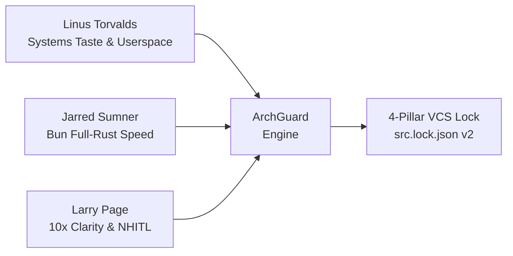
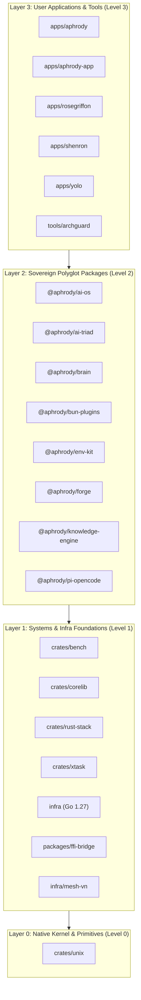

# Sovereign Monorepo Architecture & Integrity Gate: ArchGuard

Deterministic Rust Edition 2024 architectural, domain-purity, upstream hygiene, and boundary auditor for the `C:\src` Sovereign Monorepo.

---

## 1. Philosophical Foundations

ArchGuard is the automated embodiment of three unified engineering philosophies:



### 1.1 Linus Torvalds: Systems Taste & Userspace Boundary

- **Never Break Userspace (`ARCH-007`)**: Windows host directories (`C:\Windows\System32`, `C:\Windows\SysWOW64`) are strictly immutable. All userland binaries live in `C:\Users\aphro\.local\bin` or user winget/Cargo/Bun paths.
- **Good Taste in Data Structures**: Data structures in systems code are flat and cache-friendly without special edge-case branching.
- **Upstream Linux Standards (`ARCH-015`)**: Upstream `MAINTAINERS` file format is validated against disk reality. File patterns `F:` must resolve to actual directories or files. Patch series in `docs/native/patches/series` follow Quilt / b4 / git-am unified diff standards.

### 1.2 Jarred Sumner: Bun v1.4.4 Full-Rust Vertical Speed

- **Sub-Millisecond Feedback Loops**: ArchGuard parallelizes file scanning across all CPU cores using Rayon, verifying 2,800+ files in under 5 seconds.
- **Delete Glue & Zero NPM Dependencies (`ARCH-003`, `ARCH-016`)**: First-party packages avoid npm dependency sprawl. Native Bun APIs (`bun:sqlite`, `Bun.serve`, `Bun.build`) and Rust FFI DLLs replace third-party glue. Legacy `binding.gyp` and `postinstall` compilation scripts are banned.

### 1.3 Larry Page: 10x Clarity & Autonomous Ambient Verification

- **Extreme Surface Simplicity**: High-density capabilities hidden behind a clean CLI surface (`archguard check`, `archguard graph`, `archguard rules`).
- **Cryptographic Audit Digest (`report_blake3`)**: Every audit execution produces an immutable BLAKE3 hash of its findings, providing verifiable reproducibility for CI/CD and AI agent pairs.

---

## 2. The 4 Monorepo Architecture Layers (`ARCH-017`)

ArchGuard models the entire monorepo as a 4-layer Directed Acyclic Graph (DAG):



### Layer Rules:

1. **Monotonicity**: Dependencies flow strictly downward. A lower layer may never import or depend on a higher layer.
2. **Acyclicity**: Zero cycles allowed within any layer or across package boundaries.

---

## 3. The 17 Canonical ArchGuard Rules

```
RULE       CATEGORY                             SUMMARY
--------------------------------------------------------------------------------------------------------------
ARCH-001   crate-domain-purity                  crates/* must contain zero TypeScript/JavaScript/Python/Go source files or npm/Bun package manifests
ARCH-002   crate-manifest-edition               crates/* must have a valid Cargo.toml using Rust edition = "2024" and release LTO profile
ARCH-003   package-domain-purity                packages/* must have a valid @aphrody/* package.json, zero npm/pnpm/yarn lockfiles, zero unapproved external npm deps, and isolated native subdirs
ARCH-004   app-contract-purity                  apps/aphrody-app must remain 100% pure Rust (zero TS/JS); apps/aphrody must remain zero-npm (zero deps, zero node_modules, zero bun.lock)
ARCH-005   root-topology-junctions              Monorepo root must contain only canonical physical directories and valid non-dangling junctions
ARCH-006   infra-domain-purity                  infra/ must maintain a valid go.mod and restrict Bun/TypeScript code strictly to ffi-bridge and mesh-vn
ARCH-007   host-userspace-boundary              First-party scripts and code must never mutate C:\Windows\System32 or C:\Windows\SysWOW64 (Torvalds principle)
ARCH-008   secret-vault-hygiene                 No committed .env files in submodules/packages/crates/apps and no raw live credential tokens in source or docs
ARCH-009   zero-emoji-anti-slop                 Strictly zero pictographic emoji characters across first-party code, configs, and documentation
ARCH-010   single-ai-product-ownership          @aphrody/ai-os is the sole public AI product; generalist apps/crates/packages must not market themselves as AI wrappers
ARCH-011   tools-domain-purity                  tools/* must have a pure Rust 2024 Cargo.toml or @aphrody/* package.json, README.md, and deterministic tests/
ARCH-012   atlas-link-integrity                 Every file:///C:/src/... link in AGENTS.md and docs/MONOREPO_ATLAS.md must resolve to an existing file or directory
ARCH-013   manifest-versioning-integrity        Monorepo root and all first-party apps, packages, crates, tools, and infra must declare valid SemVer or CalVer versions without omissions
ARCH-014   chromium-deps-binary-hygiene         Chromium DEPS manifest must pin exact 40-char commit SHAs, and source trees must contain zero unapproved binaries > 50MB (Presubmit gate)
ARCH-015   linux-upstream-maintainers-hygiene   Linux upstream MAINTAINERS file must declare existing file patterns F:, and docs/native/patches/series must contain valid unified diffs
ARCH-016   bun-speed-zero-glue-hygiene          Bun upstream speed contracts: zero node-gyp glue, no postinstall compile hooks, and full native Rust FFI vertical integration
ARCH-017   graph-acyclic-boundaries             Architecture dependency graph must enforce monotonic layers (Kernel -> Systems -> Packages -> Apps) and zero cyclic dependencies
```

---

## 4. Integration into Sovereign Health Audit (`bun run doctor`)

ArchGuard is the first gate invoked in `bun run doctor`:

```json
"scripts": {
  "doctor": "archguard check --strict && xtk doctor && env-kit doctor && triad doctor && src-deploy doctor"
}
```

Any architectural drift, token leak, emoji intrusion, or boundary violation aborts the doctor pipeline immediately.
