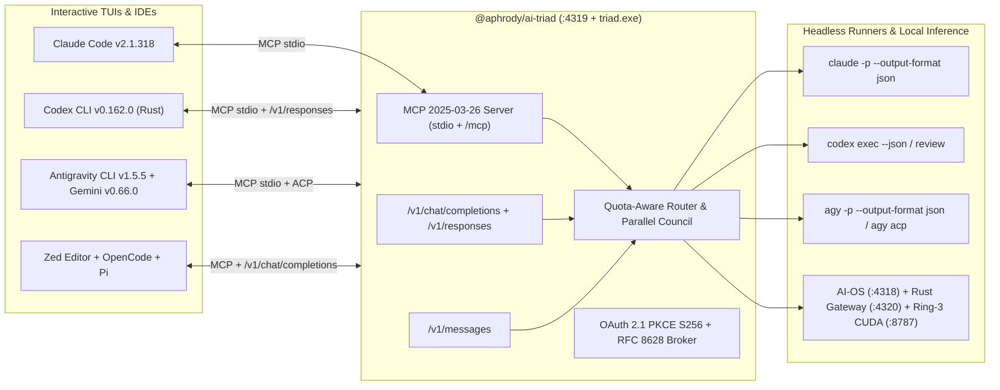

# Cross-Provider AI Triad Architecture & Protocol Interconnect

## 1. Executive Topology

`@aphrody/ai-triad` (`C:\src\packages\ai-triad`) unifies **OpenAI Codex (`codex`)**, **Google Antigravity (`agy` + `gemini`)**, and **Anthropic Claude Code (`claude`)** alongside **OpenCode**, **Pi**, **Zed**, and local **Sovereign AI-OS / Ring-3 CUDA (`sm_89`)** daemons using strictly documented, standard protocols:

- **MCP `2025-03-26` (Stdio & Streamable HTTP)**: Bidirectional cross-agent tool invocation (`triad mcp-stdio` and `POST http://127.0.0.1:4319/mcp`).
- **ACP v1 (Agent Client Protocol)**: Native JSON-RPC stdio session orchestration across `agy acp`, `gemini --acp`, and Zed external agents.
- **OpenAI Chat Completions (`POST /v1/chat/completions`)**: Universal wire interface consumed by Zed `openai_compatible`, OpenCode `providers`, Pi, Continue, and CI jobs.
- **OpenAI Responses API (`POST /v1/responses`)**: Native wire protocol required by Rust `codex-rs` custom `[model_providers.*]` (`wire_api = "responses"`).
- **Anthropic Messages API (`POST /v1/messages`)**: Native wire format consumed by Claude Code and CC-Switch provider profiles.
- **OAuth 2.1 + PKCE (`S256`) + RFC 8628 Device Authorization Grant**: Standards-compliant public-client login flows and ACL-locked AES-GCM token metadata vaulting without ever touching private auth gates or spoofing client checks.

## 2. Bidirectional Cross-CLI Matrix

| Host Environment                 | Inbound Config File                                                                                      | How It Calls Peer Agents                                                                                             | Outbound Headless Invocation                                                |
| :------------------------------- | :------------------------------------------------------------------------------------------------------- | :------------------------------------------------------------------------------------------------------------------- | :-------------------------------------------------------------------------- |
| **Claude Code (`claude`)**       | `~/.claude.json`, `~/.claude/mcp_sovereign.json`, `C:\src\CLAUDE.md`                                     | Calls `triad_ask_codex`, `triad_ask_agy`, `triad_council_review` via `ai-triad` MCP                                  | `claude -p "<prompt>" --output-format json --mcp-config ...`                |
| **OpenAI Codex (`codex`)**       | `~/.codex/config.toml`, `~/.codex/local.config.toml`, `~/.codex/triad.config.toml`, `~/.codex/AGENTS.md` | Calls `triad_ask_claude`, `triad_ask_agy`, `triad_council_review` via `ai_triad` MCP or `-p triad` (`/v1/responses`) | `codex exec "<prompt>" --json --skip-git-repo-check` or `codex exec review` |
| **Google Antigravity (`agy`)**   | `~/.gemini/antigravity-cli/mcp_config.json`, `settings.json`, `C:\src\GEMINI.md`                         | Calls `triad_ask_claude`, `triad_ask_codex`, `triad_council_review` via `ai-triad` MCP                               | `agy -p "<prompt>" --output-format json --mode accept-edits` or `agy acp`   |
| **Google Gemini CLI (`gemini`)** | `~/.gemini/settings.json`, `~/.gemini/projects.json`                                                     | MCP + ACP (`gemini --acp`)                                                                                           | `gemini -p "<prompt>" -o json`                                              |
| **OpenCode & Pi**                | `~/.config/opencode/opencode.jsonc`                                                                      | `providers.ai_triad` (`:4319/v1`) + `mcp.ai_triad`                                                                   | `pi-opencode` + Ring-3 local fallback (`:8787/v1`)                          |
| **Zed Editor**                   | `%APPDATA%\Zed\settings.json`                                                                            | `language_models.openai_compatible.ai_triad` + `context_servers.ai-triad`                                            | Consumes `triad/auto` and `triad/council` models                            |

## 3. Reference Ecosystem Integration (`C:\src\third_party\ai-ecosystem`)

1. **`openai/codex`**: Rust workspace (`codex-rs`) implementing `WireApi::Responses` (`/v1/responses`), Profile V2 (`$CODEX_HOME/<name>.config.toml`), MCP client/server, and Device Code / OAuthkeyring auth.
2. **`anthropics/claude-code`**: Reference plugins, hooks, `CLAUDE.md` conventions, and headless `--output-format stream-json|json` automation patterns.
3. **`google-gemini/gemini-cli`**: TypeScript workspace implementing `--acp`, MCP, skills, hooks, and strict Zod-validated `projects.json` slug registry.
4. **`google-antigravity/antigravity-sdk-python`**: Official Python `Agent` and `LocalAgentConfig` runtime supporting Gemini API key Express Mode and Google Cloud ADC Standard Mode.
5. **`farion1231/cc-switch` & `SaladDay/cc-switch-cli`**: Cross-CLI profile switchers managing Claude Code, Codex, Gemini CLI, OpenCode, and Pi provider endpoints and MCP registries.
6. **`cheaper-inference/OmniRoute`**: Quota-aware multi-provider routing gateway inspiring `routeTask()` HTTP 429 / quota failover chains (`agy -> claude -> codex -> rust-gateway -> ring3-local`).
7. **`lidge-jun/opencodex` & `router-for-me/CLIProxyAPI`**: Multi-protocol proxy patterns translating cleanly between OpenAI Chat Completions, OpenAI Responses, and Anthropic Messages schemas.

## 4. Security & Zero-Spoofing Guarantees

- **Zero Raw Secret Exposure**: `inspectCrossAuthStatus()` inspects file existence, byte sizes, top-level schema keys, and masked environment lengths (`SET [redacted, len=...]`) without ever logging or returning token strings.
- **Official Flows Only**: Uses official CLI headless flags (`claude -p`, `codex exec`, `agy -p`), official ACP/MCP JSON-RPC transports, and RFC 7636 PKCE `S256` + RFC 8628 Device Code state machines.
